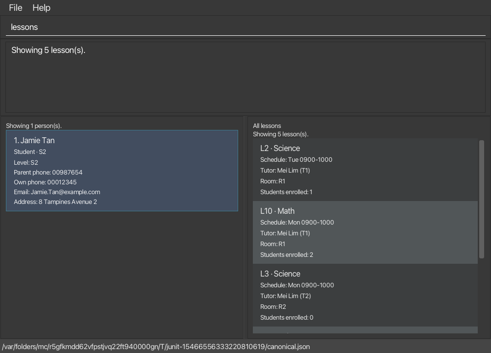

# PonHub

PonHub is being developed for tuition centre administrators to manage people, shared lessons, enrolment and dated attendance through a keyboard-focused desktop interface. The shared-lesson target lets two students join one lesson and retains attendance history after unenrolment.

The current build supports role-aware people addition/listing, own-contact people search, shared-lesson creation,
enrolment/unenrolment, dated attendance marking/removal and guarded person/lesson deletion. `lessons` and all seven
lesson-search filters show separate shared-lesson results; `showlesson` displays a lesson's roster and dated attendance.
Use `help` or `help COMMAND`, the Help menu or F1 for inline guidance.
Student lesson relationship filters are active. Attendance history and Parent/Tutor relationship filters
remain planned. Read the User Guide's
current command summary before trying the wider workflow. The screenshot shows the delivered people and lesson
panels using disposable sample data.

* [User Guide](docs/UserGuide.md)
* [Developer Guide](docs/DeveloperGuide.md)
* [Project website](https://ay2627s1-cs2103t-f13-3.github.io/tp/)

##### Acknowledgements

This project is based on the AddressBook-Level3 project created by the [SE-EDU initiative](https://se-education.org).
