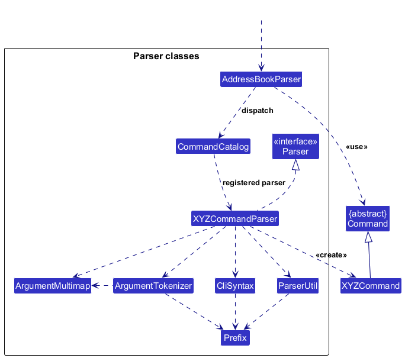

* Table of Contents
{:toc}

--------------------------------------------------------------------------------------------------------------------

## **Acknowledgements**

* PonHub evolves [AddressBook-Level3](https://github.com/se-edu/addressbook-level3) by the
  [SE-EDU initiative](https://se-education.org); existing licences and reuse credits are retained.
* Existing libraries: [JavaFX](https://openjfx.io/), [Jackson](https://github.com/FasterXML/jackson),
  and [JUnit 5](https://junit.org/junit5/).
* Zhu Zhi Yu (`ultramanarm`) used OpenAI Codex for these bounded contributions, including their tests
  and documentation: role records/common interface; ordered registry and import/export state;
  detached and aggregate-backed role-filtered views; current-index resolution; card projections,
  FXML/list rendering, previews and Linux CI virtual-display setup; representative people samples;
  role-aware addition parsing/candidates/commands and the prepared canonical session; contact
  validation/ASCII-space normalization and constant-stack email validation ([#61](https://github.com/AY2627S1-CS2103T-F13-3/tp/issues/61));
  logging fallback and UI startup error handling. He also used Codex for product scope/user stories,
  confirmed selectors/command formats/search scope, recovery/use cases/manual checks, prescribed
  Java/macOS setup, and review/conflict reconciliation/Javadoc corrections in search, inline help,
  atomic saves and the canonical aggregate (#76). These credits do not transfer feature ownership.
* Yang Shuo (`ys000009`) used OpenAI Codex for #78's scheduling APIs, aggregate invariants,
  read-only relationship queries/guards, tests and design documentation.
* Ben (`ben58882`) used OpenAI Codex for #80's indexed lesson/roster projections, committed-state
  refresh, Logic delegation, search/transaction regression tests and guide updates.
* Ernest used OpenAI Codex for the Week 8 command catalogue, inline help, regression tests and shared
  documentation; #129's active UI encapsulation/Javadoc corrections and caller/repository checks;
  #60's architecture/command conventions and AboutUs clarification; and #164's shared-guide
  consolidation, source verification and rendered checks. This credits Ernest's contributions,
  without claiming teammates' implementations or unperformed human review.

--------------------------------------------------------------------------------------------------------------------

## **Setting up, getting started**

Refer to the guide [_Setting up and getting started_](SettingUp.html).

--------------------------------------------------------------------------------------------------------------------

## **Design**

### Current increment and command integration

`MainApp` still wires the inherited contact `ModelManager`, `LogicManager` and storage. The active
`CommandCatalog` registers `add`, `delete`, `list`, `help` and `exit`; `edit`, `clear` and `find` are
withdrawn. Protected startup and [staged command transactions](#command-transactions) are active.

Canonical people/lesson models, queries, codecs, cards and `CanonicalPeopleSession` are prepared
components. They do not replace application startup or activate role-aware people, lesson, enrolment,
attendance, history or search routes. Nonempty attendance is not yet supported by the canonical codec.
The [people session](#prepared-canonical-people-session) and [Storage](#storage-component) describe
their delivered boundaries; planned command syntax is in the [UG](UserGuide.html#planned-command-summary).

Register or withdraw a route with matching parser/usage, catalogue tests and UG/manual checks.
Canonical activation must use one compatible root/view and protected writer, and disable incompatible
legacy routes immediately. Integration coordination is tracked in [#85](https://github.com/AY2627S1-CS2103T-F13-3/tp/issues/85).

### Shared-lesson target contract

The agreed design ([#60](https://github.com/AY2627S1-CS2103T-F13-3/tp/issues/60)) uses one canonical
root for ordered people, independent shared lessons and dated attendance. This contract describes
the target; the [runtime summary](#current-increment-and-command-integration) identifies active routes.

| Record or relationship | Authoritative representation |
| --- | --- |
| People | Immutable `Student`, `Tutor` and `Parent` implement `PersonRecord`. Student composes contact details, level and parent phone; it neither extends legacy `Person` nor owns lessons. |
| Shared lessons | Each Lesson has a stable Lesson ID, Tutor ID, weekday/time, subject, room and `enrolledStudentIds`. Its roster owns membership; empty lessons remain valid. |
| Derived views | Student lessons, rosters and tutor schedules resolve IDs from that root. They never form another writable membership graph or duplicate a shared lesson. |
| Attendance | Student ID + Lesson ID + date identifies one `present` or `absent` record. No entry means unrecorded; history survives unenrolment. |
| Parent links | Optional Parent records link by exact equality of their phone and a Student's parent phone, preserving leading zeros. A matching Parent record is not required. |

**Selectors and identity.** `INDEX`/`STUDENT_INDEX` is a positive one-based position in the current
filtered **people list**. Check range and required role, then resolve once to stable `PersonId` for
the whole operation. Filtering renumbers positions without changing stored IDs (`S1`, `T1`, `P1`);
cards distinguish both. Lesson, roster and history results preserve the people filter/order/indices;
their row positions are never person selectors. Existing lessons use stable `lid/LESSON_ID` (`lid/L1`).
`lessons [si/STUDENT_INDEX]` resolves its optional Student selector by the same rule. Stored
relationships and internal query APIs use stable IDs, never displayed positions.

**Tutor lookup.** `addlesson` matches `tu/TUTOR_NAME` by normalized full name, ignoring case and
repeated spaces. If supplied, `tp/TUTOR_PHONE` must also match exactly; never ignore it. Reject zero
matches or ambiguity without mutation, requesting a phone to disambiguate. Search `tu/` instead
matches a case-insensitive name fragment; Tutor-category name search uses `n/`.

The [UG command formats](UserGuide.html#planned-command-summary) and [search matrix](#supported-criteria)
define the complete planned syntax and filters. A delivered search slice advertises only available
filters while retaining the remaining target. Documentation alone does not activate a route.

**Scheduling and history.** Create each lesson once with an empty roster. Reject tutor/room clashes
between distinct same-weekday lessons, and a student's clashes with other enrolled lessons. Joining
the same lesson does not book its tutor/room again. Times are half-open `[start, end)`: adjacent
`1600–1700`/`1700–1800` slots and equal times on different weekdays are allowed.

Unenrolment removes membership only. New attendance needs current membership and a real date on the
lesson's weekday; an existing historical key can be corrected or unmarked after unenrolment.
Repeating a status is a no-op. Unmark removes that dated key, never membership.

**Deletion guards.** Reject blocked deletion without changes or cascading:

| Record | Guard or retained data |
| --- | --- |
| Student | Block while any roster or attendance record references its ID. |
| Tutor | Block while any Lesson references its ID. |
| Lesson | Block while its roster is nonempty or attendance references its ID. |
| Parent | Preserve Students' parent-phone values; only derived links disappear. |

Complete independent snapshots include relationships and monotonic allocation state; deleted
committed IDs are never reused. [Storage](#storage-component) is authoritative for versioned schema,
validation, protected loading, recovery and save-before-publication transactions. Preferences have
a separate lifecycle. Extended features are listed in [Requirements](#user-stories); undo/archiving
constraints are described [below](#future-undoredo-and-archiving).

Ownership and implementation coordination remain in [AboutUs](AboutUs.html#project-team) and
[tracker #59](https://github.com/AY2627S1-CS2103T-F13-3/tp/issues/59).

<div markdown="span" class="alert alert-primary">

:bulb: **Tip:** The `.puml` files used to create diagrams are in `docs/diagrams`. Refer to the [_PlantUML Tutorial_ at se-edu/guides](https://se-education.org/guides/tutorials/plantUml.html) to learn how to create and edit diagrams.
</div>

### Architecture


`Main` launches JavaFX; [`MainApp`](https://github.com/AY2627S1-CS2103T-F13-3/tp/blob/master/src/main/java/seedu/address/MainApp.java)
initializes preferences, storage, Model, Logic and UI in that order, then saves preferences at shutdown.

| Component | Responsibility |
| --- | --- |
| [UI](#ui-component) | Render observable views, accept commands and show feedback. |
| [Logic](#logic-component) | Parse/dispatch commands and coordinate execution, persistence and publication. |
| [Model](#model-component) | Own in-memory records, invariants, preferences and derived views. |
| [Storage](#storage-component) | Validate/load local files and persist complete operational snapshots safely. |
| [Commons](#common-classes) | Supply shared value helpers, exceptions, logging and settings. |

Components depend on interfaces rather than manager implementations, keeping UI, command and file
handling independently testable:


The inherited sequence below shows the broad `delete 1` component flow, omitting the current staging
boundary. Current execution stages Model changes and saves them before publication; failure leaves
the live state unchanged. See [Command transactions](#command-transactions) for that boundary.


### UI component

The **API** of this component is specified in [`Ui.java`](https://github.com/se-edu/addressbook-level3/tree/master/src/main/java/seedu/address/ui/Ui.java)


The JavaFX `MainWindow` composes `UiPart` controls such as `CommandBox`, `ResultDisplay` and `PersonListPanel`; their
layouts live in `src/main/resources/view`. UI sends commands through `Logic` and observes model-backed results so
committed changes refresh the display. The diagram describes the inherited `Person` UI, which remains active.

The prepared canonical person card has a separate current-view position and stable ID. At integration, lesson,
roster and history results use separate views; see the [shared selector and view contract](#shared-lesson-target-contract)
for how those results preserve the people list. This behavior is not yet active.

### Logic component

**API:** [`Logic`](https://github.com/AY2627S1-CS2103T-F13-3/tp/blob/master/src/main/java/seedu/address/logic/Logic.java).


`AddressBookParser` extracts the command word; `CommandCatalog` selects its registered `Parser`
and returns a `Command`. `LogicManager` executes it against a staged Model, persists operational
changes and commits before returning `CommandResult`. Read-only commands/no-ops skip operational
saving. Protected sessions allow only help/list/exit; see [Storage](#current-protected-startup).


The inherited deletion diagram focuses on parsing and command execution. Its per-call parser
construction predates the registered catalogue, and it omits the current transaction boundary;
both are described above. Parser subclasses share the `Parser` interface:



Canonical commands follow the [shared selector contract](#shared-lesson-target-contract) and execute
through `CanonicalCommandExecutor`; their application wiring remains prepared.

#### Read-only retrieval API contract (#113)

[`Logic`](https://github.com/AY2627S1-CS2103T-F13-3/tp/blob/master/src/main/java/seedu/address/logic/Logic.java)
declares the UI-facing retrieval methods; [`LessonQuerySource`](https://github.com/AY2627S1-CS2103T-F13-3/tp/blob/master/src/main/java/seedu/address/model/query/LessonQuerySource.java)
and [`LessonQueries`](https://github.com/AY2627S1-CS2103T-F13-3/tp/blob/master/src/main/java/seedu/address/model/query/LessonQueries.java)
define the prepared lesson backend.
The canonical Model owns projections from its one data root; Logic delegates to that source. Catalogue and filtered
results contain each lesson once in creation order, including empty lessons. Student lessons derive from current
Lesson-owned membership; rosters use people creation order, and tutor schedules use weekday, start time and numeric
lesson ID. Lookup by lesson ID reads the full catalogue regardless of its active filter.

[`LessonView`](https://github.com/AY2627S1-CS2103T-F13-3/tp/blob/master/src/main/java/seedu/address/model/query/LessonView.java)
and [`StudentView`](https://github.com/AY2627S1-CS2103T-F13-3/tp/blob/master/src/main/java/seedu/address/model/query/StudentView.java)
expose current display fields without becoming stored records. Planned
[`AttendanceHistoryEntry`](https://github.com/AY2627S1-CS2103T-F13-3/tp/blob/master/src/main/java/seedu/address/model/query/AttendanceHistoryEntry.java)
also distinguishes recorded present/absent status from current enrolment; history comes from dated attendance and
survives unenrolment. A missing entry means unrecorded. See the [shared contract](#shared-lesson-target-contract) for
command indices versus stable IDs and for preservation of the people view.

Queries never save data or allocate IDs. Lists are unmodifiable observable views: a UI-held list remains the same
object while committed changes and rollback refresh its entries. Existing records with no matches yield valid empty
lists, while an unknown lesson lookup yields an empty `Optional`. Lesson queries reject null IDs and unknown or
wrong-role IDs for list retrieval; exact signatures and exceptions are in the linked source/Javadoc.

**Integration status:** #80 supplies the lesson/roster backend, but the inherited runtime still reports retrieval
unavailable. Attendance-history methods await #100. Commands and separate result views remain pending; search
enters through `Logic.execute(String)` and follows the [planned search matrix](#supported-criteria).

### Model component

**API:** [`Model`](https://github.com/AY2627S1-CS2103T-F13-3/tp/blob/master/src/main/java/seedu/address/model/Model.java).


The diagram shows the active inherited contact model: `AddressBook` owns `UniquePersonList`, while
`ModelManager` exposes an unmodifiable observable filtered list and read-only preferences. UI binds
to that projection; commands mutate through Model operations, not UI-owned copies. Domain objects
remain independent of UI, Logic and file handling.

The prepared canonical aggregate below replaces contact-only state with the
[shared ownership and identity contract](#shared-lesson-target-contract). Its projections derive from
one root, and transaction snapshots preserve complete state.

#### Canonical data aggregate (#76)

`PonHubData` holds one immutable `PonHubDataState`: ordered people and their per-role allocation
history, shared lessons and their rosters, dated attendance, and the last allocated lesson sequence.
`exportState()` returns a stable snapshot; copy construction and `resetData(...)` safely share immutable
state. Replacing one container's state cannot change any previous snapshot or another container.

Snapshot construction copies incoming lists and rejects duplicate IDs/attendance keys, missing or
wrong-role references, and lesson IDs beyond the supplied counter. Historical attendance does not
require current enrolment. Equality includes records, collection order, rosters and allocation history,
including deleted IDs. Zero means no allocation; `Long.MAX_VALUE` means exhaustion, matching the people
registry convention. Counters are preserved as supplied, never reconstructed from retained records.

Read methods expose immutable collections and stable-ID/key lookups. The controlled replacement boundary
accepts only a validated state; invalid construction or null replacement leaves the current state intact.
Feature owners must preserve committed allocation history when preparing normal changes. Restore may
reinstate earlier counters for rollback. Lesson allocation and global tutor/room scheduling are supplied by
the #78 API below. Enrolment, deletion and attendance-editing policies remain separate feature work.

This aggregate leaves `ModelManager`, commands and JSON storage unchanged. Vincent owns snapshot/storage
contracts; Zhu/Yang will prepare validated changes through one future Model adapter, and Ben can consume
the read-only queries. UI filters, selection and preferences remain outside the operational snapshot.
`stateProperty()` exposes a read-only notification boundary for a complete validated snapshot. Staged transaction
containers publish independently; a failed command/save does not change the live root or its subscribed results.

#### Shared lesson scheduling model APIs (#78)

`PonHubData.addLesson(tutorId, timeSlot, subject, room)` is the controlled lesson-creation seam. It resolves the
stable ID against the aggregate's people snapshot and requires an existing Tutor. It derives the next positive
`LessonId` from `lastAllocatedLessonSequence`, creates one empty-roster `Lesson`, builds a complete candidate
`PonHubDataState`, and installs that state only after validation succeeds. Deleted committed IDs are therefore
not reused. Exhaustion at `Long.MAX_VALUE`, a missing/wrong-role Tutor, or any scheduling conflict leaves the
catalogue and counter unchanged.

Every complete `PonHubDataState`, including a restored or deserialized candidate, enforces the same global
schedule invariant. Two lessons whose half-open slots overlap on the same weekday are rejected when either
their stable Tutor IDs match or their normalized `Room` values match. Empty lessons participate in this check.
Adjacent intervals, different weekdays, and simultaneous lessons with both different Tutors and different rooms
are allowed. Tutor names are deliberately irrelevant to clashes; room equality uses `Room`'s locale-independent
upper-case normalization.

The aggregate exposes immutable relationship snapshots for retrieval and deletion integration:

| API | Contract and owner use |
| --- | --- |
| `getLessons()` / `getLesson(LessonId)` | Canonical catalogue order and stable-ID lookup, including empty lessons. |
| `getLessonRoster(LessonId)` | Current Students resolved from Lesson-owned IDs in global people creation order. |
| `getStudentLessons(PersonId)` | Current lessons derived from roster IDs in catalogue creation order. |
| `getAttendanceForStudent(PersonId)` / `getAttendanceForLesson(LessonId)` | Retained attendance references in aggregate storage order; neither depends on current enrolment. |
| `isPersonReferenced(PersonRecord)` | Predicate for Zhu's guarded people deletion: Student roster/attendance and Tutor lesson references block removal; Parent links remain derived. |
| `isLessonReferenced(LessonId)` | Guard for Yang's lesson deletion: a non-empty roster or retained Attendance blocks removal. |

`PonHubData` owns normal lesson allocation and atomic state installation. `PonHubDataState` owns whole-root
identity, reference and scheduling validation. `Lesson` remains the immutable record and sole owner of roster
membership. Ben may build projections only from the read APIs; they never mutate records or counters. Vincent's
serialization must preserve the supplied catalogue order and lesson allocation counter, construct the entire
candidate snapshot before replacement, and use its validation rather than installing partial arrays.

#### Indexed lesson query projections (#80)

`model.query.LessonQueries` implements `LessonQuerySource` over one supplied canonical root. Its immutable
`LessonViewData` and `StudentViewData` entries resolve current Tutor/Student information by stable ID. Lessons alone
own membership; attendance never supplies a roster or enrolment. Shared lessons appear once, including empty ones.
The Model adapter returns this component through `getLessonQueries()`; `LogicManager` delegates its six lesson
retrieval methods without saving data or changing the people filter. The current legacy adapter deliberately has
no canonical query source. Activate the prepared backend only with #85's single-root runtime integration and the
compatible persistence/command/UI slices.

| Query API | Implementation |
| --- | --- |
| `findLessonById(id)` | Hash lookup in the complete catalogue, independent of the active filter. |
| `getLessonList()` | Stable, unmodifiable observable catalogue in source creation order. |
| `getStudentLessons(id)` | Reverse index derived from Lesson-owned roster IDs, in catalogue order. |
| `getLessonRoster(id)` | Current Student projections in global people creation order. |
| `getTutorSchedule(id)` | Assigned lessons by Monday-first weekday, start time, then numeric Lesson ID. |
| `getFilteredLessonList()` | Separate observable lesson results; leaves person positions unchanged. |
| `searchLessons(criteria)` | Immutable result snapshot; does not change the active filter or stored data. |
| `getLessonFilter()` / `setLessonFilter(criteria)` | Model view state only; a category-only lesson filter restores all results. Invalid criteria preserve the previous filter/results. |

Construction builds people/lesson ID maps, Student-to-Lesson and Tutor-to-Lesson indexes, ordered roster projections,
and exact weekday/start/end buckets. A search selects the smallest supplied exact-value bucket, then applies every
criterion to each candidate Lesson. `s/`, `tu/`, `rm/` and `sn/` retain case-insensitive substring matching, including
short fragments; `tu/` searches tutor names. `sn/` examines the same lesson's current roster and excludes empty
rosters. Matching two students still emits one Lesson. There is no cross-lesson combination of day, subject, room,
tutor or student conditions. All seven lesson prefixes follow the existing [criteria matrix](#supported-criteria).
The parser rejects unsupported, incompatible, blank, repeated and malformed values before query execution.
An empty search result is valid. People/parent/tutor relationship traversal remains in its separate integration slices.

All derived indexes rebuild on `PonHubData.stateProperty()` publication, after successful save/commit or restore,
never per query. Already returned observable lists retain object identity while their entries refresh. This covers
lesson addition/deletion, current membership edits, person detail edits, attendance changes and rollback. If a
subscribed record is removed, its held list becomes empty; a new list query for that missing ID is rejected. Restoring
the record repopulates the same held list. Previously returned projection objects and `searchLessons` snapshots
remain immutable historical snapshots. All operations run on the single model/JavaFX application thread; UI selection
must follow stable IDs when immutable entries are replaced. The runtime adapter owns one query component for its lifetime.

Each subscription refresh snapshots its existing entries before firing list-change callbacks. A read-only callback
may request another Student, Tutor or roster list; that new list starts from the complete current indexes and stays
subscribed for later publications. It cannot interrupt the current refresh by changing the traversed map.

For `P` people, `L` lessons and `R` roster links, query-index construction is `O(P + L + R + L log L)` in the worst case
(the final term sorts tutor schedules). Derived storage is `O(P + L + R + C)`, where `C` counts subscribed IDs,
including removed records whose held lists must survive restore. Stable-ID lookup and returning an already
subscribed list take expected `O(1)`; first subscription
copies its `K` entries in `O(K)`. A search checks `B` candidates from the smallest exact bucket, plus their roster
links when `sn/` is supplied: `O(B + R_B + K)` for bounded field lengths and `K` returned results. Without an exact
filter, `B = L`; text-only substring searches still scan the catalogue. Reading/rendering `K` results costs `O(K)`.
These bounds describe queries, excluding the existing whole-snapshot validation and persistence work on mutations.
A prefix trie would change substring behaviour; there is no constant-time guarantee for arbitrary text searches.
Refreshing subscription snapshots also takes `O(C)` time and temporary space, in addition to copying result entries.

Regression tests compare indexed results with an independent raw-record scan for 7,500 seeded filter combinations,
including membership changes and restore. They cover missing/wrong-role/null IDs, duplicate names, shared/empty
lessons, optional contacts and leading zeros, case/Unicode/text fragments, invalid/repeated prefixes, time boundaries,
same-lesson counterexamples, immutable results, held-list refresh, retained attendance and failed-save isolation.
Listener regressions cover adding populated and empty Student/Tutor/roster subscriptions during refresh, absence
of JavaFX callback errors, consistent held roster/filter results and continued updates after subsequent publication.

### Storage component

**API** : [`Storage.java`](https://github.com/se-edu/addressbook-level3/tree/master/src/main/java/seedu/address/storage/Storage.java)


The `Storage` component,
* can save both address book data and user preference data in JSON format, and read them back into corresponding objects.
* is implemented by `StorageManager`, which delegates the actual JSON file access to `JsonAddressBookStorage` and `JsonUserPrefsStorage` (one class per data file).
* depends on some classes in the `Model` component (because the `Storage` component's job is to save/retrieve objects that belong to the `Model`)

#### Safe JSON saves

Address-book data and preferences share a UTF-8 file writer. JSON serialization finishes before writing.
Existing destinations are resolved to their real paths, so saving through a symbolic link updates its
target and preserves the link. Dangling/cyclic links and inaccessible destinations fail before writing.
New files use a resolved parent directory, creating missing directories as needed. Concurrent external
changes to links/files and multiple application instances are not coordinated.

A complete temporary sibling file is written and closed before atomic replacement is attempted.
Only `AtomicMoveNotSupportedException` selects the fallback; permission and other move errors propagate.
The fallback first copies the existing destination into a unique sibling `.ponhub-backup-*.bak` file.
If backup creation/copy fails, replacement is not attempted. After a failed ordinary replacement, the
writer restores the old bytes from that backup (or removes a partial destination for a first save).
If restoration also fails, the complete backup is retained and its path is included in the error;
restore it before continuing or restarting. Never delete such a backup without recovering its contents.

After success, backup cleanup is best effort: a cleanup failure is logged without reporting the committed
save as failed. Other cleanup failures are suppressed on the primary error. Parent directories or
recovery/temporary files can remain after failures or abrupt termination.

The fallback permits saving on filesystems without atomic moves, but is not atomic: concurrent readers
can observe an incomplete destination during replacement/recovery. Its guarantee is a recoverable old
copy, not uninterrupted access at the original path. Neither path promises power-loss durability or
preserves all previous file attributes.

#### Command transactions

`LogicManager` obtains a `ModelTransaction` before executing a command. The command operates on an
independent working model with the current people filter. It compares operational state against the
pre-command snapshot and calls `Storage.saveModel` only when that state changed. Only after the save
succeeds does it publish the staged data and view, then return the command result. Execution or save
failure discards the staged model, leaving live records, order, filter and UI selection untouched.
Publication updates existing observable lists so UI bindings continue to receive successful changes.
Read-only commands and operational no-ops skip saving; view changes such as list still take effect.
Protected startup retains its help/list/exit restriction. Preferences retain their shutdown lifecycle.

The active implementation stages legacy people data. The canonical runtime adapter must implement
`Model.beginTransaction` and `Storage.saveModel` together, including complete `PonHubDataState`, allocation
counters/exhaustion, rosters, retained attendance and all active views. This seam does not itself activate
the canonical runtime or its commands. Publication must not perform new validation or I/O.

#### JSON version detection foundation

`JsonDataVersionDetector.detect(String)` classifies file contents using the existing Jackson dependency,
without constructing Model objects or writing files. The current loader uses this gate before decoding. The planned
PonHub envelope reserves `schemaVersion` as a positive JSON integer, initially `1`; this is a data-schema
version, independent of the application version. Issue #79 will define and validate the remaining envelope.

| Result | Meaning and later loader action |
| ------ | ------------------------------- |
| `LEGACY_AB3` | An unversioned object containing a `persons` array and, optionally, the textual `_comment` used by AB3 fixtures. No other root fields are accepted. Contact validity is not checked and roles are never inferred; preserve it for manual upgrade. |
| `PONHUB_V1_CANDIDATE` | Explicit integer `schemaVersion: 1`. Continue to complete envelope/domain validation; this result alone never authorizes loading or saving. |
| `INVALID_VERSION` | An explicit version is null, blank, a string, boolean, collection, fractional number, zero or negative. Reject without coercion. |
| `UNSUPPORTED_VERSION` | A positive integer other than 1, including values beyond Java integer range. Reject even if `persons` looks like legacy data. |
| `UNRECOGNIZED_FORMAT` | A non-object root or an unversioned object that does not match the legacy root, including extra unknown fields. Reject rather than ignoring fields. |
| `MALFORMED_JSON` | Empty/invalid JSON, duplicate object keys or trailing content after the document. Reject ambiguous input. |

Missing versions identify legacy data only for the strict legacy root shape. A versioned candidate can
still contain missing or invalid records: the detector is a format gate, not a schema/domain validator.
Callers must handle file absence and read errors separately; neither is equivalent to empty JSON.
The current `JsonAddressBookStorage` classifies and decodes the same string. It accepts only legacy AB3
roots in this runtime and rejects every other classification, including version-1 candidates until their
codecs are integrated. Missing files retain the existing fresh/sample-data behavior. Only a confirmed
missing path is treated as absent; denied access and dangling final symbolic links are loading failures.

#### Current protected startup

On a controlled loading failure, `StorageManager` records recovery guidance and locks operational saves
for the rest of the session. `MainApp` creates an empty display model, not a replacement writable store.
The UI displays a recovery warning; `LogicManager` allows only help/list/exit and bypasses saving for
those commands in the protected session. Other commands are rejected before execution. Storage also
rejects direct operational saves, while preferences retain their separate lifecycle. Deleting or fixing
the file while the session is running does not unlock it: recovery requires a restart.

JSON syntax, root/version errors, invalid contact records and I/O failures become controlled loading
errors. Explicit checks reject null person/tag entries; unrelated programming errors are not swallowed.
Valid legacy contacts still load and save normally. This safety increment does not implement the new
aggregate codec, automatic migration, general command rollback or no-save behavior in normal sessions.

Manual check: in a disposable working folder, place malformed JSON, `null`, or a versioned document in
`data/addressbook.json` and record its bytes. Start the app and verify the recovery warning. Run help,
list, exit and attempt add/delete; restart as necessary. The original bytes must remain unchanged and
mutations must be blocked. Close the app, preserve the original, then restore a known-good compatible
backup or correct JSON/access permissions and restart. Confirm valid human-edited legacy data loads.
`ProtectedStartupTest` exercises the startup/command/storage boundary and original-byte preservation;
`UiManagerTest` verifies the warning without requiring a real window.

#### People-only canonical JSON storage (#79)

`JsonPonHubDataCodec` converts between a complete `PonHubDataState` and the version-1 envelope below.
`JsonPonHubDataStorage` reads one UTF-8 document into a validated candidate and uses the existing safe
file writer for saves. These classes are not wired into startup, commands or the legacy storage path;
protected runtime integration remains #84. Preferences remain in their existing separate file.

```json
{
  "schemaVersion": 1,
  "people": [
    {"id": "S1", "role": "STUDENT", "name": "Alex", "level": "P1", "parentPhone": "00123456"}
  ],
  "personCounters": {"STUDENT": 1, "TUTOR": 0, "PARENT": 0},
  "lastAllocatedLessonSequence": 0,
  "lessons": [],
  "attendance": []
}
```

People array order is global creation order. Roles are `STUDENT`, `TUTOR` or `PARENT` and must agree with
the stable ID prefix. Every record requires `id`, `role` and `name`. Students additionally require `level`
and `parentPhone`; tutors and parents require their own `phone`. Optional `phone` (for students), `email`
and `address` are omitted when absent, never encoded as null. Contact values are strings, preserving
leading zeros. Unknown fields and role-inappropriate fields are rejected rather than silently discarded.

All three person counters and the lesson counter are required nonnegative integers up to `Long.MAX_VALUE`
(exhaustion). They include deleted identities and must not be recomputed from retained records. Person
and lesson counters must cover every retained ID. Lessons and rosters are supported; attendance must
remain an empty array until #83 supplies its codec. Unsupported attendance is rejected on both read
and write, never dropped while rewriting a file. Serialization finishes before any filesystem write.

Each `lessons` entry stores a shared lesson once; student records do not duplicate its membership:

```json
{
  "id": "L2",
  "tutorId": "T1",
  "day": "Mon",
  "startTime": "0900",
  "endTime": "1000",
  "subject": "Mathematics",
  "room": "R1",
  "enrolledStudentIds": ["S1", "S2"]
}
```

All lesson fields are required. Times are four-digit strings, days use Mon–Sun, and an empty roster
is valid. The codec rejects unknown fields, wrong types and duplicate roster IDs before constructing
the roster set. After decoding all people and lessons, the immutable aggregate validates unique lesson
IDs, the lesson counter, tutor/student references and overlapping tutor, normalized room or student
bookings. Adjacent half-open time slots are allowed. JSON object-field order and reference position in
arrays do not affect validation; lesson array order is retained. Referenced records must exist in the
complete candidate. Failure returns no partial snapshot and the protected loader retains the original
bytes and blocks writes. Deleted lesson IDs remain reserved through `lastAllocatedLessonSequence`.

Close the app and preserve a backup before manual editing. For example, adding `"email": "alex@example.com"`
to the student above is valid; making a phone numeric, removing a required field, or lowering its student
counter below 1 is rejected. Object field order and whitespace do not matter. Round-trip tests compare the
complete snapshot, including optional-field absence, people order, deleted-ID history and exhausted counters.
Loading classifies the version first and validates all records/counters before returning; callers install
the candidate only on success. Loading itself never writes or changes live state. This codec supplies no
legacy migration or rejected-file session lock; the existing protected startup remains independently active.

#### Planned protected loading and legacy upgrade

These are requirements for the first canonical cutover, not behavior delivered by the inherited loader. Keep the inherited runtime until the compatible canonical Model, codecs, people commands and protected loader are activated together. The new runtime must classify the configured file before decoding: missing data may start a fresh supported root; valid supported versioned data loads only after complete domain, identity and reference validation. Unreadable, corrupt, unsupported-version and unversioned AB3 files produce controlled errors, actionable recovery guidance and no operational writes to the rejected file. Preserve its original bytes through help, list, exit and attempted mutations; saving preferences remains separate.

The initial upgrade policy is deliberate backup and manual re-entry into a separate new supported store. An unversioned AB3 contact does not contain enough information to infer a Student, Tutor or Parent role, and a Student additionally needs its level and parent phone. Do not invent those values, discard invalid records, or convert the original in place. Once the canonical build is available, tell the administrator to close the app, preserve a backup of the original data folder, deliberately start that compatible build in a separate empty folder, and re-enter records with explicitly chosen roles and required fields using the delivered commands. The preserved original and backup are not operational write targets; only the explicitly chosen new supported root is writable. Check the new records before retiring the old working folder. A migration importer and application-level export are future extensions; this policy does not introduce an `import`, `export` or `recover` command.

The contact changes in #61 can reject formerly accepted numeric-only names, long phones or slash-containing addresses, or reveal duplicates after normalization. Diagnose the affected values without overwriting the rejected data. Inspect the local JSON read-only; if the older build is needed to inspect contacts, use an additional working copy, never the preserved original or backup. The administrator supplies any corrections and missing role information. Correctly human-edited supported JSON must load: document the delivered schema, preserve valid stable IDs and allocation state, and validate all relationships without requiring users to avoid editing the file. An invalid edit is rejected as a whole with its bytes preserved. The [planned manual checks](#planned-canonical-loading-and-recovery) cover this boundary.

### Common classes

`seedu.address.commons` contains shared settings/value helpers, exceptions, JSON/file/string utilities
and `LogsCenter`. Keep reusable infrastructure here; domain invariants belong to Model and command
syntax to Logic. Logging setup and its console fallback are documented in [Logging](Logging.html).

--------------------------------------------------------------------------------------------------------------------

## **Implementation**

This section describes some noteworthy details on how certain features are implemented.

### Lesson scheduling value contracts

The lesson scheduling foundation is represented by immutable value objects in `model.lesson`. These objects validate and
normalize scheduling input before later lesson commands or persistence code use it:

* `LessonId` is a stable identifier consisting of `L` followed by a positive `long` sequence number. Lower-case prefixes
  are normalized, leading zeros are rejected, and advancing beyond `Long.MAX_VALUE` fails explicitly instead of wrapping.
  The canonical aggregate owns allocation state so committed IDs are not reused.
* `LessonDay` accepts the case-insensitive abbreviations `Mon` through `Sun` and stores their canonical display form.
* `LessonTime` accepts exactly four digits in 24-hour `HHMM` format and retains leading zeros when displayed.
* `LessonTimeSlot` combines one weekday with a start and end time. Its end must be strictly later than its start, so
  overnight lessons are rejected. Slots are treated as half-open ranges: `[start, end)`. As a result, adjacent slots do
  not overlap, and equal time ranges on different weekdays do not clash.
* `Subject` contains 1–50 letters, digits or spaces after trimming and reducing repeated spaces to one.
* `Room` contains 1–10 letters or digits. It is normalized to upper case so room comparisons do not miss clashes because
  of letter case.

These value types do not activate or advertise a lesson command. The canonical aggregate now supplies lesson creation,
global tutor/room clash checks and ID allocation; command and persistence integration remain separate increments.

### Immutable shared lesson records

`Lesson` represents one canonical recurring teaching slot. It stores a stable `LessonId`, one tutor-role `PersonId`,
the validated `LessonTimeSlot`, `Subject` and `Room`, and the set of currently enrolled student-role `PersonId` values.
An empty roster is valid, and several students can refer to the same lesson without duplicating its tutor, room or
schedule. Student records contain no copied `Lesson` values.

The constructor defensively copies the roster and rejects Tutor or Parent IDs in it; the assigned tutor must have a
Tutor ID. `getEnrolledStudentIds()` exposes an unmodifiable snapshot. `withEnrolledStudentIds`,
`withEnrolledStudent`, and `withoutEnrolledStudent` return replacement `Lesson` values, leaving the original lesson
and its stable identity unchanged. Equality, hashing, copying and string representation include every stored field,
including roster membership. The canonical aggregate owns lesson ordering, ID allocation and clash checks,
while persistence and duplicate-enrolment command feedback remain separate work. This dormant record does not change
the active runtime.

### Inline help

`CommandCatalog` keeps active parser registrations, short descriptions and command-owned usage
constants together. `HelpCommandParser` accepts zero or one topic, normalizes with `Locale.ROOT`,
and rejects unknown topics/excess arguments. `HelpCommand` returns ordinary feedback without
changing records, filters or preferences. [Command transactions](#command-transactions) skip saving
unchanged operational data, so help/list/exit work even when it is unwritable.

The Help menu and F1 both invoke `MainWindow.executeCommand("help")`, retaining the command-box
draft and card selection. `ResultDisplay` is a read-only wrapped TextArea with vertical scrolling;
each new result starts at the top. Focused text-control F1 handling uses that same route. The unused
inherited `HelpWindow` is never constructed by supported entry points.

See [manual help checks](#inline-help-and-supported-routes) for topic, menu/F1 and scrolling behavior.
The prepared canonical session maintains guidance for its own available/protected routes; it does
not register them in the active inherited catalogue.

<a id="person-record-foundation"></a>
<a id="ordered-people-registry-foundation"></a>

### People records and identity

Immutable `Student`, `Tutor` and `Parent` records implement `PersonRecord` and compose `ContactDetails` rather
than extending legacy `Person`. Constructors enforce the record's role and required fields; absent optional
contacts remain absent. Students do not contain copied lessons or attendance. Relationship ownership and
optional parent-record linking follow the [shared contract](#shared-lesson-target-contract).

| Role | Required data | Optional data |
| --- | --- | --- |
| Student | Student ID, name, education level, parent phone | Own phone, email, address |
| Tutor or parent | Matching role ID, name, own phone | Email, address |

`EducationLevel` accepts `P1`–`P6`, `S1`–`S5`, `JC1` and `JC2`, normalizing to uppercase. `PersonId` is a
role-prefixed positive `long` identity, such as `S1`, with no leading zeros; trimmed constructor input is
case-normalized. It survives contact and view changes. Value equality includes the ID and all stored fields.
Business duplicate matching instead compares **role + normalized name + identifying phone**: parent phone
for a student, own phone for a tutor or parent. Name case and repeated spaces do not distinguish duplicates;
different IDs, optional contacts or student levels cannot bypass this rule. Different-role records are distinct.

<a id="registry-apis"></a>
<a id="allocation-and-state-validation"></a>

[`PeopleRegistry`](https://github.com/AY2627S1-CS2103T-F13-3/tp/blob/master/src/main/java/seedu/address/model/person/PeopleRegistry.java)
keeps all roles in one global creation order and returns immutable snapshots. Successful additions append a
record and advance only its role's allocation counter; rejected additions change neither. If the last Student
allocation was `S2`, deleting it keeps the counter at `2`, so the next Student receives `S3`. Counters are never reconstructed
from surviving records, even when a role becomes empty. `Long.MAX_VALUE` means exhausted: allocation rejects
before overflow.

`PeopleRegistryState` defensively copies that ordered list and the complete three-role allocation map. It
rejects unsupported record types, duplicate IDs/business keys, missing or negative counters, and counters
below retained ID sequences. Copy/import/export preserve order and deleted/exhausted allocation history;
independent registries share only immutable records. The canonical root uses this state for persistence and
restoration; its actual format is described in [Storage](#people-only-canonical-json-storage-79).

<a id="deletion-and-activation-boundaries"></a>

Registry removal consults the caller's relationship predicate before changing data. Unknown IDs, references
or a failing predicate leave order and counters unchanged. The predicate must query the canonical relationships
without mutating the registry; complete deletion guards follow the shared contract above. This seam does not
activate the guarded deletion command.

### Contact validation and normalization

Shared contact value types validate construction at parser and JSON-loader boundaries, preventing commands
and saved files from admitting different formats.

| Value | Contract |
| --- | --- |
| Name | 1–100 characters after trimming/collapsing ASCII spaces; English letters, spaces, apostrophes, hyphens and periods, with at least one letter. Display case is preserved. |
| Phone | 3–15 ASCII digits, stored as text to retain leading zeros. |
| Email | At most 254 characters; local part allows letters, digits, `.`, `_`, `%`, `+`, `-`, without leading/trailing/consecutive periods. Domain has at least two letter/digit/internal-hyphen labels, ending in 2–63 English letters. Spelling/case are preserved. |
| Address | 1–200 printable ASCII characters after trimming/collapsing spaces; `/`, tabs, line breaks and controls are rejected. |

Name/address normalization occurs once in the value type, before equality and hashing; case remains significant
for value equality. Name/address parser boundaries preserve controls for rejection; role-aware add rejects
controls before extraction.
Space normalization scans linearly; email rejects excessive length before a linear, constant-stack format scan,
avoiding stack overflow on hostile repeated input. Phone/email parsing retains surrounding-whitespace trimming.

The active inherited `add` parser and loader use this policy. Previously accepted files outside it, including
normalization-created duplicates, enter [protected startup](#current-protected-startup); Storage describes
rejected-file preservation and recovery. This contact-policy change performs no legacy migration. Role-aware
commands remain dormant as described below.

<a id="role-aware-addition-parsing-foundation"></a>
<a id="staged-person-addition-candidate"></a>
<a id="current-people-index-resolution-foundation"></a>

### Prepared people commands

`RoleAwareAddParser` returns immutable, ID-free `PersonAdditionInput`, using the shared contact policy above.
It accepts lowercase prefixes once each in any order; role and education-level values ignore case.

| Role | Required prefixes | Optional prefixes |
| --- | --- | --- |
| Student | `r/`, `n/`, `l/`, `pp/` | `p/`, `e/`, `a/` |
| Tutor or parent | `r/`, `n/`, `p/` | `e/`, `a/` |

Supplied optional values must be nonblank. Unknown/repeated prefixes, student-only fields on other roles,
preambles, line breaks and controls are rejected. Unicode whitespace is accepted at prefix/value boundaries,
while interior contact characters still follow the shared validators.

[`PersonAdditionCandidate`](https://github.com/AY2627S1-CS2103T-F13-3/tp/blob/master/src/main/java/seedu/address/logic/PersonAdditionCandidate.java)
prepares a complete proposed `PonHubDataState` using a temporary registry. It applies duplicate/allocation rules
and appends the new person while preserving lessons, rosters, attendance and lesson allocation history.
Preparation changes no live state or counter; an abandoned candidate reserves no identity. The transaction
must **prepare from a fresh snapshot → save the complete compatible candidate → install**, then report success
and reset the people view to all roles. This helper supplies no save, rollback or UI action.

`CanonicalAddCommand` and `CanonicalListCommand` implement the staged transaction interface merged through
[PR #170](https://github.com/AY2627S1-CS2103T-F13-3/tp/pull/170). Addition stages a complete candidate and all-role
view with checked duplicate/exhaustion feedback; the executor saves before publishing and returning stable-ID
success. Listing selects a role and reports its count without operational saves.
`CanonicalPeopleCommandIntegrationTest` exercises the real prepared parser/executor/storage seam, covering
all roles and optional contacts, siblings, canonical duplicates, ID allocation/exhaustion, save/reload and failed-save
restoration. Application routing, restart and visible runtime acceptance remain pending #85 integration.

`PersonIndexResolver` applies the [shared selector contract](#shared-lesson-target-contract) to the authoritative
current people list. With students `[S4, S9]`, positions `1` and `2` select those IDs; position `2` never means
`S2`. Resolve once and retain the returned ID throughout the operation. Student-only resolution rejects a
Tutor/Parent at that position without searching another list; range/role failures leave data and view unchanged.

These commands remain preparation for [#85](https://github.com/AY2627S1-CS2103T-F13-3/tp/issues/85). Registry,
aggregate, view, people/lesson storage, staged command transactions and `ProtectedPonHubDataStorage`
foundations are merged. The prepared session below connects them without activating the application.
Coordinated application loading and card integration still gate loader/add/list/card activation. The active catalogue
continues to use inherited add/delete/list; `list r/student` is rejected. Canonical storage supports lessons and
rosters but rejects nonempty attendance until its codec arrives; see Storage above. Legacy delete must retire at cutover
until guarded canonical deletion is available.

### Prepared canonical people session

`CanonicalPeopleSession` loads the configured path once through `ProtectedPonHubDataStorage` and owns one
private `PonHubData` root. Its `PeopleView`, `CanonicalCommandExecutor` and lifetime `LessonQueries` component
share that root. Callers receive immutable data snapshots and the same unmodifiable observable people list;
the session does not expose writable operational data. Execute on the single model thread, or the JavaFX
application thread once controls are attached.

The session has its own prepared `add`, `list`, `help` and `exit` routes and guidance, independent of the active
legacy `CommandCatalog`. It parses role-aware additions and listings before staged execution. Changed data
is saved through the protected writer before publication, ID success feedback or reset to all roles. Parse,
domain and save failures leave the original data, allocation counters and visible filter/list unchanged.
Read-only commands perform no operational saves.

A confirmed missing file starts an unwritten empty store. A rejected file produces a protected empty view,
with its original bytes preserved and recovery guidance retained. Only `help`, `list` and `exit` are available
in that session; mutation and unknown routes reject before argument parsing. Help advertises the permitted
routes, and list feedback includes the load error so the empty view cannot be mistaken for saved records.
External repair or removal does not unlock that session; recovery requires a new session after deliberate
repair or selection of a separate supported path.

`CanonicalPeopleSessionTest` exercises the real protected loader, router, staged commands and snapshot writer.
These prepared-component checks do not establish actual application startup, native UI/card behavior or
platform acceptance. This increment leaves `MainApp`, the active catalogue and `MainWindow` on the inherited
runtime. The coordinated #77/#85 cutover must connect this session to application startup and cards, retire
legacy delete, align active help and verify actual save/restart/failure behavior with #84's owner.

<a id="role-filtered-people-listing-foundation"></a>
<a id="prepared-person-record-cards"></a>

### Prepared people view and cards

[`PeopleView`](https://github.com/AY2627S1-CS2103T-F13-3/tp/blob/master/src/main/java/seedu/address/model/PeopleView.java)
derives the people projection from one supplied `PonHubData` root and owns the selected role filter. It retains
one unmodifiable observable
list for both command selection and `PersonRecordListPanel`, preserving global relative order. The root emits
no change events: its owner explicitly refreshes after committed replacement or rollback, on the JavaFX
application thread when controls are attached. Refresh retains the selected role; parse list arguments before
changing it. A successful addition's reset to all roles belongs to the transaction above.

For detached feedback, `PersonRecordListData` copies an immutable snapshot and supplies numbered entries,
count and an empty message; it does not observe later changes. `PeopleListParser` accepts empty arguments
or one `r/student|tutor|parent` value, with case-insensitive role names, and rejects malformed arguments without
changing any view.

`PersonRecordCardData` separates the numbered name heading from the role/stable-ID line and renders the
required/optional fields in the role table above; absent contacts show `Not provided`. Display case and phone
zeros are retained. `PersonRecordCard` loads wrapping labels from FXML with no fixed card height.
`PersonRecordListPanel` fits cards to cell width, updates positions when cells are reused, and supplies count,
empty placeholder and vertical scrolling for tall cards. Neither projection nor panel owns writable records.

The view/panel/cards are dormant; `MainWindow` still constructs inherited cards. Display acceptance and
coordinated wiring remain [#77](https://github.com/AY2627S1-CS2103T-F13-3/tp/issues/77). Developer preview recipes
and earlier viewport results are preserved there; application checks appear in [manual testing](#planned-people-card-display-checks).

<a id="prepared-canonical-people-sample-checks"></a>

### Representative canonical people samples

[`PeopleSampleDataUtil`](https://github.com/AY2627S1-CS2103T-F13-3/tp/blob/master/src/main/java/seedu/address/model/util/PeopleSampleDataUtil.java)
creates a fresh independent registry in deterministic order `T1, S1, P1, S2, T2, S3`, using normal addition rules.
It supports representative acceptance work without duplicating validation or allocation logic.

| Records | Purpose |
| --- | --- |
| `S1`, `S2`, `P1` | Siblings share parent phone `00987654`, matching Pat Tan's own phone; optional Student contacts are absent/present. |
| `T1`, `T2` | Both tutors are Mei Lim with distinct phones; one omits email/address, exercising future name/phone disambiguation. |
| `S1`, `S3` | Same-name Alex Tan students with different parent phones remain distinct. |

Phone zeros and email case are preserved. These samples are dormant and contain no lessons, enrolments,
attendance or file format. [#101](https://github.com/AY2627S1-CS2103T-F13-3/tp/issues/101) preserves the developer
fixture recipes and tracks full-product samples and acceptance after runtime integration.

### Search criteria parsing foundation

[`SearchCriteriaParser`](https://github.com/AY2627S1-CS2103T-F13-3/tp/blob/master/src/main/java/seedu/address/logic/parser/SearchCriteriaParser.java)
parses the arguments
after `search` into immutable `SearchCriteria`. It produces a value object, not a `Command`; routing and help are
connected only when each search slice activates. `SearchField` owns category compatibility and field matching, while
the canonical query layer combines fields against records and relationships. Parsing never writes operational data.

#### Supported criteria

The required category is `c/student`, `c/parent`, `c/tutor` or `c/lesson`, ignoring category-value case. Category-only
input is valid. Prefixes are lowercase, order-independent and unique within a command. The full planned matrix is:

| Prefix | Field | Student | Parent | Tutor | Lesson | Matching |
|--------|-------|---------|--------|-------|--------|----------|
| `n/` | Result person's name | Yes | Yes | Yes | — | Partial text |
| `l/` | Student education level | Yes | — | — | — | Exact level |
| `p/` | Result person's own phone | Yes | Yes | Yes | — | Exact digits |
| `pp/` | Student's parent phone | Yes | — | — | — | Exact digits |
| `e/` | Email address | Yes | Yes | Yes | — | Partial text |
| `a/` | Postal address | Yes | Yes | Yes | — | Partial text |
| `sn/` | Associated student's name | — | Yes | Yes | Yes | Partial text |
| `d/` | Lesson weekday | Yes | Yes | Yes | Yes | Exact weekday |
| `st/` | Lesson start time | Yes | Yes | Yes | Yes | Exact HHMM |
| `et/` | Lesson end time | Yes | Yes | Yes | Yes | Exact HHMM |
| `s/` | Lesson subject | Yes | Yes | Yes | Yes | Partial text |
| `tu/` | Lesson tutor's name | Yes | Yes | — | Yes | Partial text |
| `rm/` | Lesson room | Yes | Yes | Yes | Yes | Partial text |

Text filters use case-insensitive substring matching after trimming and `Locale.ROOT` case normalization; fragments
need not form a complete valid field value. Thus `n/al` matches `Sally Tan` and `s/Math` matches `Add Math`.
Lesson creation selects a tutor by normalized **full** name and optional exact phone; search `tu/` matches a tutor
name **fragment**, while tutor-category own-name search uses `n/`.

Phone filters require 3–15 ASCII digits, retain leading zeros and match the complete number. Levels accept only
`P1`–`P6`, `S1`–`S5`, `JC1` and `JC2`, normalized to uppercase. Weekdays accept only `Mon`, `Tue`, `Wed`, `Thu`, `Fri`,
`Sat` and `Sun`, normalized to lowercase. Times require four digits from `0000` to `2359`, with valid minutes.
Start or end may be supplied independently; when both are present, end must be later than start on the same day.

An omitted filter imposes no restriction; a supplied filter never matches an absent optional field. A person with no
relationships still qualifies for own-field-only search. All supplied relational filters must refer to the same
linked student or lesson: a parent cannot take `sn/` from one child and `s/` from another, and a student cannot take
`d/` from one enrolled lesson and `s/` from another. Tutor `sn/` and lesson fields must match one assigned lesson.
Lesson `sn/` checks its current roster, so former members do not match; without `sn/`, empty lessons remain eligible.
Every result is distinct by stable ID and retains canonical order, including a valid zero-result list.

#### Errors and integration boundary

Invalid category, prefix, value, duplicate filter or incompatible time range fails parsing with clear feedback; an
unsupported prefix cannot be absorbed into the preceding text value. The criteria parser validates the entire matrix
but does not traverse relationships or filter a live list. The active router still rejects `search`. Own-contact,
lesson and relational slices are staged in #87, #90 and their follow-ups; each activated route must reject filters it
cannot yet execute, rather than silently ignoring them. The full matrix and conjunction rules remain the target.

### Dated attendance records

`Attendance` is a separate immutable association record; it is not nested in a Student or Lesson. Its unique
`AttendanceKey` combines one student-role `PersonId`, one `LessonId`, and one `LocalDate`. The remaining stored field
is `AttendanceStatus`, whose only recorded values are `present` and `absent`. A missing key means unrecorded, so no
`unrecorded` status is stored. Current enrolment also remains outside Attendance, allowing dated history to survive
later unenrolment.

External dates are parsed using strict ASCII `YYYY-MM-DD` syntax and calendar validation, including real leap years.
Status parsing is case-insensitive. Wrong-role person IDs, impossible dates and unknown statuses are rejected.
`withStatus` returns a replacement record for the same key and leaves the original unchanged. Equality and hashing
include all three key components and the status, which lets the later canonical aggregate keep one record per key and
replace its value when correcting attendance. This foundation adds no active command, collection or persistence route.

### Future undo/redo and archiving

No undo, redo, archive or restore route is registered. Failed-command rollback is already delivered
through [transactions](#command-transactions); it is separate from user-requested undo. A future
undo/archive design must preserve the [shared reference and identity rules](#shared-lesson-target-contract),
including attendance history and non-reuse of committed IDs. Inherited `VersionedAddressBook`/undo
examples do not describe an implemented PonHub feature.

--------------------------------------------------------------------------------------------------------------------

## **Documentation, logging, testing, dev-ops**

* [Documentation guide](Documentation.html)
* [Testing guide](Testing.html)
* [Logging guide](Logging.html)
* [DevOps guide](DevOps.html)

--------------------------------------------------------------------------------------------------------------------

## **Appendix: Requirements**

### Product scope

**Target user profile**: Tuition centre administrative staff who maintain student, tutor and parent records and coordinate lessons and attendance.

* **Usage context**: During enrolment, timetable planning and daily lesson administration, staff need to find contacts, allocate tutors and rooms, record attendance, and follow up on absences and lesson changes.
* **User characteristics**: Staff understand tuition operations and work repeatedly with names, contact details, student levels and lesson schedules. They need quick record retrieval, clear feedback on invalid changes, and command examples while learning the application.
* **Current problems**: Keeping contact details, schedules and attendance consistent requires repeated checking. Staff need to avoid tutor or room clashes, find the right parent contact promptly, and identify missed lessons that need follow-up.

**Value proposition**: For tuition centre administrative staff who need to keep people, lessons and attendance organised, PonHub provides a single place to manage and search these records, with scheduling checks and attendance tracking to support reliable daily administration.

Compared with maintaining separate contact lists, timetables and attendance records, PonHub connects the information needed for routine tasks and checks conflicting or invalid changes. Planned requirements such as make-up booking extend this support to absence follow-up.

**Shared-lesson MVP target:** Lessons are created independently of student enrolment, including lessons with empty rosters. Each shared `Lesson` owns its currently enrolled student IDs; student lessons, rosters, and tutor schedules are retrieved from that canonical membership rather than copied into each student. Attendance is a separate dated record for one student and one lesson. Unenrolment removes current membership and retains attendance history; an existing historical entry can still be corrected or removed. A missing attendance entry means unrecorded, distinct from present and absent.

**Delivered versus planned:** The [student foundation (#57)](https://github.com/AY2627S1-CS2103T-F13-3/tp/issues/57), [tutor and parent foundations (#62)](https://github.com/AY2627S1-CS2103T-F13-3/tp/issues/62), [ordered people registry (#70)](https://github.com/AY2627S1-CS2103T-F13-3/tp/issues/70), [person-card components (#119)](https://github.com/AY2627S1-CS2103T-F13-3/tp/issues/119), [role-filtered listing components (#122)](https://github.com/AY2627S1-CS2103T-F13-3/tp/issues/122), [search criteria foundation (#64)](https://github.com/AY2627S1-CS2103T-F13-3/tp/issues/64), and [lesson scheduling values (#63)](https://github.com/AY2627S1-CS2103T-F13-3/tp/issues/63) provide independently tested APIs. The registry, new cards, and role-filtered listing remain dormant. [Inline help (#68)](https://github.com/AY2627S1-CS2103T-F13-3/tp/issues/68) and [safe file replacement (#66)](https://github.com/AY2627S1-CS2103T-F13-3/tp/issues/66) are connected to the active inherited contact runtime.

Canonical people and shared-lesson runtime integration remain tracked in [#76](https://github.com/AY2627S1-CS2103T-F13-3/tp/issues/76), [#77](https://github.com/AY2627S1-CS2103T-F13-3/tp/issues/77), [#85](https://github.com/AY2627S1-CS2103T-F13-3/tp/issues/85), and their dependent command, storage, and retrieval issues. Compatible persistence, protected loading, and failed-save rollback remain activation gates. The requirements below describe the intended product; they do not claim that role-aware commands, shared lessons, enrolment, attendance, or history are currently available. Each feature owner updates implementation evidence and feature documentation as those increments are delivered.

### User stories

These stories describe the broader shared-lesson target and future ideas; they do not imply completed functionality or require every High-priority story to be delivered in Week 8.

Priorities: **High** (core shared-lesson target), **Medium** (future extensions), **Low** (future consideration).
The target includes shared rosters and regular enrolment. Capacity, make-up reservations and waiting lists are future work, as are export, saved searches, archive/restore, richer attendance and percentages, fees and guided workflows. Medium and Low priorities remain proposals for later iterations.

Shared lessons, current membership, and retained dated attendance are separate concepts in these stories. The stories specify user goals; command selectors and the complete planned search-filter matrix are confirmed in the [shared-lesson target contract](#shared-lesson-target-contract) and [#60](https://github.com/AY2627S1-CS2103T-F13-3/tp/issues/60). Implementation proceeds in working increments, and only the [active command routes](#current-increment-and-command-integration) are available today.

| ID | Priority | As a … | I want to … | So that I can … |
| --- | --- | --- | --- | --- |
| US-01 | High | tuition centre administrator | add students with their level and parent contact number | keep student records and contact a parent when needed. |
| US-02 | High | tuition centre administrator | add tutors with their contact details | maintain the information needed for lesson allocation and communication. |
| US-03 | High | tuition centre administrator | keep optional separate parent contact records | find parent details independently of a student's record. |
| US-04 | High | tuition centre administrator | list all people or only students, parents or tutors | review the relevant records quickly. |
| US-05 | High | tuition centre administrator | search student, parent and tutor records by identifying details and find parents or tutors associated with a student or lesson | retrieve the right contact information promptly. |
| US-06 | High | tuition centre administrator | filter relevant student and lesson records by tutor, subject or lesson day | find the records needed for a specific teaching session. |
| US-07 | High | tuition centre administrator | remove obsolete person records while preventing removal of records still referenced by lessons or attendance | keep the records tidy without breaking existing links. |
| US-08 | High | tuition centre administrator | create a shared recurring lesson independently of student enrolment, with its day, time, subject, tutor and room | prepare teaching slots before students join them. |
| US-09 | High | tuition centre administrator | have shared lessons that overlap existing tutor or room bookings rejected while allowing adjacent time slots | avoid double-booking teaching resources. |
| US-10 | High | tuition centre administrator | remove an unneeded shared lesson only when its roster is empty and it has no linked attendance records | keep the schedule current without breaking membership or history links. |
| US-11 | High | tuition centre administrator | mark an enrolled student present or absent for a particular shared lesson and date | keep each student's attendance independent for the same lesson occurrence. |
| US-12 | High | tuition centre administrator | correct or remove an existing dated attendance entry even after the student leaves the lesson | fix recording mistakes while preserving the lesson and remaining history. |
| US-13 | High | tuition centre administrator | view available commands with their syntax and examples | learn how to complete tasks and recover from command mistakes. |
| US-14 | High | tuition centre administrator | have successful changes saved and available when I reopen PonHub | continue my work without re-entering records. |
| US-15 | High | tuition centre administrator | have attempts to add an exact duplicate person record rejected | avoid storing the same record twice. |
| US-16 | High | tuition centre administrator | retrieve a tutor's weekly timetable from the canonical shared lessons | tell the tutor which lessons they are assigned to teach without counting a shared lesson more than once. |
| US-17 | High | tuition centre administrator | view the current roster of a shared lesson | see which students are currently enrolled, separately from their dated attendance. |
| US-18 | High | tuition centre administrator | enrol a student in a shared lesson or remove their enrolment while preventing duplicate membership and student timetable clashes | keep current membership valid without erasing attendance history. |
| US-19 | Medium | tuition centre administrator | reserve a one-off place in a suitable class for a student who missed a lesson | arrange a make-up lesson without changing the student's regular schedule. |
| US-20 | High | tuition centre administrator | enrol several students in the same existing shared lesson | manage one teaching slot and its roster without duplicating the lesson or its tutor and room bookings. |
| US-21 | Medium | tuition centre administrator | identify students who missed a lesson | follow up with parents and decide whether make-up arrangements or fee adjustments are needed. |
| US-22 | Medium | tuition centre administrator | sort students by name and filter or group them by level | review the relevant records in a clear order. |
| US-23 | Medium | tuition centre administrator | archive withdrawn students, hide them from the default active list and restore them when needed | keep the active list manageable while retaining past records. |
| US-24 | Medium | tuition centre administrator | maintain a waiting list for a full class | offer newly available places in the order students joined the list. |
| US-25 | Medium | tuition centre administrator | track pending class-swap requests | follow up on outstanding transfers. |
| US-26 | Medium | tuition centre administrator | record lesson feedback from students or parents | follow up on reported concerns. |
| US-27 | Medium | tuition centre administrator | assign a replacement tutor for one lesson occurrence | cover a tutor's absence while retaining the regular tutor for other lessons. |
| US-28 | Medium | tuition centre administrator | cancel one lesson occurrence without deleting its recurring schedule | handle a holiday or closure without rebuilding future lessons. |
| US-29 | Medium | tuition centre administrator | export a class list with student names, class details and contact information | share or print the information needed by tutors. |
| US-30 | Medium | tuition centre administrator | review possible duplicate student matches before saving a new record | avoid duplicate records that are similar but not identical. |
| US-31 | Medium | tuition centre administrator | undo my last change | recover from an accidental edit or deletion. |
| US-32 | Medium | tuition centre administrator | use additional command shortcuts or aliases | complete frequent tasks with less typing. |
| US-33 | Medium | tuition centre administrator | receive command completion, inline input guidance and suggestions for misspelled commands | enter valid commands more easily. |
| US-34 | Medium | tuition centre administrator | record names, contact numbers and education levels beyond the MVP formats | represent a wider range of people accurately. |
| US-35 | Medium | tuition centre administrator | preview the person or lesson affected by a deletion | check its consequences before removing it. |
| US-36 | Medium | tuition centre administrator | reuse recurring lesson templates | assign similar lessons without re-entering the same details. |
| US-37 | Medium | tuition centre administrator | edit an existing lesson directly | update its details without deleting and recreating it. |
| US-38 | Medium | tuition centre administrator | combine alternative search conditions and exclude unwanted matches | express more complex searches. |
| US-39 | Medium | tuition centre administrator | receive spelling suggestions, relevance ordering and highlighted search matches | identify the intended records more easily. |
| US-40 | Medium | tuition centre administrator | save and reuse searches | repeat common lookups without entering every filter again. |
| US-41 | Medium | tuition centre administrator | use a guided advanced-search form and filter completion | construct valid searches without recalling every prefix. |
| US-42 | Medium | tuition centre administrator | browse a long command-help catalogue in manageable pages | read all available help within the application. |
| US-43 | Medium | tuition centre administrator | record late or excused attendance and notes explaining absences | distinguish different attendance circumstances. |
| US-44 | Medium | tuition centre administrator | mark attendance for an entire class in one operation | process attendance efficiently. |
| US-45 | Medium | tuition centre administrator | mark attendance using clickable controls | record attendance without remembering command syntax. |
| US-46 | Medium | tuition centre administrator | view attendance percentage summaries | identify patterns that need follow-up. |
| US-47 | Medium | tuition centre administrator | see today's scheduled lessons automatically | start daily attendance work quickly. |
| US-48 | Medium | tuition centre administrator | start a make-up booking directly from a recorded absence | connect follow-up arrangements to the missed lesson. |
| US-49 | Low | tuition centre administrator | track tuition fees and adjustments associated with student attendance | follow up on payments and fee changes when needed. |
| US-50 | Medium | tuition centre administrator | set a class capacity and check its remaining places before enrolment or make-up booking | decide whether another student can be accommodated. |
| US-51 | High | tuition centre administrator | retrieve a student's dated attendance history, optionally for one lesson, after unenrolment as well as during membership | follow up on past attendance without relying on the current roster. |
| US-52 | High | tuition centre administrator | distinguish an unrecorded lesson occurrence from a present or absent attendance entry | identify attendance that still needs to be recorded. |
| US-53 | High | tuition centre administrator | retrieve the canonical lesson catalogue, including shared lessons with empty rosters, and a student's currently enrolled lessons | discover available teaching slots and review each student's current schedule. |
| US-54 | High | tuition centre administrator | use stable person and lesson identities unchanged by filtering and restart, with deleted IDs never reused | keep record references reliable as displayed lists change. |

### Use cases

For the use cases below, the **System** is `PonHub` and the **Actor** is the tuition centre administrator.
The person, shared-lesson, attendance, search, and help operations accept all required details in one keyboard-entered command. These are target use cases; only the routes listed under [Current increment and command integration](#current-increment-and-command-integration) are active today. Canonical mutations validate and save the complete change without requiring a field prompt, preview, or separate confirmation. Read-only retrieval does not save operational data. Guided previews, capacity, make-ups and other explicitly labeled future extensions are outside the core flows.

Person selectors in these target use cases are positive indices from the current filtered people list. Resolve the selected record once to its stable ID and enforce any required Student role; another result view does not supply that index. Existing shared lessons are selected by `lid/LESSON_ID`. Creating a lesson uses a normalized full tutor name and optional exact phone; search uses partial tutor-name text.

#### UC-01: Add a person record

**Related user stories:** US-01, US-02, US-03, US-14, US-15, US-30, US-34

**Preconditions:** PonHub is running. The administrator has the person's role and required contact details.

**Main success scenario**

1. The administrator enters one `add` command containing the selected role and all required person details.
2. PonHub validates the command, normalizes the details, and checks for an exact duplicate.
3. PonHub saves one new person record, refreshes the person list, and reports success.

**Extensions**

* 1a. A required field is missing, invalid, repeated, or unsupported: PonHub explains the problem without changing data. The administrator may correct and resubmit the command at step 1.
* 2a. An exact duplicate exists: PonHub rejects the addition without changing data, and the use case ends.
* 2b. The administrator explicitly requests a planned guided preview: PonHub shows the normalized record and any possible duplicate matches before saving. The administrator cancels with no change, or confirms and resumes at step 3.
* 3a. Saving fails: PonHub rolls back the addition, reports the failure, and the use case ends.

**Postconditions:** On success, one valid, non-duplicate person record is stored and visible. Existing records are unchanged.

#### UC-02: Find and review operational records

**Related user stories:** US-04, US-05, US-06, US-16, US-17

**Preconditions:** PonHub is running with the relevant canonical records and retrieval routes integrated. Available search filters are documented for the delivered slice.

**Main success scenario**

1. The administrator enters `list`, `lessons`, or one `search c/CATEGORY` command with any available filters needed.
2. PonHub validates the request and retrieves the relevant records, combining relational filters according to the same-student/same-lesson rules.
3. PonHub displays each distinct match once in the documented order, with its count and relevant relationship context. People results replace the current people filter and are numbered from one; lesson results preserve that people view.
4. To review a shared lesson, the administrator reads its stable ID from the results and enters `showlesson lid/LESSON_ID`, optionally with `d/YYYY-MM-DD` for dated attendance.
5. PonHub displays the current roster and requested dated attendance without changing operational data or the people list. For a date, missing attendance is shown as unrecorded, separately from present or absent.

**Extensions**

* 1a. The administrator runs `lessons si/STUDENT_INDEX`: PonHub resolves the current people-list index once to a Student ID and shows that student's current lessons. An invalid index or wrong role is rejected without altering records or the people view.
* 2a. A condition is invalid, unavailable in this slice or incompatible with the category: PonHub explains the supported syntax without changing data. The administrator may resubmit at step 1.
* 3a. No record matches: PonHub displays a successful empty result, and the use case ends. Unfiltered catalogue retrieval includes shared lessons with empty rosters.
* 4a. The lesson does not exist or the date is invalid: PonHub reports the error without changing data or the people list.

**Query design:** #80 supplies the read-only catalogue, stable-ID lookup, current roster/student lessons and indexed
lesson filtering through the [prepared query backend](#indexed-lesson-query-projections-80). Current membership
comes only from Lesson-owned IDs. People search routes, dated roster attendance and history remain separate slices;
this use case's command/UI flow begins only once its runtime integration preconditions hold.

**Postconditions:** The requested read-only view is displayed. Operational data is unchanged; lesson and roster results preserve the current people filter, order and indices.

**Future extensions:** Sorting/grouping controls, guided search, spelling suggestions, export and saved searches belong to US-22, US-29 and US-38 to US-41. They are not steps required by this core flow and have no promised command syntax here.

#### UC-03: Create or delete an independent shared lesson

**Related user stories:** US-08, US-09, US-10, US-20

**Preconditions:** The tutor exists. PonHub has loaded the shared lesson catalogue and tutor/room bookings; compatible mutation and persistence support is integrated. Creating a lesson does not require a student.

**Main success scenario**

1. The administrator enters `addlesson d/DAY st/HHMM et/HHMM s/SUBJECT tu/TUTOR_NAME [tp/TUTOR_PHONE] rm/ROOM`, supplying a full tutor name and an optional exact phone number.
2. PonHub resolves exactly one tutor by normalized full name and, when supplied, exact phone. It validates the remaining values, same-day time range and proposed slot against that tutor's bookings and room bookings.
3. PonHub saves one independent shared Lesson linked to the tutor's stable ID, allocates its stable Lesson ID, starts an empty roster, refreshes relevant views and reports success.

**Extensions**

* 1a. The administrator instead enters `deletelesson lid/LESSON_ID`. PonHub finds that shared lesson and checks both its current roster and retained attendance references. If neither exists, it removes and saves only the lesson, releases its tutor/room booking and reports success. Surviving lesson IDs do not change; the use case ends.
* 1a1. The lesson has enrolled students or retained attendance: PonHub blocks deletion, identifies the dependency and changes nothing. It does not cascade into student or attendance deletion.
* 2a. A value is missing or invalid, or no tutor matches the full name and optional phone: PonHub explains the problem without changing the schedule. A supplied phone is never ignored to fall back to a name-only match.
* 2b. The tutor or room has an overlapping booking on that weekday: PonHub rejects the addition and identifies the conflict. Adjacent half-open intervals are allowed.
* 2c. Several tutors match the name without a disambiguating phone: PonHub rejects the command and requests `tp/TUTOR_PHONE`. The administrator checks the intended tutor's phone and resubmits the complete command. No student selector is part of lesson creation.
* 3a. Saving an addition or deletion fails: PonHub restores the complete prior data and active views, reports the failure and ends the use case.

**Postconditions:** One clash-free shared lesson with an empty roster is stored, or one unreferenced lesson is removed. Adding a student later does not recreate the lesson or book its tutor/room again. Failed operations preserve the prior schedule and allocation state.

**Future extensions:** Lesson templates, edits, replacement tutors, one-occurrence cancellation and automatic today views are separate later requirements (US-27, US-28, US-36, US-37 and US-47).

#### UC-04: Enrol or unenrol a student in a shared lesson

**Related user stories:** US-17, US-18

**Preconditions:** The Student and shared Lesson exist. The administrator has listed or searched people and checked the intended student's current position. Canonical membership mutation and persistence support is integrated.

**Main success scenario**

1. The administrator enters `enrol STUDENT_INDEX lid/LESSON_ID` using the student's current index in the displayed filtered people list and the lesson's stable ID.
2. PonHub resolves the index once to a Student ID, validates the role and lesson, rejects duplicate membership and checks for overlap with that student's other enrolled lessons.
3. PonHub adds that Student ID to the shared lesson's roster, saves the complete change and refreshes derived student lessons and roster results without replacing the people list.

**Extensions**

* 1a. The administrator instead enters `unenrol STUDENT_INDEX lid/LESSON_ID`. PonHub resolves the Student once, requires current membership, removes only that membership and saves it. Dated attendance remains available; the shared lesson and student remain stored.
* 2a. The people-list index is out of range, selects another role or the lesson does not exist: PonHub explains the problem and changes nothing.
* 2b. Enrolment duplicates current membership or conflicts with the student's timetable, or unenrolment targets a non-member: PonHub rejects the change without modifying data.
* 3a. Saving fails: PonHub restores the previous aggregate and active views, reports the failure and ends the use case.

**Postconditions:** Current membership reflects the successful command; dated attendance and stable identities are unchanged. Tutor and room bookings are still owned by the one shared lesson and are not repeated per student. Failed operations preserve prior data and views.

**Future extensions:** Capacity limits, remaining places, waiting lists, swaps and one-off make-up reservations are outside this core membership flow (US-19, US-24, US-25 and US-48).

#### UC-05: Record, correct or retrieve dated attendance

**Related user stories:** US-11, US-12, US-14, US-21

**Preconditions:** The Student and shared Lesson exist. The administrator has listed or searched people and checked the student's current people-list position. Canonical attendance and persistence support is integrated.

**Main success scenario**

1. The administrator enters `mark STUDENT_INDEX lid/LESSON_ID d/YYYY-MM-DD s/STATUS`, using `present` or `absent` and the student's current filtered people-list index.
2. PonHub resolves the index once to a Student ID, checks the role and validates the lesson, real date, weekday and status. A new attendance key requires current enrolment; an existing key can be corrected after unenrolment.
3. PonHub creates or updates the one record keyed by Student ID, Lesson ID and date, saves the complete change, refreshes dated attendance results and reports success. A missing record is unrecorded, not absent.

**Extensions**

* 1a. The administrator instead enters `unmark STUDENT_INDEX lid/LESSON_ID d/YYYY-MM-DD`. PonHub resolves and validates the Student, lesson and date, removes only the existing dated record and saves the change. Current enrolment and the shared lesson are unchanged. Existing historical attendance can be unmarked after unenrolment.
* 1a1. No entry exists for the specified key: PonHub reports that there is nothing to unmark and changes nothing.
* 1b. The administrator enters `history STUDENT_INDEX [lid/LESSON_ID]`. PonHub resolves the Student once and displays their retained dated attendance, optionally filtered by the shared lesson. History includes former enrolments and preserves the people list. This read-only request does not save operational data.
* 2a. The index, role, lesson, date, weekday or status is invalid, or a new mark has no current membership: PonHub rejects the command and explains the problem without changing data.
* 3a. The same status already exists: PonHub reports no change and performs no operational save.
* 3b. A different status exists: PonHub corrects that key instead of adding a duplicate, including after unenrolment.
* 3c. Saving a mark or unmark fails: PonHub restores the previous aggregate and active views, reports the failure and ends the use case.

**Postconditions:** A successful mutation stores one authoritative status for the key or removes only that key. History remains independent of current membership. Failed operations preserve attendance and views; remaining attendance references still block student and lesson deletion.

**Future extensions:** Feedback, late/excused statuses, notes, bulk/clickable attendance, percentages, make-up links and fee adjustments are not core attendance promises (US-26, US-43 to US-46, US-48 and US-49).

#### UC-06: Delete an unreferenced person

**Related user stories:** US-07

**Preconditions:** The target person exists. The administrator has listed or searched people and checked their current position; canonical guarded deletion and persistence support is integrated.

**Main success scenario**

1. The administrator enters `delete INDEX` for the target in the current filtered people list.
2. PonHub validates the positive index, resolves it once to the stable person ID and checks role-specific dependencies: Student membership or attendance, or Lessons assigned to a Tutor. Deleting a separate Parent does not remove a Student's stored parent phone.
3. PonHub deletes and saves only the eligible person record, preserves the current filter, refreshes displayed positions and reports success. Surviving stable IDs and relationships remain unchanged.

**Extensions**

* 2a. The index is invalid or dependencies prevent deletion: PonHub identifies the problem and changes nothing. Linked records are never deleted automatically.
* 3a. Saving fails: PonHub restores the prior aggregate and people view, reports the failure and ends the use case.

**Postconditions:** One eligible record is deleted without broken references, or the previous state remains unchanged. Recheck displayed positions before selecting another person.

**Future extensions:** Optional previews, student archiving/restoration and undo are separate later requirements (US-23, US-31 and US-35), rather than supported alternatives to this command.

#### UC-07: Get help and recover from a command-entry error

**Related user stories:** US-13, US-32, US-33, US-42

**Preconditions:** PonHub is running and the command interface is available.

**Main success scenario**

1. The administrator enters `help` or `help COMMAND` in one command.
2. PonHub displays the command catalogue or the selected command's syntax and examples.
3. The administrator enters a complete command using the guidance.
4. PonHub validates and executes the command, then displays its result.

**Extensions**

* 2a. The administrator needs only the help catalogue: PonHub leaves the current records and selection unchanged, and the use case ends.
* 2b. Guidance exceeds the Result Display: the administrator scrolls the wrapped text and resumes at step 2.
* 2c. The administrator chooses Help from the menu or presses F1: PonHub executes the same overview help, preserving the command-box draft, filter and person selection.
* 3a. The help topic is unknown or unavailable: PonHub reports the topic and instructs the administrator to type `help` for available commands.
* 3d. More than one help topic is supplied: PonHub reports `Invalid command format!` followed by the help usage. No topic is executed.
* 3b. Required parameters are missing or invalid: PonHub shows guidance and an example without changing data. The administrator may correct and resubmit at step 3.
* 3c. The administrator uses a planned shortcut, completion, or alternative help form: PonHub maps it to the corresponding command and resumes at step 3.
* 4a. The chosen command fails for a domain-specific reason: PonHub reports the error, changes no data, and the use case ends.

**Postconditions:** The requested guidance remains visible, or the selected command has completed with clear feedback.

### Non-Functional Requirements

1.  Should work on Windows, Linux and macOS using Java `25`. On macOS, use the course-prescribed Azul JDK 25 with JavaFX (`25.0.3.fx-zulu`), as described in [Setting up and getting started](SettingUp.html#setting-up-the-project-on-your-computer).
2.  Should be able to hold up to 1,000 persons, 1,000 recurring lessons, and 10,000 attendance records without noticeable sluggishness during typical usage.
3.  Team performance target: common operations should update the GUI within 2 seconds on a reference machine recorded with its hardware, OS, Java version and test dataset. The reference machine and measured results are still to be documented; this guide does not claim the target has been verified.
3.  A user with above average typing speed for regular English text (i.e. not code or system administration commands) should be able to accomplish most recurring tasks faster using commands than using the mouse.
4.  The product should be for a single user and use one local data store, without requiring user accounts, concurrent access, or live synchronisation.
5.  The product should be packaged into a single executable `.jar` file and should not require an installer.
6.  The product file size should remain below 100 MB to ensure efficient storage and distribution.
7.  The GUI should display correctly and without layout issues on screen resolutions of 1920×1080 and higher at 100% and 125% scale.
8.  The GUI should remain usable (i.e. all functions remain accessible even if the layout is suboptimal) at screen resolutions of 1280×720 and higher at 150% scale.
9.  All operational data must be stored locally in a human-readable text file without using a database management system.
10. All successful data changes must be saved automatically and reliably. Failed validation or saving must leave both the in-memory data and stored data file unchanged.
11. All person, lesson, and attendance data must remain on the user's computer and must never be transmitted over the internet.
12. The application should function offline without requiring an internet connection or a team-owned remote server.
13. Invalid inputs must not crash the application or modify existing data. The application should display a specific error message explaining how the user can correct the input.
14. The application should be implemented primarily using object-oriented programming, with clear separation between the UI, Logic, Model, and Storage components.
15. Team testing target: the JUnit-based automated test suite should achieve at least 70% line coverage, and all automated tests should pass before a release. The percentage is the team's own goal, not a course-mandated minimum; coverage does not replace behavior-focused regression and integration checks.

### Glossary

* **Mainstream OS**: Windows, Linux, Unix, or macOS
* **AddressBook-Level3 (AB3)**: The upstream SE-EDU desktop application that is incrementally evolved into PonHub
* **Person record**: A stored record representing one student, tutor, or parent and containing the fields required for that role
* **Role**: The `student`, `tutor`, or `parent` category assigned to a person record, which determines its required fields and applicable operations
* **Shared recurring lesson**: An independent weekly teaching slot with a stable Lesson ID, day, start/end time, subject, tutor and room; its roster may contain zero or more Student IDs
* **Lesson occurrence**: One dated instance of a recurring lesson
* **Attendance record**: A stored record containing the attendance status of one student for one lesson occurrence
* **Attendance status**: The recorded state of a student for a lesson occurrence, such as `present` or `absent`
* **Attendance key**: The combination of student, lesson, and date that uniquely identifies one attendance record
* **Exact duplicate person**: A person record with the same role, normalised name, and identifying contact number as an existing record
* **Displayed person index**: The positive one-based position in the current filtered people list used to select a person in a command; it is distinct from a stable ID and may change when that people view is filtered or reordered. Lesson, roster and history row positions do not supply person command indices
* **Stable person ID**: The role-prefixed identity stored for a person and used in internal lookup, queries, relationships and persistence; commands resolve a displayed person index once to this identity
* **Stable lesson ID**: The `L`-prefixed identity of a shared Lesson, persisted and used in attendance references; existing lessons are selected in commands with `lid/LESSON_ID`, never a per-student lesson index
* **Tutor lookup**: Lesson creation resolves a normalized full tutor name and optional exact phone to one Tutor ID; search uses partial tutor-name text instead
* **Prefix**: A short marker in a command that identifies the type of information represented by the following value
* **Parser**: The Logic component that converts raw command text into validated parameters and a command object
* **Command**: An executable request representing one user operation in PonHub
* **Referential integrity**: The rule that prevents a record from being removed while another lesson or attendance record still refers to it
* **Atomic update**: An all-or-nothing change where either the complete operation is saved successfully or none of it is applied
* **Rollback**: The restoration of the previous valid state after an operation cannot be completed or saved
* **Human-readable data file**: The local text file used to store PonHub data in a form that can be inspected and edited without a database management system
* **Tutor clash**: An overlap between lessons assigned to the same tutor on the same day and during an overlapping time range
* **Room clash**: An overlap between lessons assigned to the same room on the same day and during an overlapping time range
* **Class**: A tuition-centre term for a shared recurring lesson; core membership uses the Lesson-owned roster, with capacity and one-off reservations deferred
* **Enrolment**: A Student's current membership in a shared Lesson; removing membership retains dated attendance
* **Roster**: The current enrolled Student IDs owned by one shared Lesson, from which displayed student records are derived
* **History**: Retained dated attendance keyed by Student ID, Lesson ID and date, independent of current membership
* **Capacity (future)**: A later limit on the number of students in a class
* **Make-up booking (future)**: A one-off reservation in a suitable class for a student who missed a regular lesson, without changing regular membership
* **Waiting list (future)**: An ordered queue of students requesting a place in a class that has reached a later capacity limit
* **Class-swap request (future)**: A pending request to move a student when a transfer cannot be completed immediately
* **Archived student (future)**: A withdrawn student retained for historical reference but hidden from the default active-student list

--------------------------------------------------------------------------------------------------------------------

## **Appendix: Instructions for manual testing**

Use Java 25 and the [runtime prerequisites](SettingUp.html#setting-up-the-project-on-your-computer) for these checks. On macOS, use the course-prescribed Azul JDK 25 with JavaFX (`25.0.3.fx-zulu`) for the Mac's architecture. Confirm the terminal used for `java -jar` selects that installation and record the OS, architecture and JDK distribution/version with the test results. Additional macOS trials with other distributions, including plain Oracle JDK, are optional portability checks.

### Inline help and supported routes

Use the active catalogue in the tested build; these examples apply to the inherited runtime.

1. In a fresh JAR folder, run `help`, then `help add`, `help delete`, `help list`, `help help` and
   `help exit`. Each topic matches its parser and supplies a runnable example; `help exit` keeps
   the app open. Repeat topic/example checks when another route is registered.
2. Select a card, type an unfinished command and choose Help from the menu. Repeat F1 from command
   and result focus. Expect identical inline guidance, retained draft/selection and no separate window.
3. `help ADD` matches `help add`. `help remove`, `help clear` and `help addlesson` explain the unknown
   topic and direct users to `help`. `help add delete` reports invalid format and help usage.
4. At minimum width, run `help add` and scroll to the final example/back to the top. Text wraps
   readably; a new topic resets scrolling. Record actual display conditions using the
   [people-card/whole-window checks](#planned-people-card-display-checks).
5. `edit 1 n/Alex`, `clear` and `find Alex` report `Unknown command.` without changing data.
   `list extra`/`exit extra` show usage without changing the list or exiting.
6. Compare operational bytes before/after help: unchanged, or still missing in a fresh folder.
   Repeat with unwritable operational storage; preference saving at shutdown remains separate.

Help checks do not establish the [planned shared-lesson workflow](#planned-shared-lesson-workflow-checks)
or final guide/site acceptance ([#102](https://github.com/AY2627S1-CS2103T-F13-3/tp/issues/102)).

### Planned person-index integration checks

Run these application checks only after the corresponding canonical routes activate; follow the
[shared selector contract](#shared-lesson-target-contract).

1. On a mixed-role dataset, run `list`, `list r/student`, `list r/TUTOR` and `list r/parent`.
   Verify global relative order and counts; repeat with no matching records for a successful empty role.
   Reject `list r/`, `list r/all`
   and `list r/student r/parent` without changing the previous view or data.
2. Filter to Students whose stable IDs differ from positions, such as `S2`/`S5` at `1`/`2`.
   `delete 1` targets the first card subject to relationship guards. Reject `delete S2`, zero,
   negative and out-of-range indices; Student-only commands reject a Tutor/Parent at a valid position.
3. Display lesson/roster/history results, then use a people selector. Verify the same people card is
   selected and its filter/order is preserved. Exercise `lessons si/1` against the current Student card;
   reject wrong-role/range and superseded `sid/S2` input. Existing lesson references use `lid/`.
4. Add a person successfully: expect new record last, all-role view and refreshed positions. Trigger
   validation/save failure: expect unchanged records, allocation counters and previous people view,
   including its role filter and selected card.
   Restart with compatible data: surviving stable IDs and stored references remain intact.

<a id="dormant-person-card-developer-preview"></a>

### Planned people-card display checks

The prepared cards are dormant. Repeat these checks in the activated application; isolated preview
instructions are preserved in [#77](https://github.com/AY2627S1-CS2103T-F13-3/tp/issues/77).

1. Use all roles, absent/present optional contacts, leading-zero phones and long names/email/addresses.
   Verify index and stable ID are separate, role-required fields remain readable, and absent contacts
   show `Not provided`.
2. On 1280×720 at 150% and 1920×1080 at 100%/125%, resize and scroll through an entire tall card to the
   last record. Complete values must wrap without overlap or hidden content; record the actual platform,
   scaling and build. Logical preview sizes alone do not establish these results.
3. Filter/refresh the list and repeat: current positions, count and empty placeholder update correctly;
   recycled cells show the correct person. Coordinate whole-window checks with
   [#128](https://github.com/AY2627S1-CS2103T-F13-3/tp/issues/128).

Given below are instructions to test the app manually.

<div markdown="span" class="alert alert-info">:information_source: **Note:** These instructions only provide a starting point for testers to work on;
testers are expected to do more *exploratory* testing.

</div>

### Launch and shutdown

1. Initial launch

   1. Download the JAR file and copy it into an empty folder.

   1. Double-click the JAR file.<br>
      Expected: The GUI opens with a set of sample contacts. The window size may not be optimal.

1. Saving window preferences

   1. Resize the window to an optimal size. Move the window to a different location. Close the window.

   1. Relaunch the app by double-clicking the JAR file.<br>
       Expected: The most recent window size and location are retained.

### Contact validation in the current increment

Use inherited contact commands in a disposable data folder; role-aware add remains dormant.

1. Enter `add n/  Anne-Marie   O'Neil  p/00123456 e/anne%school@example.com a/  Blk 10,   #01-02  `.
   Expect normalized name `Anne-Marie O'Neil` and address `Blk 10, #01-02`, retaining punctuation,
   email and phone zeros. Restart: the saved values remain intact.
2. Try `add n/Test User p/1234567890123456 e/test@example.com a/Blk 10`, then
   `add n/Test User p/123 e/test@localhost a/Blk 10`. Expect the relevant phone/email constraints
   and no addition. Likewise reject `n/Test2 User` and `a/Blk 10/Unit 2` in otherwise valid input.
3. Paste an email consisting of 5,000 `a.` repetitions followed by `a@example.com` into otherwise valid
   add input. Expect email constraints without a crash or saved contact.
4. In separate copies of a valid file, introduce an invalid contact above or names `Alex  Tan`/`Alex Tan`
   that become duplicate after normalization. Expect protected startup and original bytes preserved
   through help/list/exit, attempted mutations and restart. Use the [Storage recovery procedure](#current-protected-startup)
   for a deliberately corrected compatible working copy; broader canonical loading remains planned.

### Deleting a person

These checks apply to inherited contacts; canonical deletion also needs the planned selector and relationship checks.

1. Run `list` with several contacts, then `delete 1`. Expect the first visible contact to disappear and
   feedback to identify it.
2. Try `delete`, `delete 0`, `delete -1`, `delete x` and an index beyond the list size. Expect useful
   format/range feedback with no deletion or list change.

### Planned shared-lesson workflow checks

Run these as the corresponding routes become available, using an isolated supported dataset. They verify the broader target rather than adding a complete-workflow requirement to every Week 8 PR.

1. Add one Tutor and two Students, read the assigned IDs, and create one lesson with `addlesson d/Mon st/1600 et/1730 s/Math tu/FULL_NAME tp/EXACT_PHONE rm/R1`, replacing the tutor placeholders with the added tutor's values. The catalogue must show the new lesson once with an empty roster. Substitute the actual returned Lesson ID for `L1` in every later `lid/` argument.
2. Run `list r/student`, check both current positions and use them in `enrol STUDENT_INDEX lid/L1`. Both students must refer to the same Lesson ID; the tutor and room booking must still exist only once. Check student clashes separately from global tutor/room clashes, including adjacent times.
3. Keep that people view while running `lessons`, `lessons si/STUDENT_INDEX` and `showlesson lid/L1`. Verify the people filter/order/indices remain unchanged. A roster position must not be reinterpreted as a people-list selector.
4. For each student, mark Monday `2026-10-05` with `mark STUDENT_INDEX lid/L1 d/2026-10-05 s/present` or `s/absent`. Verify one record per student/lesson/date, same-status no-op, correction and explicit unrecorded display for another Monday without a mark.
5. Unenrol one student using `unenrol STUDENT_INDEX lid/L1`. `history STUDENT_INDEX lid/L1` must retain their record. Correction and `unmark STUDENT_INDEX lid/L1 d/2026-10-05` must work for that existing key; a new mark without membership must be rejected. Check Student and Lesson deletion guards before and after removing their remaining dependencies.
6. Exercise each activated search filter from the full matrix, including a parent with two linked children and a student with two differently scheduled lessons. Combined filters must not take the name from one child and the lesson from another, or the day from one lesson and the subject from another. Verify distinct-ID counts, successful empty results and empty-lesson discovery when appropriate.
7. Restart and verify IDs, global creation order, membership and retained attendance. Trigger a save failure in an isolated test seam and verify the aggregate, allocation state and active views are restored. Read-only list/query/history/help operations must not rewrite operational data in the integrated runtime. Record the actual build, platform and results; do not treat unperformed checks as passes.

### Planned canonical loading and recovery

These checks apply when canonical-format loading is activated. The current inherited runtime already protects rejected files, while canonical loading and initialization remain planned. Use copies in disposable test folders and keep the preserved original and backup outside all configured operational paths.

1. In a deliberately separate empty folder, launch the canonical build with no operational file. Expect a valid fresh supported root. Add delivered records and restart; expect successful restoration. This does not authorize replacing a legacy or rejected file in an existing folder.
2. Close the app and make a valid manual edit to supported versioned JSON using its delivered schema, such as correcting a contact value while preserving valid IDs, allocation state and references. Restart; expect the edited records to load. Repeat with valid memberships and dated history. Human editing must remain usable.
3. In independent copies, test malformed JSON, a null root/record, wrong record shapes, duplicate IDs or normalized duplicate people, dangling references, impossible dates, invalid allocation state, unreadable files and unsupported versions. Even a future-version file resembling legacy `persons` must be rejected before domain decoding or any write. Expect a controlled diagnostic and recovery instructions rather than a crash.
4. Capture each rejected file's bytes, then attempt help/list/exit and a data mutation wherever the failure state permits them. The rejected operational bytes must remain identical, and mutations must be blocked. If startup exits safely instead, verify it reports the reason and performs no operational write. Preferences are checked separately.
5. Test an unversioned AB3 file and formerly accepted contacts rejected by #61. Expect no guessed roles, silent conversion, record dropping or empty writable fallback. Follow the backup/manual re-entry guidance in a separate empty folder with explicitly chosen roles. Verify only the new supported root is writable and that the old file and preserved backup remain unchanged.
6. Correct an invalid supported file on a working copy while the app is closed, then restart and verify complete validation succeeds. If recovery uses an older build for inspection, use another working copy rather than the preserved original or backup. Record actual outcomes and the implemented error/recovery path in the UG/DG when this feature lands; no importer or recovery command is assumed.


### Prepared canonical transaction handoff (#82)

`PeopleView.beginTransaction()` creates a `CanonicalTransaction` from the view's own canonical root,
so staged person-index resolution and staged operational data share one source. It copies the current
role filter and retains the complete immutable `PonHubDataState`, including deleted-ID allocation
history, exhaustion, lesson rosters and retained attendance. Operational equality includes counters.

`CanonicalCommandExecutor` accepts that live view, a complete snapshot writer, and the authoritative
protected-session error supplier. A staged command receives only the working aggregate and working
view. Resolve a displayed index once with `PersonIndexResolver`, prepare changes (for example with
`PersonAdditionCandidate`), and set the staged filter as needed. The executor saves changed state
before installing it or returning success. Failures never refresh the live list; successful publication
refreshes its existing observable projection. Unchanged data skips storage, and unchanged views are
not refreshed, preserving selection for help/history and identical-status no-ops.

For #85, invoke this boundary from the single canonical runtime adapter; do not construct another live
writable store or activate it beside the legacy model. For #84, supply its protected-session guidance
and protected writer, and enforce the help/list/exit-only catalogue before dispatch. The guard here
also rejects any staged operational change while loading is protected. Wire `JsonPonHubDataStorage`
through that protected adapter. The codec supports lessons and rosters but still rejects nonempty
attendance until #83 supplies its codec. Never strip unsupported collections to save.

Regression tests exercise the real aggregate, addition candidate, filtered view, people codec/reload,
failed-save retry without consuming an ID, retained attendance, roster changes, protected writes,
unsupported collection rejection, and JavaFX card selection at filtered index 1 with stable ID S7.
These prepared components do not activate the application router. Teammate agreement on this handoff,
review/merge and final integrated-runtime verification remain release coordination work.


### Prepared protected canonical loading (#84)

`ProtectedPonHubDataStorage` wraps the canonical codec and file writer for one application session.
Construct it with the configured operational `Path` and call `load()` once before building the canonical
model. Only confirmed absence returns a fresh unwritten root. Supported input must pass the version
classifier and full validation in the canonical codec before any snapshot is returned. Rejection status
separates unreadable, corrupt, unsupported-version and legacy data. Unrelated programming failures are
not reclassified as corrupt user files. Uninitialized sessions cannot write either.

A rejected load throws `DataLoadingException`, records actionable path-specific guidance and blocks
`saveData()` for the entire session. Neither external repair nor deletion unlocks that instance; restart
with a new storage instance to validate recovery. No rejected snapshot is installed and no fallback
empty state is returned. If the UI shows an empty protected view, label it as unavailable saved data.
Preferences keep their existing separate storage/shutdown lifecycle.

Handoff to #85: use the returned snapshot for the single canonical model root, pass `storage::saveData`
and `storage::getDataLoadError` to `CanonicalCommandExecutor`, and enforce help/list/exit-only routing
when startup is rejected. Activate this wrapper together with canonical commands, cards and routing.
Do not point the legacy runtime at canonical data or bypass protection via `JsonPonHubDataStorage`.
The current codec still rejects nonempty attendance; the wrapper delegates domain validation
to that codec, so later compatible codecs participate without another writable store. Rejection of attendance payloads is not evidence of field-level validation by the future attendance codec.

Verification includes missing paths, injected access denial, malformed/null/legacy/unsupported input,
duplicate identities and invalid allocation history, no overwrite through direct saves or the canonical
command boundary, and restart-only recovery after deliberate supported edits. Canonical command tests
use staged help/list/exit equivalents because actual routing remains dormant. Final application startup,
configured-path/platform and routing verification belongs to coordinated activation; the existing legacy
startup regressions remain in force. For manual verification, use disposable files, record their original
bytes, attempt reads and mutations in the protected session, repair a copy, restart and verify successful
loading. Never delete the original as a recovery shortcut.
