## **Introduction**

PonHub is a keyboard-focused desktop application for tuition centre administrators. It brings student,
tutor and parent records, shared lessons, enrolment and dated attendance into one local workflow.
Administrators can manage a lesson's roster and review attendance retained after unenrolment.

This guide is for developers maintaining and extending PonHub. The
[User Guide](UserGuide.html#current-command-summary) explains supported commands for administrators;
the [requirements appendix](#product-scope) records the target audience, value proposition and intended scope.

### Maintainer reading path

- **Understand the system:** start with [Architecture](#architecture), then the
  [shared-lesson contract](#shared-lesson-target-contract) for identity and relationship rules.
- **Trace a command:** follow [Canonical people commands](#canonical-people-commands) and
  [Command transactions](#command-transactions) for preparation, saving and publication.
- **Develop and verify:** use [Setting up](SettingUp.html), the
  [Testing guide](Testing.html#running-tests) and [manual testing](#appendix-instructions-for-manual-testing).

--------------------------------------------------------------------------------------------------------------------

* Table of Contents
{:toc}

--------------------------------------------------------------------------------------------------------------------

## **Acknowledgements**

* PonHub evolves [AddressBook-Level3](https://github.com/se-edu/addressbook-level3) by the
  [SE-EDU initiative](https://se-education.org); existing licences and reuse credits are retained.
* Existing libraries: [JavaFX](https://openjfx.io/), [Jackson](https://github.com/FasterXML/jackson),
  and [JUnit 5](https://junit.org/junit5/).
* The optional logo-click percussion cue was synthesized for PonHub at Vincent's direction
  with OpenAI Codex assistance, using oscillators and seeded noise without third-party audio samples.
  The generator, synthesis description and MIT reuse notice are recorded in
  [the audio resource note](https://github.com/AY2627S1-CS2103T-F13-3/tp/blob/master/src/main/resources/audio/README.md).
* OpenAI Codex was used by Ernest Chua (`ErnestChuaa`), Benjamin Ng (`ben58882`),
  Yang Shuo (`ys000009`), Vincent Lin (`gugrusaurus`) and Zhu Zhi Yu (`ultramanarm`)
  across implementation and refactoring, test development, documentation, review support,
  integration/conflict reconciliation and verification support. The students remain responsible
  for the submitted work; this acknowledgement preserves each contributor's feature ownership
  and does not claim unaided authorship or human checks that were not performed.

--------------------------------------------------------------------------------------------------------------------

## **Setting up, getting started**

Refer to the guide [_Setting up and getting started_](SettingUp.html).

### Development assertions

Gradle development launches (`./gradlew run`, or `gradlew.bat run` on Windows) enable Java assertions.
The Gradle `test` task already enables them by default. In IntelliJ, a run configuration delegated to
the Gradle `run` task uses this setting. For a native **Application** configuration launching
`ponhub.Main`, add `-ea` to its **VM options**; project SDK and Gradle JVM should still use Java 25.
Use assertions for programmer invariants; validate user input with normal checks and exceptions.

The packaged user launch remains `java -jar ponhub.jar`; users do not need to add `-ea`.
See the [Testing guide](Testing.html#running-tests) for regression checks.

--------------------------------------------------------------------------------------------------------------------

## **Design**

<div markdown="span" class="alert alert-primary">

:bulb: **Tip:** The `.puml` files used to create diagrams are in `docs/diagrams`. Refer to the [_PlantUML Tutorial_ at se-edu/guides](https://se-education.org/guides/tutorials/plantUml.html) to learn how to create and edit diagrams.
</div>

### Architecture

[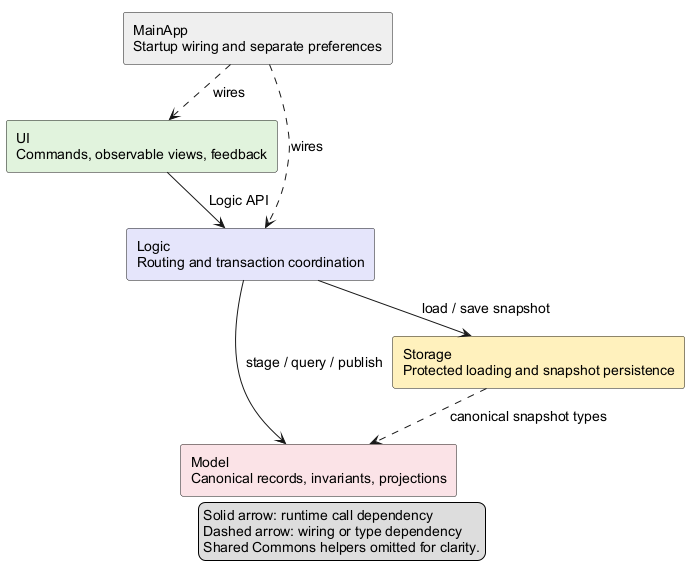](images/ArchitectureDiagram.png)

`Main` launches JavaFX; [`MainApp`](https://github.com/AY2627S1-CS2103T-F13-3/tp/blob/master/src/main/java/ponhub/MainApp.java)
checks application paths, constructs the canonical session and separate preferences, then connects
`CanonicalLogicManager` and UI. It saves preferences separately at shutdown.

| Component | Responsibility |
| --- | --- |
| [UI](#ui-component) | Render observable views, accept commands and show feedback. |
| [Logic](#logic-component) | Parse/dispatch commands and coordinate execution, persistence and publication. |
| [Model](#model-component) | Own canonical records, invariants and derived views; keep preferences separate. |
| [Storage](#storage-component) | Validate/load local files and persist complete operational snapshots safely. |
| [Commons](#common-classes) | Supply shared value helpers, exceptions, logging and settings. |

UI depends on the `Logic` interface. The canonical session owns the model/query collaborators and
injects a complete-snapshot writer into the executor. These seams let tests exercise command and
file failures without a second writable model. The arrows above show calls and type dependencies,
not separate copies of the data. Commons helpers are omitted.

#### Canonical command collaboration

The sequence below traces `edit 1 n/Jamie Tan` in a normal session where people-list position 1
exists and the replacement is valid. `MainWindow` sends the command through `Logic.execute`;
`CanonicalLogicManager` delegates to `CanonicalPeopleSession`.

<figure class="dg-figure">
  <figcaption>Canonical edit command: stage, save, then publish</figcaption>
  <a href="images/ArchitectureSequenceDiagram.png">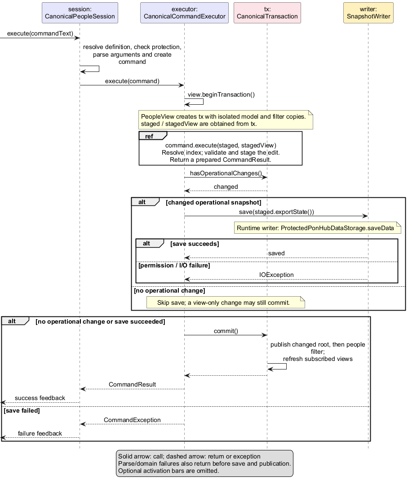</a>
</figure>

<figure class="dg-figure">
  <figcaption>Canonical edit command, continued: publication or failure</figcaption>
  <a href="images/ArchitectureSequenceDiagram_001.png">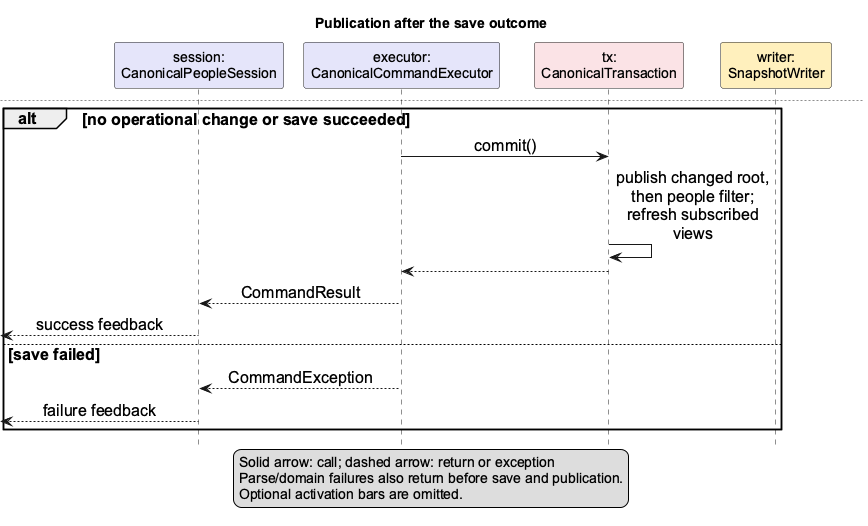</a>
</figure>

Read the two panels in order: the first establishes the save outcome, and the second continues publication
only when saving succeeded or no operational write was needed.

The session checks startup protection before parsing mutation arguments. A parse or domain failure
returns without saving or publishing. A valid command prepares a result on isolated transaction
copies; preparing that result is not user-visible success. If operational data changed, the executor
must save the complete validated snapshot before `commit()` publishes it. Permission or I/O failure
discards the staged transaction, retaining live data, allocation counters and the people view. A no-op
skips the write; view-only commands can still commit a filter change.
The final alternatives are exclusive: a failed save returns failure feedback without entering
the commit/success branch. Optional activation bars are omitted; the arrows retain the call/return boundary.

`editlesson` enters the same executor through `LessonEditParser` and `CanonicalEditLessonCommand`.
The [editing contract](#v14-editing-contract) owns field and scheduling rules; the
[transaction contract](#command-transactions) owns durability and recovery details. The figure shows
coordination rather than duplicating either contract. Command source references are listed in the
[Logic component](#logic-component).

### Command integration
{: id="current-increment-and-command-integration"}

`MainApp` connects one canonical session/root to Logic, cards and protected storage.
The [User Guide command summary](UserGuide.html#current-command-summary) lists the supported
people, lesson, enrolment, attendance and search commands with syntax and examples.
Protected sessions permit only `help`, `list` and `exit`. Canonical commands replace the inherited
AB3 model, command and storage paths; `clear` and `find` are unavailable. Shared contact values,
preferences and canonical transaction support remain. Canonical boundary tests verify that rejected
commands preserve the saved aggregate, filtered people view and preferences.

`CanonicalCommandDefinition` defines each command word, guidance and protected-session eligibility;
declaration order supplies normal help order, while recovery order preserves `help`, `list`, `exit`.
`CanonicalCommandCatalog` derives guidance from these definitions. `CanonicalPeopleSession.execute()`
resolves the word once and dispatches through an exhaustive enum switch without a default arm, so a new
definition requires a route before compilation succeeds. Protection precedes argument parsing.
Register or withdraw a definition with matching parser/usage, catalogue and routing tests, and UG/manual
checks, using this same root/view and compatible persistence.
See [startup](#canonical-application-startup-85), [Storage](#storage-component) and the
[UG](UserGuide.html#current-command-summary) for loading, transactions and supported syntax.

### Canonical application startup
{: id="canonical-application-startup-85"}

`MainApp` selects `data/ponhub.json` by default or the launch argument `--data=PATH`, then constructs one
`CanonicalPeopleSession` and its `CanonicalLogicManager`. Packaged application home is the folder containing the JAR, independently of the terminal working
directory; development launches fall back to the working directory. Relative `--data` paths resolve from
that home; absolute paths are allowed only inside it. Blank paths, `..` escapes and symbolic-link escapes
are rejected before operational/preferences access. Data, preferences and the root reserved
`ponhub.log*` and legacy `addressbook.log*` files must remain separate, including rotation/lock names,
future suffixes, case variants and symbolic/hard-link aliases. New logs use `ponhub.log*` and the `ponhub` logger;
legacy logs remain untouched and reserved for compatibility. File logging starts
only after this preflight; symbolic `ponhub.log*` files and new log files aliased to legacy logs
retain console-only logging. Quote a path containing spaces, for example
`java -jar ponhub.jar --data="separate store/ponhub.json"`. The status footer shows the selected operational
path. Preferences use `home/preferences.json` and logs stay in that same application home; an old
preference's legacy address-book path does not select canonical operational data.

The selected file is classified and validated once. Confirmed absence supplies an unwritten empty root,
without sample records; only a successful addition creates operational data. Valid supported input installs
one complete snapshot. Rejection preserves the file and opens a visibly protected empty view with actionable
path-specific recovery guidance. Only help/list/exit remain available, and external repair or removal does not
unlock that session before restart. Default startup leaves `data/addressbook.json` untouched; legacy AB3 data
selected explicitly is preserved and rejected, with backup and manual re-entry into a separate missing store.
No migration, setup or recovery command is introduced.

### Window placement and active contact-card layout

At startup, `WindowPlacement` fits saved window dimensions and coordinates to the current screen work areas. It chooses the screen with the largest overlap with the saved window, preserves valid coordinates on secondary screens, and centers a new or wholly offscreen window on the primary screen. Invalid saved dimensions fall back to the defaults. JavaFX's visual bounds already use logical coordinates and exclude desktop bars; they are not divided by the display scale again. The startup fit does not impose a permanent maximum size, so the administrator can move and resize the window on a larger monitor.

The main window has a 450-by-360 logical minimum where the work area allows it. The result area and both
people and lesson lists retain visible scrolling viewports. Canonical cards fit their list cells and wrap
required and optional values. A resizable split pane keeps people and lesson results independent.
The compact header holds the PonHub wordmark and menus on one row. `commandBoxPlaceholder` is a sibling
below `resultSplitPane`, spanning beneath both record columns; it does not move with either list or the
shared feedback divider. The people sidebar starts at 32% of the records width and remains adjustable.
The existing vertical result split retains its separate pane minima and session divider behavior.
After populating the window, startup explicitly focuses the command input. Result Display remains
focusable for text selection and copying; menu/F1 help preserves an unfinished command draft.

`Logic.getCommandWords()` supplies the canonical definitions in session catalogue order, including the
protected-startup restriction. `MainWindow` passes this immutable list to `CommandBox`.
Its Tab key filter uses `CommandWordCompleter` to replace only the first word from the prefix before
the caret; repeated presses cycle the original matches. Text/caret/selection/focus changes reset that
cycle, with an internal guard around completion's own text/caret updates. Only a successful completion
consumes unmodified Tab. Shift+Tab and ineligible input retain normal traversal, while Enter retains
the existing execution and failed-draft behavior. See the [UG keyboard guidance](UserGuide.html#completing-command-names-with-tab)
and [manual checks](#command-name-completion).

`CommandBox` also retains at most 50 nonblank submitted command strings in memory, including failures.
Unmodified Up/Down browse these without invoking Logic. The first Up saves the current draft's text,
anchor and caret; Down beyond the newest submission restores them. A guarded text/selection update
preserves browsing, while a user edit or Tab replacement starts a new draft. Submitting resets browsing;
closing the window discards the history. This UI recall is unrelated to persisted attendance history.

Use the [common window and layout checks](#common-window-and-layout-checks) to exercise the shell
on the actual platform and display configuration being assessed.
The command box exposes the routes described in [command integration](#current-increment-and-command-integration).

### Shared-lesson target contract

The agreed design ([#60](https://github.com/AY2627S1-CS2103T-F13-3/tp/issues/60)) uses one canonical
root for ordered people, independent shared lessons and dated attendance. This contract describes
the target; the [runtime summary](#current-increment-and-command-integration) identifies active routes.

| Record or relationship | Authoritative representation |
| --- | --- |
| People | Immutable `Student`, `Tutor` and `Parent` implement `PersonRecord`. Student references contact details, level and parent phone; it neither extends legacy `Person` nor owns lessons. |
| Shared lessons | Each Lesson has a stable Lesson ID, Tutor ID, weekday/time, subject, room and `enrolledStudentIds`. Its roster owns membership; empty lessons remain valid. |
| Derived views | Student lessons, rosters and tutor schedules resolve IDs from that root. They never form another writable membership graph or duplicate a shared lesson. |
| Attendance | Student ID + Lesson ID + date identifies one `present` or `absent` record. No entry means unrecorded; history survives unenrolment. |
| Parent links | Optional Parent records link by exact equality of their phone and a Student's parent phone, preserving leading zeros. A matching Parent record is not required. |

**Selectors and identity.** `INDEX`/`STUDENT_INDEX` is a positive one-based position in the current
filtered **people list**. Check range and required role, then resolve once to stable `PersonId` for
the whole operation. Filtering renumbers positions without changing stored IDs (`S1`, `T1`, `P1`);
cards distinguish both. Lesson, roster and history results preserve the people filter/order/indices;
their row positions are never person selectors. Existing lessons use stable `lid/LESSON_ID` (`lid/L1`).
`lessons [STUDENT_INDEX]` resolves its optional Student selector by the same rule; the former
`lessons si/STUDENT_INDEX` syntax remains a compatibility alias. Stored relationships and internal query APIs
use stable IDs, never displayed positions.

**Tutor lookup.** `addlesson` matches `tu/TUTOR_NAME` by normalized full name, ignoring case and
repeated spaces. If supplied, `tp/TUTOR_PHONE` must also match exactly; never ignore it. Reject zero
matches or ambiguity without mutation, requesting a phone to disambiguate. Search `tu/` instead
matches a case-insensitive name fragment; Tutor-category name search uses `n/`.

The [UG command formats](UserGuide.html#planned-command-summary) and [search matrix](#supported-criteria)
define the supported syntax and filters. The [runtime summary](#current-increment-and-command-integration)
identifies active routes; future features remain in Requirements.

**Scheduling and history.** Create each lesson once with an empty roster. Reject tutor/room clashes
between distinct same-weekday lessons, and a student's clashes with other enrolled lessons. Joining
the same lesson does not book its tutor/room again. Times are half-open `[start, end)`: adjacent
`1600–1700`/`1700–1800` slots and equal times on different weekdays are allowed.

Unenrolment removes membership only. New attendance needs current membership and a real date on the
lesson's weekday; an existing historical key can be corrected or unmarked after unenrolment.
Repeating a status is a no-op. Unmark removes that dated key, never membership.

**Deletion guards.** Reject blocked deletion without changes or cascading:

| Record | Guard or retained data |
| --- | --- |
| Student | Block while any roster or attendance record references its ID. |
| Tutor | Block while any Lesson references its ID. |
| Lesson | Block while its roster is nonempty or attendance references its ID. |
| Parent | Preserve Students' parent-phone values; only derived links disappear. |

Complete independent snapshots include relationships and monotonic allocation state; deleted
committed IDs are never reused. [Storage](#storage-component) is authoritative for versioned schema,
validation, protected loading, recovery and save-before-publication transactions. Preferences have
a separate lifecycle. Extended features are listed in [Requirements](#user-stories); undo/archiving
constraints are described [below](#future-undoredo-and-archiving).

Ownership and implementation coordination remain in [AboutUs](AboutUs.html#project-team) and
[tracker #59](https://github.com/AY2627S1-CS2103T-F13-3/tp/issues/59).

<a id="planned-v14-editing-contract"></a>

#### Editing contract
{: id="v14-editing-contract"}

**Person and Lesson editing are active.** The [runtime summary](#current-increment-and-command-integration)
lists supported routes; the [shared contract](#shared-lesson-target-contract) defines identity and relationships.
The person command uses Ben's person-model support. Feature ownership remains in
[AboutUs](AboutUs.html#project-team); the original scope decision and implementation handoffs remain in
[#258](https://github.com/AY2627S1-CS2103T-F13-3/tp/issues/258).

**Person grammar:**

```text
edit INDEX [n/NAME] [p/PHONE] [e/EMAIL] [a/ADDRESS] [l/LEVEL] [pp/PARENT_PHONE]
```

Resolve the current displayed people index once to a stable ID before preparing an immutable
replacement at the same global position. Preserve its role, ID, all allocation counters, Lessons,
rosters and attendance. At least one editable prefix is required. Omission keeps the old value;
an explicit blank `e/` or `a/` clears that optional value. Blank `p/` clears only a Student's optional
own phone; Tutor/Parent phones remain required. `l/` and `pp/` are Student-only and cannot be cleared;
`n/` cannot be cleared for any role. Reject role/ID edits, unknown/repeated prefixes, invalid values
and wrong-role fields before publication. Reuse the current field validators/normalization rather
than relaxing their character or length rules.

Check duplicates against every other record, excluding the target ID: Student uses normalized name
and parent phone; Tutor/Parent use normalized name and own phone within the same role. A Tutor rename
keeps every Lesson's Tutor ID. Changing a Parent's own phone or a Student's parent phone recomputes
exact-phone derived links without changing another person's stored phone, creating a Parent or
requiring a matching Parent. Before resetting the staged root, `CanonicalEditCommand` compares the edited
endpoint with all people in the pre-edit snapshot. Successful feedback identifies every removed Parent/Student
ID pair; unchanged phone values and previously unlinked records produce no warning. The executor returns
that feedback only after a changed snapshot is saved and published, so a failed save reports failure instead.

**Person model API (#261).** `PersonEditInput` contains typed immutable field operations:
`Field.keep()` retains an omitted field, `Field.clear()` represents an explicit blank, and
`Field.set(value)` supplies a canonical validated value. The model accepts all-kept intent as a no-op;
`PersonEditParser` requires an editable prefix and rejects unknown/repeated prefixes.
`PersonEditCandidate.prepare(source, targetId, input)` resolves intent against one complete snapshot,
rejects required-field clearing and Student-only fields on other roles, and constructs the same immutable
role with the same ID. It exposes `getCandidateState()`, `getEditedPerson()` and `isChanged()` without
changing live state, reserving IDs or writing storage. Compare complete canonical field values, including
display capitalization; a no-op returns the original snapshot and record.

`PonHubData.replacePerson(replacement)` is the single canonical installation boundary used in preparation.
It locates the existing ID, replaces only that global position, and validates new `PeopleRegistryState`
and complete `PonHubDataState` before installation. Rebuilding the ordered registry excludes the old
record from duplicate matching while retaining all counters; Lessons, rosters and attendance stay intact.
An equal replacement performs no state notification.

<!-- @@author ErnestChuaa -->
**Person command integration.** `PersonEditParser.Input` holds a validated displayed `Index` and
`PersonEditInput`. `CanonicalEditCommand` resolves that position once against the staged current people
view, prepares `PersonEditCandidate` from the fresh staged snapshot, and installs a changed candidate only
in that staged root, following the [transaction contract](#command-transactions).
The session registers `edit` with matching `help edit` guidance; protected sessions reject it before parsing.
No inherited AB3 command, schema change or new dependency is involved. `PersonEditParserTest` and
`CanonicalEditIntegrationTest` cover parsing, optional clears, role guards, duplicates, stable identity,
no-op versus display capitalization, protected startup and persistence through the real session.
`MainWindow` captures the selected stable Person ID before successful command execution and asks
`PersonRecordListPanel` to restore that identity only while it remains visible. This avoids losing selection
when an immutable replacement has different fields, or transferring selection to another search result.
Failed commands never restore or publish a replacement. Attached production-window regressions verify
successful edits, disappearing search results, failed saves and retry with a selected Lesson detail.
<!-- @@author -->

**Lesson grammar:**

```text
editlesson lid/LESSON_ID [d/DAY] [st/HHMM] [et/HHMM] [s/SUBJECT]
    [tu/TUTOR_NAME [tp/TUTOR_PHONE]] [rm/ROOM]
```

The line break above is for display; enter one command. Require an existing stable Lesson ID and
at least one editable field; omitted fields stay unchanged and supplied values cannot be blank.
Keep the ID, catalogue position, enrolled Student IDs, attendance keys/statuses and allocation
counters. A replacement Tutor uses the existing normalized full-name/optional exact-phone lookup;
reject `tp/` without `tu/`, zero matches, ambiguity or a supplied phone mismatch. Reject unknown or
repeated prefixes. Validate the complete resulting slot, including `start < end`, against every
other Lesson for Tutor, room and enrolled-Student clashes; exclude the edited Lesson itself and
allow adjacent slots. Reject a weekday change if any retained attendance date, including a former
member's, would become invalid. Never move, remove or rewrite history automatically.

**Lesson model API (#262).** `LessonEditInput` contains one typed optional replacement for each
editable value: day, start time, end time, subject, Tutor ID and room. An empty optional retains the
existing value. The model accepts an all-omitted input as a no-op; the active command parser
requires at least one editable prefix, rejects blanks and resolves the Tutor name/phone to a stable ID.
`LessonEditCandidate.prepare(source, targetId, input)` combines supplied and retained values into one
complete immutable `Lesson`, preserving the target ID, catalogue position and roster order/membership.
It exposes `getCandidateState()`, `getEditedLesson()` and `isChanged()` without changing live state,
allocating an ID or writing storage. Complete canonical equality determines a no-op.

`PonHubData.replaceLesson(replacement)` is the canonical installation boundary shared with roster
updates. It replaces only the existing catalogue position and validates a complete `PonHubDataState`
before installation. This excludes the old Lesson from conflict checks while rechecking the replacement
against every other Tutor, room and enrolled Student schedule. Whole-root validation also rejects a
weekday that disagrees with any retained attendance date, including a former member's record. People,
attendance and allocation counters are retained, and an equal replacement performs no state notification.
The `editlesson` command prepares from its fresh staged snapshot, saves a changed candidate before
publication, and skips save/publication for a no-op. Changed edits with retained attendance append a warning
that the records use current Lesson details and recommend a new Lesson for future-only changes. The
executor returns this feedback only after saving/publication. `LessonDetailList` labels dated summaries and
undated summaries with former-member attendance as current information; it does not imply historical Lesson
versioning or change attendance dates/statuses. Activation does not change the JSON schema.

<!-- @@author ys000009 -->
**Lesson command activation (#264).** `LessonEditParser.Input` holds the stable Lesson ID, typed optional
replacement values and unresolved Tutor name/phone. It requires at least one editable field, permits either time
endpoint alone for later complete-slot validation, and rejects blank, unknown, repeated and orphan `tp/` fields.
`TutorResolver` gives `addlesson` and `editlesson` one normalized-full-name and optional exact-phone rule.

`CanonicalEditLessonCommand` first confirms the target and reports an incompatible retained attendance date with
an explicit `unmark` option. It resolves any replacement Tutor, prepares `LessonEditCandidate` from the executor's
fresh staged snapshot and installs only a changed candidate. `CanonicalCommandExecutor` then saves before
publication; identical edits skip both write and publication. The session and command catalogue expose
`editlesson` only in normal sessions. `LessonRetrieval` retains a selected Lesson after publication but clears a
dated filter and its context date when a permitted weekday change makes that date obsolete.

`LessonEditParserTest` covers the prefix grammar, Unicode boundary whitespace, controls and typed values.
`CanonicalLessonEditIntegrationTest` exercises the real parser, command, session and storage path for independent
time-endpoint changes, Tutor disambiguation, stable roster/history/counters, self-exclusion and Tutor/room/Student
clashes, current/former retained history, no-op writes, selected-detail refresh, protected startup, injected IO and
permission failures, retry and reload.
<!-- @@author -->

**Execution and views.** Both edits use the [transaction contract](#command-transactions) for isolated
preparation, save-before-publication, no-op writes and failed-command state preservation. File recovery follows
[Safe JSON saves](#safe-json-saves). Protected sessions reject both commands before parsing, including no-ops.
Compare complete resulting canonical values for a no-op, not just duplicate keys. Adding extra spaces
between `Alex` and `Tan` normalizes back to `Alex Tan`; changing it to `ALEX TAN` changes the display spelling.
An identical edit reports no change and does not save or publish operational data.

After a successful edit, retain the people role/search filter and re-evaluate all predicates and
relationship contexts against committed state, preserving global relative order and renumbering
visible positions. Keep a selected person by stable ID only while still visible; otherwise clear
selection, never transfer it to the old position's new occupant. Lesson catalogue, Student-specific
lists, lesson searches, selected detail and history keep their stable-ID subscriptions and refresh
current names/fields after publication. Preserve the selected right-pane mode. For a selected dated
detail whose date no longer matches a permitted weekday edit, retain the Lesson but clear its date
filter and context date; do not label that old date as a new occurrence. History keys and statuses
remain unchanged. Recheck displayed people positions before the next indexed command.

For executable acceptance steps, use [Person editing](#person-editing) and [Lesson editing](#lesson-editing).
The corresponding regression seams are `CanonicalEditIntegrationTest`, the edit-specific
`CanonicalMainWindowTest` cases and `CanonicalLessonEditIntegrationTest`. They cover field intent,
role/duplicate guards, identity and view refresh, no-ops, protected startup, failed saves, retry and reload.

<figure class="dg-figure" markdown="1">

### UI component

The **API** of this component is specified in [`Ui.java`](https://github.com/AY2627S1-CS2103T-F13-3/tp/blob/master/src/main/java/ponhub/ui/Ui.java)

[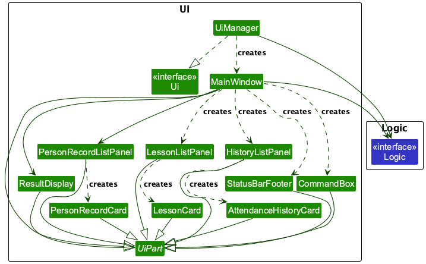](images/UiClassDiagram.png)

</figure>

This selected Java controller view shows the active panels and cards. Solid navigable lines show stored
references; dashed `creates` dependencies show construction, including card creation by panel cells.
Hollow triangles show class inheritance (solid line) or interface realization (dashed line).
`UiManager` creates and initializes a local `MainWindow`. The window stores `PersonRecordListPanel` and
`ResultDisplay`; it creates the other shown controls locally and installs their JavaFX roots. Panel cells
likewise install card roots rather than storing collections of card controllers. JavaFX scene containment,
FXML fields, model projections and other helpers are omitted. `UiPart` is abstract; all shown window,
panel, card and control classes extend it. Select the figure to view it at full size.

Layouts live in `src/main/resources/view`. UI sends commands through `Logic` and observes model-backed
results so committed changes refresh the display.

The active canonical cards display immutable `PersonRecord` projections from the session's same observable people
list, with separate current-view positions and stable IDs and wrapping labels for required and optional fields.
`LessonListPanel` observes `Logic.getDisplayedLessons()` and renders wrapping `LessonCard`s with stable lesson/tutor
IDs, schedule, subject, room and roster size. The subject is the card heading, followed by the
stable Lesson ID on its own line and a separate Schedule row. `showlesson` switches the right pane to a
scrolling detail view with
the current roster and retained former-member attendance, both expanded immediately for undated and dated
results. Detail rows, including the summary and section headings, share a virtualized list: controls are
created for the viewport as it scrolls, while every roster and retained-attendance entry remains reachable in
its original order. The hidden catalogue suppresses detail graphics to avoid duplicate row construction.
Missing dated records remain labelled `unrecorded`. Each panel scrolls independently, and lesson commands
never replace the people list. `HistoryListPanel` shares the right pane for dated records with current/former
membership labels and refreshes after committed changes. See the
[shared selector contract](#shared-lesson-target-contract).

The optional **All lessons**, **Student lessons** and **Attendance history** buttons share a wrapping `FlowPane`
at the top of `feedbackSection`, the upper child of `resultSplitPane`, spanning both record columns. A wrapping
label explains that selecting a Student card chooses the target of the Student shortcuts. Navigation, guidance
and feedback share this resizable section, with a 50-pixel minimum for the feedback placeholder. The shared
divider resizes this section; command entry stays fixed below both record columns. The buttons route through
`MainWindow` to the same `Logic.execute` boundary as the command box, using `lessons`, `lessons CURRENT_INDEX` and
`history CURRENT_INDEX` respectively. Student shortcuts resolve the selected stable Person ID against the current
people list and require a Student before creating the indexed command. Missing or stale selection and Tutor/Parent
selection produce feedback without replacing either result source. Buttons preserve the command-box draft and
use the normal command guards, including protected-session rejection. Typed retrieval and search commands require
no GUI selection; their supplied arguments select the appropriate people, Lesson/detail or history results from
any current result. Navigation introduces no parser grammar, stored state or alternate query implementation.

`LessonRetrieval.ResultKind` distinguishes `ALL_LESSONS`, `STUDENT_LESSONS`, `SEARCH` and `DETAIL`. Its read-only
`resultKindProperty()` reaches `MainWindow` through the session and `Logic.lessonResultKindProperty()`. Together
with `historyViewActiveProperty()`, it drives all three button indicators: history takes precedence; catalogue
and Student results activate their own shortcut; search and detail activate none. Validation precedes source
and kind changes. People selection/filtering, help and committed refresh do not retarget the retained source.
History invalidation reveals the retained Lesson kind; a removed selected detail remains an unavailable detail.
Display context text supplies headings, never navigation state.

### Logic component

**API:** [`Logic`](https://github.com/AY2627S1-CS2103T-F13-3/tp/blob/master/src/main/java/ponhub/logic/Logic.java).

[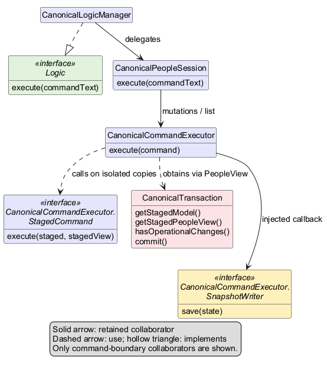](images/LogicClassDiagram.png)

The diagram shows selected command-boundary operations. `Logic` also exposes the observable
retrieval APIs used by the UI; the responsibilities below describe session routing and executor ordering.

`CanonicalLogicManager` implements `Logic` over one `CanonicalPeopleSession`. The session resolves a
`CanonicalCommandDefinition` and dispatches through its exhaustive switch. Definitions also supply
`CanonicalCommandCatalog` guidance and protected-session eligibility; protection is checked before
mutation parsing. Typed parsers return canonical inputs, without a shared legacy `Parser` interface
or AB3 tokenizer. For example, `PersonEditParser.Input` supplies `CanonicalEditCommand`, while
`LessonEditParser` supplies `CanonicalEditLessonCommand`.

`CanonicalCommandExecutor` obtains a transaction from `PeopleView.beginTransaction()` and calls the
`StagedCommand` on isolated data/view copies. Its injected `SnapshotWriter` is connected to
`ProtectedPonHubDataStorage.saveData` in the application session. The executor commits only after a
changed operational snapshot is saved. `CanonicalTransaction.commit()` publishes the root before
copying the staged people filter, so subscribed projections refresh from committed data. The
[command sequence](#canonical-command-collaboration) shows success, no-op and failed-save paths.

`list` uses the executor to change the staged people filter without an operational write. People
search changes its derived filter directly; lesson/search/detail/history routes use the session's
retrieval coordinators. `help` and `exit` return guidance/control results without operational writes.
These routes do not create a second root. The [retrieval contract](#read-only-retrieval-api-contract-113)
and [search explanation](#supported-criteria) own result ordering, selection and matching behavior.
Commands use the [shared selector contract](#shared-lesson-target-contract) for displayed positions
versus stable IDs.

Trace the implementation through
[`CanonicalPeopleSession.execute`](https://github.com/AY2627S1-CS2103T-F13-3/tp/blob/master/src/main/java/ponhub/logic/CanonicalPeopleSession.java),
[`CanonicalEditCommand`](https://github.com/AY2627S1-CS2103T-F13-3/tp/blob/master/src/main/java/ponhub/logic/commands/CanonicalEditCommand.java),
[`CanonicalCommandExecutor`](https://github.com/AY2627S1-CS2103T-F13-3/tp/blob/master/src/main/java/ponhub/logic/CanonicalCommandExecutor.java)
and [`CanonicalTransaction`](https://github.com/AY2627S1-CS2103T-F13-3/tp/blob/master/src/main/java/ponhub/model/CanonicalTransaction.java).

#### Read-only retrieval API contract
{: id="read-only-retrieval-api-contract-113"}

[`Logic`](https://github.com/AY2627S1-CS2103T-F13-3/tp/blob/master/src/main/java/ponhub/logic/Logic.java)
declares the UI-facing retrieval methods; [`LessonQuerySource`](https://github.com/AY2627S1-CS2103T-F13-3/tp/blob/master/src/main/java/ponhub/model/query/LessonQuerySource.java)
and [`LessonQueries`](https://github.com/AY2627S1-CS2103T-F13-3/tp/blob/master/src/main/java/ponhub/model/query/LessonQueries.java)
define the lesson backend supplied by the active `CanonicalPeopleSession`. Its canonical Model owns projections
from one `PonHubData` root; `CanonicalLogicManager` delegates to that same source. Catalogue and filtered
results contain each lesson once in creation order by default, including empty lessons. Student lessons derive from current
Lesson-owned membership; rosters use people creation order, and tutor schedules use weekday, start time and numeric
lesson ID. Lookup by lesson ID reads the full catalogue regardless of its active filter.

[`LessonView`](https://github.com/AY2627S1-CS2103T-F13-3/tp/blob/master/src/main/java/ponhub/model/query/LessonView.java)
and [`StudentView`](https://github.com/AY2627S1-CS2103T-F13-3/tp/blob/master/src/main/java/ponhub/model/query/StudentView.java)
expose current display fields without becoming stored records.
[`AttendanceHistoryEntry`](https://github.com/AY2627S1-CS2103T-F13-3/tp/blob/master/src/main/java/ponhub/model/query/AttendanceHistoryEntry.java)
also distinguishes recorded present/absent status from current enrolment; history comes from dated attendance and
survives unenrolment. A missing entry means unrecorded. See the [shared contract](#shared-lesson-target-contract) for
command indices versus stable IDs and for preservation of the people view.

Queries never save data or allocate IDs. Lists are unmodifiable observable views: a UI-held list remains the same
object while committed changes and rollback refresh its entries. Existing records with no matches yield valid empty
lists, while an unknown lesson lookup yields an empty `Optional`. Lesson queries reject null IDs and unknown or
wrong-role IDs for list retrieval; exact signatures and exceptions are in the linked source/Javadoc.

**Integration status:** #80's lesson/roster backend is connected to the active canonical session and exposed by
`CanonicalLogicManager`. Attendance-history methods are active through #100. `Logic.getDisplayedLessons()`
exposes the selected catalogue, student or search result
through one stable observable list. Active lesson commands enter through `Logic.execute(String)` and follow
the Lesson fields of the [search matrix](#supported-criteria). History queries retain stable observable lists,
sort records by descending date and numeric Lesson ID, and derive current membership from the Lesson roster.
`AttendanceRetrieval` resolves the current people-list index once, then selects a stable Student ID query.
The right pane switches between lesson and history results without replacing the numbered people view.

### Model component

**Person records and shared immutable values:**

[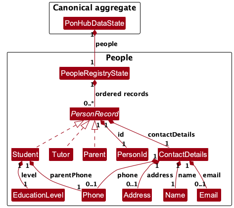](images/PersonRecordClassDiagram.png)

<figure class="dg-figure">
  <figcaption>Shared Lesson ownership and membership</figcaption>
  <a href="images/LessonMembershipClassDiagram.png">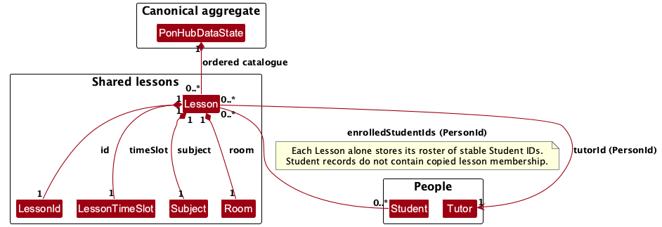</a>
</figure>

<figure class="dg-figure">
  <figcaption>Shared Lesson identity and value references</figcaption>
  <a href="images/LessonValuesClassDiagram.png">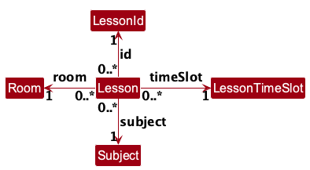</a>
</figure>

<figure class="dg-figure">
  <figcaption>Dated Attendance, separate from current membership</figcaption>
  <a href="images/AttendanceClassDiagram.png">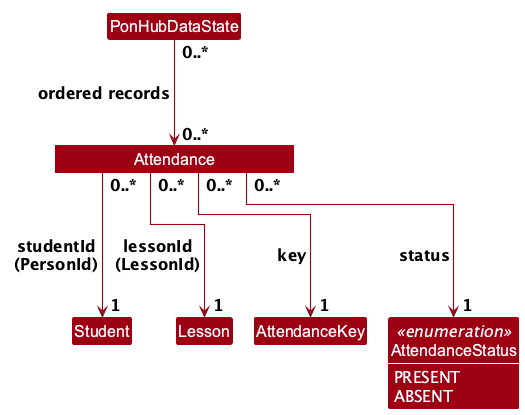</a>
</figure>

<figure class="dg-figure">
  <figcaption>Dated Attendance key and status</figcaption>
  <a href="images/AttendanceValuesClassDiagram.png">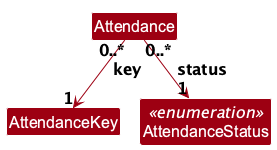</a>
</figure>

The paired views separate domain relationships from value references so that each endpoint remains readable.
The repeated `Lesson` and `Attendance` boxes denote the same classifier in each view.

The canonical model has one current `PonHubDataState` aggregate. Each state references one people-registry snapshot,
an ordered catalogue of shared `Lesson` records, and separate dated `Attendance` records. Each `PersonRecord` is
exactly one `Student`, `Tutor`, or `Parent` and references one stable `PersonId` and one `ContactDetails` value. Each
Lesson has exactly one Tutor and is the sole source of its current roster of stable Student IDs; this produces the
Student-Lesson many-to-many membership without copying lesson data into Student records. Each Attendance record
refers to exactly one Student and one Lesson through its dated `AttendanceKey`. Attendance is retained history, not
current membership.

The diagrams show both stored Java references and domain relationships resolved through stable IDs.
`Lesson` retains `tutorId` and `enrolledStudentIds`; `AttendanceKey` retains Student and Lesson IDs,
resolved through the canonical aggregate. ID-labelled associations express those domain links,
not additional object fields.

Immutable states, records, IDs and value objects can be shared safely by replacement snapshots, copied records and staged
containers, so their Java object lifetimes are not exclusive composition. Source-end `0..*` multiplicities make
that sharing explicit; they do not introduce a second writable owner of lesson membership or attendance.

**Example: one Lesson, two Students and independent dated attendance**

[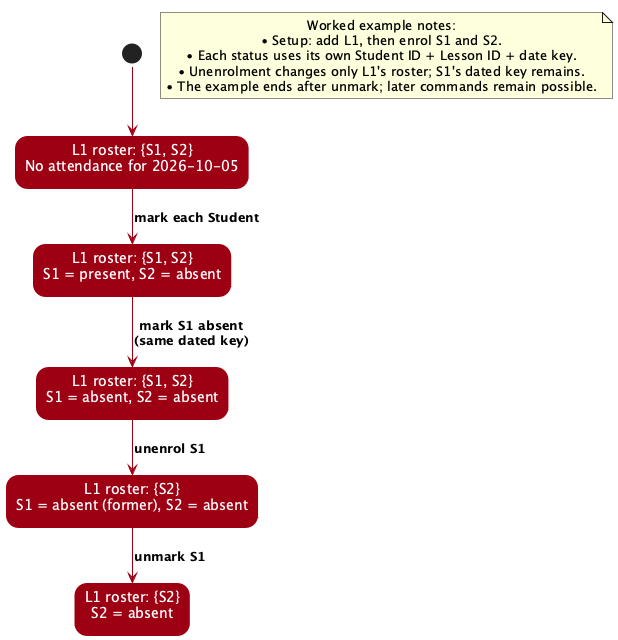](images/LessonAttendanceStateDiagram.png)

In this Monday `L1`, `S1` is Alex and `S2` is Jamie. The Lesson is the sole source of the roster `{S1, S2}` while
the separate attendance collection contains one key per Student for `2026-10-05`. Marking Alex present and Jamie
absent creates two keys; marking Alex absent later replaces only Alex's status for the same key. Unenrolling Alex
removes only `S1` from the roster, so Alex's absence remains as former-member history and Jamie's membership and
absence remain unchanged. `unmark` can then remove Alex's retained key without changing `L1` or Jamie. Every changed
step uses the shared [save-before-publication transaction](#command-transactions). A validation failure leaves the
complete preceding live state and file untouched. A save failure publishes no candidate; stored-file recovery follows
[Safe JSON saves](#safe-json-saves). The editable diagram source is
`docs/diagrams/LessonAttendanceStateDiagram.puml`.

The state diagram is one worked example. Its initial node assumes the displayed setup commands have completed, and
the example stops after removing Alex's retained key. It does not terminate the Lesson or PonHub lifecycle; later
enrolment, marking and other commands remain possible.

[`PonHubData`](https://github.com/AY2627S1-CS2103T-F13-3/tp/blob/master/src/main/java/ponhub/model/PonHubData.java)
holds the current immutable canonical state and relationships shown above. `PeopleView` derives one observable
role-filtered projection from that root. UI observes committed projections rather than maintaining writable
copies. Preferences remain outside operational snapshots. The inherited AddressBook model and its exclusive
regression fixtures are removed; shared `Name`, `Phone`, `Email`, `Address` and preferences remain.

Canonical state changes continue through validated `PonHubData` snapshots and save-before-publication transactions.
`CanonicalTransaction` implements the retained `ModelTransaction` boundary for that canonical root and its view.

The aggregate below implements the [shared ownership and identity contract](#shared-lesson-target-contract).
Complete independent transaction snapshots preserve records, relationships and allocation state.

#### Canonical data aggregate
{: id="canonical-data-aggregate-76"}

`PonHubData` holds one current immutable `PonHubDataState`: ordered people and per-role allocation history,
shared lessons/rosters, dated attendance and the last allocated lesson sequence. Snapshots copy incoming
lists and validate the entire candidate against the [shared/domain contracts](#shared-lesson-target-contract)
before replacement: identities, roles, references, scheduling and attendance must all be consistent.
Invalid construction or null replacement leaves the current state intact; no partial candidate is installed.

Equality includes collection order, records, relationships and allocation history, including deleted IDs.
Counters must cover retained IDs and are never inferred from them: zero means no allocation and
`Long.MAX_VALUE` means exhaustion. Normal changes preserve committed allocation history; restoring an
uncommitted snapshot may reinstate earlier counters during rollback.

Exported snapshots and copies safely share immutable state; replacing one container cannot change an
older snapshot or another container. Read-only collections/lookups and `stateProperty()` expose complete
validated state. UI filters, selection and preferences remain outside it. Commands work on independent
staged containers and publish only after saving through the [transaction boundary](#command-transactions),
so failed commands leave the live root and subscribed results unchanged.

#### Shared lesson scheduling model APIs
{: id="shared-lesson-scheduling-model-apis-78"}

[`PonHubData`](https://github.com/AY2627S1-CS2103T-F13-3/tp/blob/master/src/main/java/ponhub/model/PonHubData.java)
is the lesson mutation and allocation boundary. `addLesson(...)` resolves an existing Tutor ID, derives the next
positive `LessonId` from the retained counter, creates one empty-roster immutable `Lesson`, and attempts to install
a complete candidate state. Rejected candidates leave the catalogue and counter unchanged; committed IDs remain
reserved after deletion and `Long.MAX_VALUE` fails before overflow.

[`PonHubDataState`](https://github.com/AY2627S1-CS2103T-F13-3/tp/blob/master/src/main/java/ponhub/model/PonHubDataState.java)
applies the same scheduling validation to command candidates, restored snapshots and decoded files. Distinct
same-weekday lessons with overlapping half-open slots are rejected when their Tutor IDs or normalized rooms match.
This tutor/room rule applies even to empty-roster lessons. Student clashes are different: they are checked when the
same Student ID appears in the rosters of overlapping lessons. Adjacent slots, different weekdays and overlapping
lessons with different Tutors, rooms and enrolled Students remain valid.

One immutable `Lesson` owns each roster; Student records never copy lessons or membership. Read APIs derive the
catalogue, rosters and per-Student lessons from that root, while attendance stays in its separate dated collection.
The complete read/mutation surface and guard predicates are documented in the linked `PonHubData` source. Selector,
parent-link, identity and cross-component rules remain authoritative in the
[shared contract](#shared-lesson-target-contract); [Storage](#storage-component) owns schema, recovery and
save-before-publication details.

#### Shared lesson creation command
{: id="shared-lesson-creation-command-86"}

`AddLessonParser` converts the seven lowercase fields into a `LessonCreationInput` without reading operational
state or allocating an ID. It rejects preambles, control characters, unknown/repeated/missing/blank prefixes and
delegates day, time, subject, tutor-name, phone and room validation to the existing value objects. `tp/` is optional;
when present, its `Phone` retains leading zeros.

`CanonicalAddLessonCommand` resolves Tutors only from the staged aggregate. It compares `tu/` with the normalized
full name, ignoring case and repeated spaces. Zero name matches fail. Multiple name matches require `tp/`; whenever
`tp/` is supplied, it must exactly match the selected Tutor even if the name alone is unique. No fallback to a
name-only result occurs after a phone mismatch.

After resolving one stable Tutor ID, the command calls `PonHubData.addLesson(...)` on the transaction's staged root.
That existing aggregate boundary allocates the next uncommitted Lesson ID, validates the complete tutor/room
schedule, and creates an empty roster. `CanonicalCommandExecutor` then saves the complete people/lesson snapshot
before publishing it. Parse, tutor-selection, clash, allocation and save failures discard the transaction, preserving
the live catalogue, allocation counter, people filter and subscribed lesson-query lists. Success reports the new
stable Lesson ID and the saved lesson is immediately available through the lifetime `LessonQueries` component.

#### Indexed lesson query projections
{: id="indexed-lesson-query-projections-80"}

`LessonQueries` derives read-only lessons, rosters and history from one canonical `PonHubData` root.
A Lesson's roster is the only source of current membership; retained attendance never enrols a Student.
The session shares one query component between lesson retrieval and people relationship search, so both
paths resolve the same stable IDs and committed records. The UI owns neither a membership graph nor an index.

##### Follow one indexed search

Use the [UG worked example](UserGuide.html#worked-search-example) in a fresh separate store. Its setup creates
Tutor `T1` (Mei Lim), Students `S1` (Alex Tan) and `S2` (Jamie Tan), and Parent `P1` (Pat Tan). Both Students'
parent phone exactly matches Pat's own phone. The four Lessons, in creation order, are:

| Lesson | Schedule | Subject / room | Current roster |
| --- | --- | --- | --- |
| `L1` | Mon 1600–1730 | Math / R1 | Jamie (`S2`) |
| `L2` | Tue 1600–1730 | Math / R1 | Alex (`S1`) |
| `L3` | Mon 1800–1900 | Science / R1 | Alex (`S1`) |
| `L4` | Mon 1900–2000 | Math / R2 | Empty |

All four are assigned to Mei. Consider
`search c/lesson d/Mon st/1600 s/Math tu/mei rm/r1 sn/a`:

1. **Choose candidates.** The exact weekday bucket is `[L1, L3, L4]`; the exact start-time bucket is
   `[L1, L2]`. `LessonQueries` chooses the smaller supplied bucket, `[L1, L2]`, rather than scanning all
   four Lessons. Exact end-time filters can also supply a bucket; text filters cannot.
2. **Check every condition on each candidate.** `L2` fails Monday. `L1` matches Monday, 1600, Math, Mei
   and R1, and its current roster contains Jamie, whose name contains `a` ignoring case. The result is
   `[L1]`, in catalogue order, with feedback `Found 1 lesson(s).` The index only narrows candidates;
   it never replaces the remaining predicates. Optional schedule ordering adds `O(K log K)` work.
3. **Do not borrow a match.** `search c/student n/Alex d/Mon s/Math` returns zero: Alex has Tuesday Math
   and Monday Science, not Monday Math. `search c/parent sn/Alex d/Mon s/Math` also returns zero even
   though Pat's other child Jamie has Monday Math. The named child and the enrolled Lesson must both match.
4. **Keep results distinct.** After `list r/student` and `enrol 1 lid/L1`, both Students match `sn/a`
   within `L1`. Repeating the lesson query still returns one `L1`, while the Alex and Pat queries now
   each return one person. Multiple roster or context matches do not duplicate stable-ID results.

The [criteria matrix](#supported-criteria) gives the accepted fields and validation rules. Exact-value
buckets preserve substring semantics for `s/`, `tu/`, `rm/` and `sn/`; a prefix trie would not preserve
arbitrary fragments such as `s/ath`. Lesson-only `tp/` compares the assigned Tutor's current complete phone
from the same committed people index; it can be combined with partial `tu/` or used alone. Without a supplied
day or time, candidates are the whole catalogue.
Paired lesson-only `from/` and `to/` validate a same-day increasing window. Each candidate overlaps it
exactly when `lesson.start < to && lesson.end > from`; endpoint-only contact is excluded. Existing
exact `st/` and `et/` buckets remain available and all supplied predicates are conjunctive.

Optional lesson-only `sort/schedule` sorts the matched snapshot by Monday-Sunday, start time and numeric
Lesson ID; it does not change catalogue storage order. The same option on `lessons` sorts its displayed
projection after committed refreshes. Omitting the option restores creation order for that request.

For bounded field lengths, searching without sorting costs `O(B + R_B + K)`: `B` candidates, their roster links `R_B` when
`sn/` is supplied, and `K` results. This is not a constant-time text search or a mutation/persistence bound.

##### Select a view without changing another panel

[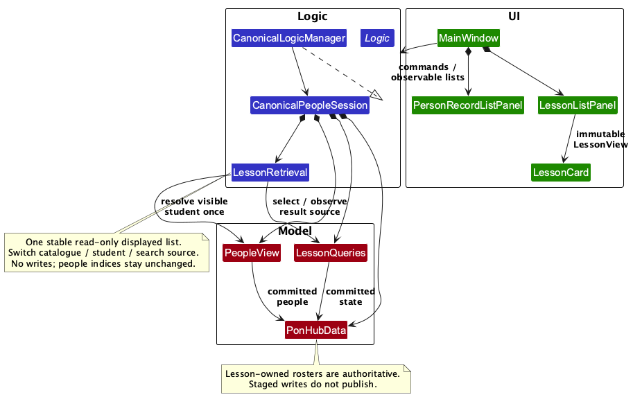](images/LessonRetrieval.png)

[`LessonRetrieval`](https://github.com/AY2627S1-CS2103T-F13-3/tp/blob/master/src/main/java/ponhub/logic/LessonRetrieval.java)
keeps one unmodifiable observable displayed list. `MainWindow` binds it once to the Lesson panel through
`CanonicalLogicManager`; commands switch its source and detach the previous source listener. The source
is the catalogue, a Student's current lessons, the filtered lesson list, or a single Lesson detail.
The heading identifies the selected Student ID, Lesson ID/date or normalized filters independently of
later people commands. This diagram focuses on the Lesson path; history uses the separate selector described below.
The source is `docs/diagrams/LessonRetrieval.puml`.
As in the [UI component](#ui-component) figure, solid navigable lines show selected stored references and
dashed arrows show dependencies. `CanonicalPeopleSession` holds the shared query through `LessonQuerySource`,
which `LessonQueries` implements. `LessonQueries` reads the root during construction and subscribes to committed
state without retaining a root field. The two unconnected comments name their subjects explicitly.
The [UG panel illustration](UserGuide.html#listing-and-searching-shared-lessons) reuses the integrated
navigation capture rather than presenting this running dataset as a screenshot.

| Path | Important difference |
| --- | --- |
| People search | Replaces the people criteria and context; evaluates own fields first, then the same-child/same-Lesson relationships. It does not change the lesson filter or selected lesson/history source. |
| `lessons INDEX` | Resolves the current visible person once, requires a Student, then subscribes by stable Student ID. `si/INDEX` remains an input alias; later people filtering cannot retarget either form. |
| Lesson search | Searches the complete catalogue, including empty rosters unless `sn/` is supplied. It changes only the lesson filter and selected lesson source. |
| `showlesson lid/ID [d/DATE]` | Looks up the complete catalogue by stable Lesson ID, independently of filters. A dated detail separates unrecorded current members from present/absent records and retained former-member attendance. |
| `history INDEX [lid/ID] [d/DATE] [s/STATUS]` | Resolves a visible Student once and selects a separate history list, newest date first then Lesson ID. Optional Lesson, exact-date and recorded-status filters combine conjunctively. It includes former enrolments and switches the right panel to history. Successful lesson retrieval switches that panel back. |

Read-only routes validate before changing selection and never save or stage a copy of the aggregate.
An invalid role, range, date or filter leaves the preceding panels intact. Student selectors always come
from the current people list; a roster row, history row or stable-ID suffix supplies no person position.

`HistoryArgumentsParser` validates optional filters with the existing attendance date/status validators.
`AttendanceRetrieval` holds those filters alongside the stable Student/Lesson selection and applies them to
each committed query refresh. The displayed list keeps the query's ordering and current/former membership
context; selecting the same query with new or omitted filters immediately replaces the previous criteria.

##### Refresh only after publication

Keep the lesson query above selected after enrolling Alex in `L1`, then run `editlesson lid/L1 s/English`.
The sequence separates the staged candidate from the live root; the user sees no intermediate mode.

<figure class="dg-figure">
  <figcaption>A saved Lesson edit refreshes the held query result: preparation and save</figcaption>
  <a href="images/LessonQueryRefresh.png">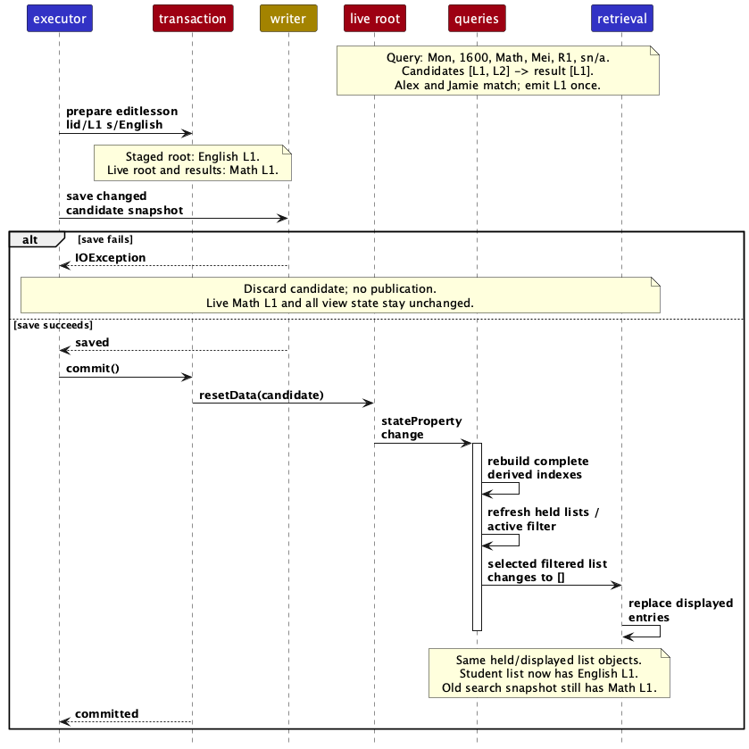</a>
</figure>

<figure class="dg-figure">
  <figcaption>Successful-save query refresh, continued</figcaption>
  <a href="images/LessonQueryRefresh_001.png">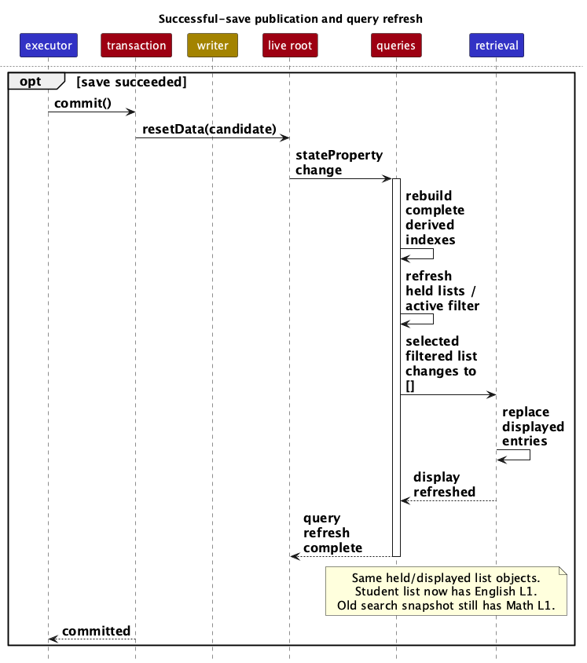</a>
</figure>

The lifelines show component roles: executor, transaction, snapshot writer, live `PonHubData` root,
`LessonQueries` and `LessonRetrieval` selector. Informal message labels omit JavaFX listener plumbing;
the query refresh stays active until the displayed entries have been replaced and the callback returns.
Select either diagram to view it at full size.

| Boundary | Candidate / saved state | Live queries and displayed result |
| --- | --- | --- |
| Before the edit | Saved `L1` is Math | Active query contains `[L1]`; a held Student lesson list contains Math `L1`. |
| Validate the staged edit | Candidate `L1` is English; saved file still has Math | Still Math and `[L1]`; the candidate is a different root. |
| Save fails or validation rejects | Candidate is discarded; file recovery follows the storage contract | Still Math and `[L1]`, with the same filter, selected source and list objects. No success is reported. |
| Save succeeds, then commit publishes | Saved and live `L1` are English with the same ID, roster and attendance | Indexes rebuild; the active Math query becomes empty and the held Student list now contains English `L1`. The displayed list object remains the same. |

[`CanonicalCommandExecutor`](https://github.com/AY2627S1-CS2103T-F13-3/tp/blob/master/src/main/java/ponhub/logic/CanonicalCommandExecutor.java)
saves changed snapshots before `CanonicalTransaction.commit()` publishes to the live root. `LessonQueries`
listens to that root's `stateProperty()`, completes its derived indexes, then refreshes the catalogue,
subscriptions and active filter. Retained observable lists keep their identity across committed changes
and restore. Their immutable entries are replaced; a previously returned `searchLessons(...)` snapshot
still describes the old Math result. A held subscription to a deleted record becomes empty and can
repopulate on restore; requesting a new subscription for a missing ID is rejected.

Lesson details rebuild the selected stable-ID snapshot on publication. If an edited weekday no longer
matches the selected detail date, the detail drops that date and shows the undated Lesson. History retains
its selected Student through people-list changes, but deleting that Student or its selected Lesson clears
the history selection. Unenrolment only changes current-membership context; it does not erase history.
These are source-level contracts; the separate [post-edit acceptance task (#268)](https://github.com/AY2627S1-CS2103T-F13-3/tp/issues/268)
and final packaged/native checks retain their own evidence requirements.

##### Find exact contracts and regression checks

Use [`LessonQuerySource`](https://github.com/AY2627S1-CS2103T-F13-3/tp/blob/master/src/main/java/ponhub/model/query/LessonQuerySource.java)
for retrieval signatures, ordering and missing-ID contracts, and
[`LessonQueries`](https://github.com/AY2627S1-CS2103T-F13-3/tp/blob/master/src/main/java/ponhub/model/query/LessonQueries.java)
for indexes, immutable snapshots, active filters and subscription refresh. Stable-ID maps, reverse
membership indexes and day/time buckets are derived once per publication, not per read. Tutor schedules
sort by weekday/start/ID; raw catalogue results retain creation order. Optional `sort/schedule` orders the
displayed catalogue, Student enrolments or search results without changing those source lists. Callbacks may request another subscription
because refresh snapshots the subscription entries before notifying listeners. All access runs on the
single model/JavaFX application thread. Construction/refresh includes index rebuilding, schedule sorting
and copying subscribed results; the query cost above excludes that work.

[`PersonRelationshipSearch`](https://github.com/AY2627S1-CS2103T-F13-3/tp/blob/master/src/main/java/ponhub/model/search/PersonRelationshipSearch.java)
shows the category-specific conjunction, parent-phone linking and distinct context rules.
[`LessonQueriesTest`](https://github.com/AY2627S1-CS2103T-F13-3/tp/blob/master/src/test/java/ponhub/model/query/LessonQueriesTest.java)
compares indexed results with a raw-record scan and covers held lists/restore;
[`CanonicalLessonRetrievalIntegrationTest`](https://github.com/AY2627S1-CS2103T-F13-3/tp/blob/master/src/test/java/ponhub/logic/CanonicalLessonRetrievalIntegrationTest.java)
checks routing, independent views and failed-save isolation. The editable refresh sequence is
`docs/diagrams/LessonQueryRefresh.puml`. These source links carry the detailed inventories rather than
repeating them here.

### Storage component

`ProtectedPonHubDataStorage` validates the active operational store and uses `JsonPonHubDataCodec` to decode
and encode complete snapshots. Its `CanonicalDataFileGuard` coordinates each save and delegates replacement
to the shared file writer. Preferences use `JsonUserPrefsStorage` separately.
[Application startup](#canonical-application-startup-85) selects and checks paths.

<a href="images/CanonicalStorageClassDiagram.png">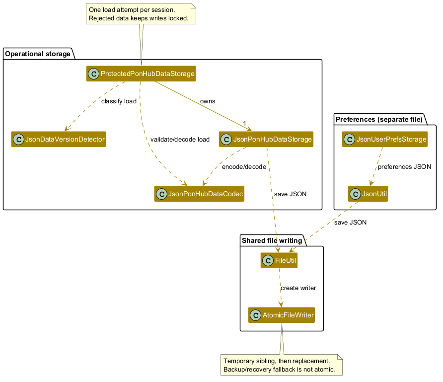</a>

Select the diagram to view it at full size. The unconnected UML note names the writer whose recovery
behavior it summarizes.

The diagram shows the active storage classes; solid arrows show a held reference and dashed arrows show
dependencies. The protected loader reads and classifies operational JSON before decoding the complete
snapshot. A successful load or confirmed absence installs one `CanonicalDataFileGuard`; before that,
or after rejected startup, the loader has no save guard, hence the `0..1` multiplicity. For each later save,
the codec encodes the candidate and the guard locks the sidecar, checks the file against its baseline, and
passes the JSON to `FileUtil`. `JsonPonHubDataStorage` remains a standalone codec/file-access convenience,
outside the active session's save path, and is omitted from this diagram.
Preferences use their own codec/path through `JsonUtil`; both active save paths reach
`AtomicFileWriter` through `FileUtil`. The writer's replacement and recovery limits are described once
under [Safe JSON saves](#safe-json-saves). This is the current implementation, not a proposed storage migration.

#### Preference recovery

Missing preference fields retain their defaults, unknown fields are ignored, and
`windowCoordinates: null` means no saved position. A JSON null root, null `guiSettings`, or explicit
null dimensions/coordinate components are invalid. Startup logs the loading failure, uses default
preferences and attempts to save them to `preferences.json`; unlike rejected operational data,
invalid preferences may be replaced. Valid human-edited sizes and positions survive save/reload;
window placement still fits them to the current screens. Preference read/write failures do not
change canonical data. Initial-save failure leaves loaded/default preferences usable, and
shutdown-save failure is logged without preventing shutdown.

#### Safe JSON saves

Canonical operational data and preferences share a UTF-8 file writer. JSON serialization finishes before writing.
Existing destinations are resolved to their real paths, so saving through a symbolic link updates its
target and preserves the link. Dangling/cyclic links and inaccessible destinations fail before writing.
New files use a resolved parent directory, creating missing directories as needed.

Runtime canonical saves additionally use `CanonicalDataFileGuard`. Successful loading records the exact JSON
text and resolved destination (or confirmed absence). Each save takes a nonblocking operating-system lock on
the persistent empty sibling `<data-file-name>.ponhub-lock`, compares the current destination and text with
that baseline, and keeps the lock through the existing replacement/recovery writer. Only successful saving
advances the baseline. Two windows loaded before the first save therefore cannot silently replace each other's
different snapshots: a stale save throws before writing or publishing the transaction and remains blocked until
restart. Reads keep the previous in-memory view; they do not automatically refresh it. Lock contention reports
a retryable save error. Lock/channel cleanup errors after committed replacement are logged, preserving success.

The sidecar is created only on a save attempt, never on loading, and remains after exit so later processes lock
the same file. Never delete/replace it while any instance runs. The `.ponhub-lock` suffix is reserved; nonempty
or symbolic-link sidecars are rejected without truncation. Resolved symbolic-link aliases use the target's
sidecar. This coordinates cooperating current-runtime saves on local filesystems with working file locks;
standalone codec writes, preferences, older builds and external editors do not participate. Concurrent external
changes to links/files, lock-file tampering, live synchronization and power-loss durability remain outside this
bounded accidental-second-window safeguard.

A complete temporary sibling file is written and closed before atomic replacement is attempted.
Only `AtomicMoveNotSupportedException` selects the fallback; permission and other move errors propagate.
The fallback first copies the existing destination into a unique sibling `.ponhub-backup-*.bak` file.
If backup creation/copy fails, replacement is not attempted. After a failed ordinary replacement, the
writer restores the old bytes from that backup (or removes a partial destination for a first save).
If restoration also fails, the complete backup is retained and its path is included in the error;
restore it before continuing or restarting. Never delete such a backup without recovering its contents.

After success, backup cleanup is best effort: a cleanup failure is logged without reporting the committed
save as failed. Other cleanup failures are suppressed on the primary error. Parent directories or
recovery/temporary files can remain after failures or abrupt termination.

The fallback permits saving on filesystems without atomic moves, but is not atomic: concurrent readers
can observe an incomplete destination during replacement/recovery. Its guarantee is a recoverable old
copy, not uninterrupted access at the original path. Neither path promises power-loss durability or
preserves all previous file attributes.

<a id="prepared-canonical-transaction-handoff-82"></a>
<a id="canonical-transaction-boundary-82"></a>

#### Command transactions

`CanonicalCommandExecutor` stages each command through `PeopleView.beginTransaction()`, using an
independent root, the complete snapshot and the current role filter. Commands resolve displayed indices
against that staged view and prepare validated changes; they must not mutate live state or execute nested
commands. Changed operational snapshots are saved through the protected writer before publication and
success feedback. Parse, execution or save failure discards the staged change, retaining live records,
allocation counters, filter, selection and subscribed query results.

After the staged callback returns, a Java assertion checks that the live snapshot, role filter and search
criteria still equal their starting values. This side-effect-free programmer invariant runs **before**
the snapshot writer, so detected misuse does not save or publish the staged candidate. It diagnoses
unexpected live changes; it cannot undo live changes already made by faulty callback code. Writers must
still obey their isolation contract. The check is enabled in development (`-ea`) and is not input validation:
user/file validation and save-failure handling continue to run with assertions disabled (`-da`).

Read-only commands and operational no-ops skip saving. Successful publication retains observable-list
identity; unchanged views avoid refresh, while a changed role filter can publish without an operational
write. Publication performs no new validation or I/O. Preferences follow their separate lifecycle.
The legacy command execution path is retired. `ModelTransaction` remains because the active
`CanonicalTransaction` implements it; retained model tests have their own regression seams.

##### Example: candidate, saved file and live state

Suppose a normal session contains Parent `P1` and its parent allocation counter is `1`.
Run `add r/parent n/Robin p/91234567` with a name/phone that does not duplicate an existing Parent.
The complete snapshot also contains any existing students, tutors, lessons, rosters and retained attendance.

| Boundary | Candidate state | Operational file | Live state and views |
| --- | --- | --- | --- |
| Before execution | No candidate yet | Contains `P1`, parent counter `1` | Same saved records; current filter/selection |
| Validate in the staged root | Contains `P1`, new `P2`, parent counter `2`; other records retained | Still the previous snapshot | Still the previous state; no success feedback |
| Save completes | Complete validated candidate | Contains the candidate snapshot | Still the previous state until publication |
| Publish and return success | Candidate installed in the live root | Saved candidate | Add returns to the all-role people view containing `P2`; subscribed list objects keep their identity |

Installing a record in the **staged** `PonHubData` is an in-memory operation, not a file commit.
`CanonicalCommandExecutor` calls the protected snapshot writer before `CanonicalTransaction.commit()`
publishes that state to the live root. The table separates these boundaries for explanation; it does not
introduce a user-visible intermediate mode. This add command also stages its all-role filter change;
that filter is published only after the save succeeds.

If input/domain validation fails, there is no save or publication. If saving reports a permission/I/O
failure, the candidate is discarded: live records, counters, filters, selection and subscribed results
remain unchanged, no success is reported, and a corrected retry can still allocate `P2`. File recovery
follows [Safe JSON saves](#safe-json-saves), including the retained-backup case if fallback restoration
itself fails; unchanged live state is not a promise of power-loss durability.

A rejected startup file follows a different path: no writable snapshot is loaded, its original bytes are
preserved, and the session stays protected even if the file is externally repaired or removed. Recovery
requires a compatible corrected copy and a restart, as described under
[protected startup](#protected-canonical-loading-84). Read-only commands and operational
no-ops skip saving; changing only a view filter may publish that filter without writing operational data.

#### JSON version detection
{: id="json-version-detection-foundation"}

`JsonDataVersionDetector.detect(String)` classifies file contents using the existing Jackson dependency,
without constructing Model objects or writing files. The current loader uses this gate before decoding. The supported
PonHub envelope uses `schemaVersion` as a positive JSON integer, initially `1`; this is a data-schema
version, independent of the application version. The canonical codec validates the complete envelope defined in #79 and its lesson and attendance extensions.

| Result | Meaning and later loader action |
| ------ | ------------------------------- |
| `LEGACY_AB3` | An unversioned object containing a `persons` array and, optionally, the textual `_comment` used by AB3 fixtures. No other root fields are accepted. Contact validity is not checked and roles are never inferred; preserve it for manual upgrade. |
| `PONHUB_V1_CANDIDATE` | Explicit integer `schemaVersion: 1`. Continue to complete envelope/domain validation; this result alone never authorizes loading or saving. |
| `INVALID_VERSION` | An explicit version is null, blank, a string, boolean, collection, fractional number, zero or negative. Reject without coercion. |
| `UNSUPPORTED_VERSION` | A positive integer other than 1, including values beyond Java integer range. Reject even if `persons` looks like legacy data. |
| `UNRECOGNIZED_FORMAT` | A non-object root or an unversioned object that does not match the legacy root, including extra unknown fields. Reject rather than ignoring fields. |
| `MALFORMED_JSON` | Empty/invalid JSON, duplicate object keys or trailing content after the document. Reject ambiguous input. |

Version detection neither validates domain records nor authorizes writes. File absence and read errors
are handled separately by the protected loader; neither is equivalent to empty JSON.

<a id="prepared-protected-canonical-loading-84"></a>
<a id="protected-canonical-loading-84"></a>

#### Current protected startup

The selected-file loader and canonical session are active. Load once before using a storage instance;
operational writes are blocked while uninitialized. Only confirmed absence creates an empty, unwritten
root without sample data. A supported file returns a snapshot only after version and complete domain
validation. Loading itself never writes or changes live state.

Unreadable files (including dangling final symbolic links), corrupt data, unsupported versions and legacy
AB3 files produce controlled, path-specific recovery guidance. Unrelated programming exceptions propagate.
Rejection preserves the original bytes and locks writes for the session, including direct saves and staged
mutations. The session exposes a protected empty view labelled as unavailable saved data; routing and help
permit only help/list/exit, and list includes the diagnostic. Neither external repair nor deletion unlocks
the instance: restart to validate recovery. Do not bypass the wrapper through the raw codec/storage.

For supported data, close the app, preserve a backup and repair a working copy or restore a known-good
file; fix access permissions where needed. Use a compatible build only on a separate inspection copy.
Follow [legacy re-entry](#planned-protected-loading-and-legacy-upgrade) for unversioned data and
[manual recovery checks](#planned-canonical-loading-and-recovery) to verify the result.

<a id="people-only-canonical-json-storage-79"></a>

#### Canonical JSON schema
{: id="canonical-json-schema-79-81-83"}

`JsonPonHubDataCodec` reads and writes one UTF-8 version-1 document for the complete snapshot:

```json
{
  "schemaVersion": 1,
  "people": [
    {"id": "S1", "role": "STUDENT", "name": "Alex", "level": "P1", "parentPhone": "00123456"}
  ],
  "personCounters": {"STUDENT": 1, "TUTOR": 0, "PARENT": 0},
  "lastAllocatedLessonSequence": 0,
  "lessons": [],
  "attendance": []
}
```

People array order is global creation order. Roles are `STUDENT`, `TUTOR` or `PARENT` and must agree with
the stable ID prefix. Every record requires `id`, `role` and `name`. Students additionally require `level`
and `parentPhone`; tutors and parents require their own `phone`. Optional `phone` (for students), `email`
and `address` are omitted when absent, never encoded as null. Contact values are strings, preserving
leading zeros. Unknown fields and role-inappropriate fields are rejected rather than silently discarded.

All three person counters and the lesson counter are required nonnegative integers up to `Long.MAX_VALUE`
(exhaustion). They include deleted identities and must not be recomputed from retained records. Person
and lesson counters must cover every retained ID. Lessons, rosters and independent attendance records
are supported. See [Retained attendance persistence](#retained-attendance-persistence-83) for attendance
fields and validation. Serialization finishes before any filesystem write.

Each `lessons` entry stores a shared lesson once; student records do not duplicate its membership:

```json
{
  "id": "L2",
  "tutorId": "T1",
  "day": "Mon",
  "startTime": "0900",
  "endTime": "1000",
  "subject": "Mathematics",
  "room": "R1",
  "enrolledStudentIds": ["S1", "S2"]
}
```

All lesson fields are required. Times are four-digit strings and days use Mon–Sun. Unknown fields,
wrong types and duplicate roster IDs are rejected before constructing the roster set. Referenced records
must exist in the complete candidate, regardless of their array position. The aggregate enforces the
[shared scheduling and membership rules](#shared-lesson-target-contract). Lesson array order is retained;
deleted lesson IDs remain reserved by the counter.

<a id="retained-attendance-persistence-83"></a>

The independent `attendance` array stores records such as:

```json
{"studentId": "S1", "lessonId": "L2", "date": "2026-10-12", "status": "present"}
```

All four fields are required strings; unknown fields are rejected. Dates must be real `YYYY-MM-DD`
calendar dates (years 0001–9999). Status accepts `present`/`absent`, ignoring case and surrounding
whitespace, and saves lowercase. The aggregate checks references, unique keys and lesson weekday;
[retained-history rules](#shared-lesson-target-contract) allow former members' records. Correction replaces
one key's status; removal omits that key. Attendance array order participates in snapshot equality.
The active `mark` and `unmark` routes persist these changes through the transaction boundary;
the `history` command reads retained entries without changing operational data.

Before manual editing, close the app and back up the file. Object-field order and whitespace do not
matter; array order and allocation history do. Adding `"email": "alex@example.com"` to the student above
is valid; numeric phones, missing required fields or a student counter below 1 are rejected. No partial
snapshot is returned: installation follows complete validation through the protected loader.

<a id="planned-protected-loading-and-legacy-upgrade"></a>

#### Protected loading and legacy upgrade

Unversioned AB3 contacts lack explicit roles, and Students additionally need a level and parent phone.
Preserve the original data folder and backup, then select a previously unused `--data=PATH` inside the JAR
folder or copy the JAR into a separate empty folder. Re-enter records with explicitly chosen roles and
required fields using `add`; verify the new store before retiring the old working folder. Never infer
roles, drop invalid records or convert the original in place. There is no import, export or recover command.

Contact validation can reject formerly accepted numeric-only names, long phones or addresses with nonnumeric
slash components, or reveal duplicates after normalization. Inspect JSON read-only, or use an older build on an
additional working copy. The administrator supplies corrections and missing role information. Valid
human edits to the supported schema must load; invalid edits follow [startup protection](#current-protected-startup).

### Common classes

`ponhub.commons` contains shared settings/value helpers, exceptions, JSON/file/string utilities
and `LogsCenter`. Keep reusable infrastructure here; domain invariants belong to Model and command
syntax to Logic. Logging setup and its console fallback are documented in [Logging](Logging.html).

--------------------------------------------------------------------------------------------------------------------

## **Implementation**

This section describes some noteworthy details on how certain features are implemented.

### Lesson scheduling value contracts

The immutable types in
[`model.lesson`](https://github.com/AY2627S1-CS2103T-F13-3/tp/tree/master/src/main/java/ponhub/model/lesson)
define the exhaustive parsing, normalization and equality rules used by commands, aggregate validation and storage.
`LessonId` is an `L`-prefixed positive `long`; `LessonDay` stores `Mon`–`Sun`; `LessonTime` stores four-digit 24-hour
time; and `Subject` and `Room` enforce their length and character contracts. A `Subject` contains 1 to 50 Unicode
letters or digits, with single spaces or hyphens separating non-empty parts, so conventional labels such as
`A-Math` survive creation, editing, search and JSON reload unchanged. A `Room` contains 1 to 10 characters in total,
including any hyphens, and otherwise uses letters or digits with optional single hyphens separating non-empty parts.
It is normalized to upper case while retaining hyphens, so `b-01` and `B-01` have the same equality and hash values
and cannot bypass clash detection.

`LessonTimeSlot` requires its end to be later than its start and models `[start, end)`. Therefore `1600–1700` and
`1700–1800` are adjacent rather than overlapping; equal clock times on different weekdays also do not overlap.
The [whole-root boundary above](#shared-lesson-scheduling-model-apis-78), rather than an individual value object,
decides whether an otherwise valid slot clashes with existing tutor, room or Student schedules.

Active command syntax belongs to the [UG](UserGuide.html) and
[`CanonicalCommandCatalog`](https://github.com/AY2627S1-CS2103T-F13-3/tp/blob/master/src/main/java/ponhub/logic/CanonicalCommandCatalog.java).
Every lesson, membership or attendance mutation resolves selectors according to the
[shared contract](#shared-lesson-target-contract), prepares a complete candidate, and uses the common
[transaction boundary](#command-transactions). No-op, parsing, domain and save failures publish no state.

### Immutable shared lesson records

[`Lesson`](https://github.com/AY2627S1-CS2103T-F13-3/tp/blob/master/src/main/java/ponhub/model/lesson/Lesson.java)
is one canonical recurring slot: stable Lesson and Tutor IDs, a validated time slot, subject, room and the current
Student-ID roster. It defensively copies that roster, exposes it as an unmodifiable set and rejects non-Student
members. An empty roster is valid.

Membership changes create a replacement `Lesson` at the same catalogue position and leave the original immutable
value untouched. The Lesson-owned roster is the single source of current membership; Student records contain no
copied lessons, and dated attendance never recreates membership. Consequently many Students can share one lesson
without duplicating its tutor, room or schedule. Ordering, ID allocation, schedule validation and deletion guards
remain responsibilities of the canonical aggregate and the [shared contract](#shared-lesson-target-contract).

### Inline help

`CanonicalCommandCatalog` owns the active command descriptions, usage and runnable examples.
Bare `help` lists one short description per supported command in catalogue order and points to
`help COMMAND` for detailed syntax, rules and examples; it does not repeat each command's usage.
`CanonicalPeopleSession` accepts zero or one help topic, normalizes with `Locale.ROOT`, rejects unknown
topics/excess arguments and restricts guidance to the protected-session routes after rejected loading.
Help preserves records and the people view without operational saves; preferences have a separate
lifecycle. Normal sessions expose help for every [active route](#current-increment-and-command-integration);
protected sessions expose only help/list/exit guidance.
Help and exit text now belong to the active catalogue. The legacy catalogue, help parser and
help/list/exit command classes are retired. Inline help returns ordinary feedback; `CommandResult`
contains feedback and the live exit flag, with no separate help effect.

The Help menu and F1 both invoke `MainWindow.executeCommand("help")`, retaining the command-box
draft and card selection. `ResultDisplay` is a read-only wrapped TextArea with vertical scrolling;
each new result starts at the top. Focused text-control F1 handling uses that same route.
Help is rendered by this existing result control in the main window.

See [manual help checks](#inline-help-and-supported-routes) for topic, menu/F1 and scrolling behavior.
Guidance follows the [current runtime summary](#current-increment-and-command-integration);
the catalogue includes the active history and relationship-search guidance.

<a id="person-record-foundation"></a>
<a id="ordered-people-registry-foundation"></a>

### People records and identity

Immutable `Student`, `Tutor` and `Parent` records implement `PersonRecord` and reference `ContactDetails` rather
than extending legacy `Person`. Constructors enforce the record's role and required fields; absent optional
contacts remain absent. Students do not contain copied lessons or attendance. Relationship ownership and
optional parent-record linking follow the [shared contract](#shared-lesson-target-contract).

| Role | Required data | Optional data |
| --- | --- | --- |
| Student | Student ID, name, education level, parent phone | Own phone, email, address |
| Tutor or parent | Matching role ID, name, own phone | Email, address |

`EducationLevel` accepts `P1`–`P6`, `S1`–`S5`, `JC1` and `JC2`, normalizing to uppercase. `PersonId` is a
role-prefixed positive `long` identity, such as `S1`, with no leading zeros; trimmed constructor input is
case-normalized. It survives contact and view changes. Value equality includes the ID and all stored fields.
Business duplicate matching instead compares **role + normalized name + identifying phone**: parent phone
for a student, own phone for a tutor or parent. Name case, repeated spaces and canonical Unicode spelling
differences do not distinguish duplicates. Keys use `Locale.ROOT` lowercase without transliteration or accent
removal, so `José` differs from `Jose`. Different IDs, optional contacts or student levels cannot bypass this rule.
Different-role records are distinct.

<a id="registry-apis"></a>
<a id="allocation-and-state-validation"></a>

[`PeopleRegistry`](https://github.com/AY2627S1-CS2103T-F13-3/tp/blob/master/src/main/java/ponhub/model/person/PeopleRegistry.java)
keeps all roles in one global creation order and returns immutable snapshots. Successful additions append a
record and advance only its role's allocation counter; rejected additions change neither. If the last Student
allocation was `S2`, deleting it keeps the counter at `2`, so the next Student receives `S3`. Counters are never reconstructed
from surviving records, even when a role becomes empty. `Long.MAX_VALUE` means exhausted: allocation rejects
before overflow.

`PeopleRegistryState` defensively copies that ordered list and the complete three-role allocation map. It
rejects unsupported record types, duplicate IDs/business keys, missing or negative counters, and counters
below retained ID sequences. Copy/import/export preserve order and deleted/exhausted allocation history;
independent registries share only immutable records. The canonical root uses this state for persistence and
restoration; its actual format is described in [Storage](#people-only-canonical-json-storage-79).

<a id="deletion-and-activation-boundaries"></a>

Registry removal consults the caller's relationship predicate before changing data. Unknown IDs, references
or a failing predicate leave order and counters unchanged. The predicate must query the canonical relationships
without mutating the registry; complete deletion guards follow the shared contract above. This seam does not
bypass canonical relationship checks. The active guarded command uses `PonHubData.removePerson` before publication.

### Contact validation and normalization

Shared contact value types validate construction at parser and JSON-loader boundaries, preventing commands
and saved files from admitting different formats.

| Value | Contract |
| --- | --- |
| Name | 1–100 Unicode code points after trimming Unicode boundary spaces, collapsing ASCII spaces and NFC normalization. Letters, attached combining marks, ASCII spaces, apostrophes (`'`, `’`), hyphens and periods; at least one letter. Standalone lowercase `s/o` and `d/o` may separate letter-bearing name text. Display case is preserved. Digits, emoji, other slashes, unattached marks and internal non-ASCII whitespace are rejected. |
| Phone | 3–15 ASCII digits, stored as text to retain leading zeros. |
| Email | At most 254 characters; local part allows English letters, digits, `.`, `_`, ASCII apostrophes (`'`), `%`, `+`, `-`, without leading/trailing/consecutive periods. Domain has at least two letter/digit/internal-hyphen labels, ending in 2–63 English letters. Spelling/case are preserved. |
| Address | 1–200 printable ASCII characters after trimming Unicode boundary spaces and collapsing ASCII spaces. Each `/` must have ASCII digits immediately on both sides; tabs, line breaks and controls are rejected. |

Name/address normalization occurs once in the value type, before equality and hashing; case remains significant
for value equality. Both reject ISO controls, format characters, line/paragraph separators and lone surrogates
before trimming, so JSON cannot hide invalid characters at a boundary. They share the parser's Unicode-boundary
trimming utility. After NFC normalization, a code-point scan enforces name length, mark attachment and
letter-bearing text on either side of each standalone marker. Address validation checks every slash's neighbors.
Existing duplicate keys and `TutorResolver` consume these canonical `Name` values; both lesson creation and
editing therefore match canonical equivalents while retaining ambiguity and exact-phone checks. No schema
change is needed: the loader constructs the same value and the writer saves its normalized display form.
Name/address parser boundaries preserve controls for rejection; role-aware add rejects controls before extraction.
Space normalization scans linearly; email rejects excessive length before a linear, constant-stack format scan,
avoiding stack overflow on hostile repeated input. Phone/email parsing retains surrounding-whitespace trimming.

The active `RoleAwareAddParser` and canonical loader use this policy. Previously accepted files outside it, including
normalization-created duplicates, enter [protected startup](#current-protected-startup); Storage describes
rejected-file preservation and recovery. This contact policy performs no legacy migration. Role-aware
add/list are active as described below.

The four add/edit parsers use `FieldValueTokenizer` only when advancing through a field's value. It skips
complete lowercase `s/o` / `d/o` tokens inside `n/` or `tu/`, and digit-surrounded slash components inside `a/`.
All other prefix-shaped tokens still reach the existing unknown/repeated-prefix checks; value types reject
malformed literals. This preserves prefix order, error precedence and edit keep/clear operations without a
quoting grammar. Search retains its own slash restriction and normalization: use fragments such as `n/Ravi`,
`a/#01` or `n/Jos`, rather than a full slash value or a promise of canonical Unicode search equivalence.

<a id="role-aware-addition-parsing-foundation"></a>
<a id="staged-person-addition-candidate"></a>
<a id="current-people-index-resolution-foundation"></a>

<a id="prepared-people-commands"></a>

### Canonical people commands

`RoleAwareAddParser` returns immutable, ID-free `PersonAdditionInput`, using the shared contact policy above.
It accepts lowercase prefixes once each in any order; role and education-level values ignore case.

| Role | Required prefixes | Optional prefixes |
| --- | --- | --- |
| Student | `r/`, `n/`, `l/`, `pp/` | `p/`, `e/`, `a/` |
| Tutor or parent | `r/`, `n/`, `p/` | `e/`, `a/` |

Supplied optional values must be nonblank. Unknown/repeated prefixes, student-only fields on other roles,
preambles, line breaks and controls are rejected. Unicode whitespace is accepted at prefix/value boundaries,
while interior contact characters still follow the shared validators.

[`PersonAdditionCandidate`](https://github.com/AY2627S1-CS2103T-F13-3/tp/blob/master/src/main/java/ponhub/logic/PersonAdditionCandidate.java)
prepares a complete proposed `PonHubDataState` using a temporary registry. It applies duplicate/allocation rules
and appends the new person while preserving lessons, rosters, attendance and lesson allocation history.
Preparation changes no live state or counter; an abandoned candidate reserves no identity. The transaction
must **prepare from a fresh snapshot → save the complete compatible candidate → install**, then report success
and reset the people view to all roles. This helper supplies no save, rollback or UI action.

`CanonicalAddCommand` and `CanonicalListCommand` implement the staged transaction interface merged through
[PR #170](https://github.com/AY2627S1-CS2103T-F13-3/tp/pull/170). Addition stages a complete candidate and all-role
view with checked duplicate/exhaustion feedback; the executor saves before publishing and returning stable-ID
success. Listing selects a role and reports its count without operational saves.
`CanonicalPeopleCommandIntegrationTest` exercises the real prepared parser/executor/storage seam, covering
all roles and optional contacts, siblings, canonical duplicates, ID allocation/exhaustion, save/reload and failed-save
restoration. The #85 cutover connects these commands to application startup and cards; manual application/platform checks remain evidence to record, rather than inferred from component tests.

`PersonIndexResolver` applies the [shared selector contract](#shared-lesson-target-contract) to the authoritative
current people list. With students `[S4, S9]`, positions `1` and `2` select those IDs; position `2` never means
`S2`. Resolve once and retain the returned ID throughout the operation. Student-only resolution rejects a
Tutor/Parent at that position without searching another list; range/role failures leave data and view unchanged.

<a id="current-people-selection"></a>

**Current people selection and stored identity:**

[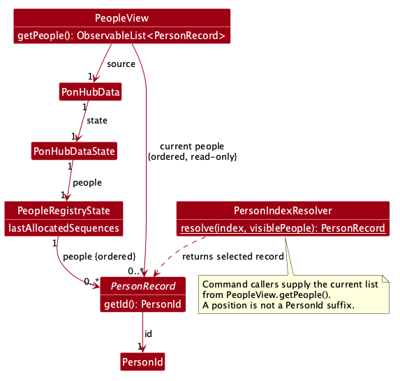](images/PeopleSelectionClassDiagram.png)

The solid arrows show references; the dashed arrow shows the resolver's dependency on the returned record type.
Reverse multiplicities are omitted: immutable snapshots and records can be shared across roots and successive
snapshots. The unconnected note explains how command callers supply the selector's list.
`PeopleView` derives an ordered, read-only list from its `PonHubData` source. Command callers pass that list to
`PersonIndexResolver`; the resolver does not own a second people list. Filtering changes positions in this
projection, while records retain their `PersonId`. The registry snapshot also retains allocation counters after
deletion, so a position can be reused but an allocated ID cannot. The
[UG walkthrough](UserGuide.html#people-positions-and-stable-ids) demonstrates both changes with executable commands.
The diagram omits contact fields, lesson/attendance references and transaction staging; their existing contracts
above still apply. This is the current add/list/delete runtime.

See [command integration](#current-increment-and-command-integration) for the active runtime and
[application startup](#canonical-application-startup-85) for how it connects to the people panel.

<a id="prepared-canonical-people-session"></a>

### Canonical people session

`CanonicalPeopleSession` loads the configured path once through `ProtectedPonHubDataStorage` and owns one
private `PonHubData` root. Its `PeopleView`, `CanonicalCommandExecutor` and lifetime `LessonQueries` component
share that root. Callers receive immutable data snapshots and the same unmodifiable observable people list;
the session does not expose writable operational data. Execute on the single model thread, or the JavaFX
application thread once controls are attached.

The session parses and dispatches commands through the
[shared routing definitions](#current-increment-and-command-integration) before staged execution. Changed data is saved through the
protected writer before publication, stable-ID success feedback or person-view changes. Parse, domain and save
failures leave
the original data, allocation counters and complete visible filter/list unchanged.
Read-only commands perform no operational saves. `CanonicalCommandExecutor` owns the exact IO and
permission-error messages and retains the original exception cause. `Logic` exposes canonical people,
lesson and history views directly; its inherited `Person` getter and compatibility-only defaults are removed.

A confirmed missing file starts an unwritten empty store. A rejected file produces a protected empty view,
with its original bytes preserved and recovery guidance retained. Only `help`, `list` and `exit` are available
in that session; mutation and unknown routes reject before argument parsing. Help advertises the permitted
routes, and list feedback includes the load error so the empty view cannot be mistaken for saved records.
External repair or removal does not unlock that session; recovery requires a new session after deliberate
repair or selection of a separate supported path.

`CanonicalPeopleSessionTest` exercises the real protected loader, router, staged commands and snapshot writer.
Component tests alone do not establish native UI/card or platform acceptance. `MainApp` now constructs
this session and its Logic adapter, and `MainWindow` observes the session's people view. Record actual
packaged save/restart/failure and platform evidence using the procedures below.

<a id="role-filtered-people-listing-foundation"></a>
<a id="prepared-person-record-cards"></a>

<a id="prepared-people-view-and-cards"></a>

### Canonical people view and cards

[`PeopleView`](https://github.com/AY2627S1-CS2103T-F13-3/tp/blob/master/src/main/java/ponhub/model/PeopleView.java)
derives the people projection from one supplied `PonHubData` root and owns the selected role filter. It retains
one unmodifiable observable
list for both command selection and `PersonRecordListPanel`, preserving global relative order. The people projection's owner explicitly refreshes after committed replacement or rollback, on the JavaFX
application thread when controls are attached. Refresh retains the selected role; parse list arguments before
changing it. A successful addition's reset to all roles belongs to the transaction above.

`PeopleListParser` accepts empty arguments or one `r/student|tutor|parent` value, with case-insensitive
role names, and rejects malformed arguments without
changing any view.

`PersonRecordCardData` separates the name, explicitly labelled command position and role/stable ID. Its
immutable caption/value groups order Student fields as education, own contacts, parent phone and address;
Tutor/Parent cards omit the Student-specific groups. Absent contacts show `Not provided`; display case and phone
zeros are retained. `PersonRecordCard` renders each group with each caption above its wrapping value, with matching relationship
context below the own fields. FXML imposes no fixed card height. The `.person-record-card` CSS scope distinguishes
names, metadata, captions and values without changing Lesson/history styling or the list selection behavior.
`PersonRecordListPanel` fits cards to cell width, updates positions when cells are reused, and supplies count,
empty placeholder and vertical scrolling for tall cards. `PeopleView.resultContextProperty()` supplies the
current all-people, role-list or normalized search scope through Logic. The panel retains that heading and
filter-reset guidance independently of command feedback. The heading's ScrollPane remains bounded to 64
logical pixels. Scoped scrollbar arrow padding and thumb insets keep the thumb paintable even at the
24-pixel minimum, without allocating more space at the expense of the people list. Its focus-traversable
property binds to content height exceeding viewport height, so Tab and
Shift+Tab can reach overflowing criteria while short headings add no stop. The existing ScrollPane keyboard
behavior handles arrows, Page Up/Down and Home/End. Accessible text follows the complete heading, and the
visible hint identifies the keyboard route when it overflows. A reserved one-pixel border turns orange on
focus without changing wrapping or viewport size. Scope changes reset scroll to the top; resize updates the
overflow binding. Neither projection nor panel owns writable records.

Each present contact detail carries an explicit copyable flag; missing values and the education level do not.
`PersonRecordCard` adds a standard, focusable **Copy** button with a contact/person accessible name.
Button activation and its platform copy shortcut write only the exact displayed value to the system clipboard.
The action holds the immutable detail and never executes a command, changes list selection or touches the
command field. Mouse press/release activates the button without moving focus, preserving the command field's
caret and selection; keyboard traversal retains normal button focus. Rebuilding a recycled card also rebuilds
its actions from the current record. Presence comes from the contact's optional value, so a real address equal
to `Not provided` remains copyable.

`MainWindow` constructs these canonical cards over the session's current list. Developer preview recipes
and earlier viewport results are preserved in [#77](https://github.com/AY2627S1-CS2103T-F13-3/tp/issues/77);
actual application/platform display evidence belongs to [manual testing](#planned-people-card-display-checks).

<a id="prepared-canonical-people-sample-checks"></a>

### Representative canonical people samples

[`PeopleSampleDataUtil`](https://github.com/AY2627S1-CS2103T-F13-3/tp/blob/master/src/test/java/ponhub/testutil/PeopleSampleDataUtil.java)
creates a fresh independent registry in deterministic order `T1, S1, P1, S2, T2, S3`, using normal addition rules.
It supports representative acceptance work without duplicating validation or allocation logic.

| Records | Purpose |
| --- | --- |
| `S1`, `S2`, `P1` | Siblings share parent phone `00987654`, matching Pat Tan's own phone; optional Student contacts are absent/present. |
| `T1`, `T2` | Both tutors are Mei Lim with distinct phones; one omits email/address, exercising name/phone disambiguation. |
| `S1`, `S3` | Same-name Alex Tan students with different parent phones remain distinct. |

Phone zeros and email case are preserved. These samples are dormant and contain no lessons, enrolments,
attendance or file format. [#101](https://github.com/AY2627S1-CS2103T-F13-3/tp/issues/101) preserves the developer
fixture recipes and tracks full-product samples and acceptance after runtime integration.

### Search criteria parsing
{: id="search-criteria-parsing-foundation"}

[`SearchCriteriaParser`](https://github.com/AY2627S1-CS2103T-F13-3/tp/blob/master/src/main/java/ponhub/logic/parser/SearchCriteriaParser.java)
parses the arguments
after `search` into immutable `SearchCriteria`. It produces a value object, not a `Command`; the canonical session
routes validated criteria to people or lesson retrieval. `SearchField` owns category compatibility and field matching, while
the canonical query layer combines fields against records and relationships. Parsing never writes operational data.

Command boundaries accept Unicode horizontal space separators (`Character.SPACE_SEPARATOR`), including
U+2003, U+00A0 and U+202F, wherever their grammar already allows ordinary spaces. The session and logging
command-word patterns both use `UNICODE_CHARACTER_CLASS`; `StringUtil.stripUnicodeBoundarySpaces` trims
outer horizontal separators while retaining trailing controls for each route's validation. The existing
`ParserUtil.stripUnicodeBoundaryWhitespace` is reused for validated value boundaries. Search prefix
recognition now uses the same Unicode character class as add/edit and attendance extraction, and search
values use the shared boundary helper before field-specific validation. No interior Unicode-space replacement
or new quoting/slash grammar is introduced.

The boundary audit covers add/edit, lesson add/edit, search, list, lessons, membership, attendance, history,
showlesson, lesson deletion, person deletion, help and exit. Fixed-selector grammars accept Unicode space
separators in the positions previously accepting ordinary spaces; they do not gain extra optional positions
inside IDs or prefixes. Existing command-specific tab rules remain. Search, history and showlesson reject
all `\R` line breaks before trimming; mutations retain their existing control rejection. Regression tests
exercise command routing, exact/fragment filters, current-index mapping, unknown/repeated prefixes,
name/address interior rejection, no-op edits, saved-byte preservation and reload through disposable sessions.

#### Supported criteria

The required category is `c/student`, `c/parent`, `c/tutor` or `c/lesson`, ignoring category-value case. Category-only
input is valid. Prefixes are lowercase, order-independent and unique within a command. The supported matrix is:

| Prefix | Field | Student | Parent | Tutor | Lesson | Matching |
|--------|-------|---------|--------|-------|--------|----------|
| `n/` | Result person's name | Yes | Yes | Yes | — | Partial text |
| `l/` | Student education level | Yes | — | — | — | Exact level |
| `p/` | Result person's own phone | Yes | Yes | Yes | — | Exact digits |
| `pp/` | Student's parent phone | Yes | — | — | — | Exact digits |
| `e/` | Email address | Yes | Yes | Yes | — | Partial text |
| `a/` | Postal address | Yes | Yes | Yes | — | Partial text |
| `sn/` | Associated student's name | — | Yes | Yes | Yes | Partial text |
| `d/` | Lesson weekday | Yes | Yes | Yes | Yes | Exact weekday |
| `st/` | Lesson start time | Yes | Yes | Yes | Yes | Exact HHMM |
| `et/` | Lesson end time | Yes | Yes | Yes | Yes | Exact HHMM |
| `from/`, `to/` | Paired Lesson time window | — | — | — | Yes | Positive interval overlap |
| `s/` | Lesson subject | Yes | Yes | Yes | Yes | Partial text |
| `tu/` | Lesson tutor's name | Yes | Yes | — | Yes | Partial text |
| `tp/` | Lesson tutor's phone | — | — | — | Yes | Exact digits |
| `rm/` | Lesson room | Yes | Yes | Yes | Yes | Partial text |
| `sort/` | Lesson presentation order | — | — | — | Yes | `creation` or `schedule` |

Text query values are trimmed, have repeated spaces collapsed, and are case-normalized with `Locale.ROOT`. Filters
use case-insensitive substring matching; fragments need not form a complete valid field value. Thus `n/al` matches
`Sally Tan` and `s/Math` matches `Add Math`. This agrees with canonical name and address normalization.
Lesson creation selects a tutor by normalized **full** name and optional exact phone; search `tu/` matches a tutor
name **fragment**, while tutor-category own-name search uses `n/`.

Phone filters require 3–15 ASCII digits, retain leading zeros and match the complete number. Levels accept only
`P1`–`P6`, `S1`–`S5`, `JC1` and `JC2`, normalized to uppercase. Weekdays accept only `Mon`, `Tue`, `Wed`, `Thu`, `Fri`,
`Sat` and `Sun`, normalized to lowercase. Times require four digits from `0000` to `2359`, with valid minutes.
Start or end may be supplied independently; when both are present, end must be later than start on the same day.
Lesson-only `from/` and `to/` must be supplied together with `from < to` on one day. They select positive
overlap; a Lesson merely touching either endpoint does not match. Exact `st/` and `et/` remain conjunctive.

An omitted filter imposes no restriction; a supplied filter never matches an absent optional field. A person with no
relationships still qualifies for own-field-only search. All supplied relational filters must refer to the same
linked student or lesson: a parent cannot take `sn/` from one child and `s/` from another, and a student cannot take
`d/` from one enrolled lesson and `s/` from another. Tutor `sn/` and lesson fields must match one assigned lesson.
Lesson `sn/` checks its current roster, so former members do not match; without `sn/`, empty lessons remain eligible.
Every result is distinct by stable ID, including a valid zero-result list. People and default Lesson results
retain canonical order; optional Lesson-only `sort/schedule` selects weekday/start-time/numeric-ID order.
`sort/creation` or omitting the option restores canonical order for that request.

#### Errors and integration boundary

Invalid category, prefix, value, duplicate filter or incompatible time range fails parsing with clear feedback; an
unsupported prefix cannot be absorbed into the preceding text value. The criteria parser validates the entire matrix
but does not traverse relationships. `CanonicalPeopleSession` routes lesson search to `LessonRetrieval` and
people search to `CanonicalSearchCommand.execute(data, view)`, which publishes only validated read-only results.
Read-only searches reuse the session's indexes without allocating a staged aggregate or invoking the writer.
All agreed Student, Parent and Tutor relationship fields are active according to the criteria matrix.

`PersonContactSearch` matches the `n/l/p/pp/e/a` own-field subset. `PersonRelationshipSearch` separates these from
Student lesson fields and runs one indexed `LessonQueries.searchLessons` request over the complete catalogue.
Every condition applies to the same lesson before its current roster is intersected with eligible Student IDs.
A stable-ID context map deduplicates results; the final people list retains creation order. Attendance never
supplies current membership. `PersonSearchResult` defensively copies results and context lists, and immutable
`PersonSearchMatch` entries hold associated records without becoming another writable relationship graph.

`PeopleView` shares the session's lifetime `LessonQueries`. Staged mutation views have their own staged query
source, preserving failed-save isolation. `setSearchCriteria` validates the entire result before publishing
criteria, context and people; `refresh` derives them from the resulting canonical state. Transactions retain the
complete criteria across membership changes. `Logic.personSearchContextProperty()` exposes an immutable map
through a read-only property. `PersonRecordListPanel` refreshes contextual cards when that property changes, even
when the eligible person IDs are unchanged. Wrapping context labels show stable IDs, schedule, tutor and room.
Listing and successful person addition clear search context; failed commands preserve the previous projection.

Exact search values reuse `Phone`, `EducationLevel`, `LessonDay` and `LessonTime` conversion. `SearchField`
retains search-specific errors and canonical keys (phone digits with leading zeros, uppercase levels,
lowercase weekdays and four-digit times). Text fragments bypass complete-field constructors.
`SearchCategory.getPersonRole()` explicitly maps the three people categories and returns no role for `LESSON`;
both own-contact matching and `PeopleView` use it after rejecting lesson criteria through their existing boundaries.

For bounded field lengths, Student relationship search takes `O(P + B + R_B + K)`: own-field filtering reads `P`
people, the existing exact bucket bounds lesson candidates to `B`, current roster links cost `R_B`, and `K`
counts emitted people/context entries. Index construction occurs on root publication, not per read-only query.
A scan testing every lesson separately for every student would repeat those checks across the people catalogue.

#### Student relationship search checks
{: id="student-relationship-search-checks-94"}

Use two enrolled lessons with opposite subject/day combinations and a third Student without enrolments.
`search c/student d/Mon s/Math` must reject a Student whose Math is Tuesday and Science is Monday. Combine all
own and lesson fields on one positive match, including absent optional contacts, exact phones and Unicode subject
fragments. Shared lessons produce one card per Student ID with only matching lesson context. Own-field-only
searches include the unassigned Student. Exercise enrol/unenrol, failed saves, retry and reload with the search
active; results and context refresh only on successful publication. Verify valid zero results and unchanged
operational bytes/counters for every search, and that lesson-result filters/selection stay independent.
The backend tests compare 1,000 seeded conjunctions with an independent scan of raw records; command-box tests
verify context additions/removals even when the matching person list is unchanged.

#### Parent relationship search
{: id="parent-relationship-search-95"}

`LessonQueries` builds an exact parent-phone bucket of immutable Students alongside its other indexes on root
publication. `getStudentsByParentPhone(Phone)` returns a read-only snapshot in people creation order; leading zeros
remain significant. This derives links rather than storing Parent IDs or inferring relationships from names.

`PersonRelationshipSearch` first applies Parent own fields, then reuses matching child/lesson context per distinct
eligible phone. A linked child must satisfy `sn/`, and every lesson condition must match one current enrolment of
that same child. The lesson predicate deliberately excludes `sn/` until the child is fixed, preventing another
roster member or sibling from supplying the name. Name-only child queries do not scan lessons and can include
unassigned children. Lesson predicates use the existing exact bucket and Student-to-Lesson index. Context shows
one Parent result with matching child IDs/names and lesson details; a shared number can link multiple Parent records.

For bounded fields the query cost is `O(P + B + C + E + K)`, where `C` and `E` count children and their enrolment
links across distinct eligible phone buckets, and `K` counts emitted context. Own-only searches remain `O(P)`;
`sn/`-only queries omit the lesson-candidate term. The phone index adds `O(P)` derived storage and refresh work.

UC-02/manual checks: contrast phones `00987654` and `0987654`, identical Parent names with different numbers,
Parents sharing a number, unlinked Parents and children with no lessons. Reject a query taking `sn/Alex` from
one sibling and Monday Math from another, or day and subject from separate lessons. Compare 1,000 seeded queries
with a raw nested Student/Lesson scan. Exercise failed publication and successful context refresh with the Parent
projection active; for real enrol/unenrol, switch to Student listing first and repeat the Parent query afterwards.
Verify read-only bytes, invalid-prefix preservation and matching results/context after reload.

#### Tutor relationship search
{: id="tutor-relationship-search-96"}

Tutor own fields are filtered first. One indexed lesson query applies `sn/d/st/et/s/rm` to each candidate before
matching the lesson's stable Tutor ID against eligible Tutors. `sn/` is tested in that lesson's current roster;
matching student details resolve through the existing stable-ID index. Without `sn/`, empty assigned lessons
remain eligible. Different assignments never combine predicates, and same-name Tutors remain distinct by ID.
The result/context map emits one Tutor card with matching lesson/student context. The query cost is
`O(P + B + R_B + K)` for bounded fields, with no additional writable associations.

UC-02/manual checks: use same-name Tutors with different phones and assignments; contrast empty rosters,
Tutors with no lessons, and an Alex roster in one lesson versus Monday Science in another. Combine exact
times, subject and room fragments on a positive match; reject `tu/` for Tutor results and use `n/` instead.
Compare 1,000 seeded queries against an independent raw assignment/roster scan. Exercise failed publication,
enrol/unenrol and reload; only current membership supplies `sn/`. Verify immutable/read-only results and
wrapping context labels for multiple matching roster Students without duplicate Tutor cards.

### Dated attendance records

[`Attendance`](https://github.com/AY2627S1-CS2103T-F13-3/tp/blob/master/src/main/java/ponhub/model/attendance/Attendance.java)
is an immutable dated record stored separately from Students, Lessons and current membership. Its
[`AttendanceKey`](https://github.com/AY2627S1-CS2103T-F13-3/tp/blob/master/src/main/java/ponhub/model/attendance/AttendanceKey.java)
is exactly one Student ID, one Lesson ID and one `LocalDate`; whole-root validation permits at most one record for
that key. The only stored statuses are `present` and `absent`. No key means **unrecorded**, not absent, so there is no
stored `unrecorded` status.

Dates use strict real-calendar `YYYY-MM-DD` values and must fall on the recurring Lesson's weekday. Creating a key
requires current enrolment. Unenrolment then changes only the Lesson roster: the dated record remains, can be
corrected with `mark`, and can be removed with `unmark`. Correcting to the stored status and unmarking a missing key
are no-ops; unmark never changes membership. A retained key continues to guard both its Student and Lesson from
deletion until explicitly removed. Exact value-object and mutation behavior is defined by the linked sources and
the canonical
[`PonHubData`](https://github.com/AY2627S1-CS2103T-F13-3/tp/blob/master/src/main/java/ponhub/model/PonHubData.java)
API; selectors and cross-component invariants remain in the [shared contract](#shared-lesson-target-contract).
The active `history` route reads retained entries without changing operational data.

The marking command compares new or changed `present` outcomes with the current local date using the session's
injected `Clock`. It requires `ack/future` for future presence, after normal model validation and before the staged
transaction can be saved or published. Future `absent` outcomes and identical stored-status no-ops remain available
without acknowledgement; the model can still load and retain valid future records.

### Future undo/redo and archiving

No undo, redo, archive or restore route is registered. Failed-command rollback is already delivered
through [transactions](#command-transactions); it is separate from user-requested undo. A future
undo/archive design must preserve the [shared reference and identity rules](#shared-lesson-target-contract),
including attendance history and non-reuse of committed IDs. Inherited `VersionedAddressBook`/undo
examples do not describe an implemented PonHub feature.

--------------------------------------------------------------------------------------------------------------------

## **Documentation, logging, testing, dev-ops**

* [Documentation guide](Documentation.html)
* [Testing guide](Testing.html)
* [Logging guide](Logging.html)
* [DevOps guide](DevOps.html)

--------------------------------------------------------------------------------------------------------------------

## **Appendix: Requirements**

### Product scope

**Target user profile**: Tuition centre administrative staff who maintain student, tutor and parent records and coordinate lessons and attendance.

* **Usage context**: During enrolment, timetable planning and daily lesson administration, staff need to find contacts, allocate tutors and rooms, record attendance, and follow up on absences and lesson changes.
* **User characteristics**: Staff understand tuition operations and work repeatedly with names, contact details, student levels and lesson schedules. They need quick record retrieval, clear feedback on invalid changes, and command examples while learning the application.
* **Current problems**: Keeping contact details, schedules and attendance consistent requires repeated checking. Staff need to avoid tutor or room clashes, find the right parent contact promptly, and identify missed lessons that need follow-up.

**Value proposition**: For tuition centre administrative staff who need to keep people, lessons and attendance organised, PonHub provides a single place to manage and search these records, with scheduling checks and attendance tracking to support reliable daily administration.

Compared with maintaining separate contact lists, timetables and attendance records, PonHub connects the information needed for routine tasks and checks conflicting or invalid changes. Person and Lesson edits support correcting records while retaining their identities and history.

**Shared lessons and attendance:** Lessons are created independently of student enrolment, including lessons with empty rosters. Each shared `Lesson` owns its currently enrolled student IDs; student lessons, rosters, and tutor schedules are retrieved from that canonical membership rather than copied into each student. Attendance is a separate dated record for one student and one lesson. Unenrolment removes current membership and retains attendance history; an existing historical entry can still be corrected or removed. A missing attendance entry means unrecorded, distinct from present and absent.

The [shared-lesson contract](#shared-lesson-target-contract) explains the current ownership and selector rules;
the [editing contract](#v14-editing-contract) explains identity and history preservation during changes.
Use the [UG command summary](UserGuide.html#current-command-summary) for the supported operations and syntax.
The stories below retain future needs, including capacity, make-up booking and waiting lists, alongside
implemented requirements.

### User stories

These stories describe user goals. **High** prioritises the core shared-lesson product, **Medium** useful
extensions, and **Low** longer-term consideration. Priority does not establish implementation status.

The High-priority workflows are available through the [current commands](UserGuide.html#current-command-summary).
Most Medium and Low stories remain future proposals. US-33 is partly delivered:
[Tab completes command names](UserGuide.html#completing-command-names-with-tab), while argument/value completion,
inline input guidance and spelling suggestions remain future work. Existing `help` guidance is covered by US-13.
Combined goals such as name sorting plus level filtering (US-22) are not fully delivered merely because one part
is available. Shared lessons, current membership and retained dated attendance remain separate concepts, as
defined in the [shared-lesson contract](#shared-lesson-target-contract).

| ID | Priority | As a … | I want to … | So that I can … |
| --- | --- | --- | --- | --- |
| US-01 | High | tuition centre administrator | add students with their level and parent contact number | keep student records and contact a parent when needed. |
| US-02 | High | tuition centre administrator | add tutors with their contact details | maintain the information needed for lesson allocation and communication. |
| US-03 | High | tuition centre administrator | keep optional separate parent contact records | find parent details independently of a student's record. |
| US-04 | High | tuition centre administrator | list all people or only students, parents or tutors | review the relevant records quickly. |
| US-05 | High | tuition centre administrator | search student, parent and tutor records by identifying details and find parents or tutors associated with a student or lesson | retrieve the right contact information promptly. |
| US-06 | High | tuition centre administrator | filter relevant student and lesson records by tutor, subject or lesson day | find the records needed for a specific teaching session. |
| US-07 | High | tuition centre administrator | remove obsolete person records while preventing removal of records still referenced by lessons or attendance | keep the records tidy without breaking existing links. |
| US-08 | High | tuition centre administrator | create a shared recurring lesson independently of student enrolment, with its day, time, subject, tutor and room | prepare teaching slots before students join them. |
| US-09 | High | tuition centre administrator | have shared lessons that overlap existing tutor or room bookings rejected while allowing adjacent time slots | avoid double-booking teaching resources. |
| US-10 | High | tuition centre administrator | remove an unneeded shared lesson only when its roster is empty and it has no linked attendance records | keep the schedule current without breaking membership or history links. |
| US-11 | High | tuition centre administrator | mark an enrolled student present or absent for a particular shared lesson and date | keep each student's attendance independent for the same lesson occurrence. |
| US-12 | High | tuition centre administrator | correct or remove an existing dated attendance entry even after the student leaves the lesson | fix recording mistakes while preserving the lesson and remaining history. |
| US-13 | High | tuition centre administrator | view available commands with their syntax and examples | learn how to complete tasks and recover from command mistakes. |
| US-14 | High | tuition centre administrator | have successful changes saved and available when I reopen PonHub | continue my work without re-entering records. |
| US-15 | High | tuition centre administrator | have attempts to add an exact duplicate person record rejected | avoid storing the same record twice. |
| US-16 | High | tuition centre administrator | retrieve a tutor's weekly timetable from the canonical shared lessons | tell the tutor which lessons they are assigned to teach without counting a shared lesson more than once. |
| US-17 | High | tuition centre administrator | view the current roster of a shared lesson | see which students are currently enrolled, separately from their dated attendance. |
| US-18 | High | tuition centre administrator | enrol a student in a shared lesson or remove their enrolment while preventing duplicate membership and student timetable clashes | keep current membership valid without erasing attendance history. |
| US-19 | Medium | tuition centre administrator | reserve a one-off place in a suitable class for a student who missed a lesson | arrange a make-up lesson without changing the student's regular schedule. |
| US-20 | High | tuition centre administrator | enrol several students in the same existing shared lesson | manage one teaching slot and its roster without duplicating the lesson or its tutor and room bookings. |
| US-21 | Medium | tuition centre administrator | identify students who missed a lesson | follow up with parents and decide whether make-up arrangements or fee adjustments are needed. |
| US-22 | Medium | tuition centre administrator | sort students by name and filter or group them by level | review the relevant records in a clear order. |
| US-23 | Medium | tuition centre administrator | archive withdrawn students, hide them from the default active list and restore them when needed | keep the active list manageable while retaining past records. |
| US-24 | Medium | tuition centre administrator | maintain a waiting list for a full class | offer newly available places in the order students joined the list. |
| US-25 | Medium | tuition centre administrator | track pending class-swap requests | follow up on outstanding transfers. |
| US-26 | Medium | tuition centre administrator | record lesson feedback from students or parents | follow up on reported concerns. |
| US-27 | Medium | tuition centre administrator | assign a replacement tutor for one lesson occurrence | cover a tutor's absence while retaining the regular tutor for other lessons. |
| US-28 | Medium | tuition centre administrator | cancel one lesson occurrence without deleting its recurring schedule | handle a holiday or closure without rebuilding future lessons. |
| US-29 | Medium | tuition centre administrator | export a class list with student names, class details and contact information | share or print the information needed by tutors. |
| US-30 | Medium | tuition centre administrator | review possible duplicate student matches before saving a new record | avoid duplicate records that are similar but not identical. |
| US-31 | Medium | tuition centre administrator | undo my last change | recover from an accidental edit or deletion. |
| US-32 | Medium | tuition centre administrator | use additional command shortcuts or aliases | complete frequent tasks with less typing. |
| US-33 | Medium | tuition centre administrator | receive command completion, inline input guidance and suggestions for misspelled commands | enter valid commands more easily. |
| US-34 | Medium | tuition centre administrator | record names, contact numbers and education levels beyond the MVP formats | represent a wider range of people accurately. |
| US-35 | Medium | tuition centre administrator | preview the person or lesson affected by a deletion | check its consequences before removing it. |
| US-36 | Medium | tuition centre administrator | reuse recurring lesson templates | assign similar lessons without re-entering the same details. |
| US-37 | High | tuition centre administrator | edit an existing lesson directly | update its details without deleting and recreating it. |
| US-38 | Medium | tuition centre administrator | combine alternative search conditions and exclude unwanted matches | express more complex searches. |
| US-39 | Medium | tuition centre administrator | receive spelling suggestions, relevance ordering and highlighted search matches | identify the intended records more easily. |
| US-40 | Medium | tuition centre administrator | save and reuse searches | repeat common lookups without entering every filter again. |
| US-41 | Medium | tuition centre administrator | use a guided advanced-search form and filter completion | construct valid searches without recalling every prefix. |
| US-42 | Medium | tuition centre administrator | browse a long command-help catalogue in manageable pages | read all available help within the application. |
| US-43 | Medium | tuition centre administrator | record late or excused attendance and notes explaining absences | distinguish different attendance circumstances. |
| US-44 | Medium | tuition centre administrator | mark attendance for an entire class in one operation | process attendance efficiently. |
| US-45 | Medium | tuition centre administrator | mark attendance using clickable controls | record attendance without remembering command syntax. |
| US-46 | Medium | tuition centre administrator | view attendance percentage summaries | identify patterns that need follow-up. |
| US-47 | Medium | tuition centre administrator | see today's scheduled lessons automatically | start daily attendance work quickly. |
| US-48 | Medium | tuition centre administrator | start a make-up booking directly from a recorded absence | connect follow-up arrangements to the missed lesson. |
| US-49 | Low | tuition centre administrator | track tuition fees and adjustments associated with student attendance | follow up on payments and fee changes when needed. |
| US-50 | Medium | tuition centre administrator | set a class capacity and check its remaining places before enrolment or make-up booking | decide whether another student can be accommodated. |
| US-51 | High | tuition centre administrator | retrieve a student's dated attendance history, optionally for one lesson, after unenrolment as well as during membership | follow up on past attendance without relying on the current roster. |
| US-52 | High | tuition centre administrator | distinguish an unrecorded lesson occurrence from a present or absent attendance entry | identify attendance that still needs to be recorded. |
| US-53 | High | tuition centre administrator | retrieve the canonical lesson catalogue, including shared lessons with empty rosters, and a student's currently enrolled lessons | discover available teaching slots and review each student's current schedule. |
| US-54 | High | tuition centre administrator | use stable person and lesson identities unchanged by filtering and restart, with deleted IDs never reused | keep record references reliable as displayed lists change. |
| US-55 | High | tuition centre administrator | edit an existing student, tutor or parent while retaining their role, stable identity and linked records | correct their details without deleting and recreating the person. |

### Use cases

For the use cases below, the **System** is `PonHub` and the **Actor** is the tuition centre administrator. The main scenarios and extensions describe delivered interactions; proposals appear only under **Future extensions**. Each successful main scenario ends after its final step.

The [UG command summary](UserGuide.html#current-command-summary) and [selector rules](UserGuide.html#selecting-people-and-lessons) provide exact syntax and selection details. The [active routes](#current-increment-and-command-integration) describe session availability; mutation cases assume changes are allowed. If saving fails, PonHub reports the failure and retains the previous records and views in the current session. The administrator follows the [unsuccessful-save recovery procedure](UserGuide.html#checking-unsuccessful-saves-in-the-current-build) before retrying or restarting; this does not guarantee an unchanged stored file after every kind of save failure.

#### UC-01: Add a person record

**Related user stories:** US-01, US-02, US-03, US-14, US-15, US-30, US-34

**Preconditions:** The administrator knows the person's role and contact details.

**Main success scenario**

1. The administrator requests a new person record, supplying the role and required details.
1. PonHub saves the person, reports success and shows the updated people list.

**Extensions**

* 1a. Required details are missing, invalid, repeated or unsupported: PonHub explains the problem without adding a person. The administrator may correct the request at step 1.
* 1b. A duplicate exists: PonHub rejects the addition without changing records, and the use case ends.
* 2a. Saving fails: the shared save-failure outcome above applies, and the use case ends.

**Postconditions:** On success, one valid, non-duplicate person is stored and visible. Existing records remain unchanged. An unsuccessful request adds no person.

**Command reference:** [Adding a person](UserGuide.html#1-adding-a-person-add), including duplicate rules.

**Future extensions:** Previewing possible duplicate matches and broader contact formats remain proposals (US-30 and US-34).

#### UC-02: Find and review operational records

**Related user stories:** US-04, US-05, US-06, US-16, US-17, US-51, US-52

**Preconditions:** PonHub is running with the requested retrieval operation available.

**Main success scenario**

1. The administrator requests people or shared lessons, optionally narrowing the request by relevant criteria or asking for one student's current lessons.
1. PonHub displays the matching records and their count. The lesson catalogue includes lessons with no students.
1. The administrator requests details of a chosen lesson, optionally for a particular date.
1. PonHub shows its details and current roster. Requested dated attendance distinguishes unrecorded attendance from present and absent; retained former-member records appear separately.

**Extensions**

* 1a. Criteria are invalid or incompatible, or the selected student is unavailable or has the wrong role: PonHub explains the problem and keeps the previous results. The administrator may revise the request at step 1.
* 2a. No records match: PonHub shows an empty result and zero count, and the use case ends.
* 2b. The administrator needs only the displayed records: the use case ends.
* 3a. The lesson is unavailable, or the supplied date is invalid or on another weekday: PonHub explains the problem and keeps the previous results. The administrator may revise the request at step 3.

**Postconditions:** The requested records are available for review, or feedback explains why retrieval failed. Stored records remain unchanged. Reviewing lessons preserves the current people list and selection. Attendance-history retrieval is covered by [UC-05](#uc-05-record-correct-or-retrieve-dated-attendance).

**Command references:** [Listing people](UserGuide.html#2-listing-people-list), [searching](UserGuide.html#6-searching-people-and-shared-lessons), [listing lessons](UserGuide.html#listing-and-searching-shared-lessons) and [lesson details](UserGuide.html#lesson-details). The [indexed query design](#indexed-lesson-query-projections-80) explains matching and retrieval mechanics.

**Future extensions:** Sorting/grouping, guided search, spelling suggestions, export and saved searches remain proposals (US-22, US-29 and US-38 to US-41).

#### UC-03: Create or delete an independent shared lesson

**Related user stories:** US-08, US-09, US-10, US-20

**Preconditions:** The intended tutor exists. Creating a lesson does not require any students.

**Main success scenario**

1. The administrator requests a new shared lesson, supplying its schedule, subject, tutor and room.
1. PonHub saves the lesson with an empty roster and confirms its lesson ID. The lesson is available for enrolment.

**Extensions**

* 1a. The administrator requests removal of an existing lesson instead: PonHub saves removal of the unreferenced lesson, confirms success and releases its tutor and room times. The use case ends. If the request is invalid, the lesson is unavailable, or it has enrolled students or retained attendance, PonHub explains the problem and removes nothing. A save failure has the shared outcome above. Linked students and attendance are never removed automatically.
* 1b. Details are missing or invalid, or no tutor matches: PonHub explains the problem without changing the schedule. The administrator may revise the request at step 1.
* 1c. Several tutors match: PonHub asks for the intended tutor's phone number. The administrator may supply it in a revised request at step 1.
* 1d. The proposed slot overlaps another booking for the tutor or room: PonHub identifies the conflict and rejects the addition. The administrator may choose another slot at step 1; adjacent slots are allowed.
* 2a. Saving fails: the shared save-failure outcome above applies, and the use case ends.

**Postconditions:** On success, one clash-free lesson with an empty roster is stored, or one unreferenced lesson is removed. Other lessons and identities remain unchanged. An unsuccessful request leaves the current session's schedule unchanged.

**Command reference:** [Creating and deleting shared lessons](UserGuide.html#4-creating-shared-lessons-and-other-lesson-operations), including tutor matching and deletion guards. [Lesson editing](UserGuide.html#editing-a-shared-lesson-editlesson) is also delivered under US-37.

**Future extensions:** Templates, one-occurrence tutor replacement/cancellation and automatic today views remain proposals (US-27, US-28, US-36 and US-47).

#### UC-04: Enrol or unenrol a student in a shared lesson

**Related user stories:** US-17, US-18

**Preconditions:** The student and shared lesson exist. The administrator has identified the intended student in the current people list.

**Main success scenario**

1. The administrator requests enrolment of the student in the chosen lesson.
1. PonHub saves the enrolment and confirms success. The student's current lessons and the lesson's roster reflect the new membership.

**Extensions**

* 1a. The administrator requests unenrolment instead: PonHub saves removal of the current membership and confirms success; the student, lesson and dated attendance remain available. If the student is not enrolled, PonHub rejects the request without changing records. A save failure has the shared outcome above. The use case ends.
* 1b. The request is invalid, the selected person is unavailable or is not a student, or the lesson is unavailable: PonHub explains the problem without changing records. The administrator may revise the request at step 1.
* 1c. The student is already enrolled or has an overlapping lesson: PonHub rejects enrolment and explains the problem. The administrator may choose another lesson at step 1.
* 2a. Saving fails: the shared save-failure outcome above applies, and the use case ends.

**Postconditions:** On success, membership reflects the request. Attendance history is retained, and the shared lesson is not duplicated. An unsuccessful request changes no membership in the current session. Active people-search criteria and the relative order of surviving matches are retained, but relationship-search results and displayed positions may change. The administrator rechecks the current list before selecting another person.

**Command reference:** [Enrolling and unenrolling students](UserGuide.html#5-enrolling-and-unenrolling-students).

**Future extensions:** Capacity limits, remaining places, waiting lists, swaps and one-off make-up reservations remain proposals (US-19, US-24, US-25, US-48 and US-50).

#### UC-05: Record, correct or retrieve dated attendance

**Related user stories:** US-11, US-12, US-14, US-21

**Preconditions:** The student exists and has been identified in the current people list. Recording, removing or filtering attendance by a lesson requires that lesson to exist. A new entry requires current enrolment.

**Main success scenario**

1. The administrator requests that the student be marked present or absent for a lesson on a particular date.
1. PonHub saves the dated attendance and confirms the status. Other students' attendance and other dates remain unchanged.

**Extensions**

* 1a. The administrator requests removal of a dated entry instead: PonHub saves removal of that entry and confirms success. The occurrence becomes unrecorded; membership and other attendance remain unchanged. Removal is available after unenrolment. An invalid student, lesson or date is rejected without changing attendance. If no entry exists, PonHub reports no change. A save failure has the shared outcome above. The use case ends.
* 1b. The administrator requests attendance history instead, optionally for one lesson: PonHub shows retained dated entries, including former enrolments. With no entries, it shows an empty result; missing entries do not count as absences. An invalid request, unavailable student/lesson or wrong person role produces feedback and preserves the previous results. The use case ends without changing records.
* 1c. The mark request is invalid, the person is unavailable or has the wrong role, the lesson/date/status is invalid, the date is on another weekday, or a new entry has no current enrolment: PonHub explains the problem without changing attendance. The administrator may revise the request at step 1.
* 1d. Attendance already exists: a different status corrects that entry at step 2, including after unenrolment. The same status produces a no-change message and ends the use case without saving.
* 1e. A new or changed future `present` outcome lacks explicit acknowledgement: PonHub warns about the date and
  changes nothing. The administrator may acknowledge intentional future presence and repeat the request at step 1.
  Future absence needs no acknowledgement, and acknowledging presence bypasses no other validation.
* 2a. Saving fails: the shared save-failure outcome above applies, and the use case ends.

**Postconditions:** On success, the occurrence has one recorded status, or its entry has been removed. History can be reviewed independently of current membership. Failed requests and no-change outcomes preserve attendance and views. Retained attendance continues to prevent student or lesson deletion. The people list is preserved.

**Command reference:** [Recording attendance and retrieving history](UserGuide.html#7-recording-attendance-and-retrieving-history).

**Future extensions:** Feedback, late/excused statuses, notes, bulk/clickable attendance, percentages, make-up links and fee adjustments remain proposals (US-26, US-43 to US-46, US-48 and US-49).

#### UC-06: Delete an unreferenced person

**Related user stories:** US-07

**Preconditions:** The administrator has identified the intended person in the current people list.

**Main success scenario**

1. The administrator requests removal of the person.
1. PonHub identifies the resolved person and requests confirmation without changing records.
1. The administrator confirms the intended person.
1. PonHub rechecks eligibility, saves the deletion, reports success and shows the updated people list.

**Extensions**

* 1a. The request is invalid or the person is unavailable: PonHub explains the problem and changes nothing. The administrator may revise the request at step 1.
* 1b. The student has current enrolments or retained attendance, or the tutor has assigned lessons: PonHub identifies the dependency and rejects deletion. Linked records are not removed automatically, and the use case ends.
* 3a. The administrator cancels, starts another operation or restarts PonHub: the pending removal is discarded without deletion, and the use case ends. A new removal request replaces the pending target.
* 4a. The target is no longer eligible: PonHub rejects deletion without changing records, and the use case ends.
* 4b. Saving fails: the shared save-failure outcome above applies. Retrying requires a fresh request and confirmation, and the use case ends.

**Postconditions:** On success, only the eligible person is removed; surviving identities and relationships remain intact. Deleting a separate parent does not erase students' stored parent phone numbers. An unsuccessful request removes no person from the current session. The administrator checks the updated list before choosing another person.

**Command reference:** [Deleting a person](UserGuide.html#3-deleting-a-person-delete).

**Future extensions:** Student archiving/restoration and undo remain proposals (US-23 and US-31).

#### UC-07: Get help and recover from a command-entry error

**Related user stories:** US-13, US-32, US-33, US-42

**Preconditions:** PonHub is running and command help is available.

**Main success scenario**

1. The administrator requests available-command guidance or help for one command.
1. PonHub displays the command catalogue or the chosen command's syntax and examples.
1. The administrator prepares a complete command using the guidance and submits it.
1. PonHub carries out the requested operation and displays its result.

**Extensions**

* 1a. The requested help topic is unknown or unavailable: PonHub identifies the topic and directs the administrator to the available-command catalogue. The administrator may revise the help request at step 1.
* 1b. More than one help topic is supplied: PonHub reports an invalid format and shows help usage. The administrator may request a single topic at step 1; no topic is executed.
* 2a. The administrator needs only guidance: records and selection remain unchanged, and the use case ends.
* 2b. The guidance exceeds the visible area: the administrator reads the remaining guidance before continuing at step 3.
* 3a. The administrator requests command-name completion while preparing the request: PonHub completes or cycles through available matching names. The administrator supplies the remaining details and resumes at step 3; completion does not submit the command. With no match, the draft stays unchanged.
* 3b. The submitted command is unknown or has missing or invalid parameters: PonHub explains the error and keeps the failed draft available for correction. The administrator may correct and resubmit at step 3.
* 4a. A domain rule or save failure prevents the operation: PonHub reports the failure without showing the requested change in the current session. The relevant use case and save-recovery guidance above apply, and this use case ends.

**Postconditions:** Guidance is available, or the operation has completed with clear feedback. An unsuccessful command leaves its draft available for correction. Help leaves records and selection unchanged.

**Command references:** [Command help](UserGuide.html#viewing-command-help-help), including equivalent menu/F1 requests, and [Tab command-name completion](UserGuide.html#completing-command-names-with-tab), delivered in [#315](https://github.com/AY2627S1-CS2103T-F13-3/tp/issues/315).

**Future extensions:** Additional aliases, argument/value completion, misspelling suggestions and paged help remain proposals under US-32, US-33 and US-42. Delivered command-name completion does not complete those stories in full.


### Non-Functional Requirements

1.  Should work on Windows, Linux and macOS using Java `25`. On macOS, use the course-prescribed Azul JDK 25 with JavaFX (`25.0.3.fx-zulu`), as described in [Setting up and getting started](SettingUp.html#setting-up-the-project-on-your-computer).
2.  Should be able to hold at least 1,000 persons, 1,000 recurring lessons, and 10,000 attendance records in one local data file.
3.  Team performance target: with the data volume in NFR 2, common command-to-GUI-update operations should complete
    within 2 seconds on the reference machine: an Apple M4 Pro MacBook Pro with 24 GB RAM, macOS 15.7.7
    and the prescribed Azul Java/JavaFX 25.0.3 runtime. Scope performance claims to the measured workload and
    environment; command-to-GUI measurements alone do not establish packaged-JAR, cross-platform, cold-start
    or physical-display performance. See [performance evidence](https://github.com/AY2627S1-CS2103T-F13-3/tp/issues/101#issuecomment-6194333977).
4.  A user with above average typing speed for regular English text (i.e. not code or system administration commands) should be able to accomplish most recurring tasks faster using commands than using the mouse.
5.  The product should be for a single user and use one local data store, without requiring user accounts, concurrent access, or live synchronisation.
6.  The product should be packaged into a single executable `.jar` file and should not require an installer.
7.  The product file size should remain below 100 MB to ensure efficient storage and distribution.
8.  The GUI should display correctly and without layout issues on screen resolutions of 1920×1080 and higher at 100% and 125% scale.
9.  The GUI should remain usable (i.e. all functions remain accessible even if the layout is suboptimal) at screen resolutions of 1280×720 and higher at 150% scale.
10. All operational data must be stored locally in a human-readable text file without using a database management system.
11. All successful operational changes must be saved automatically before they are published to live memory. Failed
    validation or saving must leave live in-memory data unchanged. If non-atomic fallback replacement of an existing
    file fails, the previous complete data must remain either at the destination after automatic recovery or in the
    recovery backup identified by the error. First-save recovery, concurrent external file changes, multiple
    application instances and power loss remain limited as described in [Safe JSON saves](#safe-json-saves).
12. All person, lesson, and attendance data must remain on the user's computer and must never be transmitted over the internet.
13. The application should function offline without requiring an internet connection or a team-owned remote server.
14. Invalid inputs must not crash the application or modify existing data. The application should display a specific error message explaining how the user can correct the input.
15. The application should be implemented primarily using object-oriented programming, with clear separation between the UI, Logic, Model, and Storage components.
16. Team testing target: the JUnit-based automated test suite should achieve at least 70% line coverage, and all automated tests should pass before a release. The percentage is the team's own goal, not a course-mandated minimum; coverage does not replace behavior-focused regression and integration checks.

### Glossary

* **Mainstream OS**: Windows, Linux, Unix, or macOS
* **AddressBook-Level3 (AB3)**: The upstream SE-EDU desktop application that is incrementally evolved into PonHub
* **Person record**: A stored Student, Tutor, or Parent record referencing one stable Person ID and one Contact Details value, plus fields required for that role
* **Contact details**: One required name with optional phone, email, and address values referenced by a Person record
* **Role**: The `student`, `tutor`, or `parent` category assigned to a person record, which determines its required fields and applicable operations
* **Lesson catalogue**: The ordered collection of independent shared Lesson records held by the canonical data aggregate
* **Shared recurring lesson**: An independent weekly teaching slot with a stable Lesson ID, day, start/end time, subject, one Tutor ID, and room; its roster may contain zero or more Student IDs, and each Student may belong to zero or more Lessons
* **Lesson occurrence**: One dated instance of a recurring lesson
* **Attendance record**: A dated history record containing the attendance status of one Student for one Lesson occurrence, stored separately from current enrolment
* **Attendance status**: The recorded state of a student for a lesson occurrence, such as `present` or `absent`
* **Attendance key**: The combination of one stable Student ID, one stable Lesson ID, and one date that uniquely identifies an Attendance record
* **Exact duplicate person**: A person record with the same role, normalised name, and identifying contact number as an existing record
* **Displayed person index**: The positive one-based position in the current filtered people list used to select a person in a command; it is distinct from a stable ID and may change when that people view is filtered or reordered. Lesson, roster and history row positions do not supply person command indices
* **Stable person ID**: The role-prefixed identity stored for a person and used in internal lookup, queries, relationships and persistence; commands resolve a displayed person index once to this identity
* **Stable lesson ID**: The `L`-prefixed identity of a shared Lesson, persisted and used in attendance references; existing lessons are selected in commands with `lid/LESSON_ID` using that single canonical identity
* **Tutor lookup**: Lesson creation resolves a normalized full tutor name and optional exact phone to one Tutor ID; search uses partial tutor-name text instead
* **Prefix**: A short marker in a command that identifies the type of information represented by the following value
* **Parser**: The Logic component that converts raw command text into validated parameters and a command object
* **Command**: An executable request representing one user operation in PonHub
* **Referential integrity**: The rule that prevents a record from being removed while another lesson or attendance record still refers to it
* **Atomic update**: A live-state change published only after its complete candidate is reported saved; if saving
  fails, no candidate is published, while stored-file recovery follows [Safe JSON saves](#safe-json-saves)
* **Rollback**: The restoration of the previous valid state after an operation cannot be completed or saved
* **Human-readable data file**: The local text file used to store PonHub data in a form that can be inspected and edited without a database management system
* **Tutor clash**: An overlap between lessons assigned to the same tutor on the same day and during an overlapping time range
* **Room clash**: An overlap between lessons assigned to the same room on the same day and during an overlapping time range
* **Class**: A tuition-centre term for a shared recurring lesson; core membership uses the Lesson-owned roster, while capacity and one-off reservations are deferred proposals rather than core model fields
* **Enrolment**: A Student's current membership in a shared Lesson; removing membership retains dated attendance
* **Roster**: The current enrolled Student IDs owned by one shared Lesson, from which displayed student records are derived
* **History**: Retained dated attendance keyed by Student ID, Lesson ID and date, independent of current membership
* **Capacity (proposal)**: A proposed limit on the number of students in a class; it is not a field in the core model
* **Make-up booking (proposal)**: A proposed one-off reservation in a suitable class for a student who missed a regular lesson, without changing regular membership
* **Waiting list (proposal)**: A proposed ordered queue of students requesting a place in a class that has reached a capacity limit
* **Class-swap request (proposal)**: A proposed pending request to move a student when a transfer cannot be completed immediately
* **Archived student (proposal)**: A proposed withdrawn-student state retained for historical reference but hidden from the default active-student list

--------------------------------------------------------------------------------------------------------------------

## **Appendix: Instructions for manual testing**

Use Java 25 and the [runtime prerequisites](SettingUp.html#setting-up-the-project-on-your-computer) for these checks. On macOS, use the course-prescribed Azul JDK 25 with JavaFX (`25.0.3.fx-zulu`) for the Mac's architecture. Confirm the terminal used for `java -jar` selects that installation and record the OS, architecture and JDK distribution/version with the test results. Additional macOS trials with other distributions, including plain Oracle JDK, are optional portability checks.

<!-- @@author ErnestChuaa -->
### Common selector and failure journey

Use this journey for shared selector, rejection and persistence checks; retain the feature-specific cases below.
The [shared contract](#shared-lesson-target-contract) defines identity, while
[command transactions](#command-transactions) and [safe JSON saves](#safe-json-saves) define publication and recovery.

1. In a fresh disposable JAR folder, record source/tag, JAR size, SHA-256 and manifest, OS/architecture,
   Java distribution/version and selected data path. Follow steps 1–3 of the
   [active shared-lesson workflow](#active-shared-lesson-and-attendance-workflow): two Tutors, Alex `S1`,
   Jamie `S2`, `L1`–`L3` and the stated enrolments. Do not reuse a populated store for these expected IDs.
2. Run `list`. Alex and Jamie must occupy positions **3 and 4**, with stable IDs **S1 and S2**.
   Run `lessons`, then `history 4 lid/L1`; both leave those people positions intact.
   Lesson and history row numbers never supply person selectors.
3. Run `list r/student`, then `search c/student n/Jamie`. Jamie `S2` is now position **1**.
   Run `mark 1 lid/L1 d/2026-10-05 s/present`, then `history 1 lid/L1`.
   The record belongs to **S2**, not S1. Run `lessons`, then `showlesson lid/L1 d/2026-10-05`;
   the Jamie people search/order remains in place while the requested result view changes.
4. Record the snapshot, saved bytes, people filter/order/selection and selected result context.
   Reject `history 0`, `history 2` (outside this one-person view), `history S2`, `lessons sid/S2`,
   `showlesson lid/L999` and `mark 1 lid/L1 d/2026-10-06 s/present` (Tuesday).
   Each rejection preserves that state and context. Run `list r/tutor`, then reject `history 1`
   to check a valid position with the wrong role. Restore `search c/student n/Jamie` before continuing.
5. Retain the original data and follow the [UG unsuccessful-save procedure](UserGuide.html#checking-unsuccessful-saves-in-the-current-build)
   in this disposable store. With the destination unwritable, attempt the otherwise valid correction
   `mark 1 lid/L1 d/2026-10-05 s/absent`. Expect save-error feedback, no success and unchanged live
   attendance, people view and result context. Restore access and retry once: exactly one S2/L1/date key
   changes to `absent`. Preparation/backup failures preserve the old destination; replacement/restoration
   failures require the named-backup recovery instructions. Do not assume saved bytes are unchanged for
   every failure. An injected failing writer establishes developer-seam behavior, not native filesystem evidence.
6. Restart the same JAR and verify equivalent saved operational state: stable IDs, memberships, attendance
   and next-ID counters. Session filters/selection are not operational persistence requirements.
   In a separate malformed disposable store, follow [canonical loading and recovery](#canonical-loading-and-recovery):
   help/list/exit work, mutation/retrieval routes are blocked, rejected bytes remain intact, and recovery
   requires correcting/restoring the file and restarting.

All-role/empty-role ordering, add allocation/reset/retry, guarded deletion, role-specific fields and protected-load
details remain in their [people procedures](#person-index-integration-checks) and
[save checks](#canonical-people-commands-and-unsuccessful-saves). Keep same-child/same-lesson search semantics,
observable query identity, former-member history and feature-specific edit cases in their respective sections.

### Common window and layout checks

Copy this matrix into the test result, recording one outcome per actual display trial. It is an unexecuted
template, not a report of current acceptance. Keep unavailable combinations **NOT RUN**, with the reason;
record observed defects as **FAIL**. Logical viewport simulations and automated FXML bounds checks supplement
physical display/scaling trials. They do not certify another platform or scale.

| OS | Physical display | Scale | Result / evidence |
| --- | --- | --- | --- |
| Windows | 1280×720 | 150% | NOT RUN |
| Windows | 1920×1080 | 100% | NOT RUN |
| Windows | 1920×1080 | 125% | NOT RUN |
| Linux | 1280×720 | 150% | NOT RUN |
| Linux | 1920×1080 | 100% | NOT RUN |
| Linux | 1920×1080 | 125% | NOT RUN |
| macOS | 1280×720 | 150% | NOT RUN |
| macOS | 1920×1080 | 100% | NOT RUN |
| macOS | 1920×1080 | 125% | NOT RUN |

For each executed row, retain the source/JAR identity from the [common journey](#common-selector-and-failure-journey),
OS version/architecture, Java distribution/version, observed display/work-area dimensions, logical window
dimensions and output scale, actual results and screenshot/transcript links. Record additional available
configurations separately; do not relabel them as one of the rows above. Use only disposable fictitious fixtures.

1. Launch inside the usable work area, resize to the minimum window, widen it, then narrow it again.
   Menus, viewing controls, feedback, command entry and both lists remain reachable.
   Drag each divider with the pointer; check wrapping and usable panel widths after each drag.
2. Use all person roles, absent optional contacts, leading-zero phones and long valid names/email/addresses.
   Use the long-contact example in [compact windows](#compact-windows-and-active-contact-cards).
   Scroll the people list and result pane independently to the final record and the bottom of a tall card;
   full values must remain reachable without card horizontal overflow. Run `help add` and reach its final example.
3. Inspect empty and large Lesson rosters, dated detail, history and former-member records. Keep their
   distinct field/membership/status checks in [Lesson cards](#lesson-cards-and-result-navigation-320-371)
   and [attendance history](#active-student-attendance-history-checks-100).
4. Select a visible person and refresh/filter the list. Verify current positions, counts and empty placeholders,
   correct recycled-card content and selection by stable ID; hiding the selected person clears selection.
   A deliberate people search/filter may change that view. Do not require it to preserve the old results.
5. Type an unfinished draft, exercise each viewing control with valid/no/wrong-role selection, then open help
   through the menu and F1. Verify the draft and the action's promised people filter/order/selection;
   successful viewing selects its requested result, while a rejected viewing action preserves the prior result.
   Follow [navigation cases](#lesson-cards-and-result-navigation-320-371) for exact feedback and protected-mode behavior.
6. Hover over the live context and summary headings after changing results. Inspect the complete current tooltip
   text and its wrapping, with no lost draft or inaccessible controls. Compare operational bytes before/after
   these read-only actions. Retain [window placement/restart cases](#compact-windows-and-active-contact-cards),
   [preference recovery](#preference-recovery-checks) and [completion cases](#command-name-completion) separately.

### Person editing

In a fresh disposable store, follow the [UG quick start](UserGuide.html#quick-start) through the first
`history 1 lid/L1` command, stopping before `unmark` so Alex's former-member history remains.
Then add `add r/parent n/Pat Tan p/91234567`. These are manual acceptance steps; the automated tests
named above do not certify native display/scaling acceptance.

1. Run `list r/student`, select Alex's card, then `edit 1 l/P2 p/ e/ a/`. Expect `Edited student: Alex Tan (S1).`,
   level P2, empty optional contacts, the same selected ID and Student filter. Run `edit 1 n/Alex  Tan`;
   expect `No changes to student: Alex Tan (S1).` and no data-file write. `edit 1 n/ALEX TAN` changes display case.
2. Reject `edit 1`, `edit S1 n/Alex`, `edit 0 n/Alex`, an out-of-range position, `edit 1 n/`, `edit 1 pp/`,
   `edit 1 p/abc`, `edit 1 r/tutor`, `edit 1 n/Alex n/Alex` and `edit 1 a/Block x/value`.
   Verify unchanged file bytes, cards, selected ID and current people mapping after each rejection.
3. Reject `edit 1 n/Jamie Tan pp/91234567` as a true duplicate. Use `list r/tutor`, then reject
   `edit 1 p/`, `edit 1 l/P2` and `edit 1 pp/91234567`. Repeat required-phone and Student-only guards on Parents.
4. With `list r/tutor`, run `showlesson lid/L1 d/2026-10-05`, then `edit 1 n/Corrected Tutor`.
   Expect the same Lesson/Tutor IDs and date, current tutor label, roster and retained former-member attendance.
5. Run `search c/parent sn/Alex`, then `edit 1 p/90000000`. Pat leaves the retained search result; the
   Student's stored parent phone remains unchanged. The success feedback lists `P1 / S1` as a removed link
   (and any other linked Students in this fixture). Run `list r/student`, then `edit 1 pp/90000000` and
   repeat the Parent search: Pat links to Alex again without a removal warning. Run `list r/student`,
   then `edit 1 pp/91234567`: expect `P1 / S1` in the warning, and repeat the Parent search to verify no
   matching Parent. Restore both phones; an unchanged
   phone, a name-only edit and a previously unlinked phone change must not warn. No additional Parent
   is created or edited implicitly.
6. Run `list r/student`, `history 1 lid/L1`, then `search c/student n/Alex`. Select Alex and run
   `edit 1 n/Changed Student`. Expect Alex to leave the people search and selection to clear, while
   the right pane keeps Student S1's retained history. Recheck positions before another indexed command.
7. Repeat the save/retry/reload part of the [common journey](#common-selector-and-failure-journey) with a valid
   Person edit. Also check cards, selected ID, detail/history mode and allocations before retrying;
   verify the edited fields and stable relationships after restart.
8. Start with rejected disposable data: `edit 1 n/Alex` is blocked before parsing, `help edit` is unavailable,
   and original bytes remain untouched. Recovery still requires correcting/restoring the file and restarting.
<!-- @@author -->

<!-- @@author ys000009 -->
### Lesson editing

Use a disposable store and complete the fixture setup in step 1 of the
[common selector and failure journey](#common-selector-and-failure-journey). This creates `L1`, `L2` and `L3`,
with Alex and Jamie enrolled in `L1`. Record Monday attendance for both Students before the history checks.
Use the same common journey for generic selector, rejection, save, retry and reload expectations; the steps below
retain only the Lesson-specific field, scheduling, Tutor and history behavior.

1. Run `editlesson lid/L1 st/1630 s/Advanced Math`. Expect `Edited lesson: L1.` followed by the retained-attendance
   warning and guidance to create a new Lesson for future-only changes. The ID, roster, Tutor, room, end time
   and recorded dates/statuses stay unchanged. Open the recorded date with `showlesson`: expect the changed
   subject/time and a **Current Lesson information** note. Restart and verify the same data and note. A changed
   Lesson without attendance has ordinary success feedback; an identical edit has no warning or write.
2. Run a valid edit with only `st/`, then one with only `et/`. Reject an endpoint that makes start equal to or
   later than end. Run an identical normalized edit and expect `No changes to lesson: L1.` with unchanged bytes.
3. Add two Tutors with the same normalized full name but different phones. Reject `tu/NAME` as ambiguous; select
   one with `tu/NAME tp/PHONE`. Reject `tp/` without `tu/` and an exact phone that belongs to no matching Tutor.
4. Attempt edits that overlap another Lesson for the replacement Tutor, room and one enrolled Student. Expect the
   relevant stable IDs in the rejection, unchanged current cards/file and no ID allocation. Verify an adjacent
   boundary and the Lesson's unchanged own slot are not treated as overlaps.
5. Run `list r/student`, then `unenrol 2 lid/L1` so Jamie's Monday record becomes former-member attendance while
   Alex's remains current. Reject `editlesson lid/L1 d/Tue`. The message must identify an incompatible date and
   explain that the retained records can be explicitly unmarked; it must not delete, move or relabel history.
   Remove each record with `unmark` only for this test, select
   `showlesson lid/L1 d/2026-10-05`, then retry the Tuesday edit. Expect the Lesson detail to remain selected with
   no date filter or date in its context.
6. Repeat the save, retry and reload part of the
   [common journey](#common-selector-and-failure-journey) with a valid Lesson edit. In addition to the shared
   expectations, verify the old Lesson card, selected detail, roster/history and counters before retrying, then
   verify exactly one persisted replacement after restart. Apply the common journey's stored-file recovery limits;
   do not assume every failed save leaves destination bytes unchanged.
7. In the common journey's rejected-data session, `editlesson lid/L1 s/Math` is blocked before parsing and
   `help editlesson` is unavailable. Original rejected bytes remain unchanged; recovery requires correcting or
   restoring the file and restarting.

For the candidate being assessed, run the focused
`./gradlew test --tests ponhub.logic.CanonicalLessonEditIntegrationTest --no-daemon` check and the executable
Lesson-edit procedure above. Report PASS, FAIL or NOT RUN for the empty/populated, conflict,
roster/detail/history, no-op, invalid-selector, retained-weekday and failed-save cases.
<!-- @@author -->

### Command-name completion

1. Launch the packaged JAR in a fresh writable folder. In the command box type `sho`, press Tab and
   expect `showlesson`, with focus retained and no feedback or data change. Replace it with `ad`, then
   press Tab three times: expect `add`, `addlesson`, `add`. Press Shift+Tab to move focus backwards.
2. Type `sho lid/L1`, adding two leading spaces, a second space between the words and two trailing
   spaces. Put the caret after `sho`, and press Tab. Expect `showlesson lid/L1` with all original spaces
   preserved and the caret after `showlesson`. Move away and back before pressing Tab: a new cycle uses
   the current prefix. Edit back to `ad` and confirm the cycle restarts at `add`.
3. Try blank input, `unknown`, a selection, and Tab after the argument in `help sho`. Expect unchanged
   text and ordinary focus traversal. Return to the box, complete `he`, then press Enter; only Enter
   submits `help`. Trigger a parse failure, correct its command word with Tab and check error recovery.
4. Retain an unfinished draft while using menu/F1 help. Expect draft, people filter and selection to
   survive. Restart with malformed operational data: `h`, `li`, `e` complete to `help`, `list`, `exit`;
   `ad` and `sho` do not complete. Preserve the rejected file and confirm only recovery commands run.

### Optional logo sound

Use the packaged JAR and a disposable store. When testing audible playback, enable a working sound output;
record unavailable or muted output separately rather than claiming that sound was heard.

1. Launch PonHub and verify that no cue plays automatically. Enter `help`, then leave `add r/student n/Alex`
   unfinished in the command box, with part of the draft selected. Note its caret/selection, feedback and views.
2. Primary-click the PonHub wordmark. With functioning audio, expect one short percussion cue. Check that focus,
   the draft and selection, feedback, people/results and operational data remain unchanged. A secondary click
   does not request playback.
3. Click repeatedly during the cue: playback must not layer. Click again after it finishes to replay it, then
   run `help` to check that command entry remains responsive. If audio is unavailable, silence must not prevent
   normal commands; do not require users to install an audio device to use PonHub.
4. Start the cue and close the main window. Expect a clean exit with no continuing playback or extra window.

The [audio resource note](https://github.com/AY2627S1-CS2103T-F13-3/tp/blob/master/src/main/resources/audio/README.md)
records the original procedural cue's provenance. Keep actual platform/audio observations in the test result.
Automated `LogoSoundPlayerTest` and `MainWindowTest` use controlled audio seams; they do not establish audible
playback on a physical device.

### Inline help and supported routes

Use the active catalogue in the tested build; these examples apply to canonical startup.

1. In a fresh JAR folder, run `help`. Expect one short description per supported command in catalogue order
   and a `help COMMAND` instruction with an example, without repeated usage blocks.
   Then run `help add`, `help edit`, `help addlesson`, `help editlesson`, `help enrol`, `help unenrol`, `help mark`,
   `help unmark`, `help history`, `help delete`, `help deletelesson`, `help list`, `help lessons`, `help showlesson`,
   `help search`, `help help` and
   `help exit`. Each topic matches its
   parser and supplies a runnable example; `help exit` keeps
   the app open. Repeat topic/example checks when another route is registered.
2. Add a person using a runnable `help add` example, then select its card, type an unfinished command
   and choose Help from the menu. Repeat F1 from command
   and result focus. Expect identical inline guidance, retained draft/selection and no separate window.
3. `help ADD`, `help EDIT`, `help ADDLESSON`, `help EDITLESSON`, `help ENROL`, `help UNENROL`, `help MARK`, `help UNMARK`, `help DELETE`,
   `help DELETELESSON` and `help SHOWLESSON` match their lowercase topics. `help remove` and
   `help clear` explain the unknown topic and direct users to `help`. `help add delete` reports
   invalid format and help usage.
   Check that `help edit` explains optional email/address/Student-phone clearing and required-field guards;
   `help editlesson` requires nonblank supplied values and `tu/` with `tp/`. In a protected session, both editing
   topics are unavailable, both mutation routes return recovery guidance before parsing, and menu/F1 list only
   help/list/exit while retaining the draft and original rejected bytes.
4. At minimum width, run `help add` and scroll to the final example/back to the top. Text wraps
   readably; a new topic resets scrolling. Record actual display conditions using the
   [people-card/whole-window checks](#planned-people-card-display-checks).
5. `clear` and `find Alex` identify the unknown command and suggest `help` without changing data.
   `edit` and `editlesson` are active canonical routes; verify their guards with the edit checks above.
   `list extra`, an invalid `addlesson`, an invalid `mark`, an invalid `unmark`, `delete S1`,
   `deletelesson 1`, `lessons sid/S1` and `exit extra` show
   validation or usage messages without
   committing data, changing the list or exiting.
6. Compare operational bytes before/after help: unchanged, or still missing in a fresh folder.
   Repeat with unwritable operational storage; preference saving at shutdown remains separate.

Help checks do not establish the
[active shared-lesson and attendance workflow](#active-shared-lesson-and-attendance-workflow)
or final guide/site acceptance ([#102](https://github.com/AY2627S1-CS2103T-F13-3/tp/issues/102)).

### Lesson cards and result navigation (#320, #371)

Use a disposable mixed-role store with two Students, a shared Lesson, an empty-roster Lesson and retained
former-member attendance. The [active shared-lesson workflow](#active-shared-lesson-and-attendance-workflow)
supplies the commands. Record the tested commit, OS, Java version, window size and actual outcomes; these steps
are a manual checklist, not evidence that a display/scaling matrix has passed.

1. From history, enter `lessons`, `lessons STUDENT_INDEX`, a Lesson search, an undated `showlesson` and a dated
   `showlesson` in turn, using valid current indices and IDs. Repeat with a different Student card selected.
   Each typed command selects its own results without a button click or reliance on the selected card. Run a
   people search from Lesson details and verify its matching people/context, then `history STUDENT_INDEX` to
   display that specified Student's history. People positions and stable IDs remain distinct.
2. Select one Student card, type an unfinished command and select part of its text, then click **Student lessons**,
   **Attendance history** and **All lessons**. Expect the same results as `lessons CURRENT_INDEX`,
   `history CURRENT_INDEX` and `lessons`.
   Each click retains the draft, cursor/text selection and people filter/order/selection; **All lessons** needs
   no selection. The visible guidance explains the purpose of selecting a Student card.
3. Clear selection and click each Student shortcut. Repeat with a Tutor and Parent selected, and after a people
   filter or deletion removes the previously selected Student. Expect explanatory feedback, unchanged prior
   results and draft, and no fallback to another person at the old position. Select a visible Student and retry.
4. In a protected session, click **All lessons** and expect the normal protected-command rejection. Click
   **Student lessons** and **Attendance history** in that empty people view and expect guidance that no current
   Student is selected. No button changes results or the draft, writes operational data or bypasses protection; unavailable
   records cannot be selected. `help`, `list` and `exit` remain usable.
5. Inspect catalogue cards, attendance-history cards and both undated and dated `showlesson` details at narrow and
   wide widths. Expect the subject or date as the heading, a distinct identity line, and labelled values for the
   schedule, Tutor, room, enrolment count, attendance status and membership context. Current roster and
   former-member attendance are distinct sections expanded without another click; dated missing records say
   `unrecorded`. Check empty and large rosters, former members, long values and enough records to scroll to the last
   entry. Resize both dividers and verify wrapping without horizontal overflow, independent vertical scrolling and
   reachable navigation, selection guidance, feedback and command entry at normal and minimum window sizes.
6. Check all three active indicators for typed commands and shortcut clicks. Initial catalogue and `lessons`
   activate **All lessons**; `lessons STUDENT_INDEX` activates **Student lessons**; `history STUDENT_INDEX`
   activates **Attendance history**, including empty results. Lesson search, with or without filters, and
   Lesson details activate none. Switch between two Students in the same result mode. Selecting a conflicting
   card, filtering the result Student out of the people list, opening help and committed edits retain the
   displayed result's scope and indicator. Invalid selectors, dates, protected rejection and failed saves retain
   the previous result and indicator. Delete the target of active history and verify the retained Lesson result
   and its indicator return; delete a selected empty Lesson detail and verify it stays an unavailable detail
   with no active shortcut. Compare operational bytes before/after read-only routes: unchanged.

### Compact windows and active contact cards

1. In an isolated working folder, launch the application on a 1280×720 display at 150% scaling and on a 1920×1080 display at 100% and 125%. Record the OS, scaling, Java version and usable desktop work area. The complete window must fit inside that work area; menu actions, command entry, results and the people list must remain reachable. Logical-size previews are useful checks, but do not replace actual platform/scaling results.
2. Resize to the minimum window size. Run `help add` and scroll to the final example. Scroll the people list to its last card. Expect separate usable result and people scrollbars, with the command box and menus still visible.
3. Add role-aware people with a long valid name, postal address and unbroken email using the active syntax, such as `add r/tutor n/Alexandra Catherine Elizabeth Montgomery Wellington p/001234567890123 e/alexandracatherineelizabethmontgomerywellington@example.com a/123 Long Residential Avenue Clementi District Block 456 Unit 12-345 Singapore 123456`. Run `list` followed by `help add` to refresh the cards, then narrow, widen and narrow the window again. Expect full values to wrap within the card without horizontal overflow; scroll vertically to reach the bottom of a tall card and the final person. Canonical add does not accept tags.
4. Submit a people search with enough long filters to overflow its heading, including a valid zero-result
   search. At compact and wide widths, use Tab/Shift+Tab to reach the heading and check its orange focus border
   and visible keyboard hint. Up/Down, Page Up/Down and Home/End must reveal the complete text; Tab and
   Shift+Tab must leave it. Check the mouse wheel and visible scrollbar thumb. From the command box, blank or
   unmatched input must still traverse and a matching command prefix must still complete; Shift+Tab leaves
   matching input. Keep a command draft/caret/selection and selected person, then scroll the heading: records,
   active filters, selection and saved bytes must remain unchanged. Resize a shorter heading until it fits;
   it should leave the traversal route. Run `list`: the heading resets to the top and no longer adds a stop.
5. Close the application and restart with the retained preferences. Valid sizes and coordinates remain unchanged. In the isolated folder, test an oversized saved window, coordinates from a removed monitor and a still-connected monitor to the left or above the primary display. Expect an oversized/offscreen window to fit a current work area, while valid secondary-monitor coordinates remain usable.

Automated bounds regressions cover scaled work areas, desktop bars, removed and secondary monitors, partial overlap and invalid saved dimensions. Actual-FXML layout checks use isolated fixture data; they do not establish Windows or Linux font/scaling behavior. Keep real display results in issue #128.

### Preference recovery checks

Use a disposable application folder containing the packaged JAR and a copied supported
`data/ponhub.json`; retain a copy of the operational file for byte comparison after each check.

1. Close the app, replace `preferences.json` with `null`, and restart. Expect a usable default window
   and a saved default preference object. Repeat with `{"guiSettings":null}` and
   `{"guiSettings":{"windowWidth":null}}`. Operational bytes remain unchanged.
2. Set `preferences.json` to `{}` or
   `{"guiSettings":{"windowWidth":910,"windowHeight":710,"windowCoordinates":null}}`.
   Restart and expect defaults for missing fields or the edited dimensions when the screen fits them.
3. While the app is closed, replace `preferences.json` with a nonempty directory of that name.
   Startup uses defaults despite read/initial-save errors. Help/list/exit remain available, the directory's
   contents remain intact, and closing the app logs the preference-save error without blocking shutdown.
4. Start with a regular preference file. While the app is running, replace that file with a nonempty
   directory. Close the app and compare operational bytes and directory contents with the retained copies.
   Expect no changes. Repeat in a fresh folder with missing operational data; it stays absent.

<a id="planned-person-index-integration-checks"></a>

### Person-index integration checks

Complete the [common selector and failure journey](#common-selector-and-failure-journey) for current-position
versus stable-ID selection, index/range/wrong-role rejection and restart identity/counter checks. Then check
these people-specific differences against the [shared selector contract](#shared-lesson-target-contract).

1. On a mixed-role dataset, run `list`, `list r/student`, `list r/TUTOR` and `list r/parent`.
   Verify global relative order and counts; repeat with no matching records for a successful empty role.
   Reject `list r/`, `list r/all`
   and `list r/student r/parent` without changing the previous view or data.
2. Restore `search c/student n/Jamie` from the common journey: Jamie `S2` is position **1**.
   Subscribe to lesson/roster results, then run `unenrol 1 lid/L1` and `enrol 1 lid/L1`.
   Both act on S2, never S1. Verify the same people list object, filter/order/indices and subscribed query
   objects remain, with their contents refreshed. `lessons 1` follows Jamie's current card and rejects
   superseded `sid/S2` input. Lesson references use `lid/`.
3. Follow the [add/save checks](#canonical-people-commands-and-unsuccessful-saves) for successful-add view reset
   and rejected-add preservation/retry. Apply the current-view selector checks to `delete` for every role;
   retain the linked-record, retained-history and counter cases in
   [guarded person deletion](#active-guarded-person-deletion-91).

<a id="dormant-person-card-developer-preview"></a>

<a id="planned-people-card-display-checks"></a>

### People-card display checks

Perform these checks in the active application and record the platform, build and actual result. Isolated preview
instructions are preserved in [#77](https://github.com/AY2627S1-CS2103T-F13-3/tp/issues/77).

1. Use all roles, absent/present optional contacts, leading-zero phones and long names/email/addresses.
   Verify the prominent name, separate `Position` and `ID` labels, and distinguishable captions/values.
   Students show level, own phone/email, parent phone and address in that order; Tutors/Parents show their
   own contacts and address. Check leading zeros and `Not provided` indicators in selected and unselected cards.
2. On 1280×720 at 150% and 1920×1080 at 100%/125%, resize and scroll through an entire tall card to the
   last record. Complete values must wrap without overlap or hidden content; record the actual platform,
   scaling and build. Logical preview sizes alone do not establish these results.
3. Filter/refresh the list and repeat: current positions, count and empty placeholder update correctly;
   recycled cells show the correct person and stable ID. Select a person, run `list r/student` then `list`,
   and verify selection restoration for a still-visible ID and clearing when hidden. Run `search c/student s/Math`
   on sample data and check that matching relationship context remains complete below the own fields.
   Coordinate whole-window checks with
   [#128](https://github.com/AY2627S1-CS2103T-F13-3/tp/issues/128).
4. Save any clipboard contents you need before testing. Add
   `add r/student n/Copy Test l/P1 pp/00912345 p/00123456 e/Copy.Test@example.com a/12 Main Road`,
   then `list r/student`. Select a different Student and leave an unfinished command with part of its text
   selected. Click each **Copy** button on Copy Test's card and paste into a disposable text editor. Expect
   only the full corresponding value, retaining phone zeros and email case. The selected card, filter/order,
   draft, caret/text selection, feedback and operational file bytes stay unchanged.
5. Use Tab/Shift+Tab to reach the buttons and Space to activate them; also try Ctrl+C on Windows/Linux or
   Cmd+C on macOS while a Copy button is focused. Confirm a visible focus border and a contact/person accessible
   name. Copy selected command and feedback text using their normal shortcuts. Missing optional contacts have
   no Copy button; Tutor/Parent phones remain copyable. Edit a contact, clear an optional contact and filter/scroll
   away and back: actions must copy current values and disappear for cleared values. Restore your clipboard
   after testing. Repeat the layout checks with the buttons visible.

Given below are instructions to test the app manually.

<div markdown="span" class="alert alert-info">:information_source: **Note:** These instructions only provide a starting point for testers to work on;
testers are expected to do more *exploratory* testing.

</div>

### Command recall

1. In a fresh window press Up: expect unchanged empty input. Submit `help`, then `list r/student`.
   Type an unfinished draft and select part of it. Up recalls `list r/student`, then `help`; Down returns
   through the commands and restores the exact draft and selection. Neither arrow executes or saves.
2. Recall a command, edit it and verify Enter executes the edited text once. A failed submission remains
   editable and is also recallable. With a restored `sho` draft, Tab must still complete `showlesson`.
   Modified arrows retain text editing, and navigation keeps focus in the command box.
3. Close and reopen: Up must not recall the previous window's submissions. `CommandBoxTest` covers
   the 50-entry eviction boundary separately. Recheck displayed people positions before rerunning mutations.


<a id="unicode-person-name-checks-383-first-increment"></a>

### Unicode and slash contact checks

In a disposable data folder, add `add r/tutor n/José Santos p/00123456`,
`add r/student n/李明 l/P1 pp/91234567` and `add r/parent n/தமிழ் p/91234567`.
Expect the displayed spellings and IDs `T1`, `S1`, `P1`; restart and check all three persist.
Create `addlesson d/Mon st/0900 et/1000 s/Math tu/JOSÉ SANTOS rm/R1` and check it resolves `T1`.
With the Tutor list selected, `edit 1 n/Anne-Marie O’Neill` must preserve `T1` and the lesson link.
Restore the Tutor to `José Santos`, then edit again with `José` entered as `Jose` plus combining acute accent:
the edit must report no change and the saved name must remain `José Santos`.
A same-role/same-identifying-phone addition using that equivalent spelling must fail.
`Jose` without an accent remains distinct. An extra Tutor with the same name but another phone must
require `tp/` for lesson selection; an incorrect supplied phone must fail.

`CanonicalUnicodeNameIntegrationTest` checks command/JSON reload, no-op/duplicate byte preservation,
allocation counters, existing ASCII data, lesson/roster/attendance stability and invalid-prefix regressions.
`NameTest` checks normalized code-point limits, supplementary letters and unattached marks;
`JsonPonHubDataStorageTest` checks human-edited Unicode and protected malformed/duplicate reloads.
For slash values, add `add r/student n/Ravi s/o Kumar l/P1 pp/91234567 a/Blk 10, #01/02` in a fresh
working copy. Edit that Student to `n/Anita d/o Kumar a/Block A12/34B`, then restart and check the stable ID,
normalized values and links. Create a Tutor named `Ravi s/o Kumar`; use `tu/Ravi s/o Kumar` in both
`addlesson` and `editlesson`, retaining the normal `tp/` disambiguation rules. Reject `n/s/o`,
`n/Ravi s/other Kumar`, `a/A/B`, `a/#01//02` and unknown/repeated prefixes without changing the snapshot.
Search with `n/Anita a/A12`, rather than a full slash value. `CanonicalSlashContactIntegrationTest` covers
these command/JSON, duplicate/no-op, relationship and unchanged-search boundaries.

### Launch and shutdown

Use the artifact/runtime record and disposable-folder setup from the
[common journey](#common-selector-and-failure-journey), substituting the actual JAR filename below.
For geometry, resizing and physical scaling, use the [common layout matrix](#common-window-and-layout-checks)
and retain its per-trial results and unavailable combinations. The cases here check storage locations and lifecycle.

1. Build or obtain the matching `ponhub.jar`, copy it to a disposable empty JAR folder, and launch
   from that folder's terminal with Java 25: `java -jar ponhub.jar`. Expect the canonical GUI and an empty
   people view, with the initial window inside the current desktop work area. Run help/list/exit;
   `data/ponhub.json` remains absent, and preferences may save separately.
2. For successful mutation and reload, use the [common journey](#common-selector-and-failure-journey).
   Verify that the complete snapshot and allocation counters use the selected operational file;
   preferences remain independent of that snapshot.
3. Check saved window placement through [compact windows](#compact-windows-and-active-contact-cards)
   and [preference recovery](#preference-recovery-checks). Select a different missing path with
   `--data=data/another-ponhub.json`; expect an
   empty dataset and the same preference location in the JAR folder, without touching the previous
   operational file. Launch the JAR from another working directory and confirm data/preferences/logs
   still remain in the JAR folder.
4. Repeat with `java -jar ponhub.jar --data="separate store/ponhub.json"`. Confirm the status footer and
   subsequent successful save/reload use that selected path. Keep a legacy `data/addressbook.json` in the
   JAR folder and verify default startup/add/exit leaves its bytes unchanged. Reject blank `--data=`,
   `../outside.json`, an absolute path outside the JAR folder and a symbolic-link escape before any
   operational read/write outside application home.

Automated initialization/shutdown checks do not establish full-window interaction, physical scaling
or packaged JAR-folder anchoring. Record actual results for the procedure above.

### Accidental second-window save protection

Use the [common journey's artifact/runtime record](#common-selector-and-failure-journey) and a disposable
JAR folder. Choose a previously unused path, such as `manual/two-windows.json`; do not use real records.
Record actual feedback, file hashes and restart results separately from these reusable instructions.

1. From two terminals in that same JAR folder, launch two windows **before either window saves**, using
   the identical command `java -jar ponhub.jar --data=manual/two-windows.json` in both terminals.
   Call them A and B. Both should show an empty people list, with no operational file created yet.
2. In A, enter `add r/student n/Alex Tan l/S2 pp/91234567`.
   Expect `New student added: Alex Tan (S1).` and Alex in A's list. Record the selected file's SHA-256:
   `shasum -a 256 manual/two-windows.json` on macOS/Linux, or
   `Get-FileHash manual/two-windows.json -Algorithm SHA256` in PowerShell.
3. In the already-open B, enter `add r/student n/Jamie Tan l/P1 pp/91234568`.
   Expect a save error saying the file changed and this window must restart, with no success feedback.
   B's list stays empty: the rejected command does not publish Jamie or consume a Student ID.
   Recheck the file hash; it must equal the hash after A's save. A must still show Alex.
4. In B, retry the same addition. Expect another rejection and the same file hash. Run `help` and `list`;
   they remain usable, but B's empty list is stale and does not mean Alex was deleted. Exit both windows
   normally with `exit`, then confirm the operational file hash still matches. Leave the empty
   `two-windows.json.ponhub-lock` sidecar in place; its presence after exit is normal.
5. Restart one window with the same command. Expect Alex as `S1` and no Jamie. Enter Jamie's command again;
   expect `New student added: Jamie Tan (S2).` and both Students in the list. Exit and reopen once more
   to confirm both records and IDs persist.
6. Repeat from an existing supported file: load it in both windows before changing either, save a real
   mutation in A, then attempt a different mutation in B. Expect B's rejection to preserve A's saved bytes
   and B's previous live view. Close both and restart before continuing normal work.

If another window is still inside a save, a busy-save error may precede stale-file detection. Wait for that
save to finish and retry; a changed file must then require restart. Do not delete the sidecar, overwrite
the newer file with a stale window's data, or edit files while windows are running. See
[Safe JSON saves](#safe-json-saves) for the safeguard's scope and recovery limits.

### Canonical people commands and unsuccessful saves

Start with the fixture, artifact/runtime record and selector checks in the
[common journey](#common-selector-and-failure-journey). Check the
[role-specific required/optional prefixes](#canonical-people-commands) and
[contact-validation cases](#contact-validation-in-the-current-increment) alongside these add-specific cases.
Use [command transactions](#command-transactions) for publication/no-op rules and
[safe JSON saves](#safe-json-saves) for stored-file recovery.

1. Using that fresh fixture, run `add r/parent n/Pat Tan p/91234567`; retain the two Students' shared
   parent phone and omitted optional contacts. Expect distinct stable IDs, readable role-specific cards
   and global creation order. Run `list r/student`, `list r/TUTOR` and `list r/parent`;
   positions renumber from one while stored IDs and relative order remain unchanged.
   Use [Person-index checks](#person-index-integration-checks) for all-role/empty-role ordering and counts,
   and common journey step 6 for restart identity/counters.
2. Select a Student card after role filtering. Try a duplicate Student with the same normalized name
   and parent phone, a missing required field, unknown/repeated prefixes, and a Tutor with `l/`. Expect
   rejection and unchanged file bytes, records, counters, filter and selection. For Tutor/Parent duplicates,
   use the same normalized name and own `p/` phone instead of the Student's identifying `pp/` phone.
   Reject `list r/all`, `list r/` and two role prefixes without changing the previous view.
   A valid empty role result succeeds.
3. Follow common journey step 5 for the disposable save-failure setup, substituting a valid addition
   for the attendance correction while a people filter and card selection are active. Record the next ID
   before the attempt: failure must not consume it, publish the candidate or reset the view. Records,
   counters, filter and selected card remain unchanged, and no success message is shown.
   After restoring access, retry once: the new record uses that next ID, appears last and resets the people
   view to all roles with refreshed positions. Restart as in step 6 to verify the complete snapshot/counters.
   Preparation/backup failure preserves the old destination. If fallback replacement and restoration both
   fail, recover the named retained backup before continuing or restarting; unchanged live state does not
   imply unchanged destination bytes after every save failure. An injected writer verifies the developer
   seam, not a native filesystem trial.
4. With a selected card, request help from the menu/F1 and through the command box. Expect preserved
   records/filter/selection; menu/F1 additionally retain unfinished text. Use the
   [common layout checks](#common-window-and-layout-checks) for help/draft/selection preservation and the
   [common journey](#common-selector-and-failure-journey) and
   [guarded-delete cases](#active-guarded-person-deletion-91) for malformed selectors.
   Also reject `delete S1` without changing data, filter or selection. Check valid Student, Parent and Tutor
   relationship searches with the [search procedure](#active-own-contact-search-checks):
   they deliberately replace the people view with matching people and Student/Lesson context.

### Active own-contact search checks

1. With mixed roles and unlinked records, run `search c/student`, `search c/tutor` and `search c/parent` after a
   different role listing. Match the full catalogue in creation order, once per stable ID, with positions from 1.
2. Combine all student own-fields: `search c/student n/Alex l/S2 p/00012345 pp/00123456 e/@example a/main road`.
   Check case/repeated-space normalization, exact phones including zeros, absent optional values and zero results.
   Resolve the next person selector against this visible view; its position must not become an ID suffix.
3. Switch between two same-role searches, then `list r/student` and `list`. Each listing clears the search criteria.
   `help search`, Help menu and F1 preserve the filtered view and its people-panel category/criteria heading;
   compare operational bytes before/after read commands. Include two searches with the same result count,
   a zero-match search and long criteria at compact widths. The scrollable heading must retain every filter,
   the reset hint stays visible and the list remains reachable. Role listing replaces the search heading;
   `list` restores `All people`.
4. Run `search c/student d/Mon`; expect `Found N student(s).` and one result per Student enrolled in a Monday
   Lesson, with only matching Lesson context. No matches is a successful `Found 0 student(s).` result.
   Run `search c/parent sn/Alex`; expect `Found N parent(s).` with each Parent linked by exact phone to a
   matching Student, including matching children without Lessons. No matches is a successful
   `Found 0 parent(s).` result. Run `search c/tutor rm/R1`; expect `Found N tutor(s).` and one result per stable Tutor assigned
   to a matching Lesson, including empty rosters, with only matching Lesson context. No matches is a
   successful `Found 0 tutor(s).` result.
   Unknown/repeated/blank/category-incompatible fields fail without replacing the previous people view.
5. Attempt an addition with a failed-save destination while a search is active. Retain data, counters, bytes,
   filter and selected card. Restore access and retry; success saves before resetting to all roles. Reopen the file
   to verify persistence. Search criteria are session view state, not stored operational data.
6. With a compound own-contact search active, create a shared lesson using an existing tutor's full name and
   optional exact phone. Success saves an empty-roster lesson and refreshes lesson queries while preserving the
   complete people search and its indices. Repeat with a failing writer: records, counters, bytes, people search
   and lesson projections stay unchanged. Restore writing and retry; the same next Lesson ID is allocated.

### Active shared-lesson and attendance workflow

The following is one end-to-end procedure for the delivered normal session. `addlesson`, `editlesson`, `enrol`, `unenrol`,
`mark`, `unmark`, `deletelesson`, `lessons`, `showlesson`, `history` and lesson search are active. Use a newly selected file in an isolated JAR folder so the IDs below begin at
`T1`, `S1` and `L1`, for example `java -jar FILENAME.jar --data="manual/lesson-workflow.json"`.

1. Create two Tutors and two Students:

   ```text
   add r/tutor n/Mei Lim p/92345678
   add r/tutor n/Ravi Kumar p/93456789
   add r/student n/Alex Tan l/P1 pp/91234567
   add r/student n/Jamie Tan l/P2 pp/91234567
   ```

2. Create `L1`, then exercise whole-root scheduling. The first two attempted additions must fail for a Tutor and
   room clash respectively. They must consume no ID. The final two additions succeed as `L2` and `L3`: `L2`
   overlaps `L1` but has a different Tutor and room, while `L3` starts exactly when `L1` ends.

   ```text
   addlesson d/Mon st/1600 et/1730 s/Math tu/Mei Lim tp/92345678 rm/R1
   addlesson d/Mon st/1700 et/1800 s/English tu/Mei Lim tp/92345678 rm/R2
   addlesson d/Mon st/1700 et/1800 s/English tu/Ravi Kumar tp/93456789 rm/R1
   addlesson d/Mon st/1630 et/1700 s/Science tu/Ravi Kumar tp/93456789 rm/R2
   addlesson d/Mon st/1730 et/1830 s/English tu/Ravi Kumar tp/93456789 rm/R2
   ```

3. Enter the commands below. Both Students share the one canonical `L1`; its tutor, room and schedule are not
   copied per Student. Alex's attempted `L2` enrolment fails because it overlaps Alex's existing `L1`, while the
   adjacent `L3` enrolment succeeds. The retrieval and search commands must preserve the two Student positions;
   the first search returns only `L1`, and the second returns zero lessons.

   ```text
   list r/student
   enrol 1 lid/L1
   enrol 2 lid/L1
   enrol 1 lid/L2
   enrol 1 lid/L3
   lessons
   lessons 1
   search c/lesson sn/Alex d/Mon s/Math
   search c/lesson sn/Nobody
   ```

   To test time-window boundaries with the Lessons above, `search c/lesson d/Mon from/1700 to/1730`
   returns `L1` only: `L2` ends at 1700 and `L3` starts at 1730. `from/1630 to/1800` returns
   `L1,L2,L3`. Adding `s/Science` leaves `L2`; adding `st/1600` instead leaves `L1`.
   A missing endpoint, equal or reversed endpoints, `2400` or a people-category window must fail without
   replacing either panel or writing data. Valid no-match windows display an empty Lesson panel.

   To check optional ordering, use a fresh store with a Tutor and create Tuesday 1600, Monday 0900 and Monday
   1400 Lessons as `L1`, `L2`, `L3`. `lessons` shows `L1,L2,L3`; `lessons sort/schedule` and
   `search c/lesson tu/Mei sort/schedule` show `L2,L3,L1`. `lessons sort/creation` restores the original
   order. Enrol a Student in two of them and repeat with `lessons STUDENT_INDEX sort/schedule`.
   After narrowing the people list, its positions must remain unchanged by each Lesson-order request.
   An invalid `sort/name` must retain the previous view and stored bytes.

   To check same-named Tutor disambiguation in a separate disposable store, create two `Mei Lim` Tutors
   with phones `0012345` and `93456789`, then give each a non-clashing Lesson using `addlesson`
   with the matching `tp/`. `search c/lesson tu/mei` returns both; adding `tp/0012345` returns
   only the first Tutor's Lesson. `tp/12345` returns none. An invalid `tp/12` must retain the
   previous results, people positions and stored bytes.

4. Record two independent keys for Monday 5 October 2026. Repeating Alex's `present` status is a no-op; changing
   it to `absent` corrects the existing key rather than adding another. Tuesday is rejected because it does not
   match the Lesson weekday. `showlesson` displays both stored statuses for `2026-10-05`; with no `2026-10-12`
   keys, the later Monday displays both current Students as unrecorded, not absent. `history 1 lid/L1`
   shows only Alex's recorded absence for 5 October; the unrecorded later Monday has no history entry.

   ```text
   mark 1 lid/L1 d/2026-10-05 s/present
   mark 2 lid/L1 d/2026-10-05 s/absent
   mark 1 lid/L1 d/2026-10-05 s/present
   mark 1 lid/L1 d/2026-10-05 s/absent
   mark 1 lid/L1 d/2026-10-06 s/present
   showlesson lid/L1 d/2026-10-05
   showlesson lid/L1 d/2026-10-12
   history 1 lid/L1
   ```

5. Remove Alex from both current rosters. Correcting Alex's existing `L1` key still succeeds, while creating the
   new `2026-10-12` key fails because Alex is no longer enrolled in `L1`. The dated detail moves Alex's corrected
   result to the former-member section, `lessons 1` excludes `L1` and `L3`, and `delete 1` remains blocked by
   retained `L1` attendance. Exit, inspect the closed file, restart with the same `--data` path, and continue with
   step 6 to verify that membership and retained history both reload.

   ```text
   list r/student
   unenrol 1 lid/L1
   unenrol 1 lid/L3
   mark 1 lid/L1 d/2026-10-05 s/present
   mark 1 lid/L1 d/2026-10-12 s/present
   showlesson lid/L1 d/2026-10-05
   lessons 1
   delete 1
   exit
   ```

6. After restarting, restore the Student list. The dated detail, empty Alex-specific Lesson result and blocked
   person deletion confirm that membership and retained history reloaded. Remove only Alex's dated key; repeating
   `unmark` is a no-op. `L1` deletion first remains blocked by Jamie's roster. After Jamie is unenrolled, it remains
   blocked by Jamie's attendance. Removing that final key makes deletion succeed. Recreating the same slot must
   receive `L4`, not the deleted `L1`. After exiting, hash the closed operational file as described in step 7.
   Restart once more, run `list r/student` to restore the Student positions, and verify that the catalogue contains
   `L2`, `L3` and empty-roster `L4` in creation order. `search c/lesson s/Math` returns `L4`, and `lessons 1`
   remains empty.

   ```text
   list r/student
   showlesson lid/L1 d/2026-10-05
   lessons 1
   delete 1
   unmark 1 lid/L1 d/2026-10-05
   unmark 1 lid/L1 d/2026-10-05
   deletelesson lid/L1
   unenrol 2 lid/L1
   deletelesson lid/L1
   unmark 2 lid/L1 d/2026-10-05
   deletelesson lid/L1
   addlesson d/Mon st/1600 et/1730 s/Math tu/Mei Lim tp/92345678 rm/R1
   exit
   ```

7. Keep that final restarted, Student-filtered session open. To confirm that retrieval is read-only, run `lessons`,
   `lessons 1`, `search c/lesson s/Math`, `showlesson lid/L4 d/2026-10-05`, `help lessons` and
   `help showlesson`, exit, and compare the closed operational file's hash with the value captured before this
   restart. Preferences are a separate file; the operational bytes must match. From the JAR folder, macOS/Linux
   users can run
   `shasum -a 256 "manual/lesson-workflow.json"` before and after; on Windows, use
   `Get-FileHash "manual/lesson-workflow.json" -Algorithm SHA256` in PowerShell.

8. Save failure is not a user command. Exercise the delivered failure seam from the repository root instead:

   ```bash
   ./gradlew test \
       --tests "ponhub.logic.CanonicalLessonMembershipIntegrationTest.execute_enrolSaveFailureRestoresAllStateAndRetryCommitsOnce" \
       --tests "ponhub.logic.CanonicalAttendanceIntegrationTest.execute_markSaveFailureRestoresStateViewsAndRetryCommits" \
       --tests "ponhub.logic.CanonicalAttendanceIntegrationTest.execute_unmarkSaveFailureRestoresStateViewsAndRetryCommits" \
       --tests "ponhub.logic.CanonicalDeleteLessonIntegrationTest.execute_failedSavePreservesStateCountersAndViewsBeforeSuccessfulRetry" \
       --tests "ponhub.logic.CanonicalLessonRetrievalIntegrationTest.addLesson_saveFailureThenCommitAndReload_refreshOnlyMatchingSelectedResults"
   ```

   Expect all targeted tests to pass. They inject failed writes and verify no staged state, counter or view is
   published, followed by one successful retry and equivalent reload. This developer seam does not claim that an
   administrator can deliberately trigger a save failure through the packaged UI.

### Contact validation in the current increment

Use role-aware commands in a disposable selected data file.

1. Enter `add r/tutor n/  Anne-Marie   O'Neil  p/00123456 e/anne.o'neil%school@example.com a/  Blk 10,   #01-02  `.
   Expect normalized name `Anne-Marie O'Neil` and address `Blk 10, #01-02`, retaining punctuation,
   email and phone zeros. Restart: the saved values remain intact.
   Run `list r/tutor`, then use the tutor's displayed index in `edit INDEX e/Anne.O'Neil@Example.COM`.
   Expect the edited email with its apostrophe and letter case intact after restarting again.
2. Try `add r/tutor n/Test User p/1234567890123456 e/test@example.com a/Blk 10`, then
   `add r/tutor n/Test User p/123 e/test@localhost a/Blk 10`. Expect the relevant phone/email constraints
   and no addition. Likewise reject `n/Test2 User` and `a/Blk 10/Unit 2` in otherwise valid role-aware input.
3. Paste an email consisting of 5,000 `a.` repetitions followed by `a@example.com` into otherwise valid
   add input. Expect email constraints without a crash or saved contact.
4. In separate copies of supported JSON, introduce an invalid contact or same-role records with the
   same identifying phone and names `Alex  Tan`/`Alex Tan`, becoming duplicates after normalization.
   Expect protected startup and original bytes preserved through help/list/exit and attempted mutations.
   Use the [Storage recovery procedure](#current-protected-startup) on a deliberately corrected working copy.

<a id="active-guarded-person-deletion-91"></a>

### Guarded person deletion and confirmation

The session parses a positive people-list index using `ParserUtil`, rejecting non-whitespace ISO control characters
before trimming the selector. `CanonicalPeopleSession` resolves it once through `PersonIndexResolver` and checks
`PonHubData.removePerson` on a disposable snapshot. It retains only the immutable target record for a prompt
showing the name and stable ID; no live model/view changes or writes occur. `delete confirm` consumes that record
and executes `CanonicalDeleteCommand`, which rechecks equality and dependency guards using the stable ID.
Every command consumes the old pending request before parsing, so intervening commands, rejected input,
cancellation and failed saves cannot leave a stale confirmation armed. Confirmation is not persisted.

The aggregate identifies a blocking current enrolment, retained attendance key or assigned lesson before
creating a replacement people registry.
Registry removal and the validated aggregate retain all allocation counters, surviving people order, lessons and
attendance. Parents have no direct lesson/attendance references; their removal preserves Student parent-phone values.
The existing executor saves the complete staged aggregate before publishing the people/query refresh. It preserves
both the role filter and the full own-contact search criteria. Protected startup still disallows deletion and its help topic.

`CanonicalDeleteIntegrationTest` exercises mixed/filtered selectors, all three roles, dependency feedback, actual
enrol/mark/unenrol routes, ID counters after reload, query continuity and failed-save invisibility/retry.
For manual checks, use an isolated supported dataset:

1. Add two Parents and a Student sharing the first Parent's phone. Run `list r/parent`, then `delete 1`.
   Check that the prompt names that Parent and stable ID, with unchanged file, selected card and views.
   Enter `delete cancel` and verify the same state. Repeat `delete 1`, then `delete confirm`: expect the remaining
   Parent at position 1 and the Student's parent phone unchanged. Preview and confirm removal of the remaining
   Parent, restart, add another Parent and verify that its stable ID exceeds both removed IDs.
2. Search for one unreferenced Student by name, with a stable ID suffix different from position 1. Run `delete 1`,
   check the target, then `delete confirm`: only that Student disappears; the search stays active and becomes empty.
   Surviving IDs and ordering remain intact. In a separate preview, run `list`, `help` or invalid input before
   `delete confirm`: expect no pending confirmation and no deletion. A fresh preview can then be confirmed.
3. Create a Lesson, enrol a Student, and attempt to delete the Student or its Tutor using current people positions.
   Expect feedback naming the blocking Lesson and unchanged file/view. Unenrol the Student without marking attendance:
   Student preview and confirmed deletion now succeed, while the Tutor remains blocked by the empty Lesson.
4. In a separate dataset, enrol, mark and unenrol a Student. Deletion must remain blocked by retained attendance;
   feedback names the Lesson and date. Restart and verify that the same guard remains. An unassigned Tutor is deletable.
5. Reject `delete`, `delete S1`, `delete 0`, `delete -1`, extra arguments and out-of-range positions without changes.
   `CanonicalDeleteIntegrationTest` also sends actual NUL, backspace and escape characters at both boundaries and
   inside selectors, verifying zero saves and unchanged bytes, snapshots, search filters and displayed positions.
   Use an isolated unwritable storage seam, preview and confirm deletion, and verify unchanged file, people
   filter/positions and query results. A repeated `delete confirm` must not write. Restore writing, preview again
   and confirm: commit only once, then restart and compare the complete saved state.

Use the active `unmark` route to remove the retained Attendance dependency before retrying Student deletion.
Use the active `deletelesson` route to remove the empty Lesson before retrying Tutor deletion.

### Future attendance acknowledgement

Use the shared-lesson workflow's disposable dataset while Alex is enrolled in Monday Lesson `L1`, then run
`list r/student` and verify Alex's current position. With a Monday after the computer's current local date
(for example `2036-10-06` while that date remains in the future), check these outcomes:

1. Enter `mark 1 lid/L1 d/2036-10-06 s/present`: expect a warning naming the supplied date and today, with
   unchanged saved bytes and attendance. Repeat with `s/absent`: expect one saved future absence.
2. Try to change that absence to `present` without acknowledgement: expect the warning and the absence retained.
   Repeat with `ack/future`: expect one corrected present entry. Repeat the identical present command without
   acknowledgement: expect no change, with unchanged saved bytes and no duplicate history entry.
3. Add `ack/future` to a wrong-weekday date or a new key for an unenrolled Student: expect the original validation
   rejection and unchanged data. Invalid or repeated `ack/` values must also be rejected.

### Active shared-lesson details and dated attendance (#99)

`ShowLessonParser` accepts one `lid/LESSON_ID` and an optional `d/YYYY-MM-DD` in either order, rejecting missing,
repeated, unknown and blank fields and invalid calendar dates.
`LessonRetrieval.show` looks up the stable Lesson independently of the current lesson filter and rejects a date
whose weekday differs from that Lesson's recurrence before replacing any result. It constructs one immutable
`LessonDetailView` from the committed root: current roster Students remain in people creation order, and absent
dated records have an empty status that the card labels `unrecorded`. Attendance for Students outside the current
roster appears in a separate former-member section, newest date first. Without a date, that section shows all
retained former-member records; with a date, it shows records for that occurrence only. No missing record becomes
an `absent` entry.

The selected detail is a separate result source in `LessonRetrieval`. A complete canonical publication rebuilds
it after enrolment, unenrolment, marking, correction, removal or restoration. A staged failure publishes nothing,
so the previous detail and people view remain unchanged. If `deletelesson` removes the selected unreferenced
Lesson, its result becomes empty and the context identifies the unavailable stable ID. `lessons` and lesson
search switch back to their own sources. The normal lesson ListView remains for catalogue results; the detail
uses a dedicated width-fitting virtualized list and wrapping labels for long rosters/history. Its row focus
supports keyboard scrolling and never selects a person-command target. No roster row number is used as a
person-command selector.

UC-02/manual checks: show a shared Monday Lesson with two current Students, one recorded present and one
unrecorded, then mark the second absent. Unenrol that Student and verify the dated absence moves to the labelled
former-member section while the current roster shrinks. Correct or remove the retained entry through active
`mark` and `unmark` commands and verify immediate refresh; repeat after restart. Reject malformed IDs/dates, a Tuesday
date for a Monday Lesson, and an unknown ID while preserving the prior detail and operational bytes. Inspect an
empty roster and many retained records at narrow window widths and scroll to the last row. Read-only detail
retrieval preserves the current people results and positions, while membership changes re-evaluate relationship
criteria. For example, with Alex and Jamie at positions 1 and 2 in
`search c/student d/Mon s/Math`, unenrolling Alex from their only matching Lesson leaves Jamie at position 1.
To correct or remove Alex's retained attendance when Alex no longer matches that search, run `list r/student`
or search by Alex's own name again. Recheck the displayed list before the next person command; it must resolve
the current position to the intended stable Student ID. Protected startup exposes no `showlesson` route.

### Active Student attendance history checks (#100)

For both result panels, `ResultHeadingTooltip` binds a wrapping, width-limited tooltip to each context
and summary label. It follows the displayed text through query and committed-result changes without
expanding the heading. At compact and normal sizes, hover over all four labels after long Lesson
searches, Student/dated Lesson selection, history/count changes and `help`; verify complete current
text and preserved list space and command drafts. Record native/scaling checks separately from the
automated tooltip-skin and command-window regressions in `ResultHeadingTooltipTest` and `CanonicalMainWindowTest`.

1. Keep a filtered people list where a Student's displayed position differs from their stable ID suffix. Run
   `history STUDENT_INDEX`, then add `lid/LESSON_ID` for an existing Lesson. Verify the same Student's retained
   entries, newest date first and then numeric Lesson ID, with stable IDs, status and current/former membership.
   An existing Student or selected existing Lesson without records produces a successful empty result.
   Add `s/absent`, then `d/YYYY-MM-DD`, using dates/statuses already recorded in the fixture. Verify exact-date
   matching, conjunctive Lesson/date/status combinations in either order, the heading's active criteria and a
   successful empty result for nonmatching filters. `history STUDENT_INDEX` clears all filters. Invalid dates,
   unknown statuses and repeated/unknown prefixes preserve the previous view and saved bytes.
2. Mark and correct a dated key while history is open, then unenrol the Student. Verify immediate committed refresh
   and a former-member label without losing the record. Remove the retained key with `unmark`; a repeat is a no-op.
   Restart and repeat the query to verify persistence. A missing dated key is unrecorded, never an absent entry.
   Repeat with `s/absent`: correcting an absence to present removes it from the filtered view, and correcting a
   present record to absent adds it in query order. Filters survive committed refreshes and later people filtering.
3. Switch from history to `showlesson`, `lessons` and lesson search, then back to history. Each successful retrieval
   selects its intended right pane. Invalid indices, wrong roles, stable person IDs, malformed Lesson IDs and missing
   Lessons preserve the prior pane, people filter/order/selection and operational bytes. Filtering people later must
   not retarget the held stable-Student history query.
4. With history selected, exercise the failing-writer seam in `CanonicalHistoryIntegrationTest` for retained-key
   removal. The failed save preserves entries and membership; a successful retry removes exactly that key. Scroll
   through long results at narrow widths. Automated FXML checks do not replace native platform/scaling acceptance.
5. Compare saved bytes before and after history/help/error commands. A missing file stays missing; protected startup
   rejects history and its help topic. These checks preserve the people list and do not treat history rows as selectors.
6. Open empty history for an unreferenced Student, then delete that Student. Repeat with history filtered to an empty,
   unreferenced Lesson and delete that Lesson. Each successful deletion clears the history context and restores the
   lesson pane. Unrelated deletions preserve valid history. A dependency rejection or failed save preserves the prior
   pane, context, entries and stored bytes; a successful retry invalidates only a deleted selection.

<a id="planned-canonical-loading-and-recovery"></a>

### Canonical loading and recovery

Use the artifact/runtime record from the [common journey](#common-selector-and-failure-journey) and the
path cases in [Launch and shutdown](#launch-and-shutdown). Keep originals and backups outside every
configured operational path; use a separate disposable copy for each rejected-file case below.

1. Follow the missing-file lifecycle in [Launch and shutdown](#launch-and-shutdown), then the common
   journey's successful save/reload. Never use a rejected or legacy file as the new store.
2. Close the app and edit a supported copy: correct a contact, preserve IDs/counters, and include valid
   lessons, rosters and attendance for a former member. Restart and verify the complete edited snapshot.
3. Test separate copies with malformed JSON, null roots/records, wrong shapes, duplicate IDs or normalized
   people, dangling/wrong-role references, invalid counters, unreadable files and unsupported versions.
   Include duplicate attendance keys, invalid dates/statuses and weekday mismatches. A future-version
   file containing `persons` must still be rejected, not decoded as legacy data.
4. Record rejected bytes. Expect a protected empty view with recovery guidance, help advertising only
   help/list/exit and list including the diagnostic. Attempt add and exit: writes stay blocked and the
   bytes stay identical. Preferences are separate. Repair or remove the disposable working copy while
   running: add remains blocked. Restart with a corrected supported copy and verify loading succeeds.
5. For unversioned AB3 or contacts rejected by current validation, follow
   [legacy re-entry](#planned-protected-loading-and-legacy-upgrade) into a separate unused path. Verify
   explicit roles/required fields and that the original and backup remain unchanged. No silent conversion,
   record dropping, guessed roles or importer/recovery command is expected.
