## Table of Contents
{:.no_toc}

* Table of Contents
{:toc}

## 1. Introduction

### 1.1 Purpose and intended readers

PonHub is a desktop application built for tuition centre administrators. In a busy tuition centre, staff must track students, tutors, and parents alongside weekly lesson schedules, class rosters, and daily attendance. Maintaining these records across separate spreadsheets or paper lists makes it easy to double-book a tutor or classroom, lose track of a parent's phone number, or accidentally erase a student's past attendance when they leave a class.

PonHub solves these problems by keeping people, shared lessons, enrolments, and dated attendance in one validated local data store. Most everyday tasks can be completed quickly from the keyboard using structured commands, supported by a two-column graphical interface for browsing people, lessons, rosters, and attendance history.

This Developer Guide is written for software developers, maintainers, and testers who want to understand how PonHub works, extend its features, or verify its behaviour safely. For end-user command syntax and task examples, see the [User Guide](UserGuide.html#current-command-summary).

### 1.2 Product overview and scope

PonHub organises tuition centre operations around four connected areas:

* **People and contact management:** Store `Student`, `Tutor`, and `Parent` records in a single ordered registry. Each person receives a permanent, role-prefixed ID (`S1`, `T1`, `P1`). Student records link to parent records automatically when the student's stored parent phone matches a parent's own phone.
* **Shared recurring lessons and scheduling:** Create weekly teaching slots (`L1`, `L2`, …) with a subject, day, start and end time, assigned tutor, and room before any students join. PonHub prevents timetable clashes across tutors, rooms, and enrolled students while allowing back-to-back lessons.
* **Student enrolment and rosters:** Enrol multiple students into the same shared lesson without duplicating the lesson or re-booking its tutor and room. Unenrolling a student removes them from the current roster while keeping their past attendance intact.
* **Dated attendance and history:** Record `present` or `absent` for a specific student, lesson, and calendar date. Unrecorded dates remain distinct from absences, and administrators can inspect or correct retained attendance history even after a student leaves a class.

### 1.3 How to use this guide

<a id="maintainer-reading-path"></a>

This guide progresses from high-level setup and architecture to domain rules, feature implementation, persistence, and verification:

* **[Section 2: Getting started](#2-getting-started):** Set up JDK 25, build and run the app, enable development assertions, and navigate the repository.
* **[Section 3: Architecture and component design](#architecture):** Understand the five main components (`UI`, `Logic`, `Model`, `Storage`, `Commons`), their design patterns, and how a command flows from input to saved state.
* **[Section 4: Domain model and data rules](#shared-lesson-target-contract):** Learn the invariants governing people, lessons, rosters, attendance, displayed positions, stable IDs, and immutable snapshots.
* **[Section 5: Feature implementation](#implementation):** Trace how individual commands, search indexes, read-only views, and UI controls work.
* **[Section 6: Persistence and recovery](#6-persistence-and-recovery):** Understand JSON storage, transactional saves, concurrent-window locking, and protected startup recovery.
* **[Section 7: Testing and maintenance](#documentation-logging-testing-dev-ops):** Run unit, integration, and UI tests, use sample fixtures, check logs, and manage releases.
* **Appendices:** Use these references as needed:
  * **[Appendix A: Requirements](#appendix-requirements):** Review the requirements.
  * **[Appendix B: Instructions for Manual Testing](#appendix-instructions-for-manual-testing):** Run the manual testing workflows.
  * **[Appendix C: Glossary](#terms-used-in-this-guide):** Look up terms used in this guide.
  * **[Appendix D: Acknowledgements](#appendix-acknowledgements):** See reused work, libraries and AI-assistance credits.

Before diving into the code, note these core software terms used throughout PonHub's class names and documentation (full definitions appear in the [Glossary](#terms-used-in-this-guide)):

| Term | Meaning in PonHub |
| --- | --- |
| Canonical data | The single authoritative set of records held by the model. All UI panels and queries read from it. |
| Root or aggregate | `PonHubData`, the container holding all operational data: people, lessons, rosters, attendance, and ID counters. |
| Snapshot | `PonHubDataState`, a complete, validated, immutable copy of all operational data at one point in time. |
| Immutable | Cannot be modified after creation. Editing a record creates a replacement object. |
| Staged change or candidate | A proposed update prepared in an isolated copy of the model before saving. |
| Transaction | The sequence that prepares a candidate change, writes it to disk, and publishes it to the live model together. |
| Publish or commit | Replace the live model state with a saved candidate and notify UI listeners. |
| Projection or derived view | A read-only list computed from canonical data (such as a student's lessons). It is never edited directly. |
| Observable list | A JavaFX list that automatically notifies UI panels when its items change. |
| Invariant | A domain rule that must always hold, such as every lesson referencing an existing tutor. |
| No-op | A valid command whose result matches the existing state and therefore skips saving. |

---

## 2. Getting started

<a id="setting-up-getting-started"></a>

### 2.1 Prerequisites and environment setup

Follow the step-by-step instructions in [Setting up and getting started](SettingUp.html) to prepare your machine:

1. **Fork and clone** the [team repository](https://github.com/AY2627S1-CS2103T-F13-3/tp), then open a terminal in the repository root (where `build.gradle` and `gradlew` reside).
2. **Install JDK 25.** Windows, Linux, and macOS all require Java 25:
   * On **macOS**, use the course-prescribed **Azul JDK 25 with JavaFX (`25.0.3.fx-zulu`)** matching your Mac's architecture (`aarch64` or `x64`), and verify `java -version` in your terminal.
   * In **IntelliJ IDEA**, import the repository as a Gradle project and set both the **Project SDK** and **Gradle JVM** to JDK 25.
3. **Configure code style.** Follow the [IDEA code-style guide](https://se-education.org/guides/tutorials/intellijCodeStyle.html) and optional Checkstyle plugin setup so your editor matches the repository's formatting rules.

### 2.2 Building and running the application

Use the included Gradle wrapper (`./gradlew` on macOS/Linux, or `gradlew.bat` / `.\gradlew.bat` on Windows) so you do not need a separate Gradle installation:

1. **Verify your build environment:**

   ```sh
   ./gradlew --version
   ```

2. **Launch a development session:**

   ```sh
   ./gradlew run
   ```

   In a fresh clone, PonHub opens with an empty people and lesson view. Type `help` or `list` in the command box, and type `exit` to close the window. Development launches resolve data (`data/ponhub.json`), preferences (`preferences.json`), and logs (`ponhub.log*`) relative to the working directory.

3. **Build the standalone fat JAR:**

   ```sh
   ./gradlew shadowJar
   ```

   This creates `build/libs/ponhub.jar`, which users launch with `java -jar ponhub.jar`.

### 2.3 Running tests and development checks

<a id="development-assertions"></a>

Run the automated test suite and style checks from the repository root:

```sh
./gradlew test
./gradlew check coverage
```

* `test` runs the JUnit 5 test suite and generates a JaCoCo report.
* `check coverage` runs both `checkstyleMain` and `checkstyleTest`, executes the test suite, and generates the coverage report used by CI.
* On headless Linux machines, run GUI tests under a virtual display: `xvfb-run --auto-servernum ./gradlew check coverage`.
* To run a single test class during development, pass `--tests`:

  ```sh
  ./gradlew test --tests "ponhub.logic.PersonIndexResolverTest"
  ```

**Enabling development assertions:**
Both `./gradlew run` and `./gradlew test` enable Java assertions (`-ea`) automatically. If you launch `ponhub.Main` through an IntelliJ **Application** run configuration, or run tests with IntelliJ's own JUnit runner, instead of delegating to Gradle, add `-ea` to **VM options**.

Use `assert` statements to catch internal programming bugs (such as an unexpected null reference or a mutated live state during a staged transaction). Always use normal runtime checks and exceptions to validate user input and external files, because end users run `java -jar ponhub.jar` with assertions disabled. See the [Testing guide](Testing.html#running-tests) for report locations.

### 2.4 Repository structure

The repository is organised as follows:

```text
tp/
├── .github/                  # GitHub Actions CI workflows and repository-wide check scripts
├── config/checkstyle/        # Checkstyle rules and suppressions
├── docs/                     # Jekyll documentation site (UserGuide.md, DeveloperGuide.md, etc.)
│   ├── diagrams/             # Editable PlantUML (.puml) diagram sources
│   └── images/               # Rendered UML diagrams and UI screenshots
├── gradle/                   # Gradle wrapper files
├── src/
│   ├── main/
│   │   ├── java/ponhub/      # Production Java source code
│   │   │   ├── commons/      # Shared utilities, logging, settings, index, and exceptions
│   │   │   ├── logic/        # Command catalogue, session, parsers, executors, and queries
│   │   │   ├── model/        # Immutable domain records (person, lesson, attendance) and PonHubData
│   │   │   ├── storage/      # JSON codec, version detector, file lock guard, and preferences storage
│   │   │   └── ui/           # JavaFX controllers, panels, cards, and window placement
│   │   └── resources/        # FXML layouts, stylesheets, images, and audio resources
│   └── test/
│       ├── java/ponhub/      # Unit, integration, and headless/JavaFX UI tests
│       └── data/             # Test JSON fixtures
└── tools/                    # Link checker (check_site_links.py) and manual-check scripts
```

---

## 3. Architecture and component design

<a id="architecture"></a>
<a id="design"></a>

Diagram source files live in `docs/diagrams/`. Edit the `.puml` files when updating a diagram; the [PlantUML tutorial](https://se-education.org/guides/tutorials/plantUml.html) explains the syntax.

### 3.1 Architecture overview

[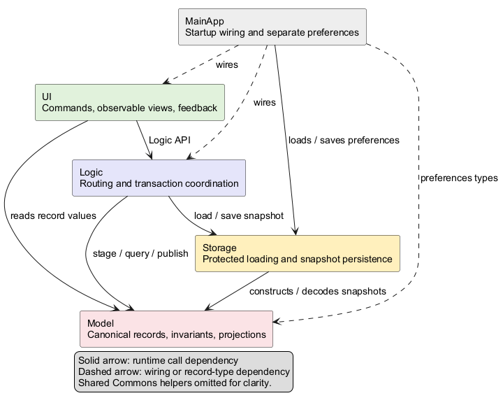](images/ArchitectureDiagram.png)

PonHub follows a layered architecture inspired by Model-View-Controller (MVC), adapted for command-driven desktop workflows and transactional file persistence. The system is divided into five main components:

| Component | Key responsibilities | Design patterns used |
| --- | --- | --- |
| [**UI**](#ui-component) | Renders people, lessons, rosters, and attendance history; captures keyboard commands and button actions; displays feedback. | **Observer** (binds to read-only JavaFX `ObservableList` and property views exposed by `Logic`). |
| [**Logic**](#logic-component) | Parses commands, coordinates staged execution, triggers snapshot persistence, and manages read-only query projections. | **Command** (`CanonicalCommandExecutor` and staged commands) and **Facade** (`Logic` / `CanonicalPeopleSession`). |
| [**Model**](#model-component) | Holds the canonical in-memory records (`PonHubData`), enforces domain and scheduling invariants, and provides filtered views. | **Immutable Value Object** and **Aggregate Root** (`PonHubData` wrapping `PonHubDataState`). |
| [**Storage**](#storage-component) | Reads and writes operational records (`data/ponhub.json`) and user preferences (`preferences.json`) safely on disk. | **Codec** (`JsonPonHubDataCodec` converts between JSON and validated snapshots) and a protective wrapper (`ProtectedPonHubDataStorage` combines loading, the file guard and atomic saves). Logic depends on a `SnapshotWriter` callback rather than a storage interface. |
| [**Commons**](#common-classes) | Supplies cross-cutting utilities for logging (`LogsCenter`), atomic file writes, path validation, settings, and exceptions. | Shared utility classes. |

[`Main`](https://github.com/AY2627S1-CS2103T-F13-3/tp/blob/master/src/main/java/ponhub/Main.java) starts JavaFX.
[`MainApp`](https://github.com/AY2627S1-CS2103T-F13-3/tp/blob/master/src/main/java/ponhub/MainApp.java)
validates startup file paths, creates one `CanonicalPeopleSession`, supplies it to
[`CanonicalLogicManager`](https://github.com/AY2627S1-CS2103T-F13-3/tp/blob/master/src/main/java/ponhub/logic/CanonicalLogicManager.java),
and opens the UI.

#### Follow an edit command

<a id="canonical-command-collaboration"></a>

To see how the components work together during a data-changing command, trace `edit 1 n/Jamie Tan` in a normal writable session (where position `1` exists and the new name changes that person's record):

<figure class="dg-figure dg-edit-flow">
<figcaption>Changed edit: prepare separately, save, then publish</figcaption>
<div class="dg-edit-flow-scroll" tabindex="0" role="region" aria-label="Edit flow diagram; scroll horizontally on narrow screens">
<a href="images/ArchitectureSequenceDiagram.png">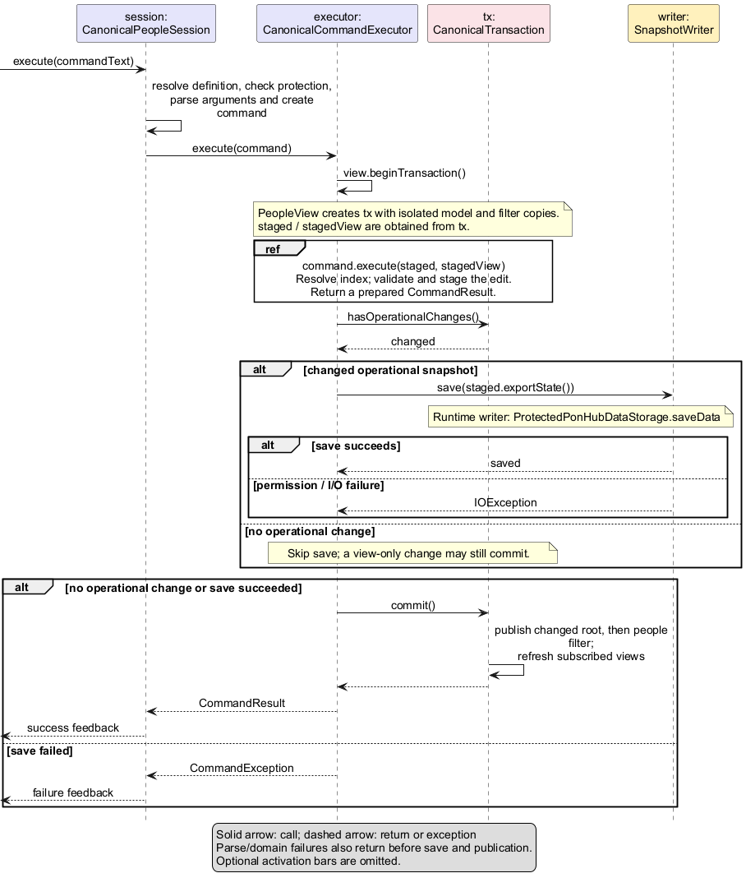</a>
</div>
</figure>

The command executes as follows:

1. **Dispatch:** After checking command availability and parsing the arguments, `CanonicalPeopleSession` passes the staged edit command to `CanonicalCommandExecutor`.
2. **Stage in isolation:** The executor opens an isolated `CanonicalTransaction` to build the candidate `PonHubDataState` and proposed `CommandResult`. At this point, the live model and UI lists have not changed.
3. **Save complete snapshot:** The executor passes the candidate snapshot to its injected `SnapshotWriter`, which calls `ProtectedPonHubDataStorage.saveData` at runtime.
4. **Publish on success:** Once the file is safely written, `CanonicalTransaction.commit()` updates the live model and people filter, refreshing subscribed UI views, and the executor returns the success `CommandResult`.
5. **Preserve state on failure:** If saving throws an exception, the executor catches it and throws a `CommandException` without committing. The live records, ID counters, and UI views remain untouched. (Disk-level recovery follows the [safe file replacement rules](#safe-json-saves).)

Parsing errors and domain rule violations stop before step 3. Valid commands that make no operational change (no-ops) skip the data-file write, and view-only commands (such as `list`) update the view filter without writing operational data.

### 3.2 UI component

<a id="ui-component"></a>

**API:** [`src/main/java/ponhub/ui/Ui.java`](https://github.com/AY2627S1-CS2103T-F13-3/tp/blob/master/src/main/java/ponhub/ui/Ui.java) (FXML layouts live in `src/main/resources/view/`).

<figure class="dg-figure">
<figcaption>UI controllers, panels and cards</figcaption>
<div class="dg-ui-class-scroll" tabindex="0" role="region" aria-label="UI class diagram; scroll horizontally to see all classes">
<a href="images/UiClassDiagram.png">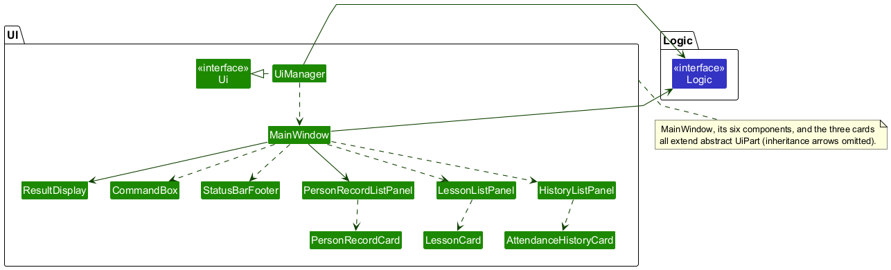</a>
</div>
</figure>

[`UiManager`](https://github.com/AY2627S1-CS2103T-F13-3/tp/blob/master/src/main/java/ponhub/ui/UiManager.java) instantiates [`MainWindow`](https://github.com/AY2627S1-CS2103T-F13-3/tp/blob/master/src/main/java/ponhub/ui/MainWindow.java), which assembles the people panel, lesson and history panels, viewing buttons, result display, command box, and status bar.

| UI element | What it renders or is responsible for |
| --- | --- |
| `PersonRecordListPanel` | Displays the current people list, active filter or search context, result count, and selected person. |
| `PersonRecordCard` | Renders one person's role, stable ID, current list position, contact details, and matching relationship context. Provides contact-copy actions. |
| `LessonListPanel` | Displays lesson results and their context. For lesson details, displays the current roster and retained attendance. |
| `LessonCard` | Renders one lesson's subject, stable ID, schedule, tutor, room, and roster size. |
| `HistoryListPanel` | Displays the selected Student's attendance-history results, context, and result count. |
| `AttendanceHistoryCard` | Renders one recorded date, Student and Lesson IDs, attendance status, and current enrolment status. |
| Viewing buttons in `MainWindow` | Request all lessons, the selected Student's lessons, or attendance history through the same command path as typed requests. |
| `CommandBox` | Accepts and submits commands, with command-name completion and recall of previous submissions. |
| `ResultDisplay` | Displays command feedback, errors, and inline help. |
| `StatusBarFooter` | Displays the selected operational data-file path. |

Every UI controller inherits from the abstract `UiPart` class, which handles loading FXML files.

`MainWindow` forwards submitted command text through `Logic.execute(...)`, then uses the returned
`CommandResult` for feedback and requested UI actions. It does not modify operational records directly.

The UI observes the read-only lists (`getPersonRecords()`, `getDisplayedLessons()`, `getDisplayedHistory()`)
and mode properties exposed by `Logic`. It renders `Model` records (`PersonRecord` adapted through
`ponhub.ui.PersonRecordCardData`) and query view types (`LessonView`, `AttendanceHistoryEntry`) in its cards.

### 3.3 Logic component

<a id="logic-component"></a>

**API:** [`src/main/java/ponhub/logic/Logic.java`](https://github.com/AY2627S1-CS2103T-F13-3/tp/blob/master/src/main/java/ponhub/logic/Logic.java).

[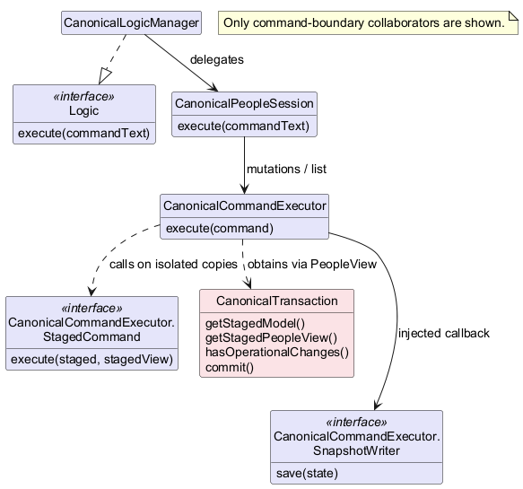](images/LogicClassDiagram.png)

`CanonicalLogicManager` delegates commands from the UI-facing `Logic` interface to the shared
[`CanonicalPeopleSession`](https://github.com/AY2627S1-CS2103T-F13-3/tp/blob/master/src/main/java/ponhub/logic/CanonicalPeopleSession.java).
The session owns the canonical model and query helpers, checks command availability during protected
startup, and routes commands to their handlers. Its execution paths are:

* **Catalogue and routing:** [`CanonicalCommandDefinition`](https://github.com/AY2627S1-CS2103T-F13-3/tp/blob/master/src/main/java/ponhub/logic/CanonicalCommandDefinition.java) and [`CanonicalCommandCatalog`](https://github.com/AY2627S1-CS2103T-F13-3/tp/blob/master/src/main/java/ponhub/logic/CanonicalCommandCatalog.java) declare every supported command word, its inline help text, and whether it is allowed during protected startup.
* **Parsers:** Feature-specific parsers (`RoleAwareAddParser`, `PersonEditParser`, `AddLessonParser`, `LessonEditParser`, `SearchCriteriaParser`, etc.) validate raw command arguments and build typed input records without mutating state.
* **Transactional execution vs. direct people search:**
  *  and `list` run through `CanonicalCommandExecutor`. It starts a `CanonicalTransaction` via `PeopleView.beginTransaction()`, runs a `StagedCommand` on the isolated candidate model, saves the snapshot if operational data changed, and calls `commit()`.
  * People-category `search` (`c/student|parent|tutor`) runs `new CanonicalSearchCommand(criteria).execute(data, view)` directly in `CanonicalPeopleSession.execute()`, updating the live `PeopleView` search criteria without `CanonicalCommandExecutor`, `beginTransaction()`, or `commit()`.
* **Read-only retrieval:** [`LessonRetrieval`](https://github.com/AY2627S1-CS2103T-F13-3/tp/blob/master/src/main/java/ponhub/logic/LessonRetrieval.java) and [`AttendanceRetrieval`](https://github.com/AY2627S1-CS2103T-F13-3/tp/blob/master/src/main/java/ponhub/logic/AttendanceRetrieval.java) coordinate right-pane queries over [`LessonQueries`](https://github.com/AY2627S1-CS2103T-F13-3/tp/blob/master/src/main/java/ponhub/model/query/LessonQueries.java) (and, for `showlesson` details, `PonHubData`) without staging a model copy or saving operational data. Like every command, they still record their outcome in the application log.

### 3.4 Model component

<a id="model-component"></a>

**Core classes:** [`PonHubData`](https://github.com/AY2627S1-CS2103T-F13-3/tp/blob/master/src/main/java/ponhub/model/PonHubData.java), [`PonHubDataState`](https://github.com/AY2627S1-CS2103T-F13-3/tp/blob/master/src/main/java/ponhub/model/PonHubDataState.java), [`PeopleView`](https://github.com/AY2627S1-CS2103T-F13-3/tp/blob/master/src/main/java/ponhub/model/PeopleView.java), and [`LessonQueries`](https://github.com/AY2627S1-CS2103T-F13-3/tp/blob/master/src/main/java/ponhub/model/query/LessonQueries.java).

[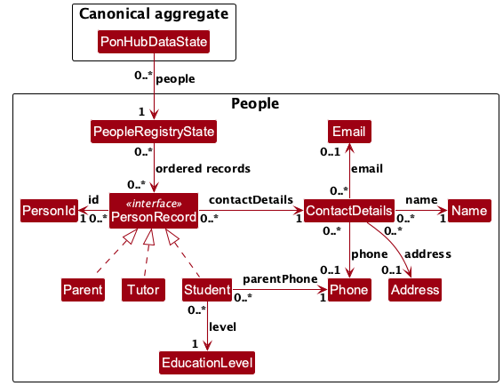](images/PersonRecordClassDiagram.png)

The `Model` component is independent of `UI`, `Logic`, and `Storage` (relying only on `Commons` utilities). Its central aggregate root is `PonHubData`, which holds a single immutable `PonHubDataState` snapshot at any moment. That snapshot contains:

1. `PeopleRegistryState`: the ordered list of `PersonRecord` objects (`Student`, `Tutor`, `Parent`) and the three per-role ID allocation counters.
2. Ordered `Lesson` records and `lastAllocatedLessonSequence`.
3. Ordered `Attendance` entries mapping an `AttendanceKey` (`studentId` as a student-role `PersonId`, `LessonId`, `LocalDate`) to an `AttendanceStatus`.

Because `PersonRecord`, `Lesson`, `Attendance`, and `PonHubDataState` are all deeply immutable, snapshots can safely share unchanged record instances across transactions without any risk of one view mutating another's data.

`PeopleView` wraps `PonHubData` to maintain the active role filter or people search criteria and expose the observable people list. `LessonQueries` listens to `PonHubData.stateProperty()` to maintain in-memory lookup indexes and read-only lesson and history projections.

### 3.5 Storage component

<a id="storage-component"></a>

**Core classes:** [`ProtectedPonHubDataStorage`](https://github.com/AY2627S1-CS2103T-F13-3/tp/blob/master/src/main/java/ponhub/storage/ProtectedPonHubDataStorage.java), [`JsonPonHubDataCodec`](https://github.com/AY2627S1-CS2103T-F13-3/tp/blob/master/src/main/java/ponhub/storage/JsonPonHubDataCodec.java), [`CanonicalDataFileGuard`](https://github.com/AY2627S1-CS2103T-F13-3/tp/blob/master/src/main/java/ponhub/storage/CanonicalDataFileGuard.java), and [`JsonUserPrefsStorage`](https://github.com/AY2627S1-CS2103T-F13-3/tp/blob/master/src/main/java/ponhub/storage/JsonUserPrefsStorage.java).

[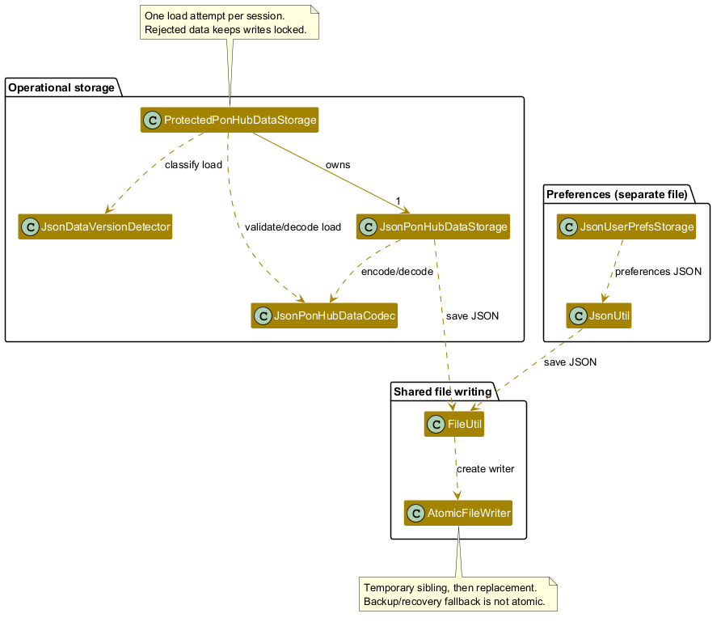](images/CanonicalStorageClassDiagram.png)

The `Storage` component manages two separate persistence paths:

* **Operational tuition data (`data/ponhub.json`):** `ProtectedPonHubDataStorage` loads the file once at startup, uses `JsonDataVersionDetector` and `JsonPonHubDataCodec` to parse and validate a complete `PonHubDataState` snapshot, and arms `CanonicalDataFileGuard` only when the file is valid or confirmed missing. Subsequent saves pass through the file guard and `AtomicFileWriter`.
* **User preferences (`preferences.json`):** `JsonUserPrefsStorage` loads and saves window dimensions and placement independently of tuition data.

`CanonicalPeopleSession` supplies
[`CanonicalCommandExecutor`](https://github.com/AY2627S1-CS2103T-F13-3/tp/blob/master/src/main/java/ponhub/logic/CanonicalCommandExecutor.java)
with a `SnapshotWriter` callback bound to `ProtectedPonHubDataStorage.saveData`. Tests can substitute a
failing writer to verify that a save error prevents proposed changes from reaching live records,
allocation counters and views.

`JsonPonHubDataStorage` is a test-source fixture wrapper for standalone JSON file access. The running application uses `ProtectedPonHubDataStorage` so that rejected startup files can never be overwritten.

### 3.6 Common utilities

<a id="common-classes"></a>

The `ponhub.commons` package contains shared infrastructure used across components:

* **`ponhub.commons.core`:** [`LogsCenter`](https://github.com/AY2627S1-CS2103T-F13-3/tp/blob/master/src/main/java/ponhub/commons/core/LogsCenter.java) (centralised `java.util.logging` setup), [`GuiSettings`](https://github.com/AY2627S1-CS2103T-F13-3/tp/blob/master/src/main/java/ponhub/commons/core/GuiSettings.java), and [`Index`](https://github.com/AY2627S1-CS2103T-F13-3/tp/blob/master/src/main/java/ponhub/commons/core/index/Index.java) (1-based displayed list positions).
* **`ponhub.commons.util`:** [`ApplicationPaths`](https://github.com/AY2627S1-CS2103T-F13-3/tp/blob/master/src/main/java/ponhub/commons/util/ApplicationPaths.java) (path confinement and alias checks), [`AtomicFileWriter`](https://github.com/AY2627S1-CS2103T-F13-3/tp/blob/master/src/main/java/ponhub/commons/util/AtomicFileWriter.java) (temp-file and backup replacement), [`JsonUtil`](https://github.com/AY2627S1-CS2103T-F13-3/tp/blob/master/src/main/java/ponhub/commons/util/JsonUtil.java), `FileUtil`, `StringUtil`, and `CollectionUtil`.
* **`ponhub.commons.exceptions`:** Shared checked exceptions such as `DataLoadingException` and `IllegalValueException`.

Keep reusable, domain-agnostic helpers in `ponhub.commons`; place domain rules in `Model` and command syntax in `Logic`.

### 3.7 Application startup and shutdown

<a id="canonical-application-startup"></a>
<a id="canonical-application-startup-85"></a>

When PonHub starts, `MainApp.init()` resolves **application home**—the directory containing `ponhub.jar` when running a packaged JAR, or the current working directory during development launches:

| File type | Path relative to application home |
| --- | --- |
| Operational data | `data/ponhub.json` by default, or the path passed via `--data=PATH` |
| User preferences | `preferences.json` |
| Application logs | `ponhub.log*` (managed by the `ponhub` logger) |

`MainApp.init()` and `MainApp.initialize()` run the startup sequence in order, followed by window teardown on exit:

1. **Path confinement and separation:** `MainApp.selectDataPath()` and `MainApp.initialize()` resolve relative `--data` paths from application home and permit absolute paths only if they stay inside application home. Startup rejects blank paths, `..` traversal escapes, and symbolic links pointing outside application home. It also checks that the data file, `preferences.json`, and reserved log names (`ponhub.log*` and legacy `addressbook.log*`, including case variants, rotation/lock suffixes, and hard/symbolic link aliases) never refer to the same file.
2. **Single operational load:** `CanonicalPeopleSession` reads the selected data file once through `ProtectedPonHubDataStorage`:
   * **Confirmed missing:** Starts an empty writable session without sample data. No data file is created on disk until a command successfully adds a record.
   * **Valid version-1 file:** Loads the complete snapshot into `CanonicalPeopleSession` and arms `CanonicalDataFileGuard`.
   * **Unreadable, corrupt, unsupported, or legacy file:** Logs a warning, preserves the file untouched, and opens a **protected empty session** showing a recovery dialog. Only `help`, `list`, and `exit` are enabled until the user fixes the file and restarts.
3. **Preferences loading:** `MainApp.initPrefs()` loads `preferences.json` through `JsonUserPrefsStorage`; `MainApp.initialize()` then creates `CanonicalLogicManager`. Missing preferences log `INFO` (`Creating new preference file ...`), whereas invalid or unreadable preferences log `WARNING`. In both cases, PonHub uses default window settings, attempts to save `preferences.json`, and leaves operational data untouched.
4. **File logging and UI initialisation:** `LogsCenter.initializeFileLogging()` opens `ponhub.log*` (falling back safely to the console if a log path is a symbolic link or aliases a legacy log), and `MainApp` constructs `UiManager` before `MainApp.start()` opens `MainWindow`.
5. **Shutdown:** When the window hides (`WindowEvent.WINDOW_HIDDEN`), `MainWindow` stops any active wordmark animation, closes `logoSound` audio playback, and closes `creditsDialog` if open. `MainApp.stop()` then saves current window preferences to `preferences.json` without rewriting operational tuition data.

---

## 4. Domain model and data rules

<a id="shared-lesson-target-contract"></a>

This section explains what PonHub stores, which values and relationships it accepts, and how changes reach read-only views. Commands, JSON loading and snapshot restoration share the same domain validation, except for the wider stored-subject limit in [Lesson values](#lesson-values) that keeps older data files loadable.

| Concept | Stored or derived form |
| --- | --- |
| People | Student, Tutor and Parent records with stable role-prefixed IDs. |
| Lessons and enrolment | Shared weekly lessons; each lesson stores its own Student roster. |
| Attendance | Separate dated records that can outlive current membership. |
| Parent links | Derived from matching phone values. |
| Displayed results | Read-only views of the shared records. |

### 4.1 People, roles, and contact details

<a id="person-record-foundation"></a>
<a id="ordered-people-registry-foundation"></a>
<a id="registry-apis"></a>
<a id="allocation-and-state-validation"></a>
<a id="deletion-and-activation-boundaries"></a>

PonHub stores three immutable person types: `Student`, `Tutor`, and `Parent`. All implement `PersonRecord` and hold a stable `PersonId` and shared `ContactDetails`.

<figure class="dg-figure">
<figcaption>People records and role-specific fields</figcaption>
<div class="dg-edit-flow-scroll" tabindex="0" role="region" aria-label="People records and role-specific fields">
<a href="images/DomainPeopleStructure.png">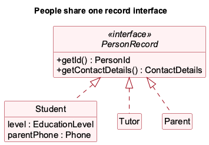</a>
</div>
</figure>

#### Required and optional fields

| Role | ID prefix | Required details | Optional details |
| --- | --- | --- | --- |
| Student | `S` | Name, education level, parent phone | Own phone, email, address |
| Tutor | `T` | Name, own phone | Email, address |
| Parent | `P` | Name, own phone | Email, address |

Student education levels are `P1`–`P6`, `S1`–`S5`, `JC1`, or `JC2`; letter case and surrounding spaces are normalised. Other levels are rejected. A record's ID must match its role.

#### Contact rules

Commands and JSON loading use the same value classes. Both paths reject invalid values.

| Value | Accepted input and limits | Rejected input |
| --- | --- | --- |
| Name | 1–100 Unicode code points after trimming boundary spaces, collapsing ASCII spaces and NFC normalisation. Letters, attached combining marks, spaces, apostrophes, hyphens and periods are allowed. Standalone lowercase `s/o` and `d/o` are allowed between letter-bearing words. | No letters; digits; emoji; other slashes; control or format characters. More than 400 code points before NFC normalisation is also rejected. |
| Phone | 3–15 ASCII digits, stored as text. Leading zeros are significant. | Letters, signs, spaces or punctuation. |
| Email | At most 254 characters. Local part accepts English letters, digits and `. _ ' % + -`. Domain labels use letters, digits and internal hyphens; the final label has 2–63 English letters. | Missing `@`; missing domain dot; empty domain labels; leading, trailing or repeated local-part dots. |
| Address | 1–200 printable ASCII characters after trimming and collapsing ASCII spaces. A slash must have an ASCII digit immediately on each side, as in `#01/02`. | Empty values, non-ASCII text, controls or other slash placements. |

#### Duplicate people and parent links

Duplicate identity means **role + normalised name + identifying phone**. Students use their parent phone; Tutors and Parents use their own phone. Siblings may share a parent phone when their names differ. Full record equality also compares the ID and all stored fields.

Name matching ignores case and unifies Greek sigma forms. Accents remain significant: `José` and `Jose` are different names. Existing saved sigma variants remain loadable through the legacy compatibility check; new additions and identity-changing edits reject those collisions.

A Parent–Student link is derived from an exact match between the Parent's own phone and the Student's parent phone. Changing either phone can change the link. The Student's parent-phone text is retained even when no matching Parent exists.

### 4.2 Lessons, tutors, and scheduling

<a id="lesson-scheduling-value-contracts"></a>
<a id="immutable-shared-lesson-records"></a>

A `Lesson` is one shared weekly booking with a stable ID, Tutor, time slot, subject and room. Its roster may be empty. Tutor and room reservations still apply before any students enrol.

<figure class="dg-figure">
<figcaption>Lesson booking and weekly time slot</figcaption>
<div class="dg-edit-flow-scroll" tabindex="0" role="region" aria-label="Lesson booking and weekly time slot">
<a href="images/DomainLessonSchedule.png">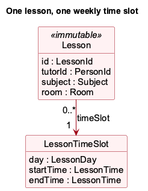</a>
</div>
</figure>

#### Lesson values

| Value | Accepted input | Rejected input |
| --- | --- | --- |
| Lesson ID | `L` followed by a positive `long` sequence, such as `L1`. | Zero, leading zeros, missing prefix or an out-of-range sequence. |
| Weekday | `Mon` through `Sun`, matched case-insensitively. | Unknown weekday values. |
| Time slot | Four-digit times from `0000` to `2359`, with the start before the end on the same day. | Invalid clock times, equal endpoints, reversed or overnight slots. |
| Subject | Command input: 1–50 Unicode code points after space and NFC normalisation, counting separators and attached combining marks. Parts are letters (each optionally followed by combining marks) or digits, separated by single spaces or hyphens, such as `A-Math` or `தமிழ்`. Subjects read from a data file (`Subject.fromStoredValue`) may instead hold up to 50 letters-with-marks, digits, spaces or hyphens within 200 code points after NFC, so subjects saved by earlier versions still load and re-save. | Empty or overlong values, unattached combining marks, other punctuation, repeated hyphens or mixed separators. |
| Room | 1–10 ASCII letters or digits with optional single internal hyphens. Surrounding spaces are trimmed and letters stored in uppercase: `b-01` becomes `B-01`. | Empty or overlong values, internal spaces, other punctuation, or leading, trailing or repeated hyphens. |

#### Tutor selection

`addlesson` and `editlesson` match a Tutor's full normalised name. Matching ignores case, collapses spaces and unifies Greek sigma forms. If the name is ambiguous, `tp/` must identify the Tutor by exact phone. A supplied phone must match even when the name is unique. Lesson search instead allows a partial Tutor name.

#### Scheduling rules

Two lessons on the same weekday cannot overlap when they share a Tutor, room or enrolled Student. Slots use `[start, end)`: `1600–1700` and `1700–1800` are allowed; `1600–1700` and `1630–1730` clash when they share one of those resources.

Creation, editing, enrolment and restored snapshots enforce the same scheduling rules.

### 4.3 Student enrolment and lesson rosters

Enrolment adds an existing Student to an existing shared `Lesson`. A lesson can have an empty roster. Adding a student keeps the same lesson ID and booking.

#### How enrolment works

For `enrol 1 lid/L1`, the command resolves position `1` in the current people list to a Student ID, such as `S7`. The roster stores that stable ID.

<figure class="dg-figure">
<figcaption>Enrolling a Student in an existing shared Lesson</figcaption>
<div class="dg-edit-flow-scroll" tabindex="0" role="region" aria-label="Student enrolment sequence">
<a href="images/StudentEnrolmentSequenceDiagram.png">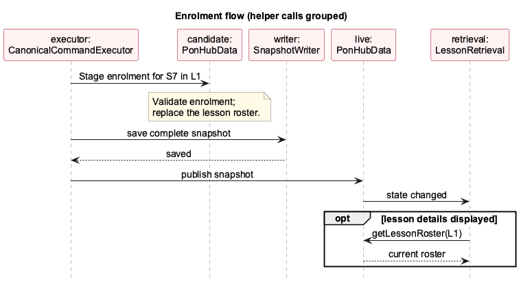</a>
</div>
</figure>

The command validates enrolment against isolated candidate data and creates a replacement lesson with the updated roster. Logic saves the complete snapshot before publishing it. If `showlesson` is displaying that lesson, `LessonRetrieval` observes the published state and rebuilds the details from `PonHubData.getLessonRoster()`. A validation or save failure leaves live data and results unchanged.

See [Section 5.4](#54-enrolling-and-unenrolling-students) for the command implementation.

#### Where membership is stored

<figure class="dg-figure">
<figcaption>Stored enrolment and derived roster views</figcaption>
<div class="dg-edit-flow-scroll" tabindex="0" role="region" aria-label="Student enrolment class relationships">
<a href="images/StudentEnrolmentClassDiagram.png">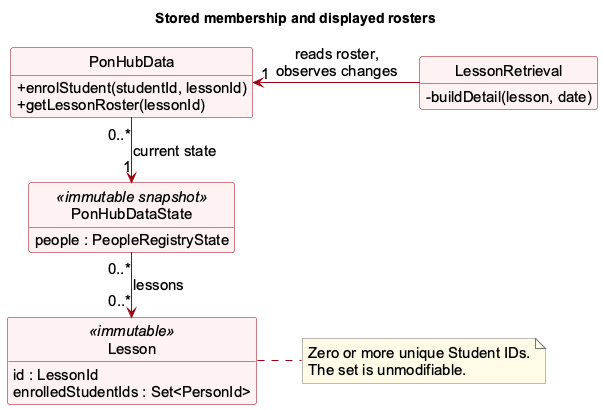</a>
</div>
</figure>

`PonHubDataState` holds the people registry and lesson catalogue. Each `Lesson` stores its roster in an unmodifiable `Set<PersonId>` called `enrolledStudentIds`. It copies incoming IDs into a `LinkedHashSet`. Student records do not store duplicate membership.

Roster IDs must refer to existing Students. The lesson's `tutorId` must refer to an existing Tutor. Both use `PersonId`, checked against `PersonRole.STUDENT` or `PersonRole.TUTOR`.

#### Enrolment rules

| Input or proposed state | Rule |
| --- | --- |
| Displayed position | Must identify a Student in the current people list. Invalid positions, Tutors and Parents are rejected. |
| Lesson ID | Must identify an existing lesson. |
| Membership | The Student must not already be enrolled in that lesson. |
| Timetable | The Student's lessons must not overlap on the same weekday. Slots use `[start, end)`, so adjacent lessons are allowed. |

Enrolment replaces the existing lesson rather than adding another booking. Tutor and room checks therefore do not compare the lesson against a duplicate of itself.

#### Roster display and unenrolment

`PonHubData.getLessonRoster()`, which `showlesson` uses, lists members in global people creation order, regardless of enrolment order or set insertion order. Filtering the people panel does not change the lesson's membership.

Unenrolment removes current membership but retains dated attendance. See [Section 4.4](#44-dated-attendance-and-retained-history).

### 4.4 Dated attendance and retained history

Attendance records an outcome for one Student, one lesson and one date. It is stored separately from the lesson's current roster.

<figure class="dg-figure">
<figcaption>Attendance records and their unique key</figcaption>
<div class="dg-edit-flow-scroll" tabindex="0" role="region" aria-label="Attendance records and their unique key">
<a href="images/DomainAttendanceStructure.png">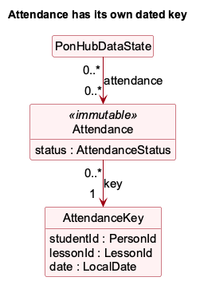</a>
</div>
</figure>

#### Attendance rules

| Value or operation | Rule |
| --- | --- |
| Key | One record per `(studentId, lessonId, date)`. Both records must exist, and the person must be a Student. |
| Date | A real `YYYY-MM-DD` date in years `0001`–`9999`, matching the lesson's weekday. Invalid dates and weekday mismatches are rejected. |
| Status | `present` or `absent`. No record means unrecorded, not absent. |
| New record | The Student must currently be enrolled in the lesson. |
| Correction | An existing record may be corrected after unenrolment. Repeating the same status changes nothing. |
| Removal | `unmark` removes only the selected Student–lesson–date record. Other attendance and current membership remain unchanged. |

#### History after unenrolment

<figure class="dg-figure">
<figcaption>Membership and dated attendance transitions</figcaption>
<div class="dg-edit-flow-scroll" tabindex="0" role="region" aria-label="Membership and dated attendance transitions">
<a href="images/DomainAttendanceHistory.png">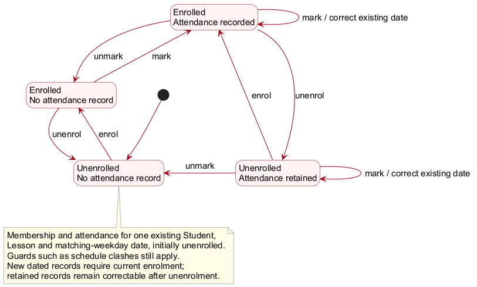</a>
</div>
</figure>

For example, Alex is enrolled in Monday lesson `L1`. Marking Alex absent on `2026-10-05` creates a dated record. Unenrolling Alex removes current membership but keeps that record for review and correction. Only `unmark` removes the selected attendance entry.

The date and Student/Lesson IDs identify the event. Enrolment order and later people-list filters do not change that identity.

### 4.5 Displayed positions and stable IDs

A displayed position selects a person from the current people list. A stable ID identifies the stored record across filtering, editing and restarts.

<figure class="dg-figure">
<figcaption>Displayed position becomes a stable identity</figcaption>
<div class="dg-edit-flow-scroll" tabindex="0" role="region" aria-label="Displayed position becomes a stable identity">
<a href="images/DomainPersonSelection.png">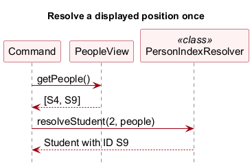</a>
</div>
</figure>

| Selector | Meaning | Common mistake |
| --- | --- | --- |
| `INDEX` or `STUDENT_INDEX` | A 1-based position in `PeopleView.getPeople()`. | Position `2` does not mean ID `S2` or the second person in the full registry. |
| `PersonId` | A permanent, role-prefixed ID such as `S9`, `T3` or `P2`. | A number from another panel is not a people position. |
| `LessonId` | A permanent lesson ID, selected with syntax such as `lid/L1`. | A lesson row number is not a lesson ID. |

Commands resolve the position once through `PersonIndexResolver` against the current people view. Student-only commands reject a Tutor or Parent at that position. Invalid or out-of-range positions are rejected. See the . Row numbers in lesson, roster, or attendance-history panels are never used as person command indices.

For a displayed list `[S4, S9]`, `enrol 2 lid/L1` targets `S9`. The command uses that Student's ID for the remaining operation. Later filtering can change position `2`, but it does not retarget stored relationships or an already selected Student's lesson/history view.

Stable IDs use positive `long` sequences without leading zeros. Surrounding spaces are trimmed and prefixes stored in uppercase. Their role prefixes must match the record type. Committed IDs are never reused; see [Section 4.7](#47-immutable-records-and-complete-snapshots).

### 4.6 Validation, references, and deletion rules

A complete snapshot must contain every record referenced by a lesson or attendance entry. Invalid links are rejected before the candidate becomes live.

| Reference | Required target |
| --- | --- |
| `Lesson.tutorId` | An existing Tutor. |
| `Lesson.enrolledStudentIds` | Existing Students, with no duplicate IDs in one roster. |
| `AttendanceKey` | An existing Student and lesson, with a date matching the lesson's weekday. Current enrolment is not required for retained history. |

#### Deletion guards

PonHub blocks deletion when stored references still depend on the target. It does not automatically delete related records.

<figure class="dg-figure">
<figcaption>Deletion checks before changing data</figcaption>
<div class="dg-edit-flow-scroll" tabindex="0" role="region" aria-label="Deletion checks before changing data">
<a href="images/DomainDeletionRules.png">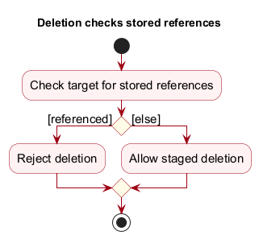</a>
</div>
</figure>

| Target | Deletion is blocked by |
| --- | --- |
| Student | Current membership in any lesson, or any retained attendance. |
| Tutor | Any lesson using that Tutor, including lessons with empty rosters. |
| Lesson | A non-empty roster, or any retained attendance for that lesson. |
| Parent | No lesson or attendance dependency. Deletion leaves Student parent-phone values unchanged. |

Remove the blocking relationships explicitly before retrying deletion. Unenrolling a Student alone is insufficient when attendance is retained. A Parent link is derived from phone values, so deleting the Parent removes the link without deleting the Student.

### 4.7 Immutable records and complete snapshots

<a id="canonical-data-aggregate"></a>
<a id="canonical-data-aggregate-76"></a>
<a id="capacity-policy"></a>

Domain records are immutable. An edit creates a replacement record; existing snapshots retain their previous values. `PonHubDataState` groups the records and allocation history into one complete operational snapshot.

<figure class="dg-figure">
<figcaption>Records and allocation history in one snapshot</figcaption>
<div class="dg-edit-flow-scroll" tabindex="0" role="region" aria-label="Records and allocation history in one snapshot">
<a href="images/DomainSnapshotStructure.png">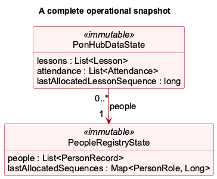</a>
</div>
</figure>

#### Validation and publication

Snapshot construction copies incoming collections and validates IDs, roles, duplicates, references, schedules, attendance dates and counters. Invalid state is rejected before it replaces live data.

Commands prepare changes in a separate candidate. Changed operational data is saved before publication; a failed validation or save leaves the live snapshot unchanged. Read-only views refresh from the published snapshot rather than maintaining another editable store.

#### Allocation rules

| Rule | Behaviour |
| --- | --- |
| Separate sequences | Students, Tutors, Parents and lessons each have their own ID sequence. |
| Allocation history | Counters retain the highest committed sequence, including deleted records. Committed IDs are never reused. |
| Bounds | Each person role needs a counter. `0` means none allocated. Counters cannot be negative or lower than a retained ID. `Long.MAX_VALUE` means the sequence is exhausted. |
| Failed candidate | An uncommitted candidate does not consume IDs in live state. |
| Record counts | The model sets no fixed class-size or total-record cap. Physical classroom limits remain an administrative decision. |

People validation uses ID and identity-key hash sets: expected `O(P)` time and space for `P` people. Schedule validation indexes bookings by weekday and resource: `O((L + E) log L)` time and `O(L + E)` space for `L` lessons and `E` enrolments. Conflict reporting retains lesson creation order.

---

## 5. Feature implementation

<a id="implementation"></a>

<!-- @@author ys000009 -->

The sequence diagrams below follow their feature explanations. They use the course's
[minimal sequence notation](https://nus-cs2103-ay2627-s1.github.io/website/schedule/week6/topics.html#w6-1-modeling-sequence-diagrams):
operation descriptions group helper work; activation bars and uninformative returns are omitted.
Solid arrows are synchronous calls, dashed arrows are returns, and `alt`/`opt` guards select paths.
Participants labelled `<<class>>` receive static calls; other typed participants are instances.
`ref` frames identify the interaction explained elsewhere. On narrow screens, focus a diagram and
scroll horizontally to retain its label size, or open its linked full-size image.

<!-- @@author -->

### 5.1 Command parsing, validation, and dispatch

<a id="current-increment-and-command-integration"></a>

All user commands enter through `CanonicalPeopleSession.execute(String)`, which processes them in this order:

1. **Pending deletion cleanup:** Any new command submission first consumes and clears any pending `delete` confirmation target, even if the input is later rejected.
2. **Catalogue lookup and startup guard:** `CanonicalPeopleSession` extracts the first whitespace-delimited command word (supporting Unicode horizontal spaces via `UNICODE_CHARACTER_CLASS`) and looks up its [`CanonicalCommandDefinition`](https://github.com/AY2627S1-CS2103T-F13-3/tp/blob/master/src/main/java/ponhub/logic/CanonicalCommandDefinition.java). If the session is in protected startup mode and the command is not marked available (`help`, `list`, `exit`), execution stops immediately before parsing arguments.
3. **Exhaustive routing:** The session dispatches the command word through an exhaustive `switch` over `CanonicalCommandDefinition` (with no `default` branch, so adding a new enum constant requires wiring its handler at compile time).
4. **Shared tokenization:** Add and edit parsers use [`FieldValueTokenizer`](https://github.com/AY2627S1-CS2103T-F13-3/tp/blob/master/src/main/java/ponhub/logic/parser/FieldValueTokenizer.java) to scan lowercase `prefix/` markers while allowing standalone `s/o` and `d/o` inside `n/` and `tu/` values and digit-surrounded slashes (such as `#01/02`) inside `a/` values. Unknown or repeated prefixes, unexpected preambles, and control characters are rejected with usage guidance.

When adding a new command, register it in `CanonicalCommandDefinition`, implement its parser and command/query handler, wire its case in `CanonicalPeopleSession`, and add unit, integration, and manual tests.

<!-- @@author ys000009 -->

<figure class="dg-figure">
<figcaption>Figure 5.1: Dispatch and role-aware add parsing</figcaption>
<div class="dg-edit-flow-scroll" tabindex="0" role="region" aria-label="Dispatch and role-aware add parsing; scroll horizontally on narrow screens">
<a href="images/FeatureDispatch.png">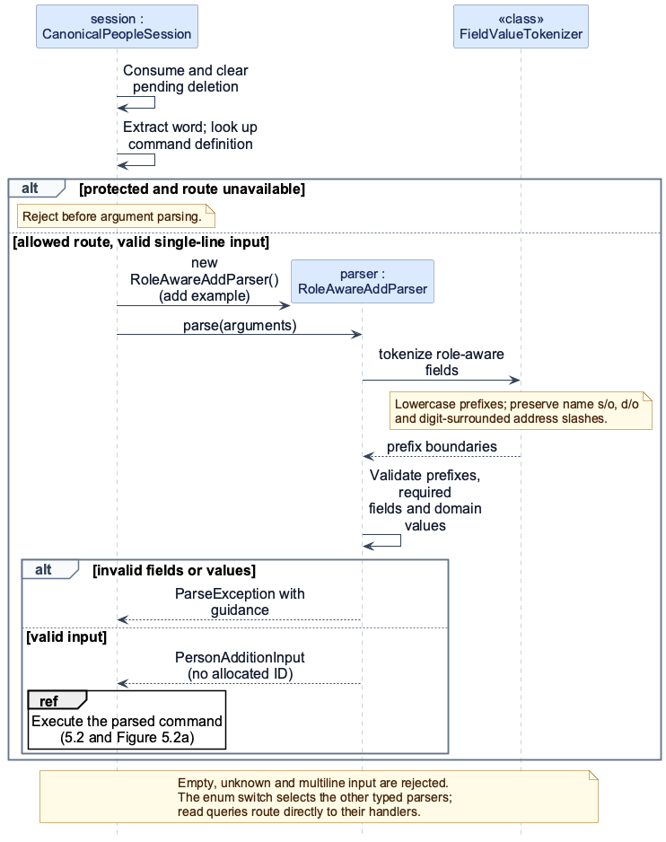</a>
</div>
</figure>

This follows steps 1–4 above. The add route illustrates the tokenizer boundary; other catalogue
routes choose their own typed parser. [Editable source](diagrams/FeatureDispatch.puml).

<!-- @@author -->

### 5.2 Adding, listing, and editing people

<a id="canonical-people-commands"></a>
<a id="editing-contract"></a>
<a id="v14-editing-contract"></a>
<a id="planned-v14-editing-contract"></a>

#### Adding and listing people

* **`add`:** `RoleAwareAddParser` validates `r/ROLE` (`student`, `tutor`, or `parent`, case-insensitive) and role-specific prefixes (`l/` and `pp/` required for students; `p/` required for tutors/parents; `e/` and `a/` optional for all roles) to produce a `PersonAdditionInput` without allocating an ID.
  * During transaction execution, `PersonAdditionCandidate.prepare` allocates the next role ID on a temporary registry, verifies there is no duplicate identity or counter exhaustion, and builds the candidate snapshot.
  * `CanonicalAddCommand` stages the new snapshot and resets the people filter to show all roles once the save commits.
* **`list`:** `PeopleListParser` accepts either no arguments (all roles) or a single `r/student|tutor|parent` filter. `CanonicalListCommand` stages the role filter on `PeopleView` and commits without writing to `data/ponhub.json`.

#### Editing a person

```text
edit INDEX [n/NAME] [p/PHONE] [e/EMAIL] [a/ADDRESS] [l/LEVEL] [pp/PARENT_PHONE]
```

`edit` updates an existing person's contact details or student level while preserving their `PersonId`, role, creation-order slot in `PeopleRegistry`, lesson assignments, rosters, attendance history, and ID counters.

* **Keep, set, or clear fields:** `PersonEditInput` models each field as `Field.keep()`, `Field.set(value)`, or `Field.clear()`. At least one prefix must be supplied. Omitted prefixes keep their existing value. Supplying an empty value clears optional fields (`e/`, `a/`, and a student's own `p/`), but is rejected for required fields (`n/`, `l/`, `pp/`, and a tutor's or parent's `p/`) or student-only fields (`l/`, `pp/`) on a tutor or parent.
* **Validation and no-op detection:** `PersonEditCandidate.prepare(source, targetId, input)` constructs the replacement `PersonRecord` and calls `PonHubData.replacePerson` on a staged copy, checking duplicate identity against all other people (using sigma-folded normalized keys whenever the business key changes).
  * If every stored field (including display case) matches the existing record—for example, `edit 1 n/Alex  Tan` with two spaces between `Alex` and `Tan`, when the stored name is `Alex Tan`—the candidate is marked unchanged (`isChanged() == false`) and skips saving.
  * Changing display case (`edit 1 n/ALEX TAN`) is a real change and is saved.
* **Parent–student link notifications:** Changing a `Parent`'s own phone or a `Student`'s `parentPhone` updates derived parent–student links automatically without modifying any other person's record. `CanonicalEditCommand` compares the linked `(parentId, studentId)` `PersonId` pairs before and after the edit and appends a warning to the success message listing any links that were disconnected.

<!-- @@author ErnestChuaa -->

`PersonEditParser.Input` captures the validated 1-based `INDEX` and `PersonEditInput`. Inside the transaction, `CanonicalEditCommand` resolves `INDEX` once from the staged `PeopleView`, prepares `PersonEditCandidate`, and hands the candidate snapshot to `CanonicalCommandExecutor` to save before publishing.

<!-- @@author -->

<!-- @@author ys000009 -->

<figure class="dg-figure" id="save-publication-sequence">
<figcaption>Figure 5.2a: Persist and publish a staged command</figcaption>
<div class="dg-edit-flow-scroll" tabindex="0" role="region" aria-label="Persist and publish a staged command; scroll horizontally on narrow screens">
<a href="images/SavePublication.png">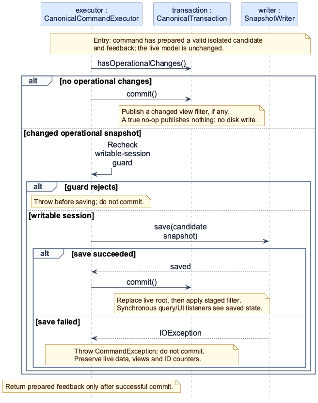</a>
</div>
</figure>

All mutating feature diagrams refer to this executor boundary, detailed in
[Section 6.3](#command-transactions). It starts after successful candidate preparation;
validation failures never reach saving. [Editable source](diagrams/SavePublication.puml).

<figure class="dg-figure">
<figcaption>Figure 5.2b: Stage an addition, edit, or role-list change</figcaption>
<div class="dg-edit-flow-scroll" tabindex="0" role="region" aria-label="Stage an addition, edit, or role-list change; scroll horizontally on narrow screens">
<a href="images/PeopleChanges.png">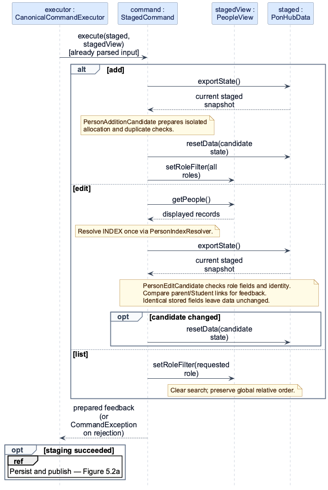</a>
</div>
</figure>

The alternatives correspond to the add, edit, and list paths above. The edit prepares disconnected-link
feedback before returning to the executor. [Editable source](diagrams/PeopleChanges.puml).

<!-- @@author -->

### 5.3 Creating and editing lessons

<a id="shared-lesson-scheduling-model-apis"></a>
<a id="shared-lesson-scheduling-model-apis-78"></a>
<a id="shared-lesson-creation-command"></a>
<a id="shared-lesson-creation-command-86"></a>

#### Creating a lesson (`addlesson`)

```text
addlesson d/DAY st/HHMM et/HHMM s/SUBJECT tu/TUTOR_NAME [tp/TUTOR_PHONE] rm/ROOM
```

1. **Parse:** `AddLessonParser` validates the weekday, time slot, subject, tutor name/phone, and room into a `LessonCreationInput` without reading model state or allocating a `LessonId`.
2. **Resolve tutor:** Inside `CanonicalAddLessonCommand`, `TutorResolver` locates the unique matching `Tutor` in the staged snapshot using the full-name and optional exact-phone rules ([Section 4.2](#42-lessons-tutors-and-scheduling)).
3. **Allocate and check clashes:** `PonHubData.addLesson` allocates the next `LessonId`, creates the lesson with an empty roster, and checks tutor and room clashes across the schedule. If validation or saving fails, no `LessonId` is consumed in the live session.

#### Editing a lesson (`editlesson`)

```text
editlesson lid/LESSON_ID [d/DAY] [st/HHMM] [et/HHMM] [s/SUBJECT] [tu/TUTOR_NAME [tp/TUTOR_PHONE]] [rm/ROOM]
```

`editlesson` replaces one or more fields of an existing lesson while preserving its `LessonId`, catalogue order position, enrolled student roster, retained attendance entries, and allocation counters.

* **Validation and clash checks:** At least one editable prefix must be supplied, and supplied values cannot be blank (`tp/` is allowed only alongside `tu/`). `LessonEditCandidate.prepare` merges the new values with the lesson's existing fields, validates the combined `LessonTimeSlot` (even when only `st/` or `et/` changed), and calls `PonHubData.replaceLesson`. Clash validation checks the updated lesson against every *other* lesson's tutor, room, and enrolled students.
* **Retained attendance weekday guard:** If `d/DAY` changes the lesson's weekday, every retained `Attendance` entry for that lesson—including former members' entries—must match the new weekday. If any dated entry exists on the old weekday, the edit is rejected with a message naming the conflicting date and explaining how to remove obsolete entries with `unmark`.
* **Historical display warning:** Because PonHub stores only current lesson details (not historical versions of a lesson), a successful edit on a lesson that already has recorded attendance includes a note reminding the administrator that past attendance views display the lesson's updated subject, tutor, room, and time.

<!-- @@author ys000009 -->

`LessonEditParser` parses the target `LessonId` and `LessonEditInput`; `TutorResolver` resolves any replacement tutor in the staged snapshot; `CanonicalEditLessonCommand` prepares `LessonEditCandidate`; and `CanonicalCommandExecutor` saves the snapshot before committing live updates.

<!-- @@author -->

<!-- @@author ys000009 -->

<figure class="dg-figure">
<figcaption>Figure 5.3: Prepare a new or edited Lesson</figcaption>
<div class="dg-edit-flow-scroll" tabindex="0" role="region" aria-label="Prepare a new or edited Lesson; scroll horizontally on narrow screens">
<a href="images/LessonChanges.png">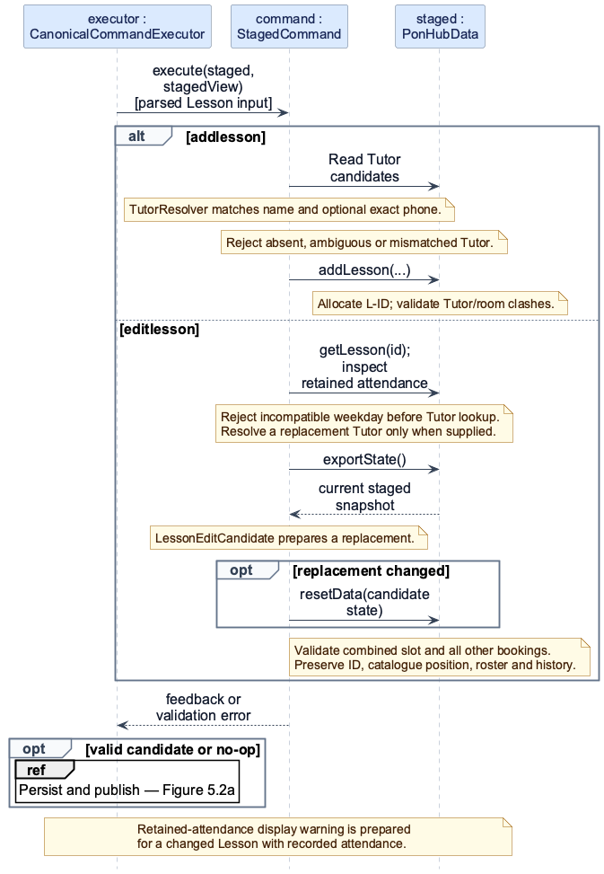</a>
</div>
</figure>

The branches follow Tutor selection/allocation and retained-history/combined-slot validation above.
Only valid staged results proceed to [Figure 5.2a](#save-publication-sequence).
[Editable source](diagrams/LessonChanges.puml).

<!-- @@author -->

### 5.4 Enrolling and unenrolling students

* **`enrol STUDENT_INDEX lid/LESSON_ID`:** `LessonMembershipParser` parses the 1-based student index and target `LessonId`. Inside the staged transaction, `CanonicalEnrolCommand` resolves `STUDENT_INDEX` in the current people view (rejecting Tutors or Parents), verifies that the lesson exists, and calls `PonHubData.enrolStudent(studentId, lessonId)`. The model checks that the student is not already enrolled and has no overlapping lesson on that weekday before saving and committing.
* **`unenrol STUDENT_INDEX lid/LESSON_ID`:** `CanonicalUnenrolCommand` resolves the student and calls `PonHubData.unenrolStudent(studentId, lessonId)`. Unenrolment removes the student's `PersonId` from `Lesson.enrolledStudentIds` while leaving all `Attendance` records for that student and lesson untouched. Attempting to unenrol a student who is not currently on the roster fails with a `CommandException`.

<!-- @@author ys000009 -->

<figure class="dg-figure">
<figcaption>Figure 5.4: Change membership using a displayed Student position</figcaption>
<div class="dg-edit-flow-scroll" tabindex="0" role="region" aria-label="Change membership using a displayed Student position; scroll horizontally on narrow screens">
<a href="images/MembershipChanges.png">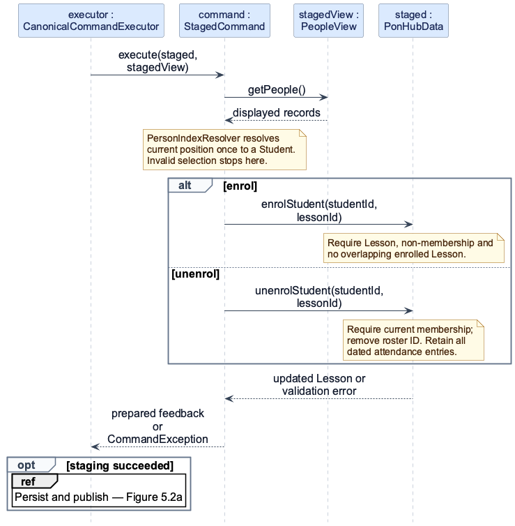</a>
</div>
</figure>

An invalid position, non-Student, or model rejection stops staging. Successful roster changes use
[Figure 5.2a](#save-publication-sequence). [Editable source](diagrams/MembershipChanges.puml).

<!-- @@author -->

### 5.5 Searching people and lessons

<a id="search-criteria-parsing"></a>
<a id="search-criteria-parsing-foundation"></a>
<a id="follow-one-indexed-search"></a>
<a id="errors-and-integration-boundary"></a>
<a id="student-relationship-search-checks"></a>
<a id="student-relationship-search-checks-94"></a>
<a id="parent-relationship-search"></a>
<a id="parent-relationship-search-95"></a>
<a id="tutor-relationship-search"></a>
<a id="tutor-relationship-search-96"></a>

`SearchCriteriaParser` parses `search c/CATEGORY ...` into an immutable `SearchCriteria` object. It retains `s/o` and `d/o` inside name values so they cannot silently become subject/day filters. An adjacent `s/o` subject after a name is ambiguous and rejected with guidance to put the subject first or separate it with `c/CATEGORY`; ordinary subject filters remain order-independent. Every search requires `c/student`, `c/parent`, `c/tutor`, or `c/lesson` (case-insensitive); supplying only `c/CATEGORY` matches all records in that category.

#### Supported search prefixes by category

| Prefix | Meaning | Student | Parent | Tutor | Lesson | Match type |
| --- | --- | --- | --- | --- | --- | --- |
| `n/` | Target person's own name | Yes | Yes | Yes | — | Case-insensitive substring (with `ς`/`σ` folding) |
| `l/` | Student education level | Yes | — | — | — | Exact level (`P1`–`JC2`) |
| `p/` | Target person's own phone | Yes | Yes | Yes | — | Exact 3–15 digits (preserving leading zeros) |
| `pp/` | Student's parent phone | Yes | — | — | — | Exact 3–15 digits |
| `e/` | Email address | Yes | Yes | Yes | — | Case-insensitive substring |
| `a/` | Postal address | Yes | Yes | Yes | — | Case-insensitive substring |
| `sn/` | Enrolled student's name | — | Yes | Yes | Yes | Case-insensitive substring |
| `d/` | Lesson weekday | Yes | Yes | Yes | Yes | Exact weekday (`Mon`–`Sun`) |
| `st/`, `et/` | Lesson start / end time | Yes | Yes | Yes | Yes | Exact `HHMM` (`st < et` if both supplied) |
| `from/`, `to/` | Paired time window | — | — | — | Yes | Positive overlap (`lesson.start < to && lesson.end > from`) |
| `s/` | Lesson subject | Yes | Yes | Yes | Yes | Case-insensitive substring |
| `tu/` | Lesson tutor's name | Yes | Yes | — | Yes | Case-insensitive substring |
| `tp/` | Lesson tutor's phone | — | — | — | Yes | Exact 3–15 digits |
| `rm/` | Lesson room | Yes | Yes | Yes | Yes | Case-insensitive substring |
| `sort/` | Lesson display order | — | — | — | Yes | `creation` (default) or `schedule` |

#### Conjunctive relationship rules

All supplied prefixes in a `search` command must be satisfied simultaneously, and related conditions must be satisfied by the **same linked record**:

* **Student search:** Own fields (`n/`, `l/`, `p/`, `pp/`, `e/`, `a/`) must match the student, and **one single currently enrolled lesson** must satisfy all supplied lesson filters (`d/`, `st/`, `et/`, `s/`, `tu/`, `rm/`). A student taking Monday Science and Tuesday Math does not match `search c/student d/Mon s/Math`.
* **Parent search:** Own fields must match the parent, and **one single linked child** (matched by exact `parentPhone == parent.phone`) must satisfy `sn/` and have **one single enrolled lesson** satisfying all supplied lesson filters.
* **Tutor search:** Own fields must match the tutor, and **one single assigned lesson** must satisfy all lesson filters and any `sn/` roster filter.
* **Lesson search:** All lesson filters must match the lesson. If `sn/` is supplied, at least one currently enrolled student on its roster must match `sn/`; otherwise empty-roster lessons also qualify.

#### Worked example of indexed lesson search

Suppose Tutor Mei teaches four lessons:

| ID | Schedule | Subject / Room | Roster |
| --- | --- | --- | --- |
| `L1` | Mon 1600–1730 | Math / R1 | Jamie (`S2`) |
| `L2` | Tue 1600–1730 | Math / R1 | Alex (`S1`) |
| `L3` | Mon 1800–1900 | Science / R1 | Alex (`S1`) |
| `L4` | Mon 1900–2000 | Math / R2 | Empty |

When executing `search c/lesson d/Mon st/1600 s/Math tu/mei rm/r1 sn/a`:

1. `LessonQueries` checks its exact-match buckets: Monday has `[L1, L3, L4]` (size 3) and start time `1600` has `[L1, L2]` (size 2). It starts with the smaller bucket `[L1, L2]`.
2. It evaluates all remaining criteria on each candidate: `L2` fails `d/Mon`, while `L1` matches `d/Mon`, `s/Math`, `tu/mei`, `rm/r1`, and roster student `Jamie` (containing `a`).
3. `L1` is returned once in creation order (or weekday/start-time/ID order if `sort/schedule` is requested).

For bounded field lengths, an unsorted lesson search runs in `O(B + R_B + K)` time, where `B` is the candidate bucket size, `R_B` is the roster links checked for `sn/`, and `K` is the number of matched lessons. `sort/schedule` adds `O(K log K)`.

Student and Tutor relationship searches run in `O(P + B + R_B + K)` time, where `P` is the number of people examined and `K` counts returned matches and their relationship contexts. Parent relationship searches run in `O(P + B + C + E + K)` time using the parent-phone index: `C` counts linked children examined once per distinct matching parent phone, and `E` counts the current lesson memberships examined for children satisfying the student-name filter. Parent searches reuse the same relationship contexts for parents sharing a phone number.

<!-- @@author ys000009 -->

<figure class="dg-figure">
<figcaption>Figure 5.5a: Narrow and publish an indexed Lesson search</figcaption>
<div class="dg-edit-flow-scroll" tabindex="0" role="region" aria-label="Narrow and publish an indexed Lesson search; scroll horizontally on narrow screens">
<a href="images/LessonSearch.png">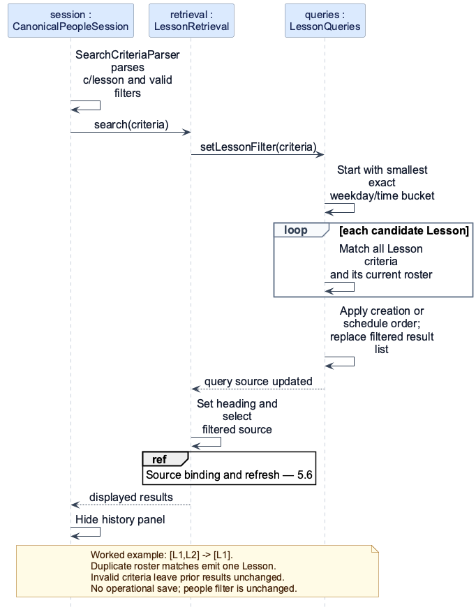</a>
</div>
</figure>

The bucket and candidate steps correspond to the `L1`–`L4` example above. Source selection uses
[Section 5.6](#56-retrieving-and-displaying-lesson-results).
[Editable source](diagrams/LessonSearch.puml).

<figure class="dg-figure">
<figcaption>Figure 5.5b: Match own fields and linked records in a people search</figcaption>
<div class="dg-edit-flow-scroll" tabindex="0" role="region" aria-label="Match own fields and linked records in a people search; scroll horizontally on narrow screens">
<a href="images/PeopleSearch.png">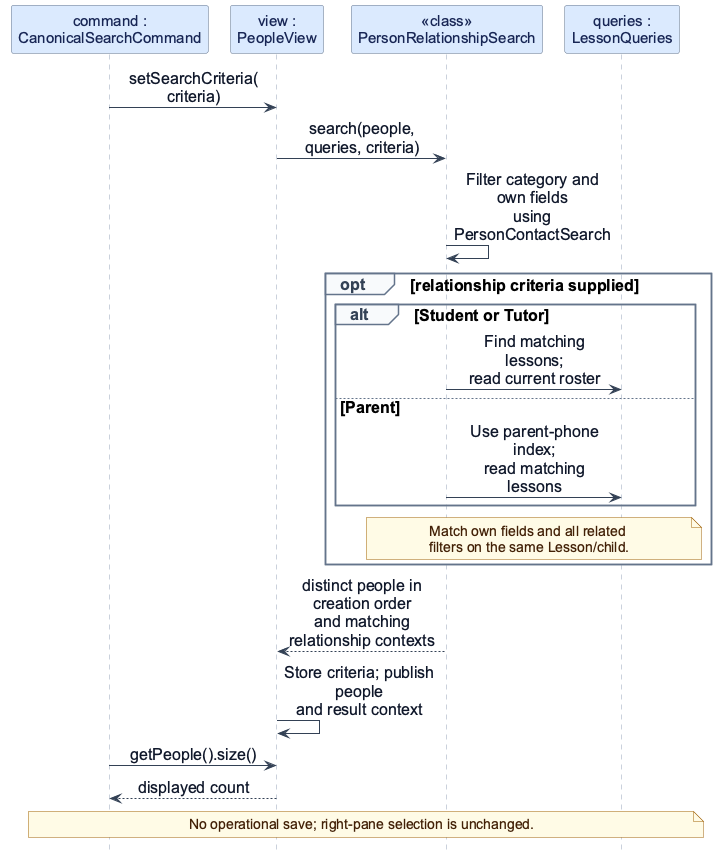</a>
</div>
</figure>

These paths implement the same-linked-record rules above. People searches execute directly on the
live view, without an operational write or a change to the selected right-pane query.
[Editable source](diagrams/PeopleSearch.puml).

<!-- @@author -->

### 5.6 Retrieving and displaying lesson results

<a id="read-only-retrieval-api-contract"></a>
<a id="read-only-retrieval-api-contract-113"></a>
<a id="indexed-lesson-query-projections"></a>
<a id="indexed-lesson-query-projections-80"></a>
<a id="select-a-view-without-changing-another-panel"></a>
<a id="refresh-only-after-publication"></a>
<a id="query-subscription-lifetime-574"></a>
<a id="find-exact-contracts-and-regression-checks"></a>

`LessonQuerySource` defines the read-only query API, and `LessonQueries` implements it over `PonHubData`:

| Query view | Default ordering and contents |
| --- | --- |
| Full lesson catalogue (`lessons`) | All lessons in creation order, including empty rosters. |
| Student lessons (`lessons INDEX`) | Lessons whose current roster contains the resolved student's `PersonId`. |
| Lesson search (`search c/lesson ...`) | Matching lessons in creation order (or `Mon`–`Sun`, start time, numeric `LessonId` when `sort/schedule` is used). |
| Lesson roster | Currently enrolled students in people creation order. Student searches with lesson filters and Tutor searches with `sn/` read it. |
| Tutor schedule | Assigned lessons ordered by weekday, start time, and numeric `LessonId`. |
| Attendance history (`history`) | Recorded entries for a student (and optional lesson/date/status) ordered newest date first, then numeric `LessonId`. |

`showlesson` does not use these projections. `LessonRetrieval.buildDetail` reads `PonHubData.getLessonRoster()` and `PonHubData.getAttendanceForLesson()` to list current members in people creation order, followed by former members' attendance newest-first. Its own `PonHubData.stateProperty()` listener rebuilds the displayed details after each commit.

#### Keeping the left and right panels independent

<figure class="dg-figure">
<figcaption>Lesson retrieval: one UI binding and switchable sources</figcaption>
<div class="dg-edit-flow-scroll" tabindex="0" role="region" aria-label="Lesson retrieval sequence diagram; scroll horizontally on narrow screens">
<a href="images/LessonRetrieval.png">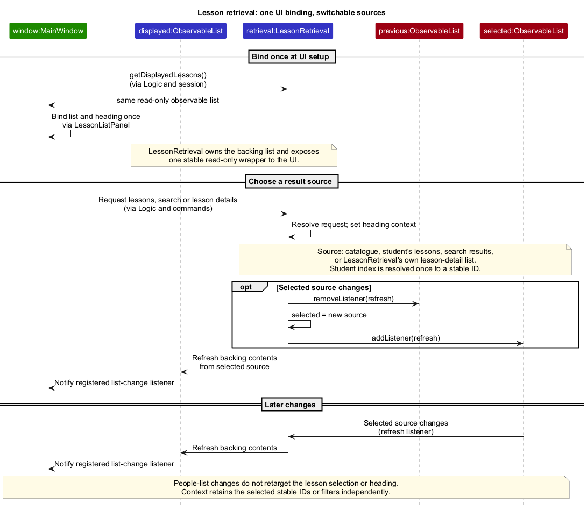</a>
</div>
</figure>

`LessonRetrieval` owns a single observable `displayedLessons` list that the UI binds to once. Switching between `lessons`, `lessons INDEX`, `search c/lesson`, and `showlesson` rebinds `LessonRetrieval` to the chosen query projection or lesson-detail list without modifying the left-hand `PeopleView`. Conversely, running `list` or `search c/student` updates the people panel without retargeting the right-hand lesson or history panel (which retains the resolved stable student `PersonId` or `LessonId`).

#### Refreshing subscribed views only after commit

<figure class="dg-figure">
<figcaption>Lesson query refresh: prepare and save</figcaption>
<div class="dg-edit-flow-scroll" tabindex="0" role="region" aria-label="Lesson query refresh: prepare and save">
<a href="images/LessonQueryRefresh.png">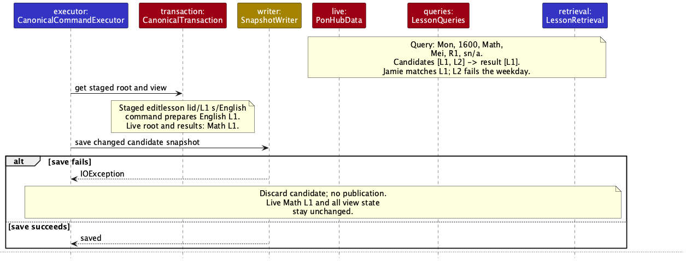</a>
</div>
</figure>

<figure class="dg-figure">
<figcaption>Lesson query refresh: publish and update results</figcaption>
<div class="dg-edit-flow-scroll" tabindex="0" role="region" aria-label="Lesson query refresh: publish and update results">
<a href="images/LessonQueryRefresh_001.png">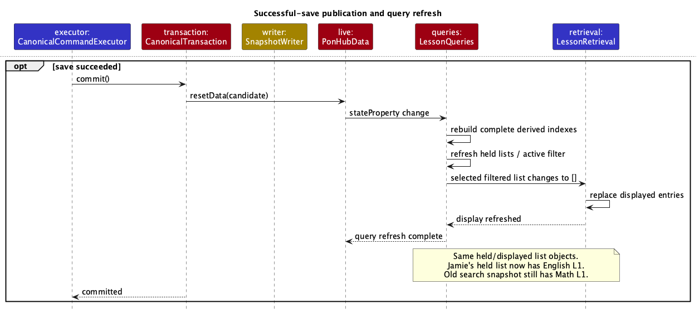</a>
</div>
</figure>

Suppose the right panel is displaying a `Math` lesson search containing `L1`, and the user runs `editlesson lid/L1 s/English`:

1. **Prepare & save:** While the edit is staged and being written to disk, `PonHubData` still holds the old state and the right panel still displays `L1`. If validation or saving fails, the candidate is discarded and no UI refresh occurs.
2. **Commit & refresh:** Once the save succeeds and `commit()` updates `PonHubData.stateProperty()`, `LessonQueries` rebuilds its lookup indexes and refreshes active subscriptions. `L1` automatically leaves the `Math` search results, and any open student-lesson view updates `L1`'s subject to `English`.

`LessonQueries` caches active subscription lists for existing Student, Tutor, and Lesson IDs and moves retired handles to weak-key caches when a record is deleted, preventing memory leaks while allowing still-held UI lists to recover if a snapshot is restored.

### 5.7 Recording and correcting attendance

<a id="dated-attendance-records"></a>

* **Marking and correcting (`mark STUDENT_INDEX lid/LESSON_ID d/YYYY-MM-DD s/present|absent [ack/future]`):** `AttendanceMarkParser` parses the student index, `LessonId`, ISO date, status, and optional future acknowledgement. `CanonicalMarkAttendanceCommand` resolves the student in the staged people view and calls `PonHubData.markAttendance`.
  * If no entry exists for `(studentId, lessonId, date)`, the student must be currently enrolled in that lesson.
  * If an entry already exists—even if the student has since been unenrolled—`mark` updates its status (or treats an identical status as a no-op that skips saving).
  * **Future-present guard:** Using the session's injected `Clock`, if a new or changed entry marks a student `present` on a date strictly after `LocalDate.now(clock)`, the command requires `ack/future`; otherwise it throws a `CommandException` before saving. Marking `absent` on a future date or repeating an already-stored future `present` entry does not require `ack/future`.
* **Removing an entry (`unmark STUDENT_INDEX lid/LESSON_ID d/YYYY-MM-DD`):** `AttendanceUnmarkParser` parses the student index, `LessonId`, and ISO date, and `CanonicalUnmarkAttendanceCommand` calls `PonHubData.unmarkAttendance` to remove the dated `AttendanceKey` so the occurrence returns to `unrecorded`. It works for both current and former roster members; unmarking an already-unrecorded date is a no-op.

<!-- @@author ys000009 -->

<figure class="dg-figure">
<figcaption>Figure 5.7: Stage a dated attendance change</figcaption>
<div class="dg-edit-flow-scroll" tabindex="0" role="region" aria-label="Stage a dated attendance change; scroll horizontally on narrow screens">
<a href="images/AttendanceChanges.png">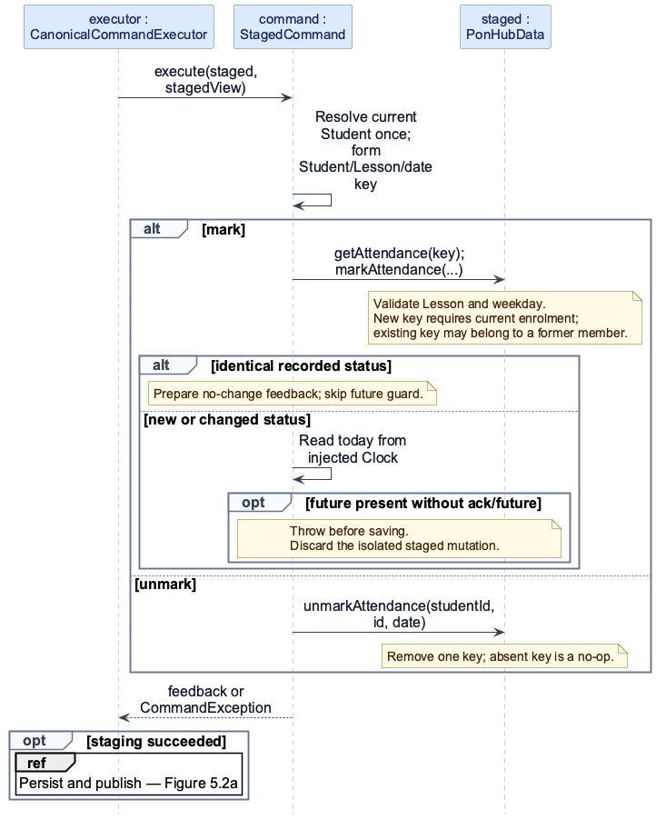</a>
</div>
</figure>

The model validates the key and membership before the future-present check. Even if that check
rejects a staged change, live data remains intact because [Figure 5.2a](#save-publication-sequence)
is not entered. Valid no-ops enter the executor boundary but skip saving.
[Editable source](diagrams/AttendanceChanges.puml).

<!-- @@author -->

### 5.8 Viewing lesson details and attendance history

* **Lesson details (`showlesson lid/LESSON_ID [d/YYYY-MM-DD]`):** Looks up `LESSON_ID` in the full catalogue (regardless of any active lesson filter). If `d/DATE` is supplied, it must be a valid calendar date matching the lesson's weekday. `LessonListPanel` switches to a virtualised detail list with two expanded sections:
  1. **Current roster:** Lists currently enrolled students in creation order. With `d/DATE`, shows each student's status on that date (`present`, `absent`, or `unrecorded`).
  2. **Former members' retained attendance:** Lists retained attendance entries for unenrolled students (for that date if `d/DATE` is given, or across all dates newest-first if undated) so historical records remain visible and auditable.
* **Student attendance history (`history STUDENT_INDEX [lid/LESSON_ID] [d/YYYY-MM-DD] [s/present|absent]`):** Resolves `STUDENT_INDEX` once to a stable student `PersonId` and switches the right pane to `HistoryListPanel` (rendering each entry in an `AttendanceHistoryCard`). Each card shows the date, stable Student and Lesson IDs (for example, `Student S2 · Lesson L1`), recorded status (`present` or `absent`), and a separate **Enrolment Status:** label (`currently enrolled` or `not currently enrolled`) reflecting current roster membership.

<!-- @@author ys000009 -->

<figure class="dg-figure">
<figcaption>Figure 5.8: Select Lesson details or Student attendance history</figcaption>
<div class="dg-edit-flow-scroll" tabindex="0" role="region" aria-label="Select Lesson details or Student attendance history; scroll horizontally on narrow screens">
<a href="images/AttendanceViews.png">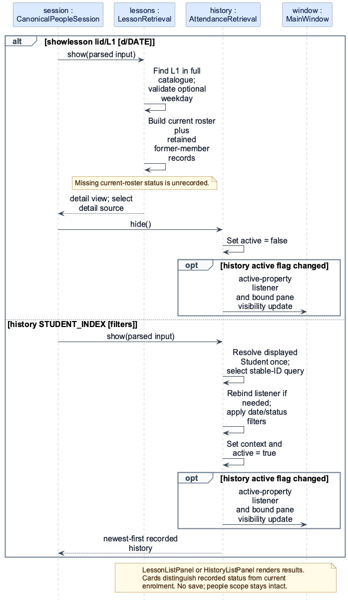</a>
</div>
</figure>

The alternatives select the views above. `MainWindow` binds pane visibility to history activation and
each panel to its stable displayed list. Validation errors preserve the previous selection.
[Editable source](diagrams/AttendanceViews.puml).

<!-- @@author -->

### 5.9 Deleting people and lessons safely

<a id="guarded-person-deletion-and-confirmation"></a>

* **Two-step person deletion (`delete INDEX` → `delete confirm` / `delete cancel`):**
  1. Running `delete INDEX` resolves the target person in the current people view and tests `PonHubData.removePerson(targetId)` on a disposable snapshot copy. If the person is referenced by any lesson or attendance record, it fails immediately, naming the blocking lesson.
  2. If eligible, the session stores the immutable target record as a pending confirmation and prompts the user with the person's name and stable ID without saving operational data or changing views.
  3. Running `delete confirm` re-validates the target in a normal staged transaction via `CanonicalDeleteCommand`, saves the updated snapshot, and removes the person. Any other command (including `delete cancel`, `help`, `list`, or an invalid command), a save failure, or an app restart clears the pending confirmation immediately.
* **Lesson deletion (`deletelesson lid/LESSON_ID`):** `CanonicalDeleteLessonCommand` checks that the lesson exists, has an empty roster (`enrolledStudentIds.isEmpty()`), and has no retained attendance entries before removing it from `PonHubData`, saving, and committing.

<!-- @@author ys000009 -->

<figure class="dg-figure">
<figcaption>Figure 5.9: Preview, confirm, cancel, or reject a deletion</figcaption>
<div class="dg-edit-flow-scroll" tabindex="0" role="region" aria-label="Preview, confirm, cancel, or reject a deletion; scroll horizontally on narrow screens">
<a href="images/GuardedDeletion.png">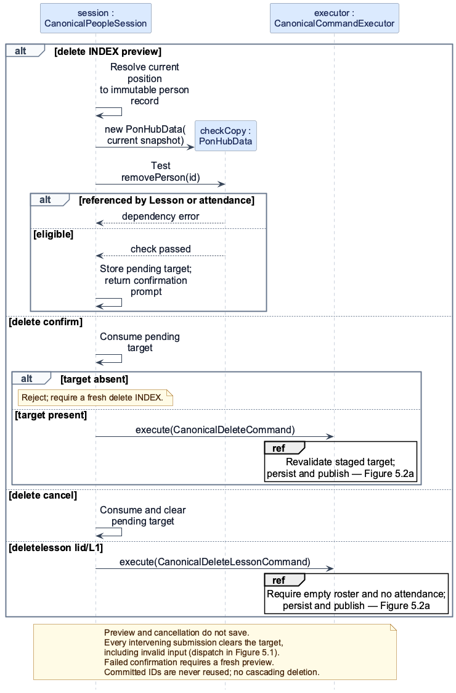</a>
</div>
</figure>

The alternatives show separate command submissions, following steps 1–3 above. The disposable check
does not delete live records. Model-object lifelines continue after a business record is removed.
[Editable source](diagrams/GuardedDeletion.puml).

<!-- @@author -->

### 5.10 Window layout, panels, and navigation

<a id="window-placement-and-active-contact-card-layout"></a>
<a id="canonical-people-session"></a>

<!-- @@author ErnestChuaa -->

`WindowPlacement` fits saved window bounds from `preferences.json` to the user's connected displays on startup. It selects the screen with the largest intersection area, preserves valid secondary-monitor positions, and centres new or off-screen windows on the primary screen's usable work area (JavaFX work-area bounds already account for OS display scaling and taskbars).

The window enforces a minimum size of `450 × 360` logical pixels where the screen allows it, and is designed for `1920×1080` at `100%`/`125%` scaling and `1280×720` at `150%` scaling (see the manual display matrix in [Section B.7](#common-window-and-layout-checks)).

<!-- @@author -->

#### Layout structure and cards

* **Header and feedback:** A compact header holds the wordmark and `File` / `Help` menus. Primary-clicking the wordmark plays an optional synthesised percussion cue and briefly replaces the `hub` badge with a click counter. The 69th click opens the window-modal `CreditsDialog` and resets the count; dismissing it restores the previous focus and command selection. Below the header, a resizable top pane contains the right-pane viewing buttons, context headings, and `ResultDisplay` (a focusable, read-only wrapping `TextArea` with a 50-pixel minimum height).
* **Two-column split pane:** The left column (initially 32% width) holds `PersonRecordListPanel`; the right column holds `LessonListPanel` or `HistoryListPanel`. The `CommandBox` sits below both columns outside the split pane so moving dividers never squeezes command entry into one column.
* **People cards and contact copying:** `PersonRecordCard` (backed by `PersonRecordCardData` in `ponhub.ui`) displays the person's name, 1-based command position, stable ID, role badge, and wrapping fields (`Not provided` for absent optional contacts). Every present contact value (`phone`, `parentPhone`, `email`, `address`) includes a keyboard-focusable **Copy** button that copies the exact value (preserving leading zeros and case) to the system clipboard without altering command focus, draft text, or card selection.
* **Overflowing headings:** Long search/filter headings become keyboard-focusable only when their text overflows, allowing users to scroll them with Arrow keys, Page Up/Down, and Home/End.
* **Viewing shortcut buttons:** **All lessons**, **Student lessons**, and **Attendance history** dispatch `lessons`, `lessons CURRENT_INDEX`, and `history CURRENT_INDEX` through `Logic.execute` while preserving any unfinished command draft and selection. Active button indicators follow `LessonRetrieval.ResultKind` and `historyViewActiveProperty()`.

<!-- @@author ys000009 -->

<figure class="dg-figure">
<figcaption>Figure 5.10: Place the window and route a Student viewing shortcut</figcaption>
<div class="dg-edit-flow-scroll" tabindex="0" role="region" aria-label="Place the window and route a Student viewing shortcut; scroll horizontally on narrow screens">
<a href="images/WindowNavigation.png">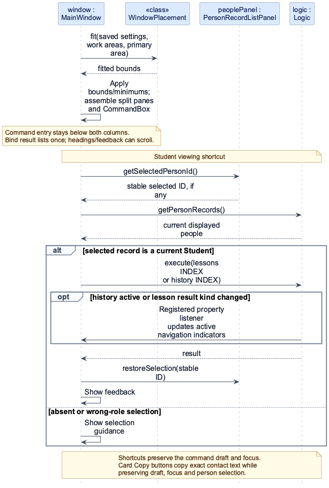</a>
</div>
</figure>

The first interaction follows startup placement; the second follows a later viewing-button action.
The layout/copy-button details above complement this flow; the [UI class diagram](#ui-component)
shows its structure. [Editable source](diagrams/WindowNavigation.puml).

<!-- @@author -->

### 5.11 Keyboard input, completion, and recall

<a id="command-completion-design"></a>
<a id="command-recall-design"></a>
<a id="raw-command-input-protection-572"></a>

`CommandBox` provides three keyboard-first input aids:

1. **Command-name Tab completion (`CommandWordCompleter`):** Pressing unmodified `Tab` when the caret is inside the first word (with no text selection) completes or cycles through matching command words from `Logic.getCommandWords()` in catalogue order. Subsequent `Tab` presses cycle through the initial matches; typing, moving the caret, or changing focus resets the cycle. If no command matches (or the caret is in the arguments), `Tab` performs normal JavaFX focus traversal. In protected startup mode, only `help`, `list`, and `exit` are offered.
2. **In-memory command recall:** `CommandBox` retains up to 50 non-blank submitted commands (including failed commands) for the current window session. Pressing `Up` saves the current unfinished draft, caret, and selection and steps backward through prior submissions; pressing `Down` steps forward and restores the saved draft when passing the newest entry. Closing the window clears this history.
3. **Raw control-character protection:** A `TextFormatter` on the command field inspects every text replacement (including clipboard paste shortcuts and context-menu paste) before JavaFX can silently strip newline or control characters. Any replacement containing ISO control characters or Unicode line/paragraph separators is rejected in full, and `Enter` remains blocked until the user edits the text.

<!-- @@author ys000009 -->

<figure class="dg-figure">
<figcaption>Figure 5.11a: Complete a command word or retain focus traversal</figcaption>
<div class="dg-edit-flow-scroll" tabindex="0" role="region" aria-label="Complete a command word or retain focus traversal; scroll horizontally on narrow screens">
<a href="images/CommandCompletion.png">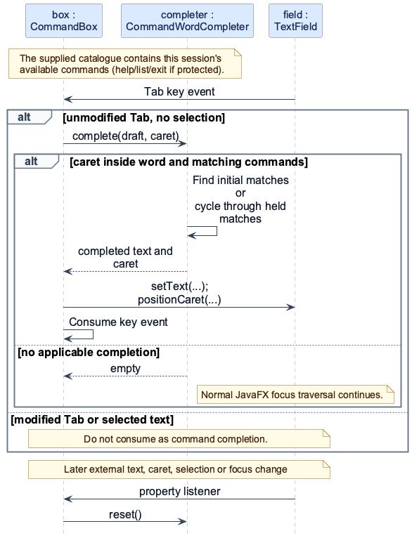</a>
</div>
</figure>

<figure class="dg-figure">
<figcaption>Figure 5.11b: Protect raw input, recall a draft, and submit a command</figcaption>
<div class="dg-edit-flow-scroll" tabindex="0" role="region" aria-label="Protect raw input, recall a draft, and submit a command; scroll horizontally on narrow screens">
<a href="images/CommandRecallInput.png">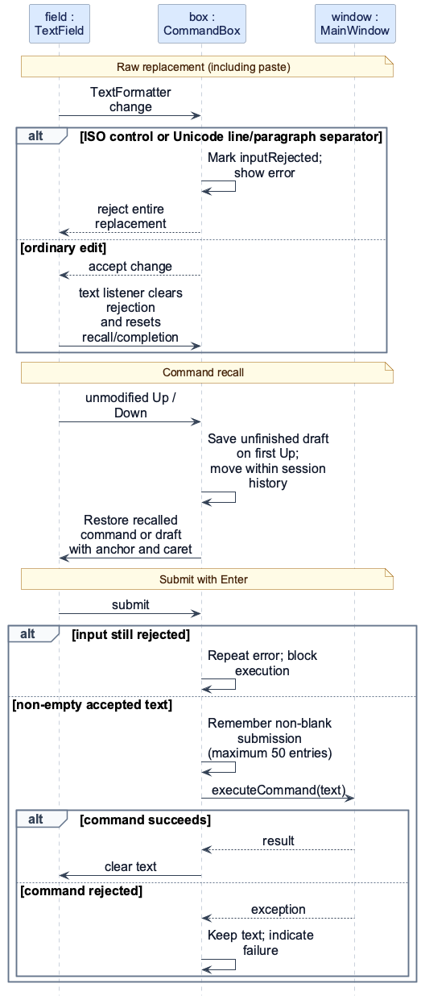</a>
</div>
</figure>

The labelled interactions correspond to input aids 1–3 above; they are separate user events in one
window session. [Completion source](diagrams/CommandCompletion.puml) ·
[Recall/input source](diagrams/CommandRecallInput.puml).

<!-- @@author -->

### 5.12 Inline help and user feedback

`CanonicalCommandCatalog` generates inline help directly from `CanonicalCommandDefinition` metadata:

* Running `help` lists a concise summary of every currently available command and prompts the user to run `help COMMAND` for detailed syntax and copy-pasteable examples.
* Running `help COMMAND` (case-insensitive, such as `help addlesson`) displays that command's usage and examples inside `ResultDisplay` and scrolls the feedback area to the top.
* Pressing `F1` or choosing **Help** from the menu bar dispatches `help` through `MainWindow` while preserving the user's unfinished command draft and selected person card. No separate pop-up help window is opened.

<!-- @@author ys000009 -->

<figure class="dg-figure">
<figcaption>Figure 5.12: Generate inline help through the command catalogue</figcaption>
<div class="dg-edit-flow-scroll" tabindex="0" role="region" aria-label="Generate inline help through the command catalogue; scroll horizontally on narrow screens">
<a href="images/InlineHelp.png">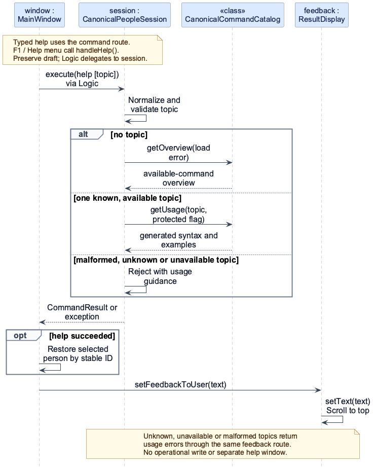</a>
</div>
</figure>

This maps the help entry points above onto the shared feedback path. F1/menu invocation leaves the
command draft intact; typed submission follows ordinary CommandBox success/failure behavior
in Figure 5.11b. [Editable source](diagrams/InlineHelp.puml).

<!-- @@author -->

---

## 6. Persistence and recovery

### 6.1 File locations and preferences

As introduced in [Section 3.7](#canonical-application-startup-85), PonHub stores operational tuition data (`data/ponhub.json` by default, or `--data=PATH` inside application home) separately from window settings (`preferences.json`) and rotating log files (`ponhub.log*`). The status bar footer displays the active operational data path.

**User preferences recovery:**
`JsonUserPrefsStorage` deserializes `preferences.json` into `UserPrefs` and `GuiSettings`. Missing fields fall back to defaults, unknown fields are ignored, and `"windowCoordinates": null` indicates that the window should be centred on the primary display. However, an explicit `null` root, `"guiSettings": null`, or explicit `null` width/height/coordinate numbers are rejected as invalid.

* **Missing vs. invalid file at startup:** If `preferences.json` is missing at startup, `MainApp.initPrefs()` logs an `INFO` message (`Creating new preference file ...`); if the file is invalid or unreadable, it logs a `WARNING`. In both cases, PonHub uses default preferences in memory and attempts to save those defaults.
* **Preferences vs. operational data:** **Invalid preferences may be overwritten with defaults, whereas rejected operational data is always preserved untouched.** If saving preferences fails at startup or on exit, PonHub logs the error without blocking launch or shutdown.

### 6.2 JSON format and version handling

<a id="json-version-detection-foundation"></a>
<a id="canonical-json-schema"></a>
<a id="canonical-json-schema-79-81-83"></a>
<a id="people-only-canonical-json-storage-79"></a>
<a id="retained-attendance-persistence-83"></a>

Before constructing domain records, [`JsonDataVersionDetector.detect(String)`](https://github.com/AY2627S1-CS2103T-F13-3/tp/blob/master/src/main/java/ponhub/storage/JsonDataVersionDetector.java) inspects the raw JSON text to classify its format (`schemaVersion` identifies the storage schema format, currently integer `1`, not the application release version):

| Detection result | Meaning |
| --- | --- |
| `PONHUB_V1_CANDIDATE` | Root JSON object with `"schemaVersion": 1`. Proceeds to full schema and domain validation in `JsonPonHubDataCodec`. |
| `LEGACY_AB3` | Unversioned JSON object containing a `"persons"` array (and optional textual `"_comment"`). Rejected and preserved for manual re-entry. |
| `INVALID_VERSION` | `schemaVersion` is null, text, boolean, fractional, zero, or negative. |
| `UNSUPPORTED_VERSION` | `schemaVersion` is a positive integer greater than `1` (including values beyond 64-bit integer range). |
| `UNRECOGNIZED_FORMAT` | Non-object JSON root or an unversioned object that does not match the legacy AB3 shape. |
| `MALFORMED_JSON` | Empty file, syntax error, duplicate object keys, or trailing content after the root object. |

#### Canonical version-1 JSON schema

`JsonPonHubDataCodec` reads and writes a single UTF-8 JSON object containing all people, lessons, attendance entries, and ID allocation counters:

```json
{
  "schemaVersion": 1,
  "people": [
    {
      "id": "S1",
      "role": "STUDENT",
      "name": "Alex Tan",
      "level": "P1",
      "parentPhone": "00123456"
    },
    {
      "id": "T1",
      "role": "TUTOR",
      "name": "Mei Lim",
      "phone": "92345678"
    }
  ],
  "personCounters": {
    "STUDENT": 1,
    "TUTOR": 1,
    "PARENT": 0
  },
  "lastAllocatedLessonSequence": 1,
  "lessons": [
    {
      "id": "L1",
      "tutorId": "T1",
      "day": "Mon",
      "startTime": "0900",
      "endTime": "1000",
      "subject": "Mathematics",
      "room": "R1",
      "enrolledStudentIds": ["S1"]
    }
  ],
  "attendance": [
    {
      "studentId": "S1",
      "lessonId": "L1",
      "date": "2026-10-12",
      "status": "present"
    }
  ]
}
```

Key schema rules enforced by `JsonPonHubDataCodec`:

* **People (`people`):** Stored in global creation order. Every entry requires `id`, `role` (`STUDENT`, `TUTOR`, `PARENT` matching the ID prefix), and `name`. Students require `level` and `parentPhone`; Tutors and Parents require `phone`. Optional fields (`phone` on a student, `email`, `address`) are omitted when absent rather than set to `null`. All phone numbers are stored as JSON strings so leading zeros are preserved.
* **Counters (`personCounters`, `lastAllocatedLessonSequence`):** Required non-negative `long` integers (`0` to `Long.MAX_VALUE`). They must be at least as large as the highest ID present in their category and are never recomputed downward from surviving records.
* **Lessons (`lessons`):** Stored in catalogue creation order. All fields (`id`, `tutorId`, `day`, `startTime`, `endTime`, `subject`, `room`, `enrolledStudentIds`) are required. Duplicate student IDs inside `enrolledStudentIds` are rejected before building the roster.
* **Attendance (`attendance`):** Each entry requires `studentId`, `lessonId`, `date` (`YYYY-MM-DD`), and `status` (`present` or `absent`, serialized in lowercase). Duplicate `(studentId, lessonId, date)` keys and dates that do not fall on the referenced lesson's weekday are rejected. Former-member attendance entries are valid and preserved.

### 6.3 Command transactions: prepare, save, and publish

<a id="command-transactions"></a>
<a id="prepared-canonical-transaction-handoff-82"></a>
<a id="canonical-transaction-boundary-82"></a>
<a id="example-candidate-saved-file-and-live-state"></a>

 and `list` run through `CanonicalCommandExecutor` using the strict four-step transaction boundary below. People-category `search` instead calls `new CanonicalSearchCommand(criteria).execute(data, view)` directly in `CanonicalPeopleSession.execute()` to update live search criteria without `CanonicalCommandExecutor`, `beginTransaction()`, or `commit()`. Right-pane queries run directly through `LessonRetrieval` / `AttendanceRetrieval`.

**Prepare candidate in isolation → Save complete snapshot → Commit to live model → Return feedback**

1. **Begin transaction:** `PeopleView.beginTransaction()` creates a `CanonicalTransaction` holding an isolated copy of `PonHubData` and `PeopleView` initialised with the current snapshot, role filter, and search criteria.
2. **Stage changes:** The command resolves any displayed people indices against the staged view and mutates only the staged `PonHubData` and staged `PeopleView`. Before saving, a development assertion verifies that the live `PonHubDataState` and live filter have not been mutated during staging.
3. **Conditional persistence:** If the staged `PonHubDataState` differs from the starting snapshot, the executor passes the complete candidate snapshot to `SnapshotWriter` (`ProtectedPonHubDataStorage.saveData`). Read-only commands, filter-only commands (`list`), and operational no-ops (such as an `edit` or `mark` that leaves state unchanged) skip this save. `CanonicalLogicManager` still logs each command's outcome.
4. **Commit:** Only after `saveData` returns without error does `CanonicalTransaction.commit()` replace the live `PonHubData` root and apply the staged people filter, triggering `LessonQueries`, `LessonRetrieval` and UI panel listeners.

#### Example: adding a parent record

Suppose the highest allocated Parent ID is `P1` and the user runs `add r/parent n/Robin p/91234567`:

| Transaction stage | Staged candidate | Disk file and live UI views |
| --- | --- | --- |
| **Before command** | None | File and live views hold existing records; `PARENT` counter is `1`. |
| **1. Prepare** | `P2` appended; `PARENT` counter becomes `2`; all other data retained. | Live views, selection, and disk file remain at `P1`. |
| **2. Save** | Complete candidate snapshot serialized and written to disk. | Disk file now contains `P2`; live UI views still show old state until commit. |
| **3. Commit** | Candidate becomes the live `PonHubDataState`. | `P2` appears in the people panel; role filter resets to all roles; success message returned. |

### 6.4 Safe file replacement and concurrent-window protection

<a id="safe-json-saves"></a>
<a id="replacing-the-file-and-recovering-failures"></a>

When `ProtectedPonHubDataStorage.saveData` writes a snapshot, it combines a sidecar lock check (`CanonicalDataFileGuard`) with safe file replacement (`AtomicFileWriter`).

#### Protecting against accidental saves from a second window

When a writable session starts, `CanonicalDataFileGuard` records the resolved path and exact baseline JSON bytes of the loaded file (or records that the file was confirmed missing). On every save attempt:

1. It acquires a non-blocking OS file lock on the persistent sibling file `<data-file-name>.ponhub-lock`.
2. While holding the lock, it verifies that the on-disk file still matches the session's last loaded or saved baseline bytes.
3. It keeps the lock while `AtomicFileWriter` writes and replaces the operational file.
4. It updates the in-memory baseline only after replacement succeeds.

If a second PonHub window has modified the data file in the meantime, step 2 detects the mismatch and aborts the save before replacing the operational data file or committing live changes. The stale window instructs the user to close and restart so it will not overwrite the newer file. (The empty `.ponhub-lock` sidecar remains on disk after exit and should not be deleted while PonHub is running.)

#### Replacing the file and fallback recovery

`JsonPonHubDataCodec` serializes the complete UTF-8 JSON string in memory before `AtomicFileWriter` touches the filesystem:

1. **Write temporary sibling:** `AtomicFileWriter` writes and flushes the complete JSON to a temporary sibling file in the same directory.
2. **Atomic move:** It attempts `Files.move(..., ATOMIC_MOVE, REPLACE_EXISTING)` over the target path (if the target is a valid symbolic link within application home, it updates the link's resolved target while preserving the symlink).
3. **Backup fallback (only on `AtomicMoveNotSupportedException`):** If the filesystem does not support atomic moves:
   * It copies the existing target file to a unique `.ponhub-backup-*.bak` sibling. (If creating the backup fails, the save aborts before touching the target file.)
   * It performs a standard `REPLACE_EXISTING` move from the temporary file to the target path.
   * If that move fails, it restores the original bytes from the `.bak` file (or deletes any partial file on a first save). If restoring the backup also fails, it preserves the `.bak` file on disk and includes the exact backup path in the error message so the user can recover it before restarting.

### 6.5 Failed saves and preservation of live state

If `SnapshotWriter` throws an `IOException` (for example, due to OS file permissions, a read-only directory, lock contention, or a concurrent modification from another window):

* `CanonicalCommandExecutor` catches the failure, abandons the `CanonicalTransaction` without calling `commit()`, and throws a `CommandException` explaining the failure.
* **In-memory state is untouched:** The live `PonHubDataState`, people list, active search/role filters, selected cards, right-pane lesson/history views, and ID allocation counters all retain their pre-command values.
* **Retrying:** If the failed command would have allocated a new ID (such as `S2` or `L4`), that uncommitted ID was never published; once the user restores write access and retries the command, the retry cleanly uses that same next ID (`S2` or `L4`) and saves once.

### 6.6 Startup loading and recovery

<a id="current-protected-startup"></a>
<a id="prepared-protected-canonical-loading-84"></a>
<a id="protected-canonical-loading-84"></a>

If `ProtectedPonHubDataStorage` encounters an unreadable file, dangling symlink, malformed JSON, unsupported schema version, legacy AB3 file, or domain invariant violation at startup:

1. **Preserve original bytes:** Loading never writes to or truncates a rejected file, and `CanonicalDataFileGuard` is never armed, blocking all operational saves for the life of the session.
2. **Protected empty session:** PonHub opens in a clearly labelled protected mode with an empty view and displays a resizable **Data file protected** dialog. The dialog shows a concise summary above a focusable, read-only, scrollable `TextArea` containing the file path and diagnostic details (navigable via Tab, Arrow keys, and Escape).
3. **Restricted command set:** Only `help`, `list` (which repeats the recovery diagnostic), and `exit` are enabled. Every other command is rejected before argument parsing.
4. **Recovery procedure:** Repairing or deleting the file on disk while PonHub is open does not unlock the running session. To recover, close PonHub, copy the rejected file to a safe backup, repair the JSON (or restore a known-good backup), and restart PonHub so startup can validate the repaired file from scratch.

### 6.7 Legacy data compatibility and resource limits

<a id="protected-loading-and-legacy-upgrade"></a>
<a id="planned-protected-loading-and-legacy-upgrade"></a>
<a id="preference-json-resource-limits-578"></a>

#### Legacy AddressBook-Level3 files

Legacy AB3 files (`data/addressbook.json` or unversioned `"persons"` JSON) lack PonHub roles (`STUDENT`, `TUTOR`, `PARENT`), student education levels, and parent phone numbers.

Default startup ignores `data/addressbook.json` completely. If a user explicitly passes `--data=data/addressbook.json`, PonHub detects `LEGACY_AB3`, preserves the file untouched, and enters protected startup mode. To migrate legacy contacts, launch PonHub with a fresh `--data` path and re-enter records explicitly with `add` rather than guessing roles automatically.

#### JSON resource limits

To prevent denial-of-service freezes or out-of-memory crashes from pathological JSON files, PonHub scans both operational and preference JSON streams before building an object tree:

* **Container nesting limit:** Maximum nesting depth of `64` JSON arrays/objects.
* **Numeric token length limit:** Non-version numeric tokens are capped at `64` characters (including sign, decimal point, and exponent). Root `schemaVersion` integers are inspected as text without allocating unbounded `BigInteger` objects.
* **Bounded preference diagnostics:** If `preferences.json` fails validation or exceeds resource limits, `JsonUtil` truncates the retained diagnostic message to at most `512` characters (plus a truncation marker) before logging and falling back to default window settings.

---

## 7. Testing and maintenance

<a id="documentation-logging-testing-dev-ops"></a>

For additional step-by-step runbooks, see:

* [Testing guide](Testing.html)
* [Logging guide](Logging.html)
* [Documentation guide](Documentation.html)
* [DevOps guide](DevOps.html)

### 7.1 Test strategy and coverage areas

PonHub verifies changes through three complementary layers:

1. **Automated unit, integration, and UI tests (`./gradlew check coverage`):** Enforce domain invariants, parser rules, transactional rollback on save failures, query index accuracy, and JavaFX controller behaviour.
2. **Repository-wide static checks (`checkstyleMain`, `checkstyleTest`, `.github/run-checks.sh`, `tools/check_site_links.py`):** Enforce coding standards, line endings, and documentation link/table integrity.
3. **Structured manual testing ([Appendix B: Instructions for Manual Testing](#appendix-instructions-for-manual-testing)):** Verify packaged JAR launches, physical display scaling, OS file permissions, and end-to-end user workflows.

The team targets at least 70% JUnit line coverage alongside behaviour-focused regression tests for every bug fix and feature boundary.

### 7.2 Unit, integration, and UI tests

Representative test classes across the codebase include:

| Layer | Representative test classes | What they verify |
| --- | --- | --- |
| **Model & value objects** | `NameTest`, `PonHubDataTest`, `PonHubDataLessonTest`, `LessonScheduleIndexTest`, `LessonQueriesTest` | Unicode NFC and `s/o` name validation, tutor/room/student schedule clashes and conflict reporting (including seeded catalogues checked against a pairwise oracle), and equivalence between indexed lesson searches and raw-record scans across 2,500 seeded searches, repeated after a roster change and a restore. |
| **Parsers & resolvers** | [`PersonIndexResolverTest`](https://github.com/AY2627S1-CS2103T-F13-3/tp/blob/master/src/test/java/ponhub/logic/PersonIndexResolverTest.java), `PersonEditParserTest`, `LessonEditParserTest`, `SearchCriteriaParserTest` | 1-based people index resolution, role guards, slash tokenization, and search prefix compatibility. |
| **Command & session integration** | [`CanonicalPeopleCommandIntegrationTest`](https://github.com/AY2627S1-CS2103T-F13-3/tp/blob/master/src/test/java/ponhub/logic/commands/CanonicalPeopleCommandIntegrationTest.java), `CanonicalEditIntegrationTest`, `CanonicalLessonEditIntegrationTest`, `CanonicalAttendanceIntegrationTest`, `CanonicalDeleteIntegrationTest`, [`CanonicalLogicManagerTest`](https://github.com/AY2627S1-CS2103T-F13-3/tp/blob/master/src/test/java/ponhub/logic/CanonicalLogicManagerTest.java) | End-to-end command execution, view refreshes, no-op handling, parent–student link warnings, and protected startup blocking. |
| **Storage & file safety** | [`JsonPonHubDataStorageTest`](https://github.com/AY2627S1-CS2103T-F13-3/tp/blob/master/src/test/java/ponhub/storage/JsonPonHubDataStorageTest.java), [`ProtectedStartupTest`](https://github.com/AY2627S1-CS2103T-F13-3/tp/blob/master/src/test/java/ponhub/ProtectedStartupTest.java) | Version detection, JSON round trips, numeric resource limits, sidecar lock guards, and path confinement. |
| **UI & keyboard controls** | `CanonicalMainWindowTest`, `CommandBoxTest`, `PersonContactCopyTest`, `ResultHeadingTooltipTest`, `LogoSoundPlayerTest` | View-mode button indicators, Tab completion cycles, 50-entry command recall, control-character paste rejection, and card contact copying. |

### 7.3 Fixtures and sample data

<a id="representative-canonical-people-samples"></a>
<a id="prepared-canonical-people-sample-checks"></a>

Fresh application launches start with an empty model rather than pre-populated sample data. For automated tests, `PeopleSampleDataUtil` builds a deterministic six-person registry in creation order `T1, S1, P1, S2, T2, S3`:

| Sample records | Scenarios exercised |
| --- | --- |
| `S1`, `S2`, and `P1` | Sibling students sharing parent phone `00987654` (matching parent Pat Tan `P1`, including leading zeros) with varied optional contacts. |
| `T1` and `T2` | Two tutors both named `Mei Lim` with different phone numbers, exercising `tp/` tutor disambiguation. |
| `S1` and `S3` | Two students both named `Alex Tan` with different `parentPhone` values, verifying that distinct parent phones form distinct student identities. |

### 7.4 Failure injection and recovery testing

Because `CanonicalCommandExecutor` accepts a functional `SnapshotWriter` interface, integration tests can inject a writer that throws an `IOException` on demand without needing OS-specific filesystem permission hacks in unit tests.

Failure-injection tests verify that when a save fails during `add`, `edit`, `addlesson`, `editlesson`, `enrol`, `unenrol`, `mark`, `unmark`, `delete`, or `deletelesson`:

1. The command throws a `CommandException` and does not publish the candidate state.
2. Live records, ID counters, people filters, and right-pane query views remain identical to their pre-command state.
3. Restoring a working writer and retrying commits the change exactly once; `add` and `addlesson` then use the expected next ID. A person-deletion retry repeats `delete INDEX` and then `delete confirm`, because the failed confirmation has already cleared the pending deletion; `deletelesson` and the other commands are retried unchanged.

`AtomicFileWriter` and `CanonicalDataFileGuard` have separate filesystem tests covering atomic-move fallback backups (`.ponhub-backup-*.bak`) and concurrent-window lock detection (`.ponhub-lock`).

### 7.5 Logging and troubleshooting

[`LogsCenter`](https://github.com/AY2627S1-CS2103T-F13-3/tp/blob/master/src/main/java/ponhub/commons/core/LogsCenter.java) configures `java.util.logging` under the `ponhub` logger at default level `INFO`, writing to the console and rotating across up to five `ponhub.log*` files (around 5 MiB each). See the [Logging guide](Logging.html) for full details.

* **Privacy-safe command logging:** At the command execution boundary, PonHub logs only the catalogue command word (or `unknown`), the outcome category (`success`, `parse_rejected`, `command_rejected`), and exception class names—for example:
  `Command type=edit outcome=command_rejected cause=CommandException>AccessDeniedException`.
  Raw command arguments, contact details, and result messages are never written to log files so user data stays private when sharing logs for troubleshooting.
* **Console fallback:** If `ponhub.log*` cannot be opened or is a symbolic/legacy alias, startup logs `Unable to initialize file logging; continuing with console logging.` and continues normally.

### 7.6 Documentation maintenance

PonHub's documentation site is built with Jekyll from `docs/`. See the [Documentation guide](Documentation.html) for local preview instructions:

1. Keep contribution-bearing technical documentation in `docs/DeveloperGuide.md` and user instructions in `docs/UserGuide.md`, preserving `<!-- @@author ... -->` blocks and section anchors referenced by other pages.
2. When updating a PlantUML diagram in `docs/diagrams/*.puml`, regenerate the matching `.png` in `docs/images/`.
3. After building `docs/_site` with Jekyll, run `python3 tools/check_site_links.py` from the repository root to verify that all internal links, `#anchor` fragments, Markdown table column counts, and `https://github.com/AY2627S1-CS2103T-F13-3/tp/...` source links resolve cleanly.

### 7.7 CI, releases, and DevOps

GitHub Actions runs automated checks on every push and pull request (see the [DevOps guide](DevOps.html)):

* **Java CI (`.github/workflows/gradle.yml`):** Runs `./gradlew check coverage` across Windows, Linux (with `xvfb-run`), and macOS on JDK 25, and uploads coverage reports to Codecov.
* **Repository-wide file checks (`.github/run-checks.sh`):** Checks tracked files for trailing whitespace, DOS line endings, and missing final newlines.
* **Linux package verification (`.github/workflows/linux-package.yml`):** Rebuilds `build/libs/ponhub.jar`, verifies its SHA-256 checksum and manifest version, and drives the packaged JAR on a virtual X11 display through core workflows and restart persistence.
* **Versioning:** When preparing a release, update both `version` in [`build.gradle`](https://github.com/AY2627S1-CS2103T-F13-3/tp/blob/master/build.gradle) and `MainApp.VERSION` in [`MainApp.java`](https://github.com/AY2627S1-CS2103T-F13-3/tp/blob/master/src/main/java/ponhub/MainApp.java).

### 7.8 Known limitations and future work

<a id="future-undoredo-and-archiving"></a>

The following capabilities are outside the current scope and remain candidates for future releases:

* **Undo, redo, and student archiving:** Failed transactions roll back automatically before commit, but there is no user-facing `undo`, `redo`, or student `archive` command. Any future undo/archive design must preserve referential integrity, retained attendance history, and non-reuse of committed IDs.
* **Single-user local store:** PonHub is designed for one administrator working against a local file. `CanonicalDataFileGuard` prevents a second local window from silently overwriting newer saves, but it does not provide live multi-window synchronisation or multi-user networked access.
* **Current-details lesson display:** Editing a lesson updates that `Lesson` record in place; PonHub does not version historical lesson metadata by date. If a class changes tutor, room, or time mid-term and old occurrences must display the old schedule, the administrator should create a new lesson for the new schedule.
* **Physical classroom capacity:** Lessons do not enforce a numeric enrolment cap, waiting list, or one-off make-up booking slot in the model (proposed in US-19, US-24, US-50).

---

## Appendix A: Requirements

<a id="appendix-requirements"></a>

### Product scope and target users

**Target user profile:**
PonHub is built for tuition centre administrative staff who manage student, tutor, and parent contacts, weekly class timetables, student enrolments, and daily attendance:

* They manage hundreds of students, lessons, and attendance records across multiple levels and subjects.
* They need fast ways to look up parent contacts, avoid double-booking tutors, rooms, or students, and follow up on student absences.
* They are comfortable typing structured desktop commands and benefit from clear validation feedback and inline command examples.

**Value proposition:**
PonHub links people, shared recurring lessons, rosters, and dated attendance in a single local application so administrators never have to reconcile separate spreadsheets by hand. Lessons can be scheduled before students join, multiple students can share a lesson slot without duplicating tutor or room bookings, and unenrolling a student preserves their historical attendance records for auditing and parent follow-up.

### User stories

Priorities: **High** (core operational workflows the product must support), **Medium** (useful workflow extensions), and **Low** (longer-term enhancements). All High-priority stories are delivered in the current release. Some Medium-priority stories are partially delivered: US-22 (level filtering via `search` is supported; name sorting/grouping remains future work), US-33 (Tab completes command words; argument completion and spelling suggestions remain future work), and US-35 (`delete` shows the person before `delete confirm`; `deletelesson` has no preview).

| ID | Priority | As a … | I want to … | So that I can … |
| --- | --- | --- | --- | --- |
| US-01 | High | tuition centre administrator | add students with their level and parent contact number | keep student records and contact a parent when needed. |
| US-02 | High | tuition centre administrator | add tutors with their contact details | maintain the information needed for lesson allocation and communication. |
| US-03 | High | tuition centre administrator | keep optional separate parent contact records | find parent details independently of a student's record. |
| US-04 | High | tuition centre administrator | list all people or only students, parents or tutors | review the relevant records quickly. |
| US-05 | High | tuition centre administrator | search student, parent and tutor records by identifying details and find parents or tutors associated with a student or lesson | retrieve the right contact information promptly. |
| US-06 | High | tuition centre administrator | filter relevant student and lesson records by tutor, subject or lesson day | find the records needed for a specific teaching session. |
| US-07 | High | tuition centre administrator | remove obsolete person records while preventing removal of records still referenced by lessons or attendance | keep the records tidy without breaking existing links. |
| US-08 | High | tuition centre administrator | create a shared recurring lesson independently of student enrolment, with its day, time, subject, tutor and room | prepare teaching slots before students join them. |
| US-09 | High | tuition centre administrator | have shared lessons that overlap existing tutor or room bookings rejected while allowing adjacent time slots | avoid double-booking teaching resources. |
| US-10 | High | tuition centre administrator | remove an unneeded shared lesson only when its roster is empty and it has no linked attendance records | keep the schedule current without breaking membership or history links. |
| US-11 | High | tuition centre administrator | mark an enrolled student present or absent for a particular shared lesson and date | keep each student's attendance independent for the same lesson occurrence. |
| US-12 | High | tuition centre administrator | correct or remove an existing dated attendance entry even after the student leaves the lesson | fix recording mistakes while preserving the lesson and remaining history. |
| US-13 | High | tuition centre administrator | view available commands with their syntax and examples | learn how to complete tasks and recover from command mistakes. |
| US-14 | High | tuition centre administrator | have successful changes saved and available when I reopen PonHub | continue my work without re-entering records. |
| US-15 | High | tuition centre administrator | have attempts to add an exact duplicate person record rejected | avoid storing the same record twice. |
| US-16 | High | tuition centre administrator | retrieve a tutor's weekly timetable from shared lessons | tell the tutor which lessons they are assigned to teach without counting a shared lesson more than once. |
| US-17 | High | tuition centre administrator | view the current roster of a shared lesson | see which students are currently enrolled, separately from their dated attendance. |
| US-18 | High | tuition centre administrator | enrol a student in a shared lesson or remove their enrolment while preventing duplicate membership and student timetable clashes | keep current membership valid without erasing attendance history. |
| US-19 | Medium | tuition centre administrator | reserve a one-off place in a suitable class for a student who missed a lesson | arrange a make-up lesson without changing the student's regular schedule. |
| US-20 | High | tuition centre administrator | enrol several students in the same existing shared lesson | manage one teaching slot and its roster without duplicating the lesson or its tutor and room bookings. |
| US-21 | Medium | tuition centre administrator | identify students who missed a lesson | follow up with parents and decide whether make-up arrangements or fee adjustments are needed. |
| US-22 | Medium | tuition centre administrator | sort students by name and filter or group them by level | review the relevant records in a clear order. |
| US-23 | Medium | tuition centre administrator | archive withdrawn students, hide them from the default active list and restore them when needed | keep the active list manageable while retaining past records. |
| US-24 | Medium | tuition centre administrator | maintain a waiting list for a full class | offer newly available places in the order students joined the list. |
| US-25 | Medium | tuition centre administrator | track pending class-swap requests | follow up on outstanding transfers. |
| US-26 | Medium | tuition centre administrator | record lesson feedback from students or parents | follow up on reported concerns. |
| US-27 | Medium | tuition centre administrator | assign a replacement tutor for one lesson occurrence | cover a tutor's absence while retaining the regular tutor for other lessons. |
| US-28 | Medium | tuition centre administrator | cancel one lesson occurrence without deleting its recurring schedule | handle a holiday or closure without rebuilding future lessons. |
| US-29 | Medium | tuition centre administrator | export a class list with student names, class details and contact information | share or print the information needed by tutors. |
| US-30 | Medium | tuition centre administrator | review possible duplicate student matches before saving a new record | avoid duplicate records that are similar but not identical. |
| US-31 | Medium | tuition centre administrator | undo my last change | recover from an accidental edit or deletion. |
| US-32 | Medium | tuition centre administrator | use additional command shortcuts or aliases | complete frequent tasks with less typing. |
| US-33 | Medium | tuition centre administrator | receive command completion, inline input guidance and suggestions for misspelled commands | enter valid commands more easily. |
| US-34 | Medium | tuition centre administrator | record names, contact numbers and education levels in more formats | represent a wider range of people accurately. |
| US-35 | Medium | tuition centre administrator | preview the person or lesson affected by a deletion | check its consequences before removing it. |
| US-36 | Medium | tuition centre administrator | reuse recurring lesson templates | assign similar lessons without re-entering the same details. |
| US-37 | High | tuition centre administrator | edit an existing lesson directly | update its details without deleting and recreating it. |
| US-38 | Medium | tuition centre administrator | combine alternative search conditions and exclude unwanted matches | express more complex searches. |
| US-39 | Medium | tuition centre administrator | receive spelling suggestions, relevance ordering and highlighted search matches | identify the intended records more easily. |
| US-40 | Medium | tuition centre administrator | save and reuse searches | repeat common lookups without entering every filter again. |
| US-41 | Medium | tuition centre administrator | use a guided advanced-search form and filter completion | construct valid searches without recalling every prefix. |
| US-42 | Medium | tuition centre administrator | browse a long command-help catalogue in manageable pages | read all available help within the application. |
| US-43 | Medium | tuition centre administrator | record late or excused attendance and notes explaining absences | distinguish different attendance circumstances. |
| US-44 | Medium | tuition centre administrator | mark attendance for an entire class in one operation | process attendance efficiently. |
| US-45 | Medium | tuition centre administrator | mark attendance using clickable controls | record attendance without remembering command syntax. |
| US-46 | Medium | tuition centre administrator | view attendance percentage summaries | identify patterns that need follow-up. |
| US-47 | Medium | tuition centre administrator | see today's scheduled lessons automatically | start daily attendance work quickly. |
| US-48 | Medium | tuition centre administrator | start a make-up booking directly from a recorded absence | connect follow-up arrangements to the missed lesson. |
| US-49 | Low | tuition centre administrator | track tuition fees and adjustments associated with student attendance | follow up on payments and fee changes when needed. |
| US-50 | Medium | tuition centre administrator | set a class capacity and check its remaining places before enrolment or make-up booking | decide whether another student can be accommodated. |
| US-51 | High | tuition centre administrator | retrieve a student's dated attendance history, optionally for one lesson, after unenrolment as well as during membership | follow up on past attendance without relying on the current roster. |
| US-52 | High | tuition centre administrator | distinguish an unrecorded lesson occurrence from a present or absent attendance entry | identify attendance that still needs to be recorded. |
| US-53 | High | tuition centre administrator | retrieve the full lesson catalogue, including shared lessons with empty rosters, and a student's currently enrolled lessons | discover available teaching slots and review each student's current schedule. |
| US-54 | High | tuition centre administrator | use stable person and lesson identities unchanged by filtering and restart, with deleted IDs never reused | keep record references reliable as displayed lists change. |
| US-55 | High | tuition centre administrator | edit an existing student, tutor or parent while retaining their role, stable identity and linked records | correct their details without deleting and recreating the person. |

### Use cases

For all use cases below, the **Actor** is the **Tuition Centre Administrator** and the **System** is **PonHub**. Data-modifying use cases assume a normal writable session. A successful change remains available after restart; validation or save failures leave records, displayed results and future ID allocation unchanged. Read-only requests and valid requests that make no change leave the operational data file unchanged. Command syntax and UI shortcuts are listed in the [User Guide](UserGuide.html#current-command-summary).

#### UC-01: Add a person record

**Related stories:** US-01, US-02, US-03, US-14, US-15.

**Preconditions:** The administrator knows the person's role (`student`, `tutor`, or `parent`) and required contact details.

**MSS:**
1. The administrator requests a new person record with the person's role and contact details.
2. PonHub adds the person with the next stable ID for that role, displays all people including the new record, and reports success.
   Use case ends.

**Extensions:**
* 1a. Required details are missing or invalid, an unsupported or repeated field is supplied, or an exact duplicate identity exists for that role:
  * 1a1. PonHub reports the error and leaves the records and future ID allocation unchanged. Use case ends.
* 2a. Saving fails:
  * 2a1. PonHub reports the failure without adding the person or consuming the ID. Use case ends.

#### UC-02: Edit an existing person record

**Related story:** US-55.

**Preconditions:** The target person is visible in the current people list, and the administrator has checked their displayed position.

**MSS:**
1. The administrator identifies the person and requests changes to their name or contact details, including any optional contacts to clear.
2. PonHub updates the person while preserving their stable ID and linked lesson/attendance records, and reports success, listing any parent–student phone links disconnected by a phone change.
   Use case ends.

**Extensions:**
* 1a. The position is invalid, no change is specified, a required field is cleared, a student-only field is supplied for a tutor or parent, or the updated identity duplicates another person of the same role:
  * 1a1. PonHub reports the error and leaves the person unchanged. Use case ends.
* 1b. All resulting details, including display case, match the existing record:
  * 1b1. PonHub reports that no change was needed and leaves the record and stored file unchanged. Use case ends.

#### UC-03: List and filter people by role

**Related story:** US-04.

**MSS:**
1. The administrator requests all people or only students, tutors, or parents.
2. PonHub displays the matching people in creation order and their count.
   Use case ends.

**Extensions:**
* 1a. The role is invalid or unsupported arguments are supplied:
  * 1a1. PonHub reports the error and preserves the current people list. Use case ends.

#### UC-04: Search people and shared lessons

**Related stories:** US-05, US-06, US-16, US-22.

**MSS:**
1. The administrator specifies a record category and any search conditions.
2. PonHub displays the matching people or lessons and their count.
   Use case ends.

**Extensions:**
* 1a. The category is missing or invalid, a condition is unsupported for that category, or a filter value or time window is invalid:
  * 1a1. PonHub displays corrective guidance and preserves the previous results. Use case ends.
* 2a. No records match the valid conditions:
  * 2a1. PonHub displays an empty result list with a count of `0`. Use case ends.

#### UC-05: Create a shared recurring lesson

**Related stories:** US-08, US-09.

**Preconditions:** The assigned tutor already exists in PonHub.

**MSS:**
1. The administrator requests a lesson with its weekday, start and end times, subject, tutor, and room.
2. PonHub creates the lesson with an empty roster and reports its new stable lesson ID.
   Use case ends.

**Extensions:**
* 1a. Multiple tutors match the supplied name and no tutor phone was supplied:
  * 1a1. PonHub asks for the tutor's phone number to distinguish them. Use case ends.
* 1b. No tutor matches, or the proposed time slot overlaps an existing lesson for that tutor or room on the same weekday:
  * 1b1. PonHub reports the problem and leaves the lessons and future ID allocation unchanged. Use case ends.

#### UC-06: Edit an existing lesson

**Related story:** US-37.

**Preconditions:** The target lesson exists.

**MSS:**
1. The administrator identifies the lesson and requests changes to its schedule, subject, tutor, or room.
2. PonHub updates the lesson while retaining its ID, roster, and attendance, and reports success, including a reminder if the lesson has retained attendance.
   Use case ends.

**Extensions:**
* 1a. The updated slot clashes with another lesson's tutor, room, or enrolled student, or a weekday change conflicts with existing attendance dates:
  * 1a1. PonHub rejects the edit and explains the conflict, including the option to remove incompatible attendance entries. Use case ends.

#### UC-07: Enrol a student in a shared lesson

**Related stories:** US-18, US-20.

**Preconditions:** The target student is visible in the current people list and the target lesson exists.

**MSS:**
1. The administrator identifies the student and requests enrolment in the lesson.
2. PonHub adds the student to the lesson's current roster and updates the displayed lessons and roster.
   Use case ends.

**Extensions:**
* 1a. The selected person is not a student, the student is already enrolled, or the lesson overlaps another lesson in which the student is enrolled:
  * 1a1. PonHub reports the error and leaves the roster unchanged. Use case ends.

#### UC-08: Unenrol a student from a shared lesson

**Related story:** US-18.

**Preconditions:** The target student is visible in the current people list and the target lesson exists.

**MSS:**
1. The administrator identifies the student and requests removal from the lesson's roster.
2. PonHub removes the enrolment, retains all dated attendance for that student and lesson, and updates the displayed results.
   Use case ends.

**Extensions:**
* 1a. The student is not currently enrolled in the lesson:
  * 1a1. PonHub reports that the student is not enrolled and makes no change. Use case ends.

#### UC-09: Retrieve the lesson catalogue or a student's lessons

**Related stories:** US-16, US-53.

**MSS:**
1. The administrator requests the full lesson catalogue or a particular student's currently enrolled lessons.
2. PonHub displays the requested lessons without altering the current people list.
   Use case ends.

#### UC-10: View lesson details and dated attendance

**Related stories:** US-17, US-52.

**Preconditions:** The target lesson exists.

**MSS:**
1. The administrator requests the lesson's details, optionally for a particular date.
2. PonHub displays the lesson's details, its current roster, and retained former-member attendance separately. For a dated request, it shows each current member's status (`present`, `absent`, or `unrecorded`) and former-member entries for that date.
   Use case ends.

**Extensions:**
* 1a. The date is not a valid calendar date or does not fall on the lesson's weekday:
  * 1a1. PonHub reports the error and preserves the previous lesson results. Use case ends.

#### UC-11: Record or correct dated attendance

**Related stories:** US-11, US-12.

**Preconditions:** The target student is visible in the current people list and the target lesson exists.

**MSS:**
1. The administrator identifies the student, lesson and date, and requests a `present` or `absent` status, acknowledging the future date when required.
2. PonHub records the attendance and updates the displayed lesson details and attendance history.
   Use case ends.

**Extensions:**
* 1a. No entry exists for that student, lesson and date and the student is not currently enrolled, or the date does not match the lesson's weekday:
  * 1a1. PonHub reports the error and leaves attendance unchanged. Use case ends.
* 1b. A new or changed `present` status is requested for a future date without acknowledgement:
  * 1b1. PonHub warns that the date is in the future and asks for acknowledgement before recording it. Use case ends.
* 1c. The requested status is already recorded for that student, lesson and date:
  * 1c1. PonHub reports that no changes were made and leaves the records and stored file unchanged. Use case ends.

#### UC-12: Remove a dated attendance entry

**Related stories:** US-12, US-52.

**Preconditions:** The target student is visible in the current people list and the target lesson exists.

**MSS:**
1. The administrator identifies the student, lesson and date, and requests removal of the attendance entry.
2. PonHub removes that entry, returning the occurrence to `unrecorded`, and updates the displayed results while retaining roster membership and other dates.
   Use case ends.

**Extensions:**
* 1a. No attendance entry exists for that student, lesson and date:
  * 1a1. PonHub reports that no recorded entry exists and leaves the records and stored file unchanged. Use case ends.

#### UC-13: Retrieve a student's attendance history

**Related story:** US-51.

**Preconditions:** The target student is visible in the current people list.

**MSS:**
1. The administrator requests the student's attendance history, optionally filtered by lesson, date or recorded status.
2. PonHub displays matching recorded entries newest first, including former-member entries, alongside each lesson's current enrolment status.
   Use case ends.

#### UC-14: Delete an unreferenced person

<a id="uc-14-delete-an-unreferenced-person-or-lesson"></a>

**Related stories:** US-07, US-35.

**MSS:**
1. The administrator identifies a person and requests deletion.
2. PonHub displays the person's name and stable ID and asks for confirmation.
3. The administrator confirms the deletion.
4. PonHub removes the person and updates the people list. Previously allocated IDs remain unavailable for reuse.
   Use case ends.

**Extensions:**
* 1a. The person is still referenced by a lesson as tutor or enrolled student, or by retained attendance:
  * 1a1. PonHub rejects the deletion and identifies the blocking lesson. Use case ends.
* 3a. The administrator cancels or makes any other request instead of confirming:
  * 3a1. PonHub cancels the pending deletion without removing the person. Use case ends.

#### UC-15: View command help and recover from input errors

**Related stories:** US-13, US-33.

**MSS:**
1. The administrator requests a command summary or help with a particular command.
2. PonHub displays the available commands or the requested command's syntax and examples. Requesting help through a keyboard shortcut or menu preserves the unfinished command draft.
3. The administrator prepares or corrects a command, optionally using completion or recall, and submits it.
   Use case ends.

#### UC-16: Delete an unused lesson

**Related story:** US-10.

**Preconditions:** The target lesson exists.

**MSS:**
1. The administrator identifies the lesson and requests deletion.
2. PonHub removes the lesson and updates the displayed results. Its ID remains unavailable for reuse.
   Use case ends.

**Extensions:**
* 1a. The lesson still has enrolled students or retained attendance:
  * 1a1. PonHub rejects the deletion and explains which references prevent it. Use case ends.

### Non-functional requirements

1. **Cross-platform Java 25 compatibility:** Run on Windows, Linux, and macOS using Java 25 (on macOS, using the prescribed Azul JDK 25 with JavaFX `25.0.3.fx-zulu` for the machine's architecture).
2. **Data scale:** Support at least `1,000` people, `1,000` recurring lessons, and `10,000` attendance records in one local data file.
3. **Responsiveness:** At the standard `1,000`-person / `1,000`-lesson / `10,000`-attendance workload, complete common command-to-GUI updates within `2` seconds on the reference environment (Apple M4 Pro MacBook Pro, 24 GB RAM, macOS 15.7.7, Azul Java/JavaFX 25.0.3).
4. **Keyboard efficiency:** Allow an administrator with above-average English typing speed to complete recurring contact, scheduling, and attendance tasks faster via typed commands than with mouse-only interactions.
5. **Single-user local operation:** Serve a single user against a local file store without requiring user accounts, network connectivity, or a remote server.
6. **Distribution size:** Package the application as a single executable fat JAR (`ponhub.jar`) under `100 MB` without requiring an external installer.
7. **Display resolutions and scaling:** Render cleanly at `1920×1080` and higher at `100%` and `125%` scaling, and keep all controls reachable and operable at `1280×720` and higher at `150%` scaling (with a minimum window size of `450 × 360` logical pixels where the screen work area allows).
8. **Human-readable local storage:** Store all operational data locally in a human-readable UTF-8 JSON file without requiring an external database management system.
9. **Transactional save safety:** Persist operational changes to disk before publishing them to the live in-memory model. Any validation or save failure must leave live state unchanged, and non-atomic move fallbacks must restore or retain a named `.bak` copy as specified in [Section 6.4](#safe-json-saves).
10. **Data privacy:** Keep all people, lesson, and attendance records strictly on the user's computer; never transmit user data over the network or write contact payloads into application log files.
11. **Graceful error handling:** Reject invalid commands, control characters, and malformed or legacy data files without crashing or corrupting existing files, and provide actionable recovery guidance.
12. **Modular object-oriented design:** Maintain clean boundaries between `UI`, `Logic`, `Model`, `Storage`, and `Commons`, targeting at least `70%` automated JUnit line coverage alongside integration tests.

---

## Appendix B: Instructions for Manual Testing

<a id="appendix-instructions-for-manual-testing"></a>

Use fictitious records inside a disposable application folder so your tests never touch real tuition records. Run PonHub with Java 25 (on macOS, confirm `java -version` selects the prescribed Azul JavaFX runtime `25.0.3.fx-zulu` for your Mac's architecture).

### B.1 Test environment and preparation

<a id="common-selector-and-failure-journey"></a>
<a id="active-shared-lesson-and-attendance-workflow"></a>

Before running the workflows below, record your test environment (OS version and architecture, JDK distribution and version, source commit/tag, `ponhub.jar` SHA-256 checksum, and display resolution/scaling).

#### Shared baseline fixture setup (Steps 1–4)

Many manual test workflows below build on a shared four-person baseline fixture. Start PonHub in a disposable directory with a fresh, non-existent data file:

```sh
java -jar ponhub.jar --data="manual/lesson-workflow.json"
```

Confirm that `manual/lesson-workflow.json` does not exist yet so the allocated IDs match the expected sequences below:

1. **Add two tutors and two students:**

   ```text
   add r/tutor n/Mei Lim p/92345678
   add r/tutor n/Ravi Kumar p/93456789
   add r/student n/Alex Tan l/P1 pp/91234567
   add r/student n/Jamie Tan l/P2 pp/91234567
   ```

   *Expected:* Creates `T1`, `T2`, `S1`, and `S2` in global creation order. In `list`, Alex and Jamie sit at positions `3` and `4`; in `list r/student`, they sit at positions `1` and `2`.

2. **Create lessons and verify schedule clash detection:**

   ```text
   addlesson d/Mon st/1600 et/1730 s/Math tu/Mei Lim tp/92345678 rm/R1
   addlesson d/Mon st/1700 et/1800 s/English tu/Mei Lim tp/92345678 rm/R2
   addlesson d/Mon st/1700 et/1800 s/English tu/Ravi Kumar tp/93456789 rm/R1
   addlesson d/Mon st/1630 et/1700 s/Science tu/Ravi Kumar tp/93456789 rm/R2
   addlesson d/Mon st/1730 et/1830 s/English tu/Ravi Kumar tp/93456789 rm/R2
   ```

   *Expected:* The first command creates `L1`. The second and third commands are rejected for tutor (`Mei Lim`) and room (`R1`) clashes without consuming lesson IDs. The fourth and fifth commands succeed as `L2` (different tutor and room) and `L3` (starts at `1730`, adjacent to `L1`'s `1600–1730` slot).

3. **Enrol students and verify student clash checks:**

   ```text
   list r/student
   enrol 1 lid/L1
   enrol 2 lid/L1
   enrol 1 lid/L2
   enrol 1 lid/L3
   ```

   *Expected:* Both Alex (`S1`, position `1`) and Jamie (`S2`, position `2`) are enrolled in `L1`. Enrolling Alex into `L2` fails because `L2` (`1630–1700`) overlaps `L1` (`1600–1730`). Enrolling Alex into adjacent `L3` (`1730–1830`) succeeds.

4. **Record initial Monday attendance:**

   ```text
   mark 1 lid/L1 d/2026-10-05 s/present
   mark 2 lid/L1 d/2026-10-05 s/absent
   ```

   *Expected:* Records Alex (`S1`) as `present` and Jamie (`S2`) as `absent` for `L1` on Monday `2026-10-05`.

### B.2 People and contact workflows

<a id="planned-person-index-integration-checks"></a>
<a id="canonical-people-commands-and-unsuccessful-saves"></a>
<a id="person-index-integration-checks"></a>
<a id="unicode-and-slash-contact-checks"></a>
<a id="unicode-person-name-checks-383-first-increment"></a>
<a id="contact-validation-in-the-current-increment"></a>

#### People positions, addition, and role listing

Start with a separate, previously unused data file (for example, `--data="manual/people-positions.json"`) and replay the [shared baseline fixture setup](#active-shared-lesson-and-attendance-workflow) through **step 4** only (stop before unenrolment or deletion so `T1`, `T2`, `S1`, `S2`, and `L1` are all present with both students enrolled):

1. **Position vs. stable ID resolution:**
   * Run `list`. Alex (`S1`) and Jamie (`S2`) appear at positions `3` and `4`. Confirm that running `lessons` and `history 4 lid/L1` does not renumber the people list.
   * Run `list r/student`, then `search c/student n/Jamie`. Jamie (`S2`) is now at displayed position `1`.
   * Run `mark 1 lid/L1 d/2026-10-05 s/present` and `history 1 lid/L1`. Confirm both commands act on Jamie (`S2`), not `S1`, and preserve the active Jamie search in the left panel.
2. **Invalid position and role rejections:**
   * Verify that `history 0`, out-of-range `history 2`, stable-ID `history S2`, and `lessons sid/S2` are rejected without altering views.
   * Run `list r/tutor` and attempt `lessons 1` or `enrol 1 lid/L1` on Tutor position `1`; confirm that Student-only commands reject Tutor positions.
3. **Role listing (`list`):**
   * Run `list`, `list r/student`, `list r/tutor`, `list r/parent`, and case-insensitive `list r/TUTOR`. Confirm global creation order and counts are preserved (an empty role list succeeds with count `0`).
   * Verify that `list r/`, `list r/all`, repeated `r/` prefixes, and extra preambles are rejected.
4. **Adding all roles and duplicate detection:**
   * Add a Parent (`add r/parent n/Pat Tan p/91234567 e/pat@example.com a/Blk 10, #01-02`). Confirm that a successful `add` resets the people filter to all roles and appends `P1` at the end.
   * Verify that adding a duplicate Student (`same normalized name + parentPhone`) or duplicate Tutor/Parent (`same normalized name + own phone`) is rejected, while two students with the same name (`Alex Tan`) but different `pp/` values are allowed.

#### Unicode, spacing, and slash contact validation

In a fresh disposable store (`--data="manual/contacts.json"`), test boundary trimming, Unicode scripts, and slash tokenization:

1. **Spacing normalization and case preservation:**

   ```text
   add r/tutor n/  Anne-Marie   O'Neil a/  Blk 10,   #01-02  p/00123456 e/anne.o'neil%school@example.com
   edit 1 e/Anne.O'Neil@Example.COM
   ```

   *Expected:* Repeated interior spaces in `n/` and `a/` collapse to single spaces while punctuation, email case, and leading phone zeros (`00123456`) survive a restart.

2. **Unicode scripts and NFC equivalence:**
   * Add `José Santos` (Tutor), `李明` (Student), and `தமிழ்` (Parent). Create a lesson referencing `tu/JOSÉ SANTOS`.
   * Edit `José Santos` using decomposed `e` + combining acute accent (`U+0065 U+0301`); confirm it normalizes to the same NFC spelling and is treated as a no-op, whereas unaccented `Jose Santos` is treated as a distinct name.

3. **Slashes inside names (`s/o`, `d/o`) and addresses:**

   ```text
   add r/student n/Ravi s/o Kumar l/P1 pp/91234567 a/Blk 10, #01/02
   search c/student n/Ravi
   edit 1 n/Anita d/o Kumar a/Block A12/34B
   ```

   *Expected:* The search selects the newly added student at position `1`, so the edit renames that student to `Anita d/o Kumar`. The student then leaves the active `Ravi` search; run `list r/student` to inspect the updated record and confirm that it reloads cleanly. Verify that `n/s/o`, `n/Ravi s/other Kumar`, `a/A/B`, `a/#01//02`, 16-digit phones, digits in names, and `test@localhost` emails are rejected.

### B.3 Lesson and enrolment workflows

Using the [shared baseline fixture](#active-shared-lesson-and-attendance-workflow) (`manual/lesson-workflow.json` after Step 4):

1. **Inspect lesson catalogue and student lessons:**

   ```text
   lessons
   list r/student
   lessons 1
   ```

   *Expected:* `lessons` displays `L1`, `L2`, and `L3` in creation order (including empty `L2`). `lessons 1` displays Alex's enrolled lessons (`L1` and `L3`).

2. **Verify duplicate enrolment and unenrolment:**
   * Run `enrol 1 lid/L1` again and confirm duplicate enrolment is rejected.
   * Run `unenrol 1 lid/L2` and confirm unenrolling a non-member is rejected.
   * Run `unenrol 1 lid/L1` and `unenrol 1 lid/L3`. Confirm `lessons 1` is now empty, while Alex's `2026-10-05` attendance entry on `L1` remains stored (verifiable via `showlesson lid/L1 d/2026-10-05` and `history 1 lid/L1`).

### B.4 Search and retrieval workflows

<a id="active-own-contact-search-checks"></a>

1. **Worked lesson search, time windows, and sorting:**
   Using the baseline fixture (`L1`: Mon 1600–1730 Math, `L2`: Mon 1630–1700 Science, `L3`: Mon 1730–1830 English):

   ```text
   search c/lesson sn/Jamie d/Mon s/Math
   search c/lesson d/Mon from/1700 to/1730
   search c/lesson d/Mon from/1630 to/1800 sort/schedule
   search c/lesson sn/Nobody
   ```

   *Expected:*
   * The first query returns `L1`.
   * `from/1700 to/1730` returns only `L1` (`L2` ends at `1700` and `L3` starts at `1730`, so neither overlaps `[1700, 1730)`).
   * `from/1630 to/1800 sort/schedule` returns `L1`, `L2`, `L3` ordered by Monday start time (`1600`, `1630`, `1730`).
   * `sn/Nobody` succeeds with `0` matches.
   * Verify that unpaired `from/`, reversed windows (`from/1800 to/1700`), time windows on people categories (`search c/student from/1600 to/1700`), and unknown sort modes are rejected without changing the displayed view.

2. **Conjunctive people relationship searches:**
   Start with a separate, previously unused data file (for example, `--data="manual/relationship-search.json"`) and replay the [shared baseline fixture setup](#active-shared-lesson-and-attendance-workflow) through **Step 4**. Then add a Student who takes Tuesday Math and Monday Science, and a Parent linked to Alex and Jamie:

   ```text
   add r/student n/Casey Lim l/P3 pp/94567890
   addlesson d/Tue st/1600 et/1730 s/Math tu/Mei Lim tp/92345678 rm/R1
   list r/student
   enrol 3 lid/L4
   enrol 3 lid/L2
   search c/student d/Mon s/Math
   search c/student d/Tue s/Math
   add r/parent n/Pat Tan p/91234567
   list r/student
   unenrol 1 lid/L1
   search c/parent sn/Alex s/Math
   search c/parent sn/Jamie s/Math
   list
   ```

   *Expected:*
   * The new lesson is `L4`, and Casey (`S3`, position `3` of `list r/student`) is enrolled in Tuesday Math `L4` and Monday Science `L2`.
   * `search c/student d/Mon s/Math` finds Alex and Jamie (both in Monday Math `L1`) but **not** Casey, whose Monday lesson and Math lesson are different lessons. `search c/student d/Tue s/Math` finds only Casey.
   * Pat Tan (`P1`) is linked to Alex and Jamie through phone `91234567`. After Alex leaves `L1`, only Jamie takes Math, so `search c/parent sn/Alex s/Math` finds `0` parents (one single child must satisfy both `sn/` and the lesson filters), while `search c/parent sn/Jamie s/Math` finds Pat Tan.
   * `list` clears the active people search heading and context.

### B.5 Attendance and history workflows

<a id="active-shared-lesson-details-and-dated-attendance-99"></a>
<a id="active-student-attendance-history-checks-100"></a>

Start with a separate, previously unused data file (for example, `--data="manual/attendance-history.json"`) and replay the [shared baseline fixture setup](#active-shared-lesson-and-attendance-workflow) through **Step 4**. Keep `list r/student` active with Alex at position `1` and Jamie at position `2`, both enrolled in `L1`. The earlier lesson/enrolment workflow removes Alex, so its resulting store cannot be used for this sequence:

1. **Mark, no-op repeat, correction, and wrong-weekday rejection:**

   ```text
   mark 1 lid/L1 d/2026-10-05 s/present
   mark 1 lid/L1 d/2026-10-05 s/absent
   mark 1 lid/L1 d/2026-10-06 s/present
   showlesson lid/L1 d/2026-10-05
   showlesson lid/L1 d/2026-10-12
   history 1 lid/L1
   ```

   *Expected:*
   * Repeat `s/present` on `2026-10-05`: reports no change without saving operational data.
   * Mark `s/absent` on `2026-10-05`: updates Alex's entry to `absent`.
   * Tuesday `2026-10-06`: rejected because `L1` is on Monday.
   * `showlesson` for `2026-10-05`: shows both students' recorded statuses; `showlesson` for `2026-10-12` shows both enrolled students as `unrecorded`.
   * `history 1 lid/L1`: lists the `2026-10-05` entry.

2. **Former-member attendance correction and new-date guard after unenrolment:**

   ```text
   unenrol 1 lid/L1
   mark 1 lid/L1 d/2026-10-05 s/present
   mark 1 lid/L1 d/2026-10-12 s/present
   showlesson lid/L1 d/2026-10-05
   history 1 lid/L1
   ```

   *Expected:*
   * After unenrolling Alex from `L1`, correcting existing date `2026-10-05` back to `present` succeeds.
   * Creating a new entry on `2026-10-12` is rejected because Alex is no longer enrolled.
   * `showlesson` lists Alex under the **Former members' retained attendance** section, and `history 1 lid/L1` shows **Enrolment Status: not currently enrolled**.

3. **Future-date `present` acknowledgement (`ack/future`):**
   * With Jamie (`S2`, position `2`) still enrolled in Monday lesson `L1`, pick a Monday strictly in the future relative to your computer's clock (for example, `2036-10-06`):

     ```text
     mark 2 lid/L1 d/2036-10-06 s/present
     mark 2 lid/L1 d/2036-10-06 s/present ack/future
     mark 2 lid/L1 d/2036-10-06 s/absent
     ```

   * *Expected:* The first command warns that `2036-10-06` is in the future and requires `ack/future`. The second command saves `present`. The third command updates it to `absent` without needing `ack/future` (and correcting `absent` back to `present` on that future date requires `ack/future` again).

### B.6 Editing and deletion workflows

<a id="active-guarded-person-deletion-91"></a>

<!-- @@author ErnestChuaa -->

#### Person editing (`edit`)

Using the baseline fixture with a Parent added (`add r/parent n/Pat Tan p/91234567`):

1. **Field updates, clearing optional contacts, and no-op vs. case change:**

   ```text
   list r/student
   edit 1 p/81234567 e/alex@example.com a/Blk 10, #01-02
   edit 1 l/P2 p/ e/ a/
   edit 1 n/Alex  Tan
   edit 1 n/ALEX TAN
   ```

   *Expected:* The first edit gives Alex (`S1`) an own phone, email, and address. The second updates Alex to level `P2` and clears those optional fields while preserving `S1` and the Student filter. The edit with two spaces between `Alex` and `Tan` normalizes to `Alex Tan` and reports no change (no operational save). `edit 1 n/ALEX TAN` updates the displayed uppercase spelling and saves.

2. **Parent–student phone link warnings and tutor rename propagation:**
   * Run `search c/parent sn/ALEX`, then edit Pat Tan's phone (`list r/parent` → `edit 1 p/99998888`). Confirm the success message lists the disconnected `(P1, S1)` and `(P1, S2)` links while leaving the students' `parentPhone` values (`91234567`) untouched.
   * Run `showlesson lid/L1 d/2026-10-05`, switch the left panel to `list r/tutor`, and rename `Mei Lim` (`edit 1 n/Dr Mei Lim`). Confirm the right-hand lesson detail immediately displays `Dr Mei Lim` while keeping `T1` and `L1`.

<!-- @@author -->

<!-- @@author ys000009 -->

#### Lesson editing (`editlesson`)

Using the baseline fixture while Monday attendance (`2026-10-05`) is recorded on `L1`:

1. **Schedule and subject updates with retained-attendance notice:**

   ```text
   editlesson lid/L1 st/1630 s/Advanced Math
   ```

   *Expected:* Updates `L1` to `Mon 1630–1730` and `Advanced Math`, preserves `L1`'s roster and `2026-10-05` attendance, and displays the retained-attendance notice reminding the user that historical attendance views show current lesson details.

2. **Clash and weekday-attendance guards:**
   * Verify that `editlesson lid/L1 rm/R2` fails because `L2` uses `R2` on `Mon 1630–1700`.
   * Verify that `editlesson lid/L1 d/Tue` fails while any `2026-10-05` (Monday) attendance entry exists (including former-member attendance), naming the incompatible date and the `unmark` option.

<!-- @@author -->

#### Guarded deletion and non-reuse of IDs (`delete`, `deletelesson`)

Start with a fresh copy of the [shared baseline fixture](#active-shared-lesson-and-attendance-workflow) after **Step 4** (`T1` `Mei Lim`, `T2` `Ravi Kumar`, `S1` `Alex Tan` enrolled in `L1` and `L3`, `S2` `Jamie Tan` enrolled in `L1`, and only Monday `2026-10-05` attendance recorded on `L1` for `S1` and `S2`). Run the following sequence to unenrol Alex from `L1` and `L3` first, then test person and lesson deletion guards and ID non-reuse:

```text
list r/student
unenrol 1 lid/L1
unenrol 1 lid/L3
delete 1
unmark 1 lid/L1 d/2026-10-05
unmark 1 lid/L1 d/2026-10-05
delete 1
delete confirm
deletelesson lid/L1
unenrol 1 lid/L1
deletelesson lid/L1
unmark 1 lid/L1 d/2026-10-05
deletelesson lid/L1
addlesson d/Mon st/1600 et/1730 s/Math tu/Mei Lim tp/92345678 rm/R1
```

*Expected:*
1. `unenrol 1 lid/L1` and `unenrol 1 lid/L3` remove Alex (`S1`, position `1`) from both rosters while keeping Alex's `2026-10-05` attendance on `L1`.
2. The first `delete 1` (targeting Alex `S1`) is blocked by Alex's retained `2026-10-05` attendance on `L1`.
3. The first `unmark 1 lid/L1 d/2026-10-05` removes that entry (repeating it reports no change). `delete 1` then prompts to confirm deleting `S1`, and `delete confirm` removes `S1`, moving Jamie (`S2`) to position `1` of `list r/student`.
4. `deletelesson lid/L1` is first blocked by Jamie's enrolment on `L1`'s roster, and after `unenrol 1 lid/L1` (targeting Jamie at position `1`) is still blocked by Jamie's `2026-10-05` attendance entry.
5. Once `unmark 1 lid/L1 d/2026-10-05` removes Jamie's entry, `deletelesson lid/L1` succeeds.
6. Adding a new lesson with `tu/Mei Lim tp/92345678` allocates **`L4`**, never reusing deleted `L1`.

### B.7 UI, keyboard, and accessibility checks

<a id="compact-windows-and-active-contact-cards"></a>
<a id="common-window-and-layout-checks"></a>
<a id="planned-people-card-display-checks"></a>
<a id="dormant-person-card-developer-preview"></a>
<a id="people-card-display-checks"></a>
<a id="keyboard-menu-access-on-macos"></a>
<a id="inline-help-and-supported-routes"></a>
<a id="lesson-cards-and-result-navigation-320-371"></a>

#### Display and window checks

Run the following window and layout checks on these physical display configurations:

<!-- @@author ErnestChuaa -->

| OS | Physical display | Scale |
| --- | --- | --- |
| Windows | 1280×720 | 150% |
| Windows | 1920×1080 | 100% |
| Windows | 1920×1080 | 125% |
| Linux | 1280×720 | 150% |
| Linux | 1920×1080 | 100% |
| Linux | 1920×1080 | 125% |
| macOS | Built-in or external display | **Larger Text** |
| macOS | Same display | **Default** |
| macOS | Same display | **More Space** |

<!-- @@author -->

macOS offers scaled resolution options instead of percentage scaling. In **System Settings → Displays**, select
each option in turn and record the display's physical resolution and the resolution macOS reports for the option.

1. **Resizing and long text wrapping:** Resize the window down to its minimum dimensions (`450 × 360` logical pixels), adjust both split-pane dividers, and add a tutor with long fields:

   ```text
   add r/tutor n/Alexandra Catherine Elizabeth Montgomery Wellington p/001234567890123 e/alexandracatherineelizabethmontgomerywellington@example.com a/123 Long Residential Avenue Clementi District Block 456 Unit 12-345 Singapore 123456
   ```

   *Expected:* All card values wrap cleanly without horizontal truncation, both lists scroll to the bottom record, and the command box remains full-width at the bottom.
2. **Contact Copy buttons:** Click **Copy** (or focus with `Tab` and press `Space` / `Ctrl+C` / `Cmd+C`) on a card's phone, parent phone, email, and address. Paste into a text editor and verify that only the exact contact value (including leading zeros) is copied without disturbing command-box focus, draft text, or card selection.
3. **Viewing shortcut buttons and mode indicators:** Select a Student card while keeping unfinished text in the command box, and click **All lessons**, **Student lessons**, and **Attendance history**. Confirm that the active button indicator updates to match the right-pane mode (clearing when `search c/lesson` or `showlesson` is run) and that unfinished command text stays intact.
4. **Tab completion, command recall, and raw paste protection:**
   * Type `ad` and press `Tab` repeatedly to cycle `add` → `addlesson` → `add`.
   * Press `Up` and `Down` in the command box to browse previous commands and return to your unfinished draft.
   * Paste multi-line text containing a newline into the command box; verify that the paste is rejected and `Enter` stays blocked until you edit the text.
5. **Inline help, menus, and wordmark interaction:**
   * Run `help`, `help add`, and press `F1` (on macOS, `Control+F10` then `Down` opens the in-window `File`/`Help` menu bar). Confirm inline help opens inside `ResultDisplay` without losing your command draft.
   * From a newly opened window, primary-click the header wordmark: confirm a short optional percussion cue plays and the `hub` badge briefly shows `1` without losing the command draft. Click up to a total of 69 times in that window and confirm the credits dialog opens. Dismiss it with **Back to debugging** or `Escape`; confirm the draft, caret and selection return, the badge fades back to `hub`, and the next click shows `1`. Rapid clicks should not layer the sound.

### B.8 Persistence, restart, and recovery checks

<a id="launch-and-shutdown"></a>
<a id="preference-recovery-checks"></a>
<a id="accidental-second-window-save-protection"></a>
<a id="canonical-loading-and-recovery"></a>
<a id="planned-canonical-loading-and-recovery"></a>
<a id="numeric-json-resource-boundary-573"></a>
<a id="readable-protected-load-diagnostics-575"></a>

1. **Read-only commands do not save operational data:**
   * Close PonHub and compute the SHA-256 hash of `manual/lesson-workflow.json`:
     * PowerShell: `Get-FileHash "manual/lesson-workflow.json" -Algorithm SHA256`
     * macOS/Linux: `shasum -a 256 "manual/lesson-workflow.json"`
   * Relaunch PonHub with `--data="manual/lesson-workflow.json"`, run `list r/student`, `lessons`, `search c/lesson s/Math`, `showlesson lid/L2`, and `help`, then `exit`. Re-hash the operational file and confirm its bytes are identical.

2. **Two windows saving the same file (`.ponhub-lock` guard):**
   * Launch two windows **A** and **B** pointing to the same new path: `java -jar ponhub.jar --data="manual/two-windows.json"`.
   * In Window **A**, run `add r/student n/Alex Tan l/P1 pp/91234567` (saves `S1`).
   * In Window **B**, run `add r/student n/Jamie Tan l/P2 pp/91234567`.
   * *Expected:* Window **B** detects that the file changed on disk, rejects the save with a restart instruction, does not publish Jamie in Window **B**, and preserves Window **A**'s saved file intact.

3. **Protected startup on corrupt, legacy, or oversized JSON:**
   * Copy a valid data file to `manual/corrupt.json`, introduce a syntax error (`{bad`) or an unquoted 500,000-digit counter, and launch with `--data="manual/corrupt.json"`.
   * *Expected:* PonHub preserves `manual/corrupt.json` byte-for-byte, opens the **Data file protected** dialog with scrollable/copyable details, and enables only `help`, `list`, and `exit`.

4. **Preferences recovery (`preferences.json`):**
   * With PonHub closed, replace `preferences.json` with `{}` or `null` (or a directory) and relaunch. Confirm PonHub starts cleanly with default window settings while leaving operational tuition data untouched.

5. **Automated failure-injection test suite:**
   To run the automated save-failure and retry integration checks from the repository root:

   ```sh
   ./gradlew test \
       --tests "ponhub.logic.CanonicalLessonMembershipIntegrationTest.execute_enrolSaveFailureRestoresAllStateAndRetryCommitsOnce" \
       --tests "ponhub.logic.CanonicalAttendanceIntegrationTest.execute_markSaveFailureRestoresStateViewsAndRetryCommits" \
       --tests "ponhub.logic.CanonicalAttendanceIntegrationTest.execute_unmarkSaveFailureRestoresStateViewsAndRetryCommits" \
       --tests "ponhub.logic.CanonicalDeleteLessonIntegrationTest.execute_failedSavePreservesStateCountersAndViewsBeforeSuccessfulRetry" \
       --tests "ponhub.logic.CanonicalLessonRetrievalIntegrationTest.addLesson_saveFailureThenCommitAndReload_refreshOnlyMatchingSelectedResults"
   ```

---

## Appendix C: Glossary

<a id="appendix-glossary"></a>

<a id="terms-used-in-this-guide"></a>
<a id="glossary"></a>

Terms are listed in alphabetical order:

| Term | Definition |
| --- | --- |
| **AB3 (AddressBook-Level3)** | The upstream SE-EDU desktop address-book application from which PonHub evolved. |
| **Application home** | The directory containing `ponhub.jar` in a packaged launch, or the working directory in a development launch. All operational data paths must stay inside it. |
| **Archived student (proposal)** | A withdrawn student hidden from default active lists while retaining past records (proposed for future work). |
| **Atomic live update** | Updating the in-memory model and UI views together only after the complete candidate snapshot has been saved to disk. |
| **Attendance key** | The composite key `AttendanceKey` (`studentId` as a student-role `PersonId`, `LessonId`, `LocalDate`) that uniquely identifies one attendance record. |
| **Attendance record / history** | A stored `present` or `absent` entry for one student, lesson, and date; retained in history even if the student is later unenrolled from the lesson. |
| **Canonical data** | The single authoritative set of people, lessons, rosters, attendance, and ID counters held by `PonHubData`. |
| **Capacity (proposal)** | A maximum student count for a lesson (proposed for future work; current lessons do not enforce a numeric cap). |
| **Class-swap request (proposal)** | A pending request to move a student between classes (proposed for future work). |
| **Command** | A structured text instruction entered by the user (such as `add`, `editlesson`, or `mark`). |
| **Contact details** | A person's required `Name` together with their `Phone`, `Email`, and `Address` values. |
| **Displayed person index (`INDEX`)** | A 1-based position in the currently displayed people list. It changes when the list is filtered or searched, and is never read from lesson or history rows. |
| **Enrolment / roster** | Current student membership in a lesson, stored as an unmodifiable `Set<PersonId>` (backed by `LinkedHashSet`, with `PersonRole.STUDENT` checks) in `Lesson.enrolledStudentIds`. |
| **Exact duplicate person** | A person with the same role, normalized name (with `ς`/`σ` folded), and identifying phone (`parentPhone` for students; own `Phone` for tutors and parents) as an existing record. |
| **Human-readable data file** | A local UTF-8 JSON file (`data/ponhub.json`) that can be inspected in a text editor without a database server. |
| **Immutable** | An object whose fields and collections cannot be modified after construction. Edits create a replacement instance. |
| **Invariant** | A domain or structural rule that every valid `PonHubDataState` snapshot must satisfy. |
| **Lesson catalogue** | The ordered list of all shared recurring lessons stored in `PonHubData`, in creation order. |
| **Lesson occurrence** | One specific calendar date falling on a recurring lesson's weekday. |
| **Mainstream OS** | Windows, Linux, Unix, or macOS running Java 25. |
| **Make-up booking (proposal)** | A one-off attendance slot in another class without changing regular enrolment (proposed for future work). |
| **No-op** | A valid command whose result leaves operational state unchanged and therefore skips saving operational data. |
| **Observable list** | A read-only JavaFX `ObservableList` that notifies UI panels automatically when committed data or filters change. |
| **Parser** | A class in `ponhub.logic.parser` that validates command text and produces a typed input record. |
| **Person record** | An immutable `Student`, `Tutor`, or `Parent` implementing `PersonRecord`. |
| **Prefix** | A lowercase marker ending with a slash (such as `n/`, `lid/`, or `d/`) that labels a command argument. |
| **Projection / derived view** | A read-only list or lookup index computed from canonical data (such as `LessonQueries` results). |
| **Protected startup** | A read-only recovery mode entered when the operational data file cannot be safely loaded; preserves the file untouched and enables only `help`, `list`, and `exit`. |
| **Publish / commit** | Replace the live `PonHubData` state and view filters with a staged transaction's saved candidate. |
| **Referential integrity** | The rule that every stored tutor `PersonId`, student `PersonId`, and `LessonId` reference must point to an existing record of the matching role or type. |
| **Role** | `STUDENT`, `TUTOR`, or `PARENT`; determines a person's ID prefix, required fields, and allowed commands. |
| **Rollback** | Discarding an uncommitted staged transaction (or restoring a `.bak` file on fallback move failure) so failed operations leave live state unchanged. |
| **Root / aggregate** | `PonHubData`, the single model container owning the current `PonHubDataState` snapshot. |
| **Shared recurring lesson** | A weekly teaching slot (`Lesson`) with a stable `LessonId`, tutor, weekday, time slot, subject, room, and student roster. |
| **Snapshot** | `PonHubDataState`, a complete, self-contained, immutable copy of all operational records and counters at one point in time. |
| **Stable ID** | A permanent identifier (`S1`, `T1`, `P1`, `L1`) assigned at creation; never changes across filtering, editing, or restarts, and is never reused after deletion. |
| **Staged change / candidate** | A proposed snapshot prepared inside an isolated transaction before saving to disk. |
| **Transaction** | The prepare-save-publish sequence run by `CanonicalCommandExecutor`: a staged command prepares a candidate in an isolated `CanonicalTransaction`, the executor saves it, and `CanonicalTransaction.commit()` publishes it to the live model. |
| **Tutor lookup** | Matching a tutor by full normalized name (plus optional exact phone `tp/`) during `addlesson` and `editlesson`. |
| **Tutor / room / student clash** | Two lessons on the same weekday whose `[start, end)` time intervals overlap while sharing a tutor, room, or enrolled student. |
| **Unrecorded** | A lesson occurrence for which no `AttendanceKey` exists yet (distinct from a recorded `absent` entry). |
| **Waiting list (proposal)** | An ordered queue of students waiting for a place in a full class (proposed for future work). |

---

## Appendix D: Acknowledgements

<a id="appendix-acknowledgements"></a>

<a id="acknowledgements"></a>

* **AddressBook-Level3:** PonHub evolved from [AddressBook-Level3](https://github.com/se-edu/addressbook-level3) created by the [SE-EDU initiative](https://se-education.org); upstream licences and attribution are retained.
* **Third-party libraries:** PonHub uses [JavaFX](https://openjfx.io/) for the graphical interface, [Jackson](https://github.com/FasterXML/jackson) for JSON processing, and [JUnit 5](https://junit.org/junit5/) for automated testing.
* **Synthesised audio resource:** The optional header wordmark percussion cue was synthesised for PonHub at Vincent Lin's direction with OpenAI Codex assistance, using oscillators and seeded noise without third-party audio samples. The generator script, synthesis details, and MIT reuse notice are documented in [`src/main/resources/audio/README.md`](https://github.com/AY2627S1-CS2103T-F13-3/tp/blob/master/src/main/resources/audio/README.md).
* **Architecture command-flow diagram:** Original command flow by Ernest Chua; sequence layout and overview by Vincent Lin, with OpenAI Codex assistance.
* **AI assistance:** OpenAI Codex was used by Ernest Chua (`ErnestChuaa`), Benjamin Ng (`ben58882`), Yang Shuo (`ys000009`), Vincent Lin (`gugrusaurus`), and Zhu Zhi Yu (`ultramanarm`) across implementation, refactoring, test development, documentation, code review support, integration/conflict resolution, and verification support. Zhu Zhi Yu (`ultramanarm`) also used Claude (Anthropic) for implementation and tests (launch-argument validation, lesson-command parsing, command feedback and stored-subject compatibility), Developer and User Guide corrections, UML diagram corrections, manual-check tool cleanup, AboutUs and portfolio updates, print styling and review support. Each team member remains responsible for their submitted work and feature ownership.

<!-- DG skeleton structure prepared by Vincent Lin (gugrusaurus); reordered and rewritten by Ernest Chua (ErnestChuaa) with AI assistance. -->
