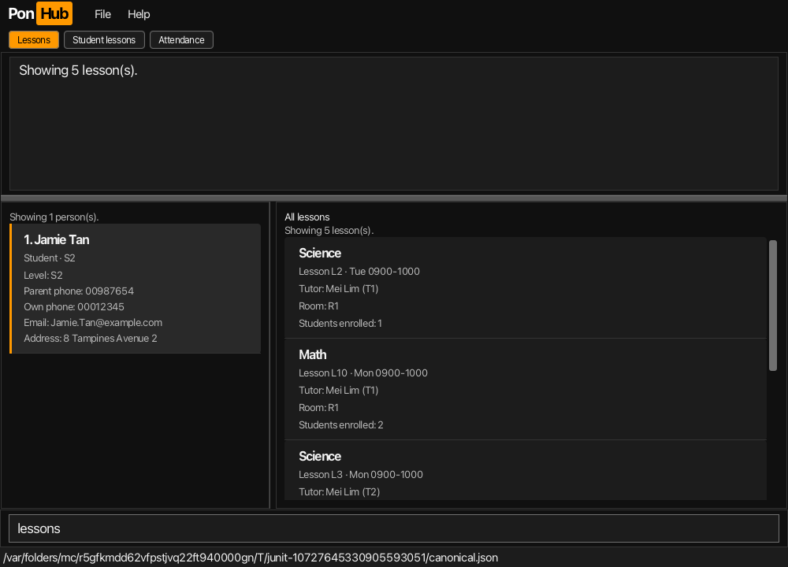
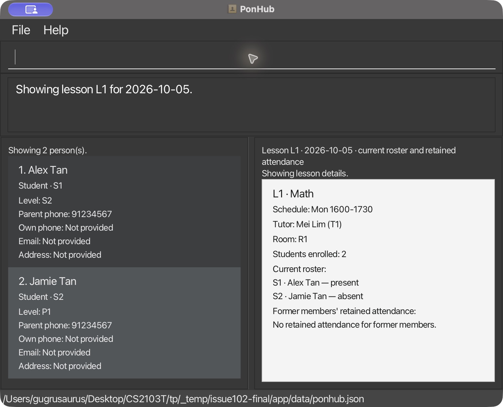
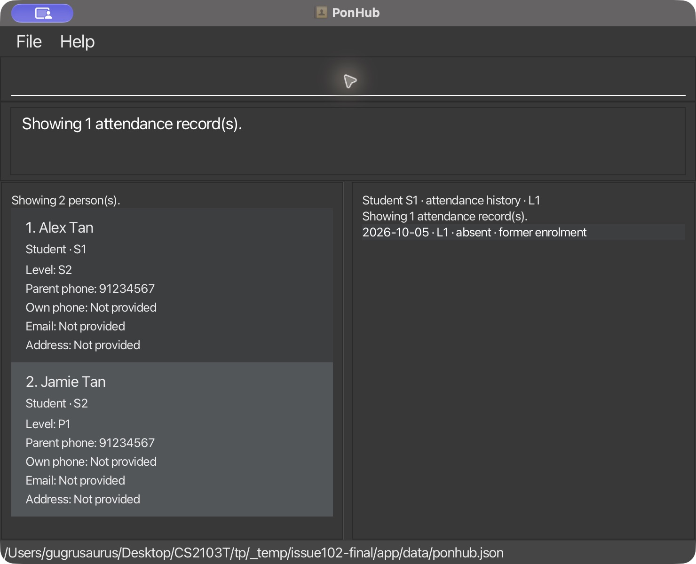

PonHub is a desktop app for tuition centre administrators to manage student, tutor and parent records and create
shared recurring lessons and track attendance. Its command box lets you work quickly from the keyboard while
the graphical interface shows separate people and shared-lesson results.

The people list is on the left, with Lesson or attendance results on the right. Enter commands in the
full-width box below both lists and press Enter. The shared feedback/help area above the lists remains
resizable; drag its divider to adjust reading space, and scroll either list independently.
The optional **All lessons**, **Student lessons** and **Attendance history** buttons above the results provide
shortcuts to the same commands; see [moving between results](#moving-between-results).

The [Lesson board example](#listing-and-searching-shared-lessons) shows a filtered people list beside
independent Lesson results. View the [application overview](images/Ui.png) for the full layout.
Screenshots show the current development build, including changes after public v1.4;
[the capture record](images/README.html) identifies the package and fictitious fixture.

* Table of Contents
{:toc}

--------------------------------------------------------------------------------------------------------------------

<a id="reading-the-planned-command-formats"></a>

## Reading the command formats

* Uppercase words such as `NAME` are placeholders. Replace them with your values; type lowercase words such as `r/student` literally.
* Square brackets mark optional input. For `help [COMMAND]`, enter `help` or `help add`, without brackets.
* A vertical bar (`|`) separates alternatives. For `s/present|absent`, enter either `s/present` or `s/absent`, without the bar.
* A prefix identifies a value: `n/Alex Tan` supplies a name, including its internal space. Type command names and prefixes in lowercase. Prefixed fields may appear in any order, once each; omit unknown optional values. Only `edit` accepts explicit blank optional fields to clear them.
* An ellipsis (`...`) means more supported fields may follow. For search, combine different filters allowed for that category; do not type the dots or repeat a prefix. Accepted values and case rules are given with each command.
* Person positions and stored IDs select different things. Follow [Selecting people and lessons](#selecting-people-and-lessons) before using `INDEX`, `STUDENT_INDEX` or `LESSON_ID`.

### Selecting people and lessons

`INDEX` is a positive, one-based position in the **currently displayed people list**. `STUDENT_INDEX` uses
that same list and must select a student, even when other roles are displayed. Run `list` or a people search
and check the current cards before each person command. Filtering, addition and deletion can change positions.

Cards show a stable person ID separately: `S1` for a student, `T1` for a tutor or `P1` for a parent.
Stored IDs and relationships survive view changes and restart. Commands resolve the current position to that ID;
do not type a person ID where a position is required. Addition allocates IDs automatically.

Shared lessons use stable IDs such as `L1`. Select an existing lesson with `lid/LESSON_ID`; there is no
per-student lesson index. Lesson, roster and history results preserve the people list and do not supply person
positions. To create a lesson, use the [tutor lookup rules](#4-creating-shared-lessons-and-other-lesson-operations).

`st/HHMM` and `et/HHMM` use four-digit, 24-hour times. A prefix's meaning depends on the command:
`d/` accepts a weekday for lesson creation/search and a real `YYYY-MM-DD` date for attendance or dated details;
`s/` accepts a subject for creation/search and an attendance status for `mark`.

## Quick start

The latest published release is [v1.4](https://github.com/AY2627S1-CS2103T-F13-3/tp/releases/tag/v1.4).
This current-source guide can include unreleased changes; use the
[v1.4 User Guide](https://github.com/AY2627S1-CS2103T-F13-3/tp/blob/v1.4/docs/UserGuide.md#quick-start)
for the commands available in that downloaded JAR.

1. Ensure that Java `25` is installed on your computer.<br>
   **Mac users:** Install Azul JDK 25 with JavaFX (`25.0.3.fx-zulu`) as prescribed by the [course's Mac advisory](https://nus-cs2103-ay2627-s1.github.io/website/admin/programmingLanguages.html) and [Mac installation guide](https://se-education.org/guides/tutorials/javaInstallationMac.html). Use this installation in the terminal that launches PonHub.

1. Download **`ponhub.jar`** from the [v1.4 release](https://github.com/AY2627S1-CS2103T-F13-3/tp/releases/tag/v1.4).
   To preview unreleased changes described in this guide, contributors can instead build
   `build/libs/ponhub.jar` with `./gradlew shadowJar`; see [DevOps](DevOps.html#build-automation).

1. Put the JAR file in the folder you want to use for PonHub. Keep this folder when moving or backing up your data.

1. Open a terminal in that folder, confirm `java -version` reports Java 25, and run `java -jar ponhub.jar`.
   The PonHub window should open.

1. A missing `data/ponhub.json` starts an empty people list. Enter a command in the command box and press Enter. Start with `help`, then `help add`:

   * `add r/tutor n/Mei Lim p/92345678 e/mei@example.com` adds a tutor.
   * `addlesson d/Mon st/1600 et/1730 s/Math tu/Mei Lim rm/R1` creates an empty-roster shared lesson.
   * `add r/student n/Alex Tan l/S2 pp/91234567` adds a student.
   * `add r/student n/Jamie Tan l/P1 pp/91234567` adds a second student.
   * `list r/student` shows Alex at position 1 and Jamie at position 2 in this fresh dataset.
   * `enrol 1 lid/L1`, then `enrol 2 lid/L1`, enrols both students in the same lesson.
   * `lessons` shows lesson `L1` once with a roster size of 2; `lessons 1` shows Alex's current lessons.
   * `mark 1 lid/L1 d/2026-10-05 s/present`, then `mark 2 lid/L1 d/2026-10-05 s/absent`,
     records independent attendance for the same Monday occurrence.
     `showlesson lid/L1 d/2026-10-05` displays Alex as present and Jamie as absent.
   * `mark 1 lid/L1 d/2026-10-05 s/absent` corrects only Alex's record.
     Run `showlesson lid/L1 d/2026-10-05` again to see both students recorded as absent.
   * `unenrol 1 lid/L1` removes Alex's membership while keeping both attendance records.
     `lessons 1` now shows no current lessons; `lessons` still shows `L1` with Jamie enrolled.
   * `history 1 lid/L1` shows Alex's retained absence with former-member context after unenrolment.
   * `unmark 1 lid/L1 d/2026-10-05` removes Alex's retained record after unenrolment, keeping Jamie's record and membership.
     Repeating it reports no change.
   * `deletelesson lid/L1` is blocked because Jamie's membership and attendance still reference `L1`.
   * `addlesson d/Tue st/1600 et/1730 s/Math tu/Mei Lim rm/R1` creates an unreferenced lesson `L2`.
     `deletelesson lid/L2` removes it; `L1` and both people records remain.
   * `add r/parent n/Pat Tan p/91234567` adds a parent.
   * `list r/student` displays students; `list` displays all roles.
   * `help ADD` shows the same guidance as `help add`.
   * `exit` closes PonHub.

The first successful mutation creates the data file. Keep the same JAR folder to load the saved records and stable IDs after restart. Reopen it, run `list r/student`, then `lessons`: Alex and Jamie retain their IDs, and `L1` still has Jamie enrolled. `history 2 lid/L1` shows Jamie's retained dated attendance. These example positions and `L1` assume a fresh dataset; with existing data, use the returned Lesson ID and recheck current people positions before each student command.

For a separate store, launch with `java -jar FILENAME.jar --data=data/another-ponhub.json`. Quote an argument containing spaces, for example `java -jar FILENAME.jar --data="separate store/ponhub.json"`. Select a previously unused path when re-entering legacy records; see [Data protection](#data-protection-in-the-current-build).

### Completing command names with Tab

In the command box, type a lowercase command prefix and press **Tab**: `sho` becomes `showlesson`.
Press Tab again to cycle through matches in catalogue order, for example `ad` → `add` → `addlesson` → `add`.
Completion uses the prefix before the caret and replaces the whole command word, keeping surrounding
spaces and arguments unchanged. The caret ends just after the completed word. Editing the draft, moving
the caret or leaving the command box starts a new cycle. Only commands available in this session are offered;
a protected session offers `help`, `list` and `exit`.

Tab completes only when the caret is within or immediately after the command word, with a nonempty
matching prefix and no selected text. Otherwise Tab moves focus normally, including on blank input,
unmatched prefixes and arguments. **Shift+Tab** always moves focus backwards; use it to leave the box
while a command name matches. Tab does not run a command; press **Enter** to submit the completed draft.
Arguments and values are not completed.

### Recalling submitted commands with Up and Down

With focus in the command box, press **Up** for an older submitted command and **Down** for a newer one.
Recall does not execute a command; edit it if needed and press **Enter** to submit it. Down past the newest
entry restores your unfinished draft, including its caret and selection. Typing or using Tab completion on
a recalled command makes the edited text your new draft. Shift/Ctrl/Alt/Command with an arrow keeps its
normal editing behavior.

The last 50 nonblank submissions, including unsuccessful commands, are kept only for the current window
session and are cleared when it closes. Check current people positions and Lesson IDs before reusing an
old command: its original target may have moved or been removed. This recall is separate from the
attendance `history` command.

## Current command summary

Use this summary to find a command's syntax and example; the linked action names lead to its details.
The [shared conventions](#reading-the-command-formats) explain the notation and selectors. Type `help` for your
session's catalogue. A protected session permits only `help`, `list` and `exit`; `clear` and `find` are unavailable.

| Action | Format | Example |
| --- | --- | --- |
| [Add student](#1-adding-a-person-add) | `add r/student n/NAME l/LEVEL pp/PARENT_PHONE [p/PHONE] [e/EMAIL] [a/ADDRESS]` | `add r/student n/Alex Tan l/S2 pp/91234567` |
| [Add tutor or parent](#1-adding-a-person-add) | `add r/ROLE n/NAME p/PHONE [e/EMAIL] [a/ADDRESS]` | `add r/tutor n/Mei Lim p/92345678` |
| [Edit person](#editing-a-person-edit) | `edit INDEX [n/NAME] [p/PHONE] [e/EMAIL] [a/ADDRESS] [l/LEVEL] [pp/PARENT_PHONE]` | `edit 1 l/P2 e/` |
| [Create shared lesson](#4-creating-shared-lessons-and-other-lesson-operations) | `addlesson d/DAY st/HHMM et/HHMM s/SUBJECT tu/TUTOR_NAME [tp/TUTOR_PHONE] rm/ROOM` | `addlesson d/Mon st/1600 et/1730 s/Math tu/Mei Lim rm/R1` |
| [Edit shared lesson](#editing-a-shared-lesson-editlesson) | `editlesson lid/LESSON_ID [d/DAY] [st/HHMM] [et/HHMM] [s/SUBJECT] [tu/TUTOR_NAME] [tp/TUTOR_PHONE] [rm/ROOM]` | `editlesson lid/L1 st/1630 s/Advanced Math` |
| [Enrol student](#5-enrolling-and-unenrolling-students) | `enrol STUDENT_INDEX lid/LESSON_ID` | `enrol 1 lid/L1` |
| [Unenrol student](#5-enrolling-and-unenrolling-students) | `unenrol STUDENT_INDEX lid/LESSON_ID` | `unenrol 1 lid/L1` |
| [Mark attendance](#7-recording-attendance-and-retrieving-history) | <code>mark STUDENT_INDEX lid/LESSON_ID d/YYYY-MM-DD s/present&#124;absent [ack/future]</code> | `mark 1 lid/L1 d/2026-10-05 s/present` |
| [Unmark attendance](#7-recording-attendance-and-retrieving-history) | `unmark STUDENT_INDEX lid/LESSON_ID d/YYYY-MM-DD` | `unmark 1 lid/L1 d/2026-10-05` |
| [Delete person](#3-deleting-a-person-delete) | `delete INDEX`, then `delete confirm` or `delete cancel` | `delete 1`, then `delete confirm` |
| [Delete shared lesson](#4-creating-shared-lessons-and-other-lesson-operations) | `deletelesson lid/LESSON_ID` | `deletelesson lid/L1` |
| [List people](#2-listing-people-list) | `list [r/ROLE]` | `list r/student` |
| [Search people](#searching-people-search) | `search c/CATEGORY [FILTER/VALUE]...` | `search c/student n/Alex d/Mon s/Math` |
| [List shared lessons](#listing-and-searching-shared-lessons) | `lessons [STUDENT_INDEX]` | `lessons` |
| [Attendance history](#7-recording-attendance-and-retrieving-history) | `history STUDENT_INDEX [lid/LESSON_ID]` | `history 1 lid/L1` |
| [Show lesson details](#listing-and-searching-shared-lessons) | `showlesson lid/LESSON_ID [d/YYYY-MM-DD]` | `showlesson lid/L1 d/2026-10-05` |
| [Search shared lessons](#listing-and-searching-shared-lessons) | `search c/lesson [sn/NAME] [d/DAY] [st/HHMM] [et/HHMM] [s/SUBJECT] [tu/TUTOR_NAME] [rm/ROOM]` | `search c/lesson tu/mei d/Mon` |
| [Get help](#viewing-command-help-help) | `help [COMMAND]` | `help add` |
| Exit | `exit` | `exit` |

Use the [selector rules](#selecting-people-and-lessons) to choose a person or lesson.
The [people example](#people-positions-and-stable-ids) shows how positions change while IDs stay fixed.
Addition allocates the ID; do not supply it as an add argument. Role values ignore case. `exit` accepts no arguments.

### Viewing command help: `help`

**Format:** `help [COMMAND]`

`help` shows a concise catalogue in Result Display, with one short description per supported command.
Use `help COMMAND`, for example `help list`, for that command's full syntax, rules and examples.
In a normal session, `help add`,
`help edit`, `help addlesson`, `help editlesson`, `help enrol`, `help unenrol`, `help mark`, `help unmark`, `help delete`, `help deletelesson`,
`help list`, `help lessons`, `help showlesson`, `help history`, `help search`, `help help` and `help exit` show usage guidance.
Topic names are case-insensitive, so `help ADD` is
accepted; the command word `help` remains lowercase. Asking for exit guidance does not exit the application.

Drag the horizontal divider below Result Display down to show more help or feedback, or up to give the
people and Lesson lists more room. Both areas keep a minimum height. Your split stays in place while you
enter commands or open help during the same session. Long messages still wrap and scroll vertically;
you can select and copy their text.

Choose **Help > Help** or press **F1** for the same catalogue, including when focus is in the command box or Result Display. Menu/F1 preserve unfinished command text. Help preserves records, the active person filter, order, selection and preferences. Typed help clears the submitted command in the usual way. Help needs no internet connection and does not save operational data.

Long guidance wraps within Result Display. Scroll vertically to read the rest; each new result starts at the top.

* `help addlesson`, `help editlesson`, `help enrol`, `help unenrol`, `help mark`, `help unmark` and `help showlesson` show their active syntax and examples. `help remove` returns
  `Unknown command: 'remove'. Type 'help' to see available commands.`
* `help add delete` returns `Invalid command format!` followed by `Usage: help [COMMAND]` and its explanation. Supply at most one topic.
* `clear` and `find` are absent from the catalogue. `edit` and `editlesson` each require a selector and at least one
  field; use their help topics for syntax. `edit` permits explicit blanks only for optional email, address and a
  Student's own phone. Every supplied `editlesson` value must be nonblank. Invalid commands make no data changes.
* In a protected session, help lists only `help`, `list` and `exit`; `help add`, `help edit`, `help addlesson`, `help editlesson`, `help enrol`,
  `help unenrol`, `help mark`, `help unmark`, `help history`, `help delete`, `help deletelesson`, `help lessons`, `help showlesson`
  and `help search`
  are unavailable.

### Adding a person: `add`
{: id="1-adding-a-person-add"}

Creates a student, tutor or parent record.

#### Format

* **Student:** `add r/student n/NAME l/LEVEL pp/PARENT_PHONE [p/PHONE] [e/EMAIL] [a/ADDRESS]`
* **Tutor:** `add r/tutor n/NAME p/PHONE [e/EMAIL] [a/ADDRESS]`
* **Parent:** `add r/parent n/NAME p/PHONE [e/EMAIL] [a/ADDRESS]`

#### Parameters

| Parameter | Description and accepted values |
|-----------|---------------------------------|
| `r/ROLE` | Required. Use `student`, `tutor` or `parent`. Values are case-insensitive. |
| `n/NAME` | Required. Between 1 and 100 Unicode code points after normalization. Use letters, attached combining marks, ordinary spaces, apostrophes (`'` or `’`), hyphens or periods, with at least one letter. See the name rules below. |
| `l/LEVEL` | Required for students; not allowed for tutors or parents. Use `P1`–`P6`, `S1`–`S5`, `JC1` or `JC2`. Values are case-insensitive and displayed in uppercase. |
| `pp/PARENT_PHONE` | Required for students; not allowed for tutors or parents. Use 3–15 digits without spaces or punctuation. |
| `p/PHONE` | Required for tutors and parents; optional for students. Use 3–15 digits without spaces or punctuation. Leading zeros are retained. |
| `e/EMAIL` | Optional. Use an email address such as `mei@example.com`, with no spaces and at most 254 characters. |
| `a/ADDRESS` | Optional. Between 1 and 200 printable ASCII characters. A slash is allowed only with a digit immediately on each side, as in `#01/02`. Tabs and line breaks are rejected. Surrounding Unicode spaces are removed and repeated ordinary spaces collapse before measuring length. |

For names, surrounding Unicode spaces are removed, repeated ordinary spaces collapse, and canonically
equivalent spellings are stored in NFC form. Letter case is preserved. Standalone lowercase `s/o` and `d/o`
are accepted between letter-bearing name text, as in `Ravi s/o Kumar` and `Anita d/o Kumar`.
Other slashes, digits, emoji, controls, invisible format characters and internal non-ASCII spaces are rejected.
Addresses accept `Blk 10, #01/02`, `Blk 12/34` and `Block A12/34B`; `A/B`, `/` and `#01//02` are rejected.
These literals apply to `n/` and `a/` in add/edit, and to Tutor `tu/` in lesson creation/editing.
Unknown, uppercase and repeated prefixes still cause errors; general quoting or escaping is unavailable.

For example, `add r/student n/Ravi s/o Kumar l/P1 pp/91234567 a/Blk 10, #01/02` stores both values.
The same name and address rules apply when editing a person and when loading saved data.

For email addresses, the local part before `@` may contain English letters, digits, periods, underscores, ASCII apostrophes (`'`), `%`, `+` and `-`, for example `sean.o'connor@example.com`. It must not begin or end with a period or contain consecutive periods. Domain labels may contain English letters, digits and hyphens. The domain must contain at least two dot-separated labels, with no leading or trailing hyphens in a label. Its final label must contain 2–63 English letters. Email spelling and letter case are preserved.

**Current behavior:** The role-specific formats and contact rules above are active. Unknown, repeated, missing or blank fields are rejected. `l/` and `pp/` are student-only. Tags and the inherited contact-only add format are unavailable. Saved records must satisfy the same validation rules when loaded.

**Testing older data:** Back up the data file before testing this increment and use a working copy. If an older file fails validation, the app starts a [protected session](#data-protection-in-the-current-build): the empty view is not your saved data, only `help`, `list` and `exit` are available, and the original file is preserved. Close the app before restoring or deliberately correcting a compatible file, then restart.

#### Examples

* `add r/student n/Alex Tan l/S2 pp/91234567`<br>
  Adds Alex Tan as a Secondary 2 student with parent contact number 91234567.
* `add r/tutor n/Mei Lim p/92345678 e/mei@example.com`<br>
  Adds Mei Lim as a tutor with a phone number and email address.
* `add r/parent n/Pat Tan p/91234567`<br>
  Adds Pat Tan as a parent.
* `add r/student n/José Santos l/P1 pp/91234567`<br>
  Accented names, `李明`, `தமிழ்` and `Anne-Marie O’Neill` are also accepted. A combining mark must
  follow a letter or another attached mark; names cannot begin with a combining mark.

#### Expected result

PonHub saves the new record and displays a confirmation such as:
`New student added: Alex Tan (S1).`

The person list resets to show all roles, with the new record at the end. Recheck its displayed positions before selecting a person in your next command. A new student starts with no lessons or attendance records.

#### Things to note

* A separate parent record is optional. You can add a student using their parent's phone number before creating a parent record.
* A duplicate has the same role, normalized name and contact number. For students, the contact number used for this check is `pp/`; for tutors and parents, it is `p/`.
* Duplicate name comparisons ignore letter case, repeated spaces and canonical Unicode spelling differences
  (for example, `é` typed as one code point or as `e` plus an accent). Accents remain significant:
  `José` and `Jose` are different names.
* Siblings with different names may share the same parent phone number.
* Changing an optional email, address or student phone number does not make an otherwise duplicate record unique.

For example, a duplicate student is rejected with:
`A student with the same name and parent phone already exists.`

Validation and duplicate failures do not write. A save failure preserves the current session data, allocation
counters, role filter and selected card; follow the [unsuccessful-save recovery steps](#checking-unsuccessful-saves-in-the-current-build)
for the stored file. Success is reported only after saving; a failed addition consumes no ID.

### Listing people: `list`
{: id="2-listing-people-list"}

Displays all people or only people with a specified role, including each current command index and separately labelled stable ID.

#### Format

`list [r/ROLE]`

#### Examples

| Command | Result |
|---------|--------|
| `list` | Displays everyone and clears previous person filters. |
| `list r/student` | Displays students only. |
| `list r/tutor` | Displays tutors only. |
| `list r/parent` | Displays parents only. |

#### Expected result

People appear in creation order, numbered from 1 within the displayed result. Each card shows the name prominently, followed by its role, stable `ID` and current command `Position`.
Attribute captions appear above their values. Student details are grouped as education level, own phone/email,
parent phone, then address; Tutor and Parent cards show their own contacts and address. Missing optional contacts
show `Not provided`. Long values wrap; scroll vertically to read the full card. Use positions according to the [shared selector rules](#reading-the-command-formats).

Example feedback:
`Showing 3 student(s).`

An empty result is valid. PonHub reports a count of zero and the people panel shows `No persons to display.`

#### Copying contact values

Click **Copy** beside an available phone, email or address to put the full value on your system clipboard,
without its caption. For example, **Copy** beside Alex's parent phone copies `91234567`.
Phone numbers retain their displayed leading zeros. Missing values marked `Not provided` have no Copy button.

For keyboard access, use Tab or Shift+Tab to focus the desired **Copy** button, then press Space or
Ctrl+C (Cmd+C on macOS). The button's accessible name identifies the contact and person.
Copying leaves records, the people filter/order, selected card and unfinished command text unchanged.
Mouse copying also keeps command focus, cursor and text selection. It replaces the clipboard's previous
contents. Ctrl+C or Cmd+C in the command box or feedback area continues to copy that area's selected text.

<a id="people-positions-and-stable-ids"></a>

#### Example: positions change, IDs stay fixed

In a fresh, empty dataset, run these commands in order. The result column abbreviates the people cards as **position: name (ID)**.

| Command | Displayed people after the command |
| --- | --- |
| `add r/tutor n/Mei Lim p/92345678` | **1:** Mei Lim (`T1`) |
| `add r/student n/Alex Tan l/S2 pp/91234567` | **1:** Mei Lim (`T1`); **2:** Alex Tan (`S1`) |
| `add r/student n/Jamie Tan l/S2 pp/91234567` | **1:** Mei Lim (`T1`); **2:** Alex Tan (`S1`); **3:** Jamie Tan (`S2`) |
| `list r/student` | **1:** Alex Tan (`S1`); **2:** Jamie Tan (`S2`) |
| `delete 1` | **1:** Alex Tan (`S1`); **2:** Jamie Tan (`S2`); asks for confirmation |
| `delete confirm` | **1:** Jamie Tan (`S2`) |
| `add r/student n/Robin Tan l/S2 pp/91234567` | **1:** Mei Lim (`T1`); **2:** Jamie Tan (`S2`); **3:** Robin Tan (`S3`) |

`delete 1` previews Alex, who has no lesson or attendance references in this example; `delete confirm` removes him.
Jamie keeps `S2` throughout;
Robin receives `S3` because deleted IDs are never reused. Addition shows all roles again, so Jamie moves to
position 2. Check the current people cards before the next person command. With existing data, use your actual
positions and IDs rather than this example's numbers.

#### Things to note

* Use the singular role names `student`, `tutor` and `parent`. To display everyone, enter `list`; `list r/all` is invalid.
* Listing changes the displayed view without modifying stored records.
* Use positions from the latest people list or people search. A previous position may select someone else after the view changes or a person is deleted.

--------------------------------------------------------------------------------------------------------------------

### Searching people: `search`

Enter `search c/student`, `search c/parent` or `search c/tutor`, followed by any filters needed.
For example, `search c/student n/alex l/s2 pp/91234567` finds students whose own details match all three values.
See [Searching people and shared lessons](#6-searching-people-and-shared-lessons) for the complete filter matrix,
matching rules and a reusable example. Results replace the people list, so check its new positions before
issuing a person command.

### Searching parents through their children

Use `search c/parent` with `sn/` or Lesson filters to find Parents through their linked children.
The [relationship rules](#relationship-search-rules) explain exact parent-phone links and why one child's
name cannot combine with another child's Lesson.

### Searching tutors through assigned lessons

Use `search c/tutor` with `sn/` or Lesson filters to find Tutors through their assigned Lessons.
The [relationship rules](#relationship-search-rules) explain stable Tutor assignments and current rosters;
use `n/` for the Tutor's own name in this category.

### Listing and searching shared lessons

**Formats:**

* `lessons [STUDENT_INDEX]`
* `search c/lesson [sn/STUDENT_NAME] [d/DAY] [st/HHMM] [et/HHMM] [s/SUBJECT] [tu/TUTOR_NAME] [rm/ROOM]`

The right-hand lesson panel initially shows the full catalogue. `lessons` restores it after a lesson search or
student selection. Every shared lesson appears once in creation order, including empty rosters. Cards show the
subject as the heading, followed by a separate identity line with the stable Lesson ID. Labelled fields show the
schedule, tutor name and ID, room and the number of currently enrolled students.
The lesson heading identifies the selected Student ID or active filters even after another command changes
the feedback. Scroll either panel independently; drag the divider to give long values more room. Labels wrap within their cards.

To show one student's current lessons, find their position in the **current people panel**, then enter
`lessons POSITION`. For example, after `list r/student`, use `lessons 1` only if the intended Student is at
position 1. The older `lessons si/POSITION` form remains accepted for compatibility. Either form selects the
visible person once. A stable ID such as `S1`, a lesson ID, zero, negative or out-of-range position, a repeated
or combined selector, or a position occupied by a Tutor/Parent is rejected. Changing the people filter later
does not change which Student's lessons are being shown. Attendance retained after unenrolment does not make a
lesson part of that Student's current enrolments; use `history` to inspect retained records.

For Lesson search, use `search c/lesson` with the filters in the
[search matrix](#6-searching-people-and-shared-lessons). A search starts from the complete catalogue rather
than narrowing the previously displayed results. `lessons` reports `Showing N lesson(s).`; Lesson search
reports `Found N lesson(s).`. An empty result is valid and shows `No lessons to display.`.



This development-build example shows Alex selected in a filtered Student list, with **Student lessons**
active and the right heading identifying Student S1's current lessons. Math L1 has two enrolled Students.
Its fictitious records are separate from the [worked search example](#worked-search-example) below.
The heading above each panel identifies its active results. Drag the divider to adjust their widths;
long values wrap, and either list scrolls independently. The command box remains below both lists.

Lesson retrieval preserves people filters, order, selection and command positions, and never saves operational
data. A people search likewise preserves the selected Lesson or history results. Committed changes refresh
both panels as needed; invalid requests and failed saves leave the previous results intact. See
[Lesson details](#lesson-details) and [attendance history](#attendance-history) for the other right-panel views.

### Moving between results

Hover over a Lesson or attendance heading or its result count to read its complete current text in a
wrapping tooltip. This also works after `help` replaces the command feedback.

Enter `lessons`, `lessons STUDENT_INDEX`, `history STUDENT_INDEX`, `showlesson lid/LESSON_ID` or a `search`
command from any current result. Successful commands display their results automatically. Typed commands use
their supplied selectors and filters, regardless of which people card is selected; no preliminary button click
is needed. Check the current people-list position before supplying a Student index.

If you prefer a shortcut, use the buttons above the results:

| Button | Equivalent command | Selection needed |
| --- | --- | --- |
| **All lessons** | `lessons` | None |
| **Student lessons** | `lessons STUDENT_INDEX` | A Student card in the current people list |
| **Attendance history** | `history STUDENT_INDEX` | A Student card in the current people list |

The guidance below the buttons explains card selection: select a Student card to choose the target of
**Student lessons** or **Attendance history**. Selecting a card does not replace either panel's results. The Student
shortcuts use that card's current displayed position. Select a Student again if filtering or a data change
removes that selection. With no current Student selected, including a selected Tutor or Parent,
the buttons explain what to select and keep the previous results. Clicking a shortcut preserves any unfinished
command text, cursor and text selection. The shortcuts follow the same validation and protected-session
restrictions as typed commands. For dated Lesson details, Lesson-specific history or search filters, enter
the full command directly.

An orange button identifies the displayed result: **All lessons** for the complete catalogue, **Student
lessons** for one Student's current lessons, or **Attendance history** for recorded attendance, including empty
results. Lesson search and Lesson details leave all three buttons inactive. The indicator follows typed
commands too. Selecting another card, changing the people filter or opening help keeps the current result
and indicator; the heading still identifies the Student or query being displayed. Invalid commands and failed
saves also retain them. If deleting the target of active history clears it, the retained Lesson result returns
with its corresponding indicator.

## Data protection in the current build

PonHub saves people, shared lessons, rosters, retained attendance and ID allocation state together in
`data/ponhub.json` inside the folder containing the JAR. Attendance history is retained when a student
is unenrolled from a lesson.

`--data=PATH` selects a different file within that folder or its subfolders; relative paths start from the JAR folder. Absolute paths are accepted only within that folder. Blank paths and paths escaping it, including through symbolic links, are rejected at startup. Select a separate data file: `preferences.json` and the root `ponhub.log*` and legacy `addressbook.log*` names are reserved, including rotation/lock files, future suffixes, case variants and aliases to them. New logs use `ponhub.log*`; old `addressbook.log*` files remain untouched and reserved for compatibility. Window preferences are saved separately in `preferences.json` in the JAR folder; selecting a different store does not change the preference file.

A missing selected file starts a normal empty session and remains missing until the first successful mutation.
`help`, `list`, `lessons`, `showlesson`, `history`, `search` and `exit` do not create or rewrite operational data. An invalid, unreadable, corrupt,
unsupported or legacy selected file produces a **Data file protected** warning. The empty list in that session is
unavailable saved data: it does **not** mean the original records were deleted. Only `help`, `list` and `exit` are
available, and operational writes are blocked.

A command save error does not publish its proposed change to the current session. The stored-file outcome depends
on where writing failed; follow [Checking unsuccessful saves](#checking-unsuccessful-saves-in-the-current-build)
before retrying or restarting.

To recover:

1. Note the selected file path and the reason in the warning. Close PonHub and back up the original file before making changes.
2. For a supported file, restore a known-good compatible backup or correct the reported JSON/access-permission problem on a working copy. Preserve stable IDs, relationships, retained attendance and allocation counters. For an unsupported version, use a compatible PonHub build on a separate copy. Follow the legacy-file instructions below for unversioned AB3 data.
3. Restart PonHub with the recovered file selected. Check the people, lessons, rosters and attendance history before continuing, and keep the original backup until you have verified recovery.

Repairing or removing the file while PonHub is running does not unlock that session. Do not delete
the original file to dismiss the protection.

The default startup leaves an older `data/addressbook.json` untouched. Selecting an unversioned AB3 file with `--data` rejects it and preserves its bytes; PonHub does not guess roles or migrate it automatically. Back it up, choose a separate previously unused store inside the JAR folder, such as `java -jar FILENAME.jar --data="separate store/ponhub.json"`, then manually add each person with an explicit role. There is no importer or setup command. Verify the new records before relying on the new store.

<a id="planned-shared-lesson-workflow"></a>

## Shared-lesson workflow

The following sections record the shared-lesson and guarded-deletion contracts. Role-aware add/list,
`addlesson`, `editlesson`, `enrol`, `unenrol`, `mark`, `unmark`, `delete`, `deletelesson`, `lessons`, own-contact people search,
lesson details, history, lesson search and Student, Parent and Tutor relationship search are active.
Use the [current command summary](#current-command-summary) and your build's `help` for active routes.

<a id="planned-quick-start"></a>

### Shared-lesson example

Follow the [Quick start](#quick-start) for one runnable journey: create two students and one shared lesson,
enrol both students, record and correct dated attendance, retain history after unenrolment, and remove a record.
It also shows deletion guards and restart checks. For individual operations, use the
[command summary](#current-command-summary) and the command's examples below.

<!-- @@author ErnestChuaa -->
### Editing a person: `edit`

Correct one student, tutor or parent while retaining their role, stable ID and linked records.

**Format:** `edit INDEX [n/NAME] [p/PHONE] [e/EMAIL] [a/ADDRESS] [l/LEVEL] [pp/PARENT_PHONE]`

Run `list` or a people search and check the current position first. Supply at least one field, using the
same value rules as [adding a person](#1-adding-a-person-add). Omitted fields remain unchanged.
Only students accept `l/` and `pp/`. Blank `e/` or `a/` clears that optional value; blank `p/` clears a
student's own phone. Names, student levels/parent phones and tutor/parent phones cannot be cleared.
Role/ID changes, repeated or unknown prefixes, invalid values and duplicates of another person are rejected.

A duplicate error identifies the fields to correct: students use the normalized name and parent phone
(`pp/`); tutors and parents use the normalized name and own phone (`p/`). Change `n/` or that identifying
phone to a unique combination. A student's different level or own phone does not resolve a duplicate.
The rejected edit leaves the existing records unchanged and stays in the command box for correction.

For example, after the quick-start data, `list r/student` then `edit 1 l/P2 e/` updates Alex's level and
clears their email. `edit 1 n/Alex  Tan` reports no change after space normalization and does not save;
`edit 1 n/ALEX TAN` saves the corrected display capitalization. Successful changes survive restart.

The role/search filter stays active and results are re-evaluated. A renamed person may disappear from a
name search; recheck positions before the next indexed command. Lessons, rosters, attendance and counters
retain their identities. A tutor rename updates current lesson labels. Changing `pp/`, or a parent's `p/`,
recomputes exact-phone relationships without changing anyone else's stored phone.
Protected sessions reject edits. Invalid input does not write. Save errors preserve the previous live data and view;
follow the [unsuccessful-save recovery steps](#checking-unsuccessful-saves-in-the-current-build) for the stored file.
<!-- @@author -->

<!-- @@author ys000009 -->
### Editing a shared lesson: `editlesson`

Correct one existing Lesson while retaining its stable ID, catalogue position, roster and attendance history.

**Format:** `editlesson lid/LESSON_ID [d/DAY] [st/HHMM] [et/HHMM] [s/SUBJECT] [tu/TUTOR_NAME] [tp/TUTOR_PHONE] [rm/ROOM]`

Use the stable ID shown by `lessons` or `showlesson` and supply at least one field. Omitted fields remain
unchanged, so either time endpoint can be edited by itself when the complete resulting slot still has its start
before its end. Values follow the same day, time, subject, Tutor and room rules as `addlesson`. Use `tp/` only
together with `tu/`; the optional phone selects one exact Tutor when normalized full names are shared.

For example, `editlesson lid/L1 st/1630 s/A-Math` keeps `L1`'s weekday, end time, Tutor, room and roster.
An identical edit reports `No changes to lesson: L1.` and does not save. A successful change updates current
lesson cards, searches and selected details, and survives restart without changing IDs or allocation counters.

The complete replacement is checked against every other Lesson. Tutor, room and enrolled-Student overlaps are
rejected; the Lesson being edited is not treated as its own conflict, and adjacent slots remain valid. A weekday
change is rejected while any current or former Student has retained attendance on an incompatible date. PonHub
does not move or delete that history automatically. Use `showlesson lid/LESSON_ID d/YYYY-MM-DD` with the Lesson
and date from the rejection to identify the retained records, including former members. Run `list r/student`
and match the intended Student's name/stable ID to their current position. Use
`unmark STUDENT_INDEX lid/LESSON_ID d/YYYY-MM-DD` only if removal is intended, then retry the edit. Recheck positions
before each indexed command. If a selected dated detail has no attendance but its
date no longer matches an allowed weekday change, PonHub keeps the Lesson selected and clears that obsolete date.

Unknown, repeated, blank or missing fields, a missing Lesson, Tutor lookup failures, malformed resulting slots and
schedule clashes are rejected without writing. A save failure preserves the live state and view; follow the
[unsuccessful-save recovery steps](#checking-unsuccessful-saves-in-the-current-build) for the stored file. Protected
sessions reject the command before parsing and omit `help editlesson`.
<!-- @@author -->

### Deleting a person: `delete`
{: id="3-deleting-a-person-delete"}

**Active.** Permanently removes one unreferenced person after you check and confirm their name and stable ID.

#### Format

`delete INDEX`, followed by `delete confirm` to proceed or `delete cancel` to keep the person.

#### Example

1. `list r/parent`
2. Check the intended parent's current position. If Pat Tan is at position 1 in this result, enter `delete 1`.
3. Check the name and stable ID in the prompt. Enter `delete confirm` only if they identify the intended person.
   Enter `delete cancel` to leave the record and current view unchanged.

For a complete add/filter/delete sequence, follow the [people-position example](#people-positions-and-stable-ids).

#### Expected result

The first command leaves data and views unchanged and displays:

```text
Delete parent: Pat Tan (P1)? This permanently removes the record.
Enter delete confirm to proceed or delete cancel to keep it.
Any other command cancels this request.
```

After `delete confirm`, PonHub saves the deletion and reports:
`Deleted parent: Pat Tan (P1).`

The current filter is preserved. Remaining people keep their IDs and their displayed positions are renumbered.
Cancellation reports `Person deletion cancelled. No records were changed.` and does not save.

#### Restrictions

* `INDEX` must be a positive integer within the current people list. A stable person ID such as `P1` is not a delete selector.
* Only one person can be deleted per command.
* Student deletion is blocked while enrolled or referenced by attendance. Tutor deletion is blocked while any lesson references the tutor, including a lesson with an empty roster. Linked records are not deleted automatically; removing a student never removes a shared lesson.
* Deleting a separate parent record does not erase the parent phone number stored on a student's record.
* Confirmation applies only to the most recent preview. Any other command, including `help`, `list`, a search or
  rejected input, cancels it. A new `delete INDEX` replaces it. Closing or restarting also discards it.
* `delete confirm` and `delete cancel` take no extra arguments. Without a pending preview, confirmation is rejected;
  cancellation simply reports that no person deletion is awaiting confirmation.

If dependencies prevent deletion, feedback identifies the Student or Tutor and the blocking Lesson ID. Retained
attendance also identifies its date, for example:
`Student S1 cannot be deleted while retained attendance exists for lesson L1 on 2026-10-05.`

Unenrolment removes current membership but keeps dated attendance, which continues to block Student deletion.
Use `unmark STUDENT_INDEX lid/LESSON_ID d/YYYY-MM-DD` to remove a dated Attendance dependency before retrying
Student deletion. Use `deletelesson lid/LESSON_ID` only after clearing the Lesson's roster and attendance.

Successful deletion preserves the role or own-contact search filter and renumbers remaining positions. Surviving
stable IDs, lesson/attendance records and Student parent-phone values are unchanged. Deleted IDs are never reused,
including after restart. Invalid selectors and blocked deletions do not write. Failed saves preserve the live state
and current view; follow the [unsuccessful-save recovery steps](#checking-unsuccessful-saves-in-the-current-build)
for the stored file. After a save failure, run `delete INDEX` again, recheck the target and enter `delete confirm`.
If the lesson panel shows the deleted student's current lessons, it stays empty and identifies that same Student ID
until you run another `lessons` or lesson-search command. Deletion never switches it to a different student.
Check the updated people list before deleting another person.

### Creating shared lessons and other lesson operations
{: id="4-creating-shared-lessons-and-other-lesson-operations"}

**Create (active):** `addlesson d/DAY st/HHMM et/HHMM s/SUBJECT tu/TUTOR_NAME [tp/TUTOR_PHONE] rm/ROOM`

Example: `addlesson d/Mon st/1600 et/1730 s/A-Math tu/Mei Lim rm/B-01`.

A subject contains 1 to 50 Unicode letters or digits, with single spaces or hyphens between non-empty parts.
For example, `Math`, `Primary 5 Math` and `A-Math` are accepted; leading, trailing or repeated hyphens are rejected.

A room identifier contains 1 to 10 characters in total, including any hyphens. It otherwise uses letters or digits,
with optional single hyphens between non-empty parts. PonHub displays it in upper case, so `b-01` becomes `B-01`.
Case variants therefore identify the same room and cannot bypass room-clash checks. Spaces and leading, trailing or
repeated hyphens are rejected.

The tutor must already exist. `tu/` uses the same name rules as `n/` and matches the complete name,
ignoring letter case, repeated spaces and canonical Unicode spelling differences. Accents remain significant.
If several tutors share that name, supply their exact phone number, for example `tu/Mei Lim tp/92345678`.
An ambiguous name without `tp/` is rejected. A supplied phone must match the named tutor exactly,
even when the name is unique; an unmatched name or phone is rejected.

Use `Mon` through `Sun` and four-digit 24-hour HHMM times. Start must be earlier than end on the same day. A successful addition returns a stable lesson ID, such as `L1`, with an empty roster. Creation does not select or enrol a student. Tutor and room bookings must not overlap another lesson on that weekday; adjacent intervals are allowed. Adding more students to this lesson does not book the tutor or room again.

**Delete (active):** `deletelesson lid/LESSON_ID`, for example `deletelesson lid/L1`.

`LESSON_ID` is the stable ID shown on the lesson card. Do not use a lesson search position or a Student's lesson
position. Deletion is blocked while the roster is non-empty or any attendance refers to the Lesson, including
history retained after unenrolment. Feedback identifies either the roster Student IDs to unenrol or the first
Student/date attendance dependency to unmark. The command never removes Students, memberships or attendance
automatically.

Once every Student has been unenrolled and every dated attendance record has been unmarked, deletion removes only
that Lesson. Its tutor and room times become available again. Surviving Lesson IDs do not change, and a later
`addlesson` receives a new higher ID rather than reusing the deleted ID. A missing Lesson, invalid command, blocked
deletion or failed save preserves the live schedule, allocation counter and current people/lesson views. Missing,
invalid and blocked requests do not write; after a save failure, follow the
[unsuccessful-save recovery steps](#checking-unsuccessful-saves-in-the-current-build) for the stored file.
Use [`editlesson`](#editing-a-shared-lesson-editlesson) to change a shared Lesson's recurring details while
preserving its stable ID, roster and retained attendance. Cancelling one occurrence remains future scope.

For catalogue and current Student enrolments, see
[Listing and searching shared lessons](#listing-and-searching-shared-lessons).

<a id="lesson-details"></a>

**Details (active):** `showlesson lid/LESSON_ID [d/YYYY-MM-DD]`.

For example, `showlesson lid/L1` displays the subject as the heading, followed by the stable Lesson ID and labelled
schedule, tutor, room and enrolment count. The current roster lists each Student's stable ID and name. The lesson
details use a separate scrolling panel; no
extra click is needed to expand the roster or retained former-member attendance. Scroll to reach all entries;
no roster row number is a person-command selector. `showlesson lid/L1 d/2026-10-05` also shows each current roster
student's `present`, `absent` or `unrecorded` status for that real, matching-weekday date. `Unrecorded` means no
attendance entry exists; it is never treated as absent. Retained records for former members appear in a separate
section, limited to the supplied date when one is given. Without a date, that section shows all retained
former-member records, newest first. The two prefixes may appear in either order, for example
`showlesson d/2026-10-05 lid/L1`. An empty roster is valid.

An unknown lesson ID, invalid date or date on another weekday leaves the previous lesson result visible. Lesson
details refresh after saved membership and attendance changes, including corrections and removal by `unmark`.
Deleting the selected unreferenced Lesson clears its detail and identifies the unavailable ID. A failed save leaves
the displayed detail unchanged. `lessons` or lesson search restores the catalogue
view. `showlesson` preserves the current people filter, selection and command positions and does not save data.

### Enrolling and unenrolling students
{: id="5-enrolling-and-unenrolling-students"}

Both commands are active.

**Enrol (active):** `enrol STUDENT_INDEX lid/LESSON_ID`.

Run `list r/student` and check the intended student's current position. If the student appears at position 1 and the lesson ID is `L1`, enter `enrol 1 lid/L1`.

The index is resolved once from the current displayed people list, so it can differ from the number in the Student's
stable ID. Both records must exist and the selected person must be a Student. Duplicate enrolment and overlap with
that Student's other enrolled lessons are rejected. Adjacent times and equal times on different weekdays are allowed.
A second Student can join the same shared lesson without creating another lesson or tutor/room booking. Success
reports both stable IDs, for example `Student S3 enrolled in lesson L1.`

**Unenrol (active):** `unenrol STUDENT_INDEX lid/LESSON_ID`.

Run `list r/student` and recheck the student's position. If the intended student appears at position 1, enter `unenrol 1 lid/L1` for lesson `L1`.

This removes current membership and retains dated attendance. It does not delete the lesson or Student. A Student
who is not currently in that roster is rejected without change. Both commands retain the active people filter
and the relative order of surviving matches, and refresh derived roster/student-lesson results. Membership changes
re-evaluate relationship searches, so matching people and displayed positions can change. Recheck the people list
before the next indexed command. For example, if Alex and Jamie match `search c/student d/Mon s/Math` at positions
1 and 2, unenrolling Alex from their only matching Lesson removes Alex from the results; Jamie then occupies
position 1. Invalid input, validation failure and save
failure leave the live aggregate and active views unchanged. Invalid input and validation failure do not write; after
a save failure, follow the [unsuccessful-save recovery steps](#checking-unsuccessful-saves-in-the-current-build) for
the stored file.

### Searching people and shared lessons
{: id="6-searching-people-and-shared-lessons"}

**Format:** `search c/CATEGORY [FILTER_PREFIX/VALUE]...`

Use `student`, `parent`, `tutor` or `lesson`; category values ignore case. Type command names and prefixes in
lowercase, supply each prefix once, and give every supplied prefix a nonblank value. Prefixes may appear in
any order. A category-only search imposes no filters: `search c/student` includes students without Lessons,
and `search c/lesson` includes Lessons with empty rosters. The complete active filter matrix is below.

| Prefix | Field | Student | Parent | Tutor | Lesson |
| --- | --- | --- | --- | --- | --- |
| `n/` | Result person's name | Yes | Yes | Yes | — |
| `l/` | Student's education level | Yes | — | — | — |
| `p/` | Result person's own phone | Yes | Yes | Yes | — |
| `pp/` | Student's parent phone | Yes | — | — | — |
| `e/` | Result person's email | Yes | Yes | Yes | — |
| `a/` | Result person's address | Yes | Yes | Yes | — |
| `sn/` | Associated student's name | — | Yes | Yes | Yes |
| `d/` | Lesson weekday | Yes | Yes | Yes | Yes |
| `st/` | Lesson start time | Yes | Yes | Yes | Yes |
| `et/` | Lesson end time | Yes | Yes | Yes | Yes |
| `s/` | Lesson subject | Yes | Yes | Yes | Yes |
| `tu/` | Lesson tutor's name | Yes | Yes | — | Yes |
| `rm/` | Lesson room | Yes | Yes | Yes | Yes |

Name, email, address, associated Student name, subject, Tutor name and room match case-insensitive text
fragments. Text queries trim surrounding whitespace and collapse repeated spaces. For example, `n/al` can
match Sally Tan and `e/@example` can match `mei@example.com`. `tu/mei` searches Tutor names, not IDs;
use `n/mei` for the Tutor's own name when the result category is `tutor`.

Search does not normalize canonical Unicode spelling differences. Copy the displayed spelling or use a
fragment such as `n/Jos` to find `José Santos`. Slash-bearing full values remain unsupported in search:
use `n/Ravi` for `Ravi s/o Kumar` or `a/#01` for `#01/02`.

Phone and parent-phone filters match the complete 3–15-digit number, including leading zeros. Level and
weekday filters match a complete allowed value, ignoring case: `P1`–`P6`, `S1`–`S5`, `JC1` or `JC2` for
`l/`, and `Mon` through `Sun` for `d/`. Start and end each match an exact four-digit, 24-hour `HHMM` time.
Either time may be supplied alone; together, end must be later than start on the same day. Missing optional
contacts do not match a supplied filter. Unsupported, category-incompatible, blank or repeated prefixes,
invalid values, slashes and line breaks in values are rejected before replacing either result panel.

<a id="relationship-search-rules"></a>

#### Matching people through relationships

All supplied filters must hold together. Own-field filters (`n/`, `l/`, `p/`, `pp/`, `e/`, `a/`, where supported)
apply to the result person. Relationship filters follow these rules:

* **Student:** All Lesson conditions must match **one currently enrolled Lesson**. Math on Tuesday and Science
  on Monday cannot satisfy `s/Math d/Mon` together.
* **Parent:** A child is linked when the child's stored parent phone exactly equals the Parent's own phone,
  including leading zeros. Names, emails and addresses do not establish a link; a separate Parent record is
  optional for a Student. **One linked child** must match `sn/`, if supplied, and **one Lesson of that same
  child** must match all Lesson conditions. Alex in Science and Jamie in Math cannot satisfy
  `sn/Alex s/Math`; two different Lessons cannot contribute separate day and subject matches either.
* **Tutor:** All Lesson conditions must match **one Lesson assigned to that Tutor's stable ID**. If supplied,
  `sn/` must match a Student in that same Lesson's current roster. Another assigned Lesson cannot supply the
  Student, day or subject. Tutors with the same name remain separate people; `tu/` is rejected in this category.
* **Lesson:** Every condition must match **one shared Lesson**. If supplied, `sn/` checks that Lesson's current
  roster. A former member's retained attendance never satisfies current-roster matching.

With only own-field filters, people without relationships remain eligible and have no matching relationship
context. With only `sn/`, a Parent's matching child need not have a Lesson. Without `sn/`, an empty assigned
Lesson can match a Tutor or Lesson search. Different Parent records with the same exact phone can link to the
same children.

Each matching stable person or Lesson ID appears once, in creation order. People cards include the matching
Student and Lesson context relevant to the query; several matching Lessons add context rather than duplicate
cards. Likewise, several matching Students in one Lesson produce one Lesson result. A valid search with no
matches succeeds with `Found 0 student(s).`, `Found 0 parent(s).`, `Found 0 tutor(s).` or `Found 0 lesson(s).`.

#### Result panels and refresh

Each search starts from the complete relevant catalogue. People searches replace the people list and number
its results from 1; `list` or `list r/ROLE` clears their criteria and relationship context. A successful person
addition also restores all roles. Recheck the current positions before a person command, especially after a
change removes a match. To enrol a Student while viewing Parents or Tutors, display Students first, perform
the command using the current position, then repeat the relationship search.

Lesson searches use the independent right panel and preserve the people list, its filter, selection and
positions. People searches preserve the selected Lesson, roster or history view. `lessons STUDENT_INDEX`
and `history STUDENT_INDEX` resolve the current people-list position once, then keep the selected stable
Student ID even if the people filter changes. Lesson cards, roster rows, history rows and stable ID suffixes
do not supply person-command positions. See [Selecting people and lessons](#selecting-people-and-lessons).

Searches and other retrieval commands do not save operational data. A committed edit, membership change or
attendance change refreshes the affected active results and relationship context. Until saving succeeds,
prepared changes are not displayed; invalid commands and failed saves preserve the previous live data, criteria
and cards. A retained history record never recreates current membership.

#### Worked search example

Use a fresh separate store so these positions and IDs are reproducible. Launch
`java -jar FILENAME.jar --data=data/search-example.json` with a previously unused path, then enter:

```text
add r/tutor n/Mei Lim p/92345678 e/mei@example.com
add r/student n/Alex Tan l/S2 pp/91234567
add r/student n/Jamie Tan l/P1 pp/91234567
add r/parent n/Pat Tan p/91234567
addlesson d/Mon st/1600 et/1730 s/Math tu/Mei Lim rm/R1
addlesson d/Tue st/1600 et/1730 s/Math tu/Mei Lim rm/R1
addlesson d/Mon st/1800 et/1900 s/Science tu/Mei Lim rm/R1
addlesson d/Mon st/1900 et/2000 s/Math tu/Mei Lim rm/R2
list r/student
enrol 2 lid/L1
enrol 1 lid/L2
enrol 1 lid/L3
```

The example has Mei (`T1`), Alex (`S1`), Jamie (`S2`) and Pat (`P1`). Alex and Jamie share Pat's exact parent
phone. Lessons are `L1` Monday Math with Jamie, `L2` Tuesday Math with Alex, `L3` Monday Science with Alex,
and `L4` Monday Math with an empty roster. All four are assigned to Mei. The times do not overlap.

| Command | Expected result before further changes |
| --- | --- |
| `search c/student n/alex l/s2 pp/91234567` | Alex (`S1`) at people position 1. |
| `search c/student d/Mon s/Math` | Jamie (`S2`) once; Alex's Tuesday Math and Monday Science cannot combine. |
| `search c/parent sn/Alex d/Mon s/Math` | No Parents; Jamie's Monday Math cannot satisfy Alex's Lesson conditions. |
| `search c/tutor n/mei sn/Alex d/Mon s/Math` | No Tutors; Mei's different assigned Lessons cannot combine. |
| `search c/lesson d/Mon s/Math` | `L1`, then empty-roster `L4`. |
| `search c/lesson d/Mon st/1600 s/Math tu/mei rm/r1 sn/a` | `L1` once: Jamie matches `sn/a`; `L2` has the wrong weekday. |

Now run `list r/student`, then `enrol 1 lid/L1`. Alex joins Jamie in `L1`; repeating the Parent and Tutor queries
now finds Pat and Mei respectively. The final Lesson query still displays `L1` only once when both Students match
`sn/a`. Run `search c/student d/Mon s/Math` to show both Students while keeping that Lesson query on the right.
A successful `editlesson lid/L1 s/English` immediately empties both active searches. A successful
`editlesson lid/L1 s/Math` restores them. If saving either edit fails, its proposed subject and result changes
remain invisible; the previous subject and both result panels remain intact.

To compare current membership with retained history in the same example, run `list r/student`,
`mark 1 lid/L1 d/2026-10-05 s/present`, `history 1 lid/L1`, then `unenrol 1 lid/L1`. Alex's open history retains
the recorded presence and refreshes its label to former member. `lessons 1` then shows only `L2` and `L3`;
`search c/lesson sn/Alex d/Mon s/Math` returns no Lessons. `showlesson lid/L1 d/2026-10-05` shows Jamie's
current-roster status as unrecorded and Alex's retained presence separately. See [Lesson details](#lesson-details)
and [attendance history](#attendance-history) for their complete behavior.

### Recording attendance and retrieving history
{: id="7-recording-attendance-and-retrieving-history"}

**Mark (active):** `mark STUDENT_INDEX lid/LESSON_ID d/YYYY-MM-DD s/present|absent [ack/future]`

Example: Run `list r/student`. If the intended student appears at position 1 and the lesson ID is `L1`, enter `mark 1 lid/L1 d/2026-10-05 s/present`.

`STUDENT_INDEX` is the Student's current position in the displayed people list; `lid/` takes the shared Lesson's
stable ID, not a per-student lesson index. Use a real date in `YYYY-MM-DD` format that matches the Lesson's weekday,
and status `present` or `absent`. Past dates are accepted. A new Student/Lesson/date record requires current
enrolment. The same date is independent for different Students, and different dates are independent for one Student.

A future `absent` outcome is accepted without extra syntax so planned absence can be recorded intentionally.
A new or changed future `present` outcome requires `ack/future` before it can be saved. If PonHub warns about the
date, check it, then repeat the valid command with `ack/future` only when future presence is intentional, for example
`mark 1 lid/L1 d/2036-10-06 s/present ack/future`. The acknowledgement does not bypass real-date, Lesson weekday,
Student, membership or persistence checks.

Marking an existing Student/Lesson/date again with the other status corrects that one record instead of appending a
duplicate. This correction remains allowed after unenrolment, but a new date is rejected until the Student is enrolled
again. Repeating the status already stored reports that nothing changed and does not save. No attendance entry means
unrecorded, not absent. Successful marks and corrections preserve the current people filter, order and command positions.

**Unmark (active):** `unmark STUDENT_INDEX lid/LESSON_ID d/YYYY-MM-DD`

Example: After `list r/student`, if the intended student appears at position 1, enter `unmark 1 lid/L1 d/2026-10-05` for lesson `L1`.

Unmark uses the same current people-list Student position and stable Lesson ID rules as `mark`. Supply a real date
matching the Lesson's weekday; do not supply `s/` or another status field. The Student and Lesson must still exist.
Unmark removes only that Student/Lesson/date record and does not change the Lesson, recurring schedule, roster or
other Students' and dates' attendance.

Existing historical attendance can be corrected with `mark` or removed with `unmark` after unenrolment. If the
selected record does not exist, PonHub reports that nothing changed and does not save. A successful removal makes that
occurrence unrecorded, not absent. Success, no-op and failure preserve the current people filter, order and command positions.

<a id="attendance-history"></a>

**History (active):** `history STUDENT_INDEX [lid/LESSON_ID]`.

Example: After `list r/student`, if the intended student appears at position 1, enter `history 1 lid/L1` to view their attendance for lesson `L1`.

History shows recorded entries as dated cards in a separate scrolling panel, newest date first, then by numeric
Lesson ID. Each card shows the stable Student and Lesson IDs, labelled `present` or `absent` status, and whether the
Student is currently enrolled or a former member. An existing Student with no records, or no records for the selected existing Lesson, gets a successful
empty result. An unrecorded occurrence has no entry; it is never counted as absent. After `mark`, correction, `unmark` or
unenrolment, an open history view refreshes from committed data. History retrieval does not save data or change the
current people filter, order, selection or indices. Use the Student's current position in the people list, not a
roster/history row or stable ID suffix. `lessons`, `showlesson` or a lesson search returns the right panel to lesson results. Invalid requests preserve the prior panel.

Deleting the selected Student or the selected Lesson successfully clears that history selection and returns the
right panel to lesson results. Unrelated deletions and failed deletions preserve a valid history selection.



In this development-build panel crop, Alex is present and Jamie is absent for L1 on 5 October 2026;
both are still enrolled. The crop keeps the dated heading, roster and statuses readable.



After `unenrol 2 lid/L1`, `history 2 lid/L1` retains Jamie's existing absence with former-enrolment context.
No attendance correction occurs between these two captures; the absent record is the same in both.
See [capture provenance](images/README.html) for the exact package, commands and crop bounds.

<a id="planned-failure-and-data-behavior"></a>

### Failure and data behavior

PonHub saves people, shared lessons/rosters, retained attendance and ID allocation state together in the selected file. `addlesson`, `editlesson`, `deletelesson`,
`enrol` and `unenrol` use that protected transaction, as do changed `mark` and `unmark` operations. Invalid
attendance commands,
missing-record/identical-status no-ops do not write. Failed saves leave the live aggregate and current people view
unchanged; follow the [unsuccessful-save recovery steps](#checking-unsuccessful-saves-in-the-current-build) for the
stored file.
Attendance history retrieval is active and read-only. See
[Data protection in the current build](#data-protection-in-the-current-build) for actual paths and recovery.

The supported JSON format remains human-editable. Close PonHub and keep a backup before editing. Preserve the
supported schema and version, valid field values, stable IDs, relationships and ID allocation state. Correctly
edited supported data loads after complete validation. Read-only and invalid commands do not save operational data;
failed saves preserve the previous live data and view. Future mutations must retain the same guarantees.

--------------------------------------------------------------------------------------------------------------------

## FAQ

**Q**: How do I transfer my PonHub data to another computer?<br>
**A**: Close PonHub on both computers. Install the same version or one that supports your data format on the new computer, then copy your operational file into the new JAR folder, preserving its relative path, or select its new location inside that folder with `--data=PATH`. If you use the default location, copy the `data` folder. Keep a backup of the original folder until you have opened PonHub and checked your records on the new computer. Moving a legacy contact file to a canonical-format build does not migrate it; follow the [current recovery rules](#data-protection-in-the-current-build).

**Q**: Should I use a displayed position or an ID?<br>
**A**: Use the current people-list position for a person and a stable `lid/` reference for a lesson.
The [selector rules](#selecting-people-and-lessons) explain which list supplies each value.

**Q**: How do I choose the tutor for `addlesson` or `editlesson`?<br>
**A**: Follow the [lesson-creation tutor lookup](#4-creating-shared-lessons-and-other-lesson-operations),
including exact-phone disambiguation. Both Lesson commands use the same lookup; their help topics give the
active syntax and examples.

--------------------------------------------------------------------------------------------------------------------

<a id="planned-command-summary"></a>

<a id="command-format-reference"></a>

## Planned scope and saved-file reference

For active formats, use the [current command summary](#current-command-summary).
Person and Lesson editing are active under the
[editing contract](DeveloperGuide.html#planned-v14-editing-contract).
Capacity, waiting lists, make-ups, fees, occurrence cancellation and undo/redo remain future proposals.
So do exports, saved/guided searches, alternative/exclusion search conditions, archives, late/excused attendance,
notes, bulk/clickable attendance and attendance percentages. The relationship-filter matrix above is active.

The following sections describe existing saved-file and recovery behavior. Manual file editing is separate
from application edit commands.

### Checking unsuccessful saves in the current build

If a command reports a save error, its proposed change has not been applied to the current session: the live
records, allocation counters and views remain at their previous state. Do not assume that the selected data file is
unchanged. Failures while preparing the temporary file or recovery backup occur before replacement and leave the
previous file in place. On a filesystem that does not support atomic replacement, PonHub first retains the existing
complete file in a sibling `.ponhub-backup-*.bak` file and tries an ordinary replacement. If that replacement fails,
PonHub normally restores the previous file automatically.

If automatic restoration also fails, the save error identifies the retained backup containing the previous complete
data. Close PonHub, preserve both files, and restore the named backup to the reported data-file path before continuing
or restarting. Keep the backup until the recovered records, relationships, attendance and allocation counters have
been verified. A failed first save has no previous file or recovery backup; if its error warns of a partial file,
close PonHub and inspect the reported path before retrying.

If another PonHub window saves to the selected file, this window rejects its next save rather than overwriting
the newer records. The command is not applied, and this window's displayed records remain unchanged and may be
stale. Close the other windows, back up the current file, then restart and inspect its records before re-entering
the rejected command. Further saves from the stale window stay blocked until restart. A busy-save warning means
another window is currently saving; wait and retry, following the restart guidance if a change is then detected.

PonHub coordinates saves using an empty sibling file named `<data-file-name>.ponhub-lock`. Leave that file in
place; its presence after exit is normal and does not block restart. Do not delete or replace it while PonHub is
running, or select a data filename ending in `.ponhub-lock`. Use one window for normal work. This safeguard
does not provide live synchronization, coordinate older PonHub builds or external editors, or cover abrupt power
loss or concurrent changes to symbolic links. Close all windows before manually editing saved data.
See [Data protection](#data-protection-in-the-current-build) for general backup and startup-recovery precautions.

### Canonical loading and recovery

An empty protected view does not mean your saved records have been deleted. Follow the warning and
[Data protection recovery steps](#data-protection-in-the-current-build), then restart with the recovered
file selected. Changing the file while the app is running does not unlock the protected session.

### Editing saved shared lessons (supported format)

The canonical format now supports shared lessons and their student rosters. Each lesson contains its
stable ID, tutor ID, weekday, start/end time, subject, room and enrolled student IDs. Times are strings
such as `"0900"`; an empty student roster is valid. Several students share one lesson record.

Before editing, close the app and retain a backup. Keep referenced tutors/students in the same file,
use each lesson ID once and each student ID once per roster, and preserve allocation counters even
after deleting records. Do not create overlapping bookings for a tutor, room or enrolled student;
back-to-back lessons are allowed. Invalid files are rejected as a whole rather than partially loaded.
Attendance is supported in saved files as described below. `addlesson`, `editlesson`, `deletelesson`, `enrol`, `unenrol`, `mark`,
`lessons` and lesson search are active, guarded `delete` removes eligible people, and `unmark` removes a selected
dated attendance record. `history` displays retained records without changing them.

If an edited file is rejected, close PonHub and restore the valid backup before restarting. Follow
[Data protection](#data-protection-in-the-current-build) rather than deleting records to bypass the warning.


### Editing saved attendance (supported format; mark and unmark active)

Close the app and back up the file before editing. The root `attendance` array contains records such as
`{"studentId":"S1","lessonId":"L2","date":"2026-10-12","status":"present"}`.
Each record requires these four string fields, with no extra fields. The student and lesson must exist.
Use a real `YYYY-MM-DD` date (years 0001–9999) matching the lesson's weekday and status `present` or
`absent` (case and surrounding whitespace are ignored for status).

Keep each student/lesson/date combination unique. Correct a record by changing its status;
remove just that record to make the occurrence unrecorded. Removing a student from a lesson's roster
does not remove attendance: retain those records in the array to preserve their history. A student
can have history for a lesson without being currently enrolled. Do not delete referenced people or
lessons while retaining their attendance records. Keep all allocation counters intact.

Restart to load the edited file. Invalid dates, weekday mismatches, duplicate keys, unknown fields
or missing references protect the entire file from writes. Restore or repair the backup and restart;
repairing the file does not unlock an already protected session. The active `mark` and `unmark` commands apply these
same rules; `history` displays retained records without changing membership.
