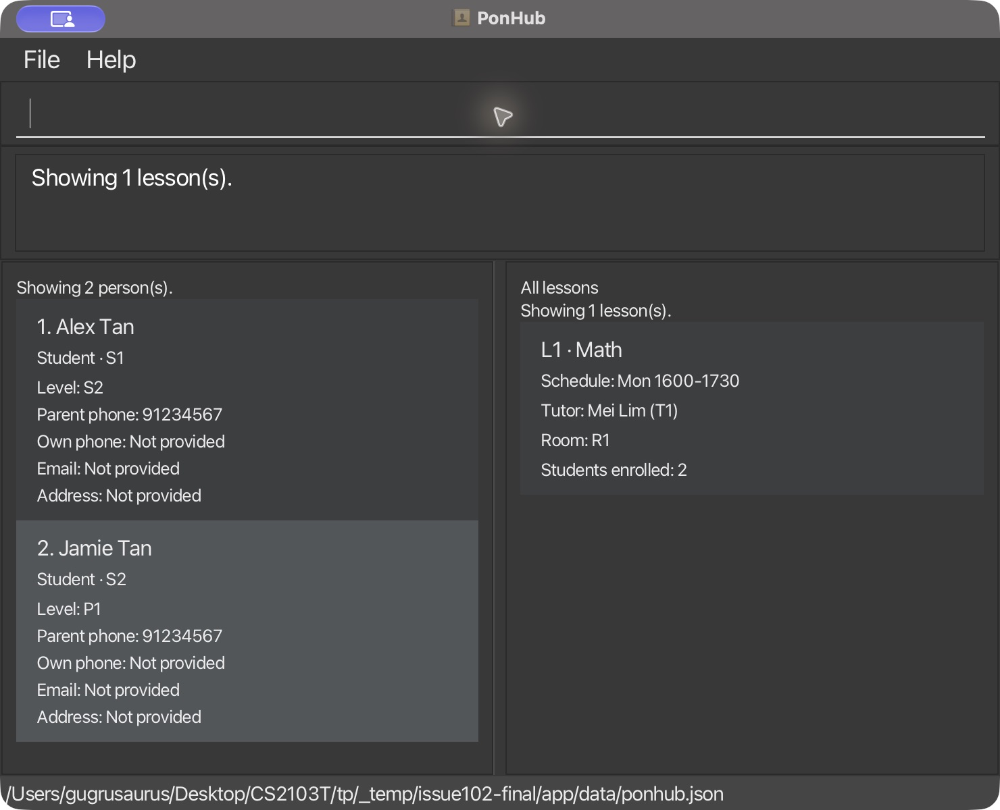
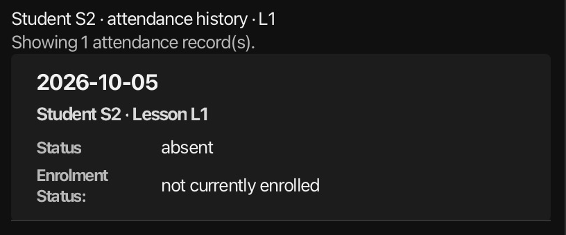

<a id="how-to-use-this-guide"></a>

## Table of Contents
{:.no_toc}

* Table of Contents
{:toc}

* **New users:** Start with [Quick start](#quick-start), walk through a full session in [First-session walkthrough](#first-session-walkthrough), and read [PonHub basics](#ponhub-basics) once to learn how positions, stable IDs, and command formats work.
* **Returning users:** Jump straight to the [Command summary](#command-summary) and follow the link to the command you need.
* **Warnings or save errors:** Go to [Saving and protecting your data](#saving-and-protecting-your-data) before making changes or deleting files.

<a id="introduction"></a>

## 1. Introduction

<a id="what-ponhub-does"></a>

### 1.1 What PonHub does

PonHub is a desktop application for tuition-centre administrators. You can use it to:
* Keep contact records for students, tutors, and parents.
* Run shared weekly lessons where multiple students share one recurring slot.
* Track dated attendance and review a student's attendance history.

PonHub is designed for fast keyboard work. You type a command in the box at the bottom of the window and press **Enter**, while the window shows people and lesson results side by side.

--------------------------------------------------------------------------------------------------------------------

<a id="quick-start"></a>

## 2. Quick start

Follow these steps to go from download to a working PonHub window in a few minutes.

1. **Install Java 25** on your computer.<br>
   **Mac users:** Install Azul JDK 25 with JavaFX (`25.0.3.fx-zulu`) as prescribed by the [course Mac advisory](https://nus-cs2103-ay2627-s1.github.io/website/admin/programmingLanguages.html) and [Mac installation guide](https://se-education.org/guides/tutorials/javaInstallationMac.html). Launch PonHub from a terminal that uses this installation.
2. **Download `ponhub.jar`** from the [latest published PonHub release (v1.5)](https://github.com/AY2627S1-CS2103T-F13-3/tp/releases/tag/v1.5) (or the v1.6 release once published).
3. **Place `ponhub.jar` in its own dedicated folder.** PonHub saves your data next to the JAR file, so keep this entire folder together when moving or backing up your records.
4. **Open a terminal in that folder**, check that `java -version` reports Java `25`, and run:
   ```text
   java -jar ponhub.jar
   ```
5. **Try your first commands.** When PonHub opens for the first time, the people list is empty. Type `help` in the command box at the bottom and press **Enter**, then try `help add` (or `help ADD`) to see how to add a person.

Next, follow the [First-session walkthrough](#first-session-walkthrough) to try the full workflow from adding records to taking attendance.

--------------------------------------------------------------------------------------------------------------------

<a id="planned-quick-start"></a>
<a id="shared-lesson-example"></a>

<a id="first-session-walkthrough"></a>

## 3. First-session walkthrough

This walkthrough takes you through a complete session: adding people, creating a shared lesson, enrolling students, marking attendance, unenrolling while keeping history, testing deletion guards, and checking that everything is saved on restart.

**Before you begin:** The positions (`1`, `2`) and lesson ID (`L1`) below assume a fresh, empty data file. If you already have records in PonHub, check the displayed positions in the people list and use the lesson ID returned by `addlesson`. PonHub creates the data file on disk as soon as your first change succeeds.

1. **Add a tutor, two students, and a parent.** Run these commands one by one:
   ```text
   add r/tutor n/Mei Lim p/92345678 e/mei@example.com
   add r/student n/Alex Tan l/S2 pp/91234567
   add r/student n/Jamie Tan l/P1 pp/91234567
   add r/parent n/Pat Tan p/91234567
   ```
   Alex (`S1`) and Jamie (`S2`) are siblings who share their parent Pat's phone number (`91234567`). Enter `list` to see all four people across all roles, then enter `list r/student` to show only students (Alex at position `1` and Jamie at position `2`).

2. **Create a shared lesson and enrol both students.**
   ```text
   addlesson d/Mon st/1600 et/1730 s/Math tu/Mei Lim rm/R1
   list r/student
   enrol 1 lid/L1
   enrol 2 lid/L1
   ```
   `addlesson` creates Monday Math (`L1`) with an empty roster. Enrolling positions `1` and `2` puts both Alex and Jamie into `L1`. Run `lessons` to see `L1` listed once with `2` students enrolled, then run `lessons 1` to see only Alex's current lessons.

3. **Mark and correct dated attendance.**
   ```text
   mark 1 lid/L1 d/2026-10-05 s/present
   mark 2 lid/L1 d/2026-10-05 s/absent
   showlesson lid/L1 d/2026-10-05
   ```
   The right panel shows Alex as `present` and Jamie as `absent` for Monday, 5 October 2026. Now correct Alex's record:
   ```text
   mark 1 lid/L1 d/2026-10-05 s/absent
   showlesson lid/L1 d/2026-10-05
   ```
   Only Alex's record changes; both students now show as `absent`.

4. **Unenrol a student and see how attendance history is kept.**
   ```text
   unenrol 1 lid/L1
   lessons 1
   lessons
   history 1 lid/L1
   ```
   `lessons 1` is now empty because Alex is no longer enrolled, while `lessons` shows `L1` still has Jamie (`1` student enrolled). However, `history 1 lid/L1` still displays Alex's absence on `2026-10-05`, labelled `not currently enrolled`. To remove that retained record:
   ```text
   unmark 1 lid/L1 d/2026-10-05
   ```
   Running `unmark 1 lid/L1 d/2026-10-05` a second time reports that nothing changed. Jamie's membership and attendance record remain untouched.

5. **See how deletion guards protect linked records.**
   ```text
   deletelesson lid/L1
   ```
   PonHub blocks this deletion because Jamie is still enrolled in `L1` and has attendance recorded for it. By contrast, a brand-new lesson with no students or attendance deletes cleanly:
   ```text
   addlesson d/Tue st/1600 et/1730 s/Math tu/Mei Lim rm/R1
   deletelesson lid/L2
   ```

6. **Restart and verify that your data was saved.**
   Enter `exit` to close PonHub, then launch `java -jar ponhub.jar` again from the same folder and run:
   ```text
   list r/student
   lessons
   history 2 lid/L1
   ```
   Alex (`S1`) and Jamie (`S2`) keep their stable IDs, `L1` still has Jamie enrolled, and `history 2 lid/L1` shows Jamie's recorded absence on `2026-10-05`.

--------------------------------------------------------------------------------------------------------------------

<a id="ponhub-basics"></a>

## 4. PonHub basics

Read this section once before diving into the individual commands. It explains the window layout and the three rules every command relies on.

<a id="the-main-window"></a>

### 4.1 The main window

The PonHub window is split into four areas:
* **People panel (left):** Shows student, tutor, and parent cards.
* **Lesson and attendance panel (right):** Shows the lesson catalogue, one student's lessons, lesson details, or attendance history.
* **Feedback and help area (top):** Displays the response to your last command or `help` text.
* **Command box (bottom):** Full-width text box where you type commands and press **Enter**.

You can drag the dividers to resize the feedback area or adjust the width of the left and right panels. Each list scrolls independently, and long values wrap inside their cards.

The heading above each panel always tells you which filter, selected student, or search query is currently displayed—even after another command changes the feedback message at the top. If a heading or result count is cut off, hover your mouse over it to read the full text in a tooltip.

Above the lists sit three shortcut buttons (**All lessons**, **Student lessons**, and **Attendance history**); see [Switching result views](#switching-result-views) for how they work.



*See the [screenshot source and credit note](images/README.html) for details on the fictitious sample data shown in screenshots.*

<a id="reading-the-command-formats"></a>
<a id="reading-the-planned-command-formats"></a>

<a id="reading-command-formats"></a>

### 4.2 Reading command formats

Throughout this guide, command formats use these conventions:
* **`UPPERCASE` words** are placeholders you replace with your own values (for example, `NAME` or `LESSON_ID`). **Lowercase words** such as `r/student` are typed exactly as shown.
* **Square brackets `[ ]`** mark optional fields. **Vertical bars `|`** separate choices (for example, `s/present|absent` means type `s/present` or `s/absent`). **Three dots `...`** mean you can supply several filters. Never type `[ ]`, `|`, or `...` in your command.
* **Prefixes** label each field, such as `n/Alex Tan` for a name. Always type command words and prefixes in lowercase. Prefixed fields can appear in any order, at most once per command (except in [`lessons`](#listing-lessons-lessons), where the optional student selector—including its legacy `si/STUDENT_INDEX` form—must come before `sort/creation|schedule`). Unknown or repeated prefixes are rejected, and there is no quoting or escaping syntax.
* **Blank values:** If you do not have an optional value when adding a record, leave its prefix out altogether. Only `edit` accepts an empty prefix (such as `e/` or `a/`) to clear an existing optional field.
* **Prefixes whose meaning depends on the command:**
  * `d/` takes a weekday (`Mon`–`Sun`) when creating, editing, or searching lessons, but takes a real `YYYY-MM-DD` calendar date in `mark`, `unmark`, `showlesson`, and `history`.
  * `s/` takes a subject name in lesson commands (`addlesson`, `editlesson`, `search`), but takes an attendance status (`present` or `absent`) in `mark` and `history`.
  * `st/` and `et/` always take 4-digit, 24-hour `HHMM` times (such as `0900` or `1630`).
* **Spaces and line breaks:** If you copy and paste a command containing horizontal Unicode spaces—such as an em space (`U+2003`), no-break space (`U+00A0`), or narrow no-break space (`U+202F`)—PonHub treats them as normal spaces between words and prefixes, and trims surrounding spaces from values. Inside a name or address, use ordinary spaces; phone numbers take no spaces at all. Line breaks, tabs, and control characters are always rejected.

<a id="selecting-people-and-lessons"></a>
<a id="people-positions-and-stable-ids"></a>

<a id="positions-and-stable-ids"></a>

### 4.3 Positions and stable IDs

PonHub uses two different kinds of identifiers. Knowing when to use each avoids targeting the wrong record:

* **People commands use `INDEX` or `STUDENT_INDEX`:** This is the **1-based position** (`1`, `2`, `3`, ...) shown on a card in the **currently displayed people list** on the left. `STUDENT_INDEX` uses the exact same list and must point to a student card (even when all roles are shown).
* **Positions change; stable IDs never change:** Filtering with `list r/ROLE`, running a `search`, adding a person, or deleting a person can change which person sits at position `1`. By contrast, every record is assigned a permanent **stable ID** when created:
  * `S1`, `S2`, ... for students
  * `T1`, `T2`, ... for tutors
  * `P1`, `P2`, ... for parents
  * `L1`, `L2`, ... for lessons

  PonHub allocates stable IDs automatically, keeps them across restarts, and never reuses an ID after deletion. **Never type a person's stable ID (`S1`, `T1`, `P1`) where a command expects `INDEX` or `STUDENT_INDEX`.**
* **Lessons are always selected by `lid/LESSON_ID`:** Always use the lesson's stable ID (such as `lid/L1`). There is no per-student lesson index, and rows in the lesson, roster, or attendance panels never supply person positions.

**Good habit:** Always check the current people list on the left before running any command that takes `INDEX` or `STUDENT_INDEX`.

<a id="example-how-positions-change-while-stable-ids-stay-fixed"></a>

#### 4.3.1 Example: how positions change while stable IDs stay fixed

In a fresh, empty data file, running these seven commands in order produces the following positions and stable IDs:

| Command | Displayed people after the command |
| --- | --- |
| `add r/tutor n/Mei Lim p/92345678` | **1:** Mei Lim (`T1`) |
| `add r/student n/Alex Tan l/S2 pp/91234567` | **1:** Mei Lim (`T1`); **2:** Alex Tan (`S1`) |
| `add r/student n/Jamie Tan l/S2 pp/91234567` | **1:** Mei Lim (`T1`); **2:** Alex Tan (`S1`); **3:** Jamie Tan (`S2`) |
| `list r/student` | **1:** Alex Tan (`S1`); **2:** Jamie Tan (`S2`) |
| `delete 1` | **1:** Alex Tan (`S1`); **2:** Jamie Tan (`S2`); asks for confirmation |
| `delete confirm` | **1:** Jamie Tan (`S2`) |
| `add r/student n/Robin Tan l/S2 pp/91234567` | **1:** Mei Lim (`T1`); **2:** Jamie Tan (`S2`); **3:** Robin Tan (`S3`) |

Notice that Jamie keeps `S2` throughout, even as her position shifts from `3` to `2` to `1` and back to `2`. Because `S1` was deleted, Robin receives `S3`.

<a id="planned-failure-and-data-behavior"></a>

<a id="when-a-command-fails-or-cannot-save"></a>

### 4.4 When a command fails or cannot save

Every command in PonHub follows the same safety rules when something goes wrong:
* **Invalid input changes nothing:** If a command has a syntax error, fails a validation check, or is blocked by a clash or dependency, PonHub explains the problem, leaves all records and panels unchanged, and keeps your typed text in the command box so you can fix it.
* **Read-only commands do not save operational data:** `list`, `lessons`, `showlesson`, `history`, `search`, and `help` only read or filter in-memory records.
* **Changes are reported only after saving:** Commands that modify data save to disk before reporting success. If a disk save fails, your live session data, ID counters, and views remain at their previous state; follow [If a save fails](#if-a-save-fails) to check the file on disk before continuing.

--------------------------------------------------------------------------------------------------------------------

<a id="current-command-summary"></a>
<a id="planned-command-summary"></a>
<a id="command-format-reference"></a>

<a id="command-summary"></a>

## 5. Command summary

Use this table as a quick lookup. Click any action to read its full rules and examples.

| Action | Format | Example |
| --- | --- | --- |
| [Add student](#adding-a-person-add) | `add r/student n/NAME l/LEVEL pp/PARENT_PHONE [p/PHONE] [e/EMAIL] [a/ADDRESS]` | `add r/student n/Alex Tan l/S2 pp/91234567` |
| [Add tutor or parent](#adding-a-person-add) | <code>add r/tutor&#124;parent n/NAME p/PHONE [e/EMAIL] [a/ADDRESS]</code> | `add r/tutor n/Mei Lim p/92345678` |
| [List people](#listing-people-list) | `list [r/ROLE]` | `list r/student` |
| [Edit person](#editing-a-person-edit) | `edit INDEX [n/NAME] [p/PHONE] [e/EMAIL] [a/ADDRESS] [l/LEVEL] [pp/PARENT_PHONE]` | `edit 1 l/P2 e/` |
| [Delete person](#deleting-a-person-delete) | `delete INDEX`, then `delete confirm` or `delete cancel` | `delete 1`, then `delete confirm` |
| [Create lesson](#creating-a-lesson-addlesson) | `addlesson d/DAY st/HHMM et/HHMM s/SUBJECT tu/TUTOR_NAME [tp/TUTOR_PHONE] rm/ROOM` | `addlesson d/Mon st/1600 et/1730 s/Math tu/Mei Lim rm/R1` |
| [Edit lesson](#editing-a-lesson-editlesson) | `editlesson lid/LESSON_ID [d/DAY] [st/HHMM] [et/HHMM] [s/SUBJECT] [tu/TUTOR_NAME] [tp/TUTOR_PHONE] [rm/ROOM]` | `editlesson lid/L1 st/1630 s/Advanced Math` |
| [Enrol student](#enrolling-a-student-enrol) | `enrol STUDENT_INDEX lid/LESSON_ID` | `enrol 1 lid/L1` |
| [Unenrol student](#unenrolling-a-student-unenrol) | `unenrol STUDENT_INDEX lid/LESSON_ID` | `unenrol 1 lid/L1` |
| [Delete lesson](#deleting-a-lesson-deletelesson) | `deletelesson lid/LESSON_ID` | `deletelesson lid/L1` |
| [List lessons](#listing-lessons-lessons) | <code>lessons [STUDENT_INDEX] [sort/creation&#124;schedule]</code> | `lessons` |
| [Show lesson details](#viewing-lesson-details-showlesson) | `showlesson lid/LESSON_ID [d/YYYY-MM-DD]` | `showlesson lid/L1 d/2026-10-05` |
| [Mark attendance](#marking-attendance-mark) | <code>mark STUDENT_INDEX lid/LESSON_ID d/YYYY-MM-DD s/present&#124;absent [ack/future]</code> | `mark 1 lid/L1 d/2026-10-05 s/present` |
| [Unmark attendance](#removing-an-attendance-record-unmark) | `unmark STUDENT_INDEX lid/LESSON_ID d/YYYY-MM-DD` | `unmark 1 lid/L1 d/2026-10-05` |
| [View attendance history](#viewing-attendance-history-history) | <code>history STUDENT_INDEX [lid/LESSON_ID] [d/YYYY-MM-DD] [s/present&#124;absent]</code> | `history 1 lid/L1 s/absent` |
| [Search people](#searching-people) | <code>search c/student&#124;parent&#124;tutor [FILTER/VALUE]...</code> | `search c/student n/Alex d/Mon s/Math` |
| [Search lessons](#searching-lessons) | <code>search c/lesson [sn/NAME] [d/DAY] [st/HHMM] [et/HHMM] [s/SUBJECT] [tu/TUTOR_NAME] [tp/TUTOR_PHONE] [rm/ROOM] [from/HHMM to/HHMM] [sort/creation&#124;schedule]</code> | `search c/lesson tu/mei d/Mon` |
| [Get help](#getting-help-help) | `help [COMMAND]` | `help add` |
| Exit | `exit` | `exit` |

**Notes:**
* See [Positions and stable IDs](#positions-and-stable-ids) for how to choose `INDEX`, `STUDENT_INDEX`, and `lid/LESSON_ID`.
* If PonHub starts in a [protected session](#if-ponhub-shows-data-file-protected), only `help`, `list`, and `exit` are available. Inherited AB3 commands such as `clear` and `find` are not used in PonHub.

--------------------------------------------------------------------------------------------------------------------

<a id="managing-people"></a>

## 6. Managing people

Add, view, copy, edit, and delete student, tutor, and parent records. Remember to check the current people list before running any command that uses `INDEX`.

<a id="1-adding-a-person-add"></a>

<a id="adding-a-person-add"></a>

### 6.1 Adding a person: `add`

Creates a new student, tutor, or parent record and assigns it a permanent ID (`S1`, `T1`, or `P1`).

**Format:**
* **Student:** `add r/student n/NAME l/LEVEL pp/PARENT_PHONE [p/PHONE] [e/EMAIL] [a/ADDRESS]`
* **Tutor or parent:** `add r/tutor|parent n/NAME p/PHONE [e/EMAIL] [a/ADDRESS]`

`l/` (education level) and `pp/` (parent phone) are for students only. Role names (`student`, `tutor`, `parent`) ignore case. For accepted characters and lengths on every field, see [Field reference](#field-reference).

**Examples:**
* `add r/student n/Alex Tan l/S2 pp/91234567` — adds a Secondary 2 student with parent phone `91234567`.
* `add r/tutor n/Mei Lim p/92345678 e/mei@example.com` — adds a tutor with phone and email.
* `add r/parent n/Pat Tan p/91234567` — adds a parent record.
* `add r/student n/José Santos l/P1 pp/91234567` — accented and non-Latin names such as `José Santos`, `李明`, `தமிழ்`, and `Anne-Marie O’Neill` are supported.
* `add r/student n/Ravi s/o Kumar l/P1 pp/91234567 a/Blk 10, #01/02` — standalone `s/o` or `d/o` in names and unit numbers like `#01/02` in addresses are accepted.

**What you will see:**
* Confirmation such as `New student added: Alex Tan (S1).`
* The people panel resets to show **all roles**, with the new record at the end of the list. Recheck positions before your next command.
* A new student starts with no lessons or attendance records.

**Notes:**
* **Parent records are optional:** You can add a student with `pp/PARENT_PHONE` without creating a separate parent record first.
* **How duplicates are checked:** Two people are considered duplicates if they have the **same role**, **same normalized name**, and **same identifying phone** (`pp/` for students; `p/` for tutors and parents).
  * Name comparison ignores letter case (including Greek `Σ`, `σ`, and `ς`), repeated spaces, and canonical Unicode composition (`é` as one code point vs `e` + combining acute). Accents still distinguish names, so `José` and `Jose` are treated as different names.
  * Siblings with different names can share the same parent phone (`pp/`).
  * Changing an optional field (`e/`, `a/`, or a student's own `p/`) never makes a duplicate unique.
  * If a duplicate is rejected, PonHub shows a message such as `A student with the same name and parent phone already exists.` and does not consume an ID.

<a id="2-listing-people-list"></a>

<a id="listing-people-list"></a>

### 6.2 Listing people: `list`

Shows everyone in PonHub, or filters the people panel to a single role.

**Format:** `list [r/ROLE]`

Use the singular role name `student`, `tutor`, or `parent` (case-insensitive). To show everyone, enter `list` by itself (`list r/all` is invalid).

**Examples:**
* `list` — shows all people and clears any active role or search filter.
* `list r/student` — shows only students.
* `list r/tutor` — shows only tutors.
* `list r/parent` — shows only parents.

**What you will see:**
* Cards appear in creation order, numbered from `1` for the current view. Each card shows the person's name, role, stable ID, and current command `Position`.
* Captions sit above each value. Missing optional fields (`p/`, `e/`, or `a/`) display `Not provided`.
* Feedback reports the count, such as `Showing 3 student(s).` If nobody matches, the panel shows `No persons to display.`

**Notes:**
* Listing only changes what is displayed; it never modifies or saves data.

<a id="copying-contact-details"></a>

### 6.3 Copying contact details

You can copy a person's phone number, parent phone, email, or address directly from their card without selecting text manually.

* **Mouse:** Click the **Copy** button beside any available phone, email, or address.
* **Keyboard:** Press **Tab** or **Shift+Tab** until the desired **Copy** button is focused, then press **Space** or **Ctrl+C** (**Cmd+C** on macOS).

**Notes:**
* Only the value itself is copied (for example, `91234567`), with leading zeros preserved. Fields showing `Not provided` have no **Copy** button.
* Copying updates your system clipboard while leaving all records, active filters, card selection, and any unfinished command in the command box untouched. Pressing **Ctrl+C** (**Cmd+C** on macOS) inside the command box or feedback area still copies selected text from that area as usual.

<a id="editing-a-person-edit"></a>

<!-- @@author ErnestChuaa -->
### 6.4 Editing a person: `edit`

Updates one student, tutor, or parent while keeping their role, stable ID, lessons, and attendance history intact.

**Format:** `edit INDEX [n/NAME] [p/PHONE] [e/EMAIL] [a/ADDRESS] [l/LEVEL] [pp/PARENT_PHONE]`

Supply at least one field to change. Omitted fields stay as they are. All values follow the [Field reference](#field-reference) rules, and only students accept `l/` and `pp/`.

**Example:**
1. Run `list r/student` and check that the student you want to edit is at position `1`.
2. Run `edit 1 l/P2 e/` to update that student's level to `P2` and clear their email address.

**What you will see:**
* Confirmation of the updated record.
* Your current role or search filter stays active, and the list re-evaluates against that filter. If you rename someone during a name search and they no longer match, they will disappear from the filtered list—so recheck positions before your next command.

**Notes:**
* **Clearing optional fields:** Supply an empty `e/` or `a/` to clear an email or address, or an empty `p/` to clear a student's own phone. Required fields (names, student levels, student parent phones, and tutor or parent phones) cannot be cleared, and a person's role and stable ID cannot be changed.
* **Duplicates and no-op edits:** If your edit would match another person's role, normalized name, and identifying phone (`pp/` for students, `p/` for tutors and parents), the error message names the fields you need to change (`n/` or the identifying phone). An edit that changes nothing after space normalization (such as `edit 1 n/Alex  Tan`) reports no change and does not save, whereas changing capitalization (such as `edit 1 n/ALEX TAN`) saves the new display casing.
* **Linked records:** Renaming a tutor automatically updates the tutor name shown on their lessons. Changing a student's `pp/` or a parent's `p/` recomputes parent–student links by exact phone match without altering anyone else's phone number; if any existing parent–student link is broken, the confirmation message lists the affected Parent–Student ID pairs.
<!-- @@author -->

<a id="3-deleting-a-person-delete"></a>

<a id="deleting-a-person-delete"></a>

### 6.5 Deleting a person: `delete`

Permanently removes one unreferenced person using a two-step preview and confirmation.

**Format:**
1. `delete INDEX` — previews the person's name and stable ID without deleting anything yet.
2. `delete confirm` — permanently deletes the previewed person; or `delete cancel` — cancels the request.

**Example:**
1. Run `list r/parent` and check that Pat Tan (`P1`) is at position `1`.
2. Enter `delete 1`.
3. Verify the name and ID in the prompt, then enter `delete confirm` (or `delete cancel` to keep the record).

**What you will see:**
After `delete 1`, PonHub leaves your data unchanged and shows:
```text
Delete parent: Pat Tan (P1)? This permanently removes the record.
Enter delete confirm to proceed or delete cancel to keep it.
Any other command cancels this request.
```
After `delete confirm`, PonHub saves the change, reports `Deleted parent: Pat Tan (P1).`, keeps the current filter, and renumbers the remaining people. After `delete cancel`, PonHub reports `Person deletion cancelled. No records were changed.`

**Notes:**
* **How the preview resets:** Entering any other command, running another `delete INDEX`, or closing PonHub cancels the pending preview. `delete confirm` and `delete cancel` take no extra arguments. If a save fails during confirmation, run `delete INDEX` again before confirming.
* **Deletion guards:**
  * A **student** cannot be deleted while enrolled in any lesson or while any attendance record (including retained history after unenrolment) refers to them. The error message names the blocking lesson ID and attendance date (for example, `Student S1 cannot be deleted while retained attendance exists for lesson L1 on 2026-10-05.`). Use [`unenrol`](#unenrolling-a-student-unenrol) and [`unmark`](#removing-an-attendance-record-unmark) first.
  * A **tutor** cannot be deleted while assigned to any lesson, even one with an empty roster. Reassign the lesson with [`editlesson`](#editing-a-lesson-editlesson) or delete it with [`deletelesson`](#deleting-a-lesson-deletelesson) first.
  * PonHub never deletes linked lessons or attendance automatically.
* **Parent phones and panels:** Deleting a parent record does not erase the `pp/` phone number stored on any student card. Deleted stable IDs are never reused. If the right-hand panel was showing a deleted student's lessons, it stays empty and still names that student ID until you run another `lessons` or lesson-search command.

--------------------------------------------------------------------------------------------------------------------

<a id="planned-shared-lesson-workflow"></a>
<a id="shared-lesson-workflow"></a>

<a id="managing-lessons"></a>

## 7. Managing lessons

A **shared lesson** is one recurring weekly slot—defined by a weekday, start and end time, subject, tutor, and room—with a roster of enrolled students and a permanent ID such as `L1`. Multiple students enrol in the same shared lesson rather than creating separate lesson records.

<a id="4-creating-shared-lessons-and-other-lesson-operations"></a>

<a id="creating-a-lesson-addlesson"></a>

### 7.1 Creating a lesson: `addlesson`

Creates a new weekly shared lesson with an empty student roster.

**Format:** `addlesson d/DAY st/HHMM et/HHMM s/SUBJECT tu/TUTOR_NAME [tp/TUTOR_PHONE] rm/ROOM`

See [Field reference](#field-reference) for the exact format of `d/`, `st/`, `et/`, `s/`, `tu/`, and `rm/`.

**Example:**
* `addlesson d/Mon st/1600 et/1730 s/A-Math tu/Mei Lim rm/B-01`
* `addlesson d/Mon st/1600 et/1730 s/A-Math tu/Mei Lim tp/92345678 rm/B-01` (when two tutors share the name `Mei Lim`)

**What you will see:**
* Confirmation with a new stable lesson ID (such as `L1`) and an empty roster (`0` students enrolled). Creating a lesson never enrols a student automatically.

**Notes:**
* **How tutor lookup works:** The tutor must already exist in PonHub. `tu/` matches a tutor's full name, ignoring letter case (including Greek `Σ`, `σ`, and `ς`), repeated spaces, and canonical Unicode spelling differences; accents remain significant.
  * If two tutors have the same normalized name, include `tp/TUTOR_PHONE` with the intended tutor's exact phone number.
  * Whenever `tp/` is supplied, it must match the named tutor's phone number even if the tutor's name is unique.
  * If an older data file contains two tutors with both the same normalized name and the same phone number, use `list r/tutor` and [`edit`](#editing-a-person-edit) to give one a distinct name or phone first.
* **Schedule rules and clashes:** Start time (`st/`) must be earlier than end time (`et/`) on the same day. Neither the tutor nor the room may overlap another lesson on the same weekday (rooms are stored in uppercase, so `b-01` and `B-01` are the same room). Back-to-back lessons (such as `1600`–`1730` and `1730`–`1900`) are allowed, and enrolling students later never books the tutor or room a second time.

<a id="editing-a-shared-lesson-editlesson"></a>

<a id="editing-a-lesson-editlesson"></a>

<!-- @@author ys000009 -->
### 7.2 Editing a lesson: `editlesson`

Updates an existing lesson's schedule, subject, tutor, or room while keeping its stable ID, catalogue position, roster, and attendance history.

**Format:** `editlesson lid/LESSON_ID [d/DAY] [st/HHMM] [et/HHMM] [s/SUBJECT] [tu/TUTOR_NAME] [tp/TUTOR_PHONE] [rm/ROOM]`

Supply `lid/LESSON_ID` and at least one field to change. You can edit `st/` or `et/` on its own as long as the resulting slot still has start before end. Supply `tp/` only together with `tu/`.

**Example:**
* `editlesson lid/L1 st/1630 s/A-Math` — changes `L1`'s start time to `1630` and subject to `A-Math`, keeping its weekday, end time, tutor, room, and enrolled students.

**What you will see:**
* Confirmation of the updated lesson, and any open lesson list, search, or detail view refreshes immediately.
* If the edit changes nothing, PonHub reports `No changes to lesson: L1.` and does not save.
* If the lesson already has attendance records, PonHub includes a warning that past attendance will now be displayed with the lesson's updated details (subject, tutor, room, and time). If a schedule change is only for future weeks and you want past records to keep showing the old details, create a new lesson with [`addlesson`](#creating-a-lesson-addlesson) instead.

**Notes:**
* **Clash checks:** PonHub checks the updated slot against every other lesson for tutor, room, and enrolled-student time overlaps. Adjacent (back-to-back) slots remain valid.
* **Changing the weekday when attendance exists:** You cannot change `d/DAY` while any current or former student has attendance recorded on a date that does not fall on the new weekday. To resolve this:
  1. Run `showlesson lid/LESSON_ID d/YYYY-MM-DD` using the lesson ID and date named in the error message to see which students (including former members) have records on that date.
  2. Run `list r/student` to find each student's current position.
  3. If you genuinely want to remove those attendance records, run [`unmark`](#removing-an-attendance-record-unmark) for each one, then retry `editlesson`.
* This command is unavailable in a [protected session](#if-ponhub-shows-data-file-protected).
<!-- @@author -->

<a id="5-enrolling-and-unenrolling-students"></a>

<a id="enrolling-a-student-enrol"></a>

### 7.3 Enrolling a student: `enrol`

Adds a student to a shared lesson's current roster.

**Format:** `enrol STUDENT_INDEX lid/LESSON_ID`

**Example:**
1. Run `list r/student` and check that the student you want is at position `1`.
2. Enter `enrol 1 lid/L1`.

**What you will see:**
* Confirmation naming both stable IDs, such as `Student S3 enrolled in lesson L1.`
* The lesson's **Students enrolled** count increases by `1`, and any open view of that lesson or student refreshes.

**Notes:**
* `STUDENT_INDEX` must point to a student card in the current people list.
* PonHub rejects the command if the student is already enrolled in `lid/LESSON_ID` or if the lesson overlaps another lesson the student is enrolled in on the same weekday. Back-to-back lessons and lessons at the same time on different weekdays are fine.
* **No automatic class-size cap:** PonHub does not enforce a maximum room capacity. Check your room's physical limit before enrolling; **Students enrolled** shows the number of current members, not remaining seats.

<a id="unenrolling-a-student-unenrol"></a>

### 7.4 Unenrolling a student: `unenrol`

Removes a student from a lesson's current roster while keeping their past attendance records.

**Format:** `unenrol STUDENT_INDEX lid/LESSON_ID`

**Example:**
1. Run `list r/student` and check that the student you want is at position `1`.
2. Enter `unenrol 1 lid/L1`.

**What you will see:**
* Confirmation that the student was unenrolled from the lesson.
* The student is removed from the lesson's current roster, while the student record, the lesson itself, and any dated attendance records remain stored.

**Notes:**
* Unenrolling a student who is not currently on that lesson's roster is rejected without changes.
* **Positions can shift in a relationship search:** Both `enrol` and `unenrol` keep your active people filter and refresh relationship searches. For example, if Alex (`1`) and Jamie (`2`) are listed by `search c/student d/Mon s/Math`, unenrolling Alex from his only Monday Math lesson removes him from the search results and moves Jamie to position `1`. Always recheck the people list before your next indexed command.

<a id="deleting-a-lesson-deletelesson"></a>

### 7.5 Deleting a lesson: `deletelesson`

Permanently removes an unreferenced shared lesson.

**Format:** `deletelesson lid/LESSON_ID`

Use the stable lesson ID shown on the lesson card (such as `lid/L1`), never a list position.

**Example:**
* `deletelesson lid/L1`

**What you will see:**
* Confirmation that the lesson was removed, and its tutor and room time slot becomes free again.

**Notes:**
* **Deletion guards:** A lesson cannot be deleted while any student is enrolled in its roster or while any attendance record (including history retained after unenrolment) refers to it. The error message names either the enrolled student IDs to [`unenrol`](#unenrolling-a-student-unenrol) or the first student and date to [`unmark`](#removing-an-attendance-record-unmark). PonHub never removes students, enrolments, or attendance automatically.
* Surviving lessons keep their IDs, and deleted lesson IDs are never reused.
* Deleting a lesson removes the entire recurring weekly slot. Cancelling a single dated occurrence is not supported in v1.6 (see [Coming soon](#coming-soon)).

--------------------------------------------------------------------------------------------------------------------

<a id="viewing-lessons"></a>

## 8. Viewing lessons

Use the right-hand panel to browse the full lesson catalogue, check one student's timetable, or inspect a single lesson's roster and dated attendance.

<a id="listing-and-searching-shared-lessons"></a>

<a id="listing-lessons-lessons"></a>

### 8.1 Listing lessons: `lessons`

Displays either the complete lesson catalogue or the lessons a single student is currently enrolled in.

**Format:** `lessons [STUDENT_INDEX] [sort/creation|schedule]`

**Examples:**
* `lessons` — shows all shared lessons in creation order, including lessons with empty rosters.
* `lessons sort/schedule` — shows all lessons ordered from Monday to Sunday, then by start time, then by numeric lesson ID.
* `lessons 1` — shows only the lessons currently enrolled by the student at position `1` in the people list (the older `lessons si/1` syntax also works; when combined with `sort/`, the student selector must come before `sort/creation|schedule`, as in `lessons si/1 sort/schedule`).
* `lessons 1 sort/schedule` — shows that student's current timetable in weekly schedule order.

**What you will see:**
* Lesson cards in the right panel. Each card shows the subject, stable lesson ID, weekday and time, tutor name and ID, room, and **Students enrolled** count.
* Feedback reports `Showing N lesson(s).` An empty result shows `No lessons to display.`


**Notes:**
* **How student selection sticks:** `lessons STUDENT_INDEX` resolves the student's position from the current people panel once, then remembers that student's stable ID (`S1`, `S2`, ...) even if you later change the people filter on the left.
* Retained attendance after unenrolment does not count as current enrolment; use [`history`](#viewing-attendance-history-history) to see past records for former lessons.
* Your chosen `sort/` order stays active while that lesson view remains open, and resets to `sort/creation` on restart.

<a id="lesson-details"></a>

<a id="viewing-lesson-details-showlesson"></a>

### 8.2 Viewing lesson details: `showlesson`

Opens a read-only detail view for one lesson, showing its current roster and (optionally) attendance statuses for a specific date.

**Format:** `showlesson lid/LESSON_ID [d/YYYY-MM-DD]`

The `lid/` and `d/` prefixes can appear in either order. When `d/` is supplied, it must be a real calendar date that falls on the lesson's weekday.

**Examples:**
* `showlesson lid/L1` — shows `L1`'s summary, current student roster (stable ID and name), and all retained attendance records for former members (newest first).
* `showlesson lid/L1 d/2026-10-05` — shows `L1`'s details for Monday, 5 October 2026: each currently enrolled student appears as `present`, `absent`, or `unrecorded`, and any former member's retained record for that date appears in a separate section below.

**What you will see:**
* A scrolling detail card in the right panel showing the subject, lesson ID, schedule, tutor, room, enrolment count, current roster, and any retained former-member records.


**Notes:**
* **Roster rows are not command positions:** Always use positions from the left-hand people panel when running student commands.
* **`unrecorded` is not `absent`:** `unrecorded` simply means no attendance has been marked for that student on that date yet.
* **Current Lesson information:** When viewing a date or former-member records, the summary is labelled **Current Lesson information** because it shows the lesson's subject, tutor, room, and schedule as they are *now*, not a historical snapshot from that date.
* If you enter an unknown lesson ID, an invalid date, or a date on the wrong weekday, PonHub keeps the previous right-panel view unchanged. Open details refresh automatically after edits or attendance changes, and clear if the lesson is deleted.

<a id="moving-between-results"></a>

<a id="switching-result-views"></a>

### 8.3 Switching result views

You can switch the right-hand panel at any time either by typing a command (`lessons`, `lessons STUDENT_INDEX`, `history STUDENT_INDEX`, `showlesson`, or `search c/lesson`) or by clicking the shortcut buttons above the panels:

| Button | Equivalent command | Selection needed |
| --- | --- | --- |
| **All lessons** | `lessons` | None |
| **Student lessons** | `lessons STUDENT_INDEX` | A student card in the current people list |
| **Attendance history** | `history STUDENT_INDEX` | A student card in the current people list |

**How the buttons and selection work:**
* Clicking a person card in the left list selects it, which by itself does not change the right panel. Once a **student** card is selected, clicking **Student lessons** or **Attendance history** opens that view for the selected student.
* If no student is selected (or if a tutor or parent is selected), clicking **Student lessons** or **Attendance history** explains what to select and keeps your current results visible.
* The active view button is highlighted in **orange**. When you are viewing a lesson search (`search c/lesson`) or lesson details (`showlesson`), all three buttons remain unhighlighted.
* **Keyboard and draft preservation:** Reach the buttons with **Tab** or **Shift+Tab** and press **Space** to activate one. Using the buttons keeps any unfinished command text in the command box intact. For date filters, lesson-specific history, or search filters, type the command directly.

--------------------------------------------------------------------------------------------------------------------

<a id="tracking-attendance"></a>

## 9. Tracking attendance

PonHub keeps **current enrolment** (who is on a lesson's roster right now) separate from **dated attendance** (what happened on a specific date):
* Unenrolling a student removes them from the current roster, but keeps all of their dated attendance records.
* If a date has no attendance entry for a student, it is **unrecorded**—never treated as `absent`.

<a id="7-recording-attendance-and-retrieving-history"></a>

<a id="marking-attendance-mark"></a>

### 9.1 Marking attendance: `mark`

Records or corrects a student's `present` or `absent` status for one dated occurrence of a lesson.

**Format:** `mark STUDENT_INDEX lid/LESSON_ID d/YYYY-MM-DD s/present|absent [ack/future]`

**Examples:**
* `mark 1 lid/L1 d/2026-10-05 s/present` — marks the student at position `1` present for lesson `L1` on 5 October 2026.
* `mark 1 lid/L1 d/2026-10-05 s/absent` — corrects that same record to `absent`.
* `mark 1 lid/L1 d/2036-10-06 s/present ack/future` — marks a future occurrence as `present` with explicit acknowledgement.

**What you will see:**
* Confirmation of the recorded or updated attendance, and any open lesson-detail or attendance-history view refreshes immediately.
* The people filter and positions on the left stay unchanged.

**Notes:**
* **Date and enrolment rules:** `d/YYYY-MM-DD` must be a real calendar date that falls on `lid/LESSON_ID`'s weekday (past dates are fine). Creating a **new** attendance record requires the student to be currently enrolled in that lesson. Each student and date is independent.
* **Correcting existing records:** Running `mark` again on the same student, lesson, and date with the opposite status updates that record in place—even if the student has since been unenrolled. Running `mark` with the status already stored reports that nothing changed and does not save.
* **Future dates:** You can mark `s/absent` on a future date right away (for example, for a planned absence). Marking `s/present` on a future date requires adding `ack/future` to confirm that the future date is intentional; `ack/future` does not bypass any other check.

<a id="removing-an-attendance-record-unmark"></a>

### 9.2 Removing an attendance record: `unmark`

Deletes one dated attendance record so that the occurrence becomes `unrecorded` again.

**Format:** `unmark STUDENT_INDEX lid/LESSON_ID d/YYYY-MM-DD`

Do not include `s/` in `unmark`.

**Example:**
* `unmark 1 lid/L1 d/2026-10-05`

**What you will see:**
* Confirmation that the attendance record was removed. The student's status for that date returns to `unrecorded`.

**Notes:**
* Works for both currently enrolled and unenrolled students.
* If no attendance record exists for that student, lesson, and date, PonHub reports that nothing changed and does not save.
* Removing an attendance record never changes the lesson schedule, current roster, or any other student's or date's records.

<a id="attendance-history"></a>

<a id="viewing-attendance-history-history"></a>

### 9.3 Viewing attendance history: `history`

Displays a student's recorded attendance entries in the right-hand panel, with optional filters for lesson, date, and status.

**Format:** `history STUDENT_INDEX [lid/LESSON_ID] [d/YYYY-MM-DD] [s/present|absent]`

Optional filters can appear in any order, once each, and must all match. Run `history STUDENT_INDEX` without filters to clear previous history filters for that student.

**Examples:**
* `history 1` — shows all recorded attendance for the student at position `1`.
* `history 1 lid/L1` — shows that student's attendance for lesson `L1` only.
* `history 1 lid/L1 d/2026-10-05 s/absent` — narrows to absences in `L1` on 5 October 2026.

**What you will see:**
* Attendance cards in the right panel ordered newest date first, then by numeric lesson ID.
* Each card shows the student ID, lesson ID, date, `present` or `absent` status, and **Enrolment Status:** (`currently enrolled` or `not currently enrolled`, reflecting the lesson's current roster rather than membership on that past date).



*After `unenrol 2 lid/L1`, `history 2 lid/L1` retains Jamie's absence and labels **Enrolment Status:** `not currently enrolled`. See [screenshot sources and credits](images/README.html).*

**Notes:**
* Unlike `mark` and `showlesson`, the date filter in `history` does not have to match a lesson's weekday—if no record exists on that date, you simply get a valid empty result (`0` records).
* Unrecorded occurrences have no history card and are never counted as absences.
* The view is read-only, refreshes automatically when attendance or enrolment changes, and clears back to lesson results if the selected student or lesson is deleted.

--------------------------------------------------------------------------------------------------------------------

<a id="searching"></a>

## 10. Searching

Find people or lessons by their own fields or by how they are connected (such as finding parents through a child's lesson, or tutors through the students they teach).

<a id="searching-people-search"></a>

<a id="searching-people"></a>

### 10.1 Searching people

Searches students, parents, or tutors and displays the matches in the left-hand people panel.

**Format:** `search c/student|parent|tutor [FILTER/VALUE]...`

See the [Search filter reference](#search-filter-reference) for every filter accepted by each category.

**Examples:**
* `search c/student n/alex l/s2 pp/91234567` — finds Secondary 2 students named Alex with parent phone `91234567`.
* `search c/parent sn/Alex d/Mon s/Math` — finds parents who have a linked child named Alex enrolled in a Monday Math lesson.
* `search c/tutor n/mei sn/Alex d/Mon` — finds tutors named Mei who teach a Monday lesson with a student named Alex on its current roster.

**What you will see:**
* Matching people cards replace the left-hand people list, numbered from `1`. Because positions change, always check the new list before running `edit`, `delete`, `enrol`, or `mark`.
* The people panel heading displays your active search criteria.

**Notes:**
* **Tutor name prefix:** When searching for tutors (`c/tutor`), use `n/` for the tutor's own name; `tu/` is rejected in `c/tutor`.
* **Reading long search headings with the keyboard:** When a search heading is too long to fit on one line, press **Tab** or **Shift+Tab** to focus the heading (shown by an orange border), scroll through all criteria with **Up/Down**, **Page Up/Page Down**, or **Home/End**, then press **Tab** to move on.
* **Ending a search:** Run `list` or `list r/ROLE` to return to the full or role-filtered people list.

<a id="searching-lessons"></a>

### 10.2 Searching lessons

Searches the shared lesson catalogue and displays matches in the right-hand panel without changing the people list on the left.

**Format:** `search c/lesson [sn/STUDENT_NAME] [d/DAY] [st/HHMM] [et/HHMM] [s/SUBJECT] [tu/TUTOR_NAME] [tp/TUTOR_PHONE] [rm/ROOM] [from/HHMM to/HHMM] [sort/creation|schedule]`

**Examples:**
* `search c/lesson tu/mei d/Mon` — finds Monday lessons taught by a tutor whose name contains `mei`.
* `search c/lesson tu/Mei tp/92345678` — narrows to lessons taught by the tutor named Mei with exact phone `92345678`.
* `search c/lesson d/Mon from/1630 to/1730 sort/schedule` — finds Monday lessons that overlap the `1630`–`1730` time window, ordered by schedule.

**What you will see:**
* Matching lesson cards in the right panel, and feedback reporting `Found N lesson(s).`

**Notes:**
* **Tutor filters:** In `c/lesson`, `tu/` matches a case-insensitive fragment of the tutor's name, while `tp/` matches the tutor's complete phone number (including leading zeros) and can be used alone or alongside `tu/`.
* **Time-window search (`from/` and `to/`):** Supply `from/HHMM` and `to/HHMM` together (with `from` earlier than `to` on the same day; overnight windows are not supported) to find lessons that overlap any positive part of that window. Lessons that merely touch the boundary do not match: for example, if you have Monday lessons at `1600`–`1700` and `1700`–`1800`, `search c/lesson d/Mon from/1630 to/1730` returns both, whereas `from/1700 to/1800` returns only the `1700`–`1800` lesson. Omit `d/` to check that time window across all weekdays.

<a id="relationship-search-rules"></a>

<a id="how-filters-match"></a>

### 10.3 How filters match

Every `search` starts from the full catalogue (not by narrowing the previous search), and **all supplied filters must match together**:

* **Text vs exact filters:** Name (`n/`, `sn/`, `tu/`), email (`e/`), address (`a/`), subject (`s/`), and room (`rm/`) filters match a **case-insensitive fragment** after trimming surrounding spaces and collapsing repeated spaces. Phone (`p/`, `pp/`, `tp/`), education level (`l/`), weekday (`d/`), and start/end time (`st/`, `et/`) filters must match **the complete value** (ignoring case for `l/` and `d/`).
* **How relationship filters connect records:**
  * **Student (`c/student`):** One currently enrolled lesson of that student must satisfy every lesson filter (`d/`, `st/`, `et/`, `s/`, `tu/`, `rm/`) together.
  * **Parent (`c/parent`):** One linked child (whose `pp/` exactly matches the parent's `p/`, including leading zeros) must match `sn/` (if given), and one current lesson of *that same child* must satisfy all lesson filters together.
  * **Tutor (`c/tutor`):** One lesson assigned to that tutor's stable ID must satisfy all lesson filters and (if `sn/` is given) have a matching student in its current roster.
  * **Lesson (`c/lesson`):** One shared lesson must satisfy all lesson filters and (if `sn/` is given) have a matching student in its current roster.
* **Edge cases to keep in mind:**
  * If you supply only own-detail filters (`n/`, `p/`, `e/`, `a/`, `l/`, `pp/`), people with no lessons or linked children can still match.
  * In `c/parent`, if you supply `sn/` without lesson filters, the matching child does not need to be enrolled in any lesson.
  * In `c/tutor` or `c/lesson`, if you omit `sn/`, lessons with empty rosters can match.
  * Retained attendance after unenrolment never counts as current roster membership.
* **No duplicate cards:** Each matching person or lesson appears at most once, with the matching student and lesson context shown on its card. Zero matches is a valid result (`Found 0 ...`). Active search results refresh automatically whenever you save a change.
* **Special characters in text searches:**
  * Greek sigma forms (`Σ`, `σ`, `ς`) match one another. Search does not fold `ß` to `ss` or strip accents (`José` and `Jose` differ).
  * Search does not normalize different Unicode compositions—copy the displayed spelling or search by an ASCII fragment such as `n/Jos`.
  * Because `/` introduces prefixes, values containing a slash cannot be searched in full; search by a slash-free fragment instead (such as `n/Ravi` for `Ravi s/o Kumar`, or `a/#01` for `Blk 10, #01/02`).

<a id="6-searching-people-and-shared-lessons"></a>
<a id="searching-people-and-shared-lessons"></a>

<a id="search-filter-reference"></a>

<!-- @@author ErnestChuaa -->
### 10.4 Search filter reference

Use this matrix to see which prefixes are supported for each search category (`c/student`, `c/parent`, `c/tutor`, and `c/lesson`):

| Prefix | Field | Student | Parent | Tutor | Lesson |
| --- | --- | --- | --- | --- | --- |
| `n/` | Result person's name | Yes | Yes | Yes | — |
| `l/` | Student's education level | Yes | — | — | — |
| `p/` | Result person's own phone | Yes | Yes | Yes | — |
| `pp/` | Student's parent phone | Yes | — | — | — |
| `e/` | Result person's email | Yes | Yes | Yes | — |
| `a/` | Result person's address | Yes | Yes | Yes | — |
| `sn/` | Associated student's name | — | Yes | Yes | Yes |
| `d/` | Lesson weekday | Yes | Yes | Yes | Yes |
| `st/` | Lesson start time | Yes | Yes | Yes | Yes |
| `et/` | Lesson end time | Yes | Yes | Yes | Yes |
| `from/`, `to/` | Paired lesson time window | — | — | — | Yes |
| `s/` | Lesson subject | Yes | Yes | Yes | Yes |
| `tu/` | Lesson tutor's name | Yes | Yes | — | Yes |
| `tp/` | Lesson tutor's exact phone | — | — | — | Yes |
| `rm/` | Lesson room | Yes | Yes | Yes | Yes |
| `sort/` | Lesson order: `creation` or `schedule` | — | — | — | Yes |

Any unsupported, category-incompatible, blank, or repeated prefix—or any value containing a slash, line break, or invalid format—is rejected before either result panel changes.
<!-- @@author -->

<a id="worked-search-example"></a>

### 10.5 Worked search example

To try these searches with reproducible IDs and positions, launch PonHub with a fresh data file:
```text
java -jar ponhub.jar --data=data/search-example.json
```
Then paste and run each of these setup commands:
```text
add r/tutor n/Mei Lim p/92345678 e/mei@example.com
add r/student n/Alex Tan l/S2 pp/91234567
add r/student n/Jamie Tan l/P1 pp/91234567
add r/parent n/Pat Tan p/91234567
addlesson d/Mon st/1600 et/1730 s/Math tu/Mei Lim rm/R1
addlesson d/Tue st/1600 et/1730 s/Math tu/Mei Lim rm/R1
addlesson d/Mon st/1800 et/1900 s/Science tu/Mei Lim rm/R1
addlesson d/Mon st/1900 et/2000 s/Math tu/Mei Lim rm/R2
list r/student
enrol 2 lid/L1
enrol 1 lid/L2
enrol 1 lid/L3
```

This creates tutor Mei (`T1`), students Alex (`S1`) and Jamie (`S2`), and parent Pat (`P1`), where both students share Pat's phone (`91234567`). All four lessons are taught by Mei: `L1` (Monday Math with Jamie), `L2` (Tuesday Math with Alex), `L3` (Monday Science with Alex), and `L4` (Monday Math with an empty roster).

| Command | Expected result before further changes |
| --- | --- |
| `search c/student n/alex l/s2 pp/91234567` | Alex (`S1`) at people position `1`. |
| `search c/student d/Mon s/Math` | Jamie (`S2`) once; Alex's Tuesday Math (`L2`) and Monday Science (`L3`) cannot combine. |
| `search c/parent sn/Alex d/Mon s/Math` | No parents; Jamie's Monday Math cannot satisfy Alex's lesson conditions. |
| `search c/tutor n/mei sn/Alex d/Mon s/Math` | No tutors; Mei's separate lessons cannot combine to match `sn/Alex`, `d/Mon`, and `s/Math`. |
| `search c/lesson d/Mon s/Math` | `L1`, followed by empty-roster `L4`. |
| `search c/lesson d/Mon st/1600 s/Math tu/mei rm/r1 sn/a` | `L1` once: Jamie (`Jamie Tan`) matches `sn/a`, while `L2` is on Tuesday. |

Now try two quick follow-ups on the same data:
1. **Enrol Alex in `L1` and rerun the relationship queries:** Run `list r/student`, then `enrol 1 lid/L1`. Because Alex (`S1`) is now in Monday Math (`L1`), rerunning `search c/parent sn/Alex d/Mon s/Math` and `search c/tutor n/mei sn/Alex d/Mon s/Math` now finds Pat (`P1`) and Mei (`T1`), while `search c/lesson d/Mon st/1600 s/Math tu/mei rm/r1 sn/a` still lists `L1` once even though both students match `sn/a`.
2. **Compare current membership with retained history:** Run `list r/student`, `mark 1 lid/L1 d/2026-10-05 s/present`, `history 1 lid/L1`, and `unenrol 1 lid/L1`. Alex's history card stays visible (`not currently enrolled`), `showlesson lid/L1 d/2026-10-05` shows Alex under former members, and `search c/lesson sn/Alex d/Mon s/Math` returns `0` lessons because retained history never counts as current enrolment.

--------------------------------------------------------------------------------------------------------------------

<a id="help-and-keyboard-shortcuts"></a>

## 11. Help and keyboard shortcuts

Look up command syntax inside the app and navigate panels, history, and menus without leaving the keyboard.

<a id="viewing-command-help-help"></a>

<a id="getting-help-help"></a>

### 11.1 Getting help: `help`

Displays built-in command summaries and detailed command usage right in the top feedback area.

**Format:** `help [COMMAND]`

**Examples:**
* `help` — lists every available command with a one-line summary.
* `help add` (or `help ADD`) — shows full syntax, rules, and examples for `add`.

**What you will see:**
* The command catalogue or detailed usage guide in the top feedback area, scrolled to the top.

**Notes:**
* **Topic rules:** Command topics ignore case, and you can supply at most one topic at a time (`help add delete` is rejected as an invalid format). Asking for an unknown command such as `help remove` reports `Unknown command: 'remove'. Type 'help' to see available commands.`
* **Menu and F1 shortcut:** Pressing **F1** or choosing **Help > Help** opens the same command summary without clearing any unfinished command you were typing in the command box.
* Works completely offline and never modifies or saves data.
* In a [protected session](#if-ponhub-shows-data-file-protected), only `help`, `list`, and `exit` are available and listed.

<a id="completing-command-names-with-tab"></a>
<a id="recalling-submitted-commands-with-up-and-down"></a>

<a id="typing-commands-faster"></a>

### 11.2 Typing commands faster

* **Tab completion:** Type the start of a lowercase command word in the command box and press **Tab**—for example, `sho` completes to `showlesson`. When several commands match (such as `ad`), press **Tab** repeatedly to cycle through them (`add` → `addlesson` → `add`).
  * Only command words complete (never prefixes or values), and only when the cursor is inside or right after the command word with no text selected.
  * When the command box is blank or the cursor is in the arguments, **Tab** moves keyboard focus to the next UI control as usual. **Shift+Tab** always moves focus backwards.
* **Recalling past commands (`Up` and `Down`):** With focus in the command box, press **Up** to step back through the last 50 commands submitted in this window (including failed commands) and **Down** to step forward; pressing **Down** past the newest entry restores your unfinished draft.
  * Recalling a command places it in the box for editing and does not run it until you press **Enter**. Always recheck positions and lesson IDs before rerunning an old command.
  * Command recall is cleared when you close PonHub and is completely separate from the attendance [`history`](#viewing-attendance-history-history) command.
* **Pasting commands:** Paste a single command on a single line. If a pasted string contains tabs, line breaks, or control characters, PonHub rejects the paste, explains why, and keeps your previous draft in the command box so you do not accidentally submit an older command.

<a id="reading-long-responses-with-the-keyboard"></a>

<a id="reading-long-responses"></a>

### 11.3 Reading long responses

When `help` or another command displays a long message in the top response area:
1. Leave the command box blank and press **Tab** past the result shortcut buttons (**All lessons**, **Student lessons**, **Attendance history**) until the response area shows an **orange focus outline**. (If you have an unfinished command in the box and **Tab** triggers command completion, press **Shift+Tab** to move focus out instead.)
2. Use **Up/Down** or **Page Up/Page Down** (**Fn+Up/Down** on Mac keyboards) to scroll through the text.
3. Press **Tab** or **Shift+Tab** to return to the command box.

You can also drag the horizontal divider below the response area downwards to give it more room, or select and copy text directly from it. Each new response automatically scrolls back to the top.

<a id="using-the-menus-from-the-keyboard-on-macos"></a>

### 11.4 Using the menus from the keyboard on macOS

To open the **File** and **Help** menus from the keyboard on macOS:
1. Press **Control+F10** to highlight **File** on the menu bar. (If your Mac's top row is set to control system features like brightness or volume, hold **Fn/Globe+Control** and tap **F10**.)
2. **Release all keys completely**, then press **Down** to open the **File** menu.
3. Use **Left/Right** to switch between **File** and **Help**, **Up/Down** to choose an item, **Enter** to activate it, or **Escape** to close the menu.

Keep **Control** released while pressing the arrow keys, because **Control+Down** triggers a macOS window-overview shortcut. Depending on your [Mac function-key setting](https://support.apple.com/en-us/102439), the **F1** help shortcut may also require **Fn+F1**.

--------------------------------------------------------------------------------------------------------------------

<a id="data-protection-and-recovery"></a>

<a id="saving-and-protecting-your-data"></a>

## 12. Saving and protecting your data

Learn where PonHub stores your files, how to back them up, and what to do if PonHub warns you about a protected data file or a failed save.

<a id="data-protection-in-the-current-build"></a>

<a id="where-ponhub-saves-your-data"></a>

### 12.1 Where PonHub saves your data

All operational records—people, shared lessons, rosters, attendance history, and ID allocation counters—are saved together in one JSON file inside the folder containing `ponhub.jar`:
* **Default data file:** `data/ponhub.json` (created automatically upon your first successful change; read-only commands never create or write to it).
* **Window preferences:** `preferences.json` in the JAR folder.
* **Application logs:** `ponhub.log*` in the JAR folder.

**Using a separate data file (`--data`):**
You can launch PonHub with a different data file inside the JAR folder (or one of its subfolders) using `--data=PATH`. Relative paths start from the JAR folder; wrap the argument in quotes if the path contains spaces:
```text
java -jar ponhub.jar --data="separate store/ponhub.json"
```
For safety, PonHub rejects blank paths, paths outside the JAR folder (including via symbolic links), and reserved filenames (`preferences.json`, `ponhub.log*`, legacy `addressbook.log*`, and any name ending in `.ponhub-lock`).

**Backing up your data:**
Close PonHub first, then copy your selected operational data file (`data/ponhub.json` by default, or the custom `--data=PATH` file you selected) or the entire JAR folder to your backup location.

<a id="if-ponhub-shows-data-file-protected"></a>

### 12.2 If PonHub shows "Data file protected"

If your selected data file is unreadable, corrupted, modified with invalid JSON or broken links, from an unsupported version, or an unversioned legacy file, PonHub starts in a **protected session** and shows a **Data file protected** warning.

* **Your data has not been deleted:** The empty people and lesson lists on screen only mean PonHub refused to load or overwrite the damaged file.
* **Writes are locked:** Only `help`, `list`, and `exit` work in a protected session, so the original file on disk stays untouched.

**How to recover:**
1. **Back up first:** Note the file path and reason shown in the warning, close PonHub, and make a backup copy of the original file.
2. **Restore or repair a working copy:**
   * Restore a known-good backup, or fix the reported JSON or permission issue on a working copy while keeping all stable IDs, relationships, attendance records, and ID counters intact.
   * If the file is from a newer or unsupported PonHub version, open a copy of it with that compatible build instead.
3. **Restart and verify:** Launch PonHub with the recovered file and check your people, lessons, rosters, and attendance history before resuming work. Keep your backup until you are sure everything is intact.

**Important:**
* Fixing or deleting the file while PonHub is still open does **not** unlock the running window—always restart PonHub after restoring the file. Never delete your data file just to dismiss the warning.
* **Legacy AddressBook (`addressbook.json`) files:** Default startup ignores an old `data/addressbook.json` file, and selecting one with `--data` starts a protected session because old AddressBook contacts have no roles (`student`, `tutor`, `parent`). There is no automatic importer; launch with a new `--data` path and add your records with roles.
* **Testing with older data:** Always back up your file and test on a working copy.

<a id="checking-unsuccessful-saves-in-the-current-build"></a>

<a id="if-a-save-fails"></a>

### 12.3 If a save fails

When a command reports a save error, the change is **not** applied to your open PonHub session—your on-screen lists and ID counters stay at their previous state. However, do not assume the selected data file on disk is unchanged; check where writing failed before continuing or restarting:

* **Preparation or backup-creation failure:** Failures that happen while preparing the temporary file or while copying the recovery backup (`.ponhub-backup-*.bak`) occur before file replacement and leave your previous data file intact. Do not overwrite your data file with a `.ponhub-backup-*.bak` file if an error happened while creating the backup itself, as that backup copy may be incomplete.
* **Non-atomic replacement and automatic recovery:** On a file system that does not support atomic replacement, PonHub first saves your existing complete file in a sibling `.ponhub-backup-*.bak` file and tries an ordinary replacement. If that replacement fails, PonHub normally restores the previous file automatically.
* **When automatic recovery also fails:** Only when the save error explicitly reports `Save failed and automatic recovery failed ... Previous complete data is retained at ...` is that named `.ponhub-backup-*.bak` file guaranteed to hold your previous complete data. In that case, close PonHub immediately, keep copies of both files, and restore the backup identified by that message to the reported data-file path before continuing or restarting. Keep the backup until you have verified your records, relationships, attendance, and allocation counters.
* **Failed first save:** A failed first save has no previous file or recovery backup; if its error warns of a partial file, close PonHub and inspect or remove the reported path before retrying.

<a id="using-more-than-one-window"></a>

### 12.4 Using more than one window

We recommend running **one PonHub window at a time**. If you accidentally open two windows on the same data file:
* **Stale-window protection:** Once another window saves a change to the data file, your current window blocks its next save rather than overwriting the newer data on disk. Close the other windows, back up the data file, and restart PonHub so you see the latest records before re-entering your command.
* **Busy-save warning:** If another window is in the middle of saving, wait a moment and retry.
* **Lock file (`.ponhub-lock`):** PonHub uses an empty `<data-file-name>.ponhub-lock` file next to your data file to coordinate saves. Leave this file alone—it is normal for it to remain in the folder after you exit, and it will not block your next startup.
* This safeguard does not provide live sync between open windows or protect against external text editors, older builds, or sudden power loss.

<a id="planned-scope-and-saved-file-reference"></a>

<a id="editing-the-data-file-directly-advanced"></a>

### 12.5 Editing the data file directly (advanced)

`data/ponhub.json` is stored in human-readable JSON. We strongly recommend using PonHub's commands rather than editing the file by hand, because PonHub validates the **entire file** on startup—any mistake will start a [protected session](#if-ponhub-shows-data-file-protected).

If you must edit the file directly, **close PonHub and make a backup copy first**, then follow these rules:
* **Lessons:** Each lesson entry stores its stable ID (`L1`), tutor ID (`T1`), weekday (`Mon`–`Sun`), 4-digit start and end time strings (such as `"0900"` and `"1030"`), subject, room, and array of enrolled student IDs. Every referenced tutor and student ID must exist in the same file, IDs must not repeat, and no tutor, room, or enrolled student may have overlapping lessons on the same weekday (back-to-back times are allowed).
* **Attendance records:** Each entry in the root `attendance` array must contain only the four string fields `studentId`, `lessonId`, `date`, and `status`—for example:
  ```json
  {"studentId":"S1","lessonId":"L2","date":"2026-10-12","status":"present"}
  ```
  Both `studentId` and `lessonId` must exist, `date` must be a real `YYYY-MM-DD` date matching the lesson's weekday, `status` must be `present` or `absent`, and each `(studentId, lessonId, date)` combination must be unique. If you remove a student from a lesson's roster, keep their `attendance` entries in the array so their history is preserved.
* **Never delete referenced records or lower ID counters:** Do not delete a student, tutor, or lesson while any roster or attendance entry still references its ID, and always keep the allocation counters at the top level of the file intact.

--------------------------------------------------------------------------------------------------------------------

<a id="capacity-and-large-datasets"></a>

<a id="faq"></a>

## 13. FAQ

**Q: Is there a maximum class size or a limit on total records?**<br>
**A:** PonHub enforces no fixed cap on class size, lessons, people, or attendance records, and never trims or hides valid records as your file grows; all field, duplicate, clash, and ID-counter rules still apply. Note that this is a data-retention rule rather than a performance guarantee—response times depend on your computer and the mix of records stored.

**Q: How do I move my data to another computer?**<br>
**A:** Close PonHub on both computers. Install Java 25 and the same version of PonHub (or one that supports your data format) on the new computer, then copy your operational data file into the new `ponhub.jar` folder while preserving its relative path, or select its new location inside that folder with `--data=PATH`:
* If you use the default location, copy the `data` folder (containing `data/ponhub.json`) and launch PonHub normally.
* If you use a custom store (such as `separate store/ponhub.json`), preserve its relative path inside the new JAR folder and launch with the matching `--data="separate store/ponhub.json"` argument (or pass `--data=PATH` for its new relative location), because PonHub opens `data/ponhub.json` unless `--data=PATH` is supplied.

Keep a backup of the original folder until you have opened PonHub on the new computer and checked your records. Moving a legacy AddressBook contact file does not migrate it automatically; follow [If PonHub shows "Data file protected"](#if-ponhub-shows-data-file-protected).

**Q: When do I type a position (`1`, `2`) versus a stable ID (`S1`, `L1`)?**<br>
**A:** Always use the current 1-based people-list position (`INDEX` or `STUDENT_INDEX`) to select a person, and always use `lid/LESSON_ID` (such as `lid/L1`) to select a lesson; see [Positions and stable IDs](#positions-and-stable-ids).

**Q: How do I select the tutor when creating or editing a lesson?**<br>
**A:** Supply the tutor's full name with `tu/TUTOR_NAME`, and add `tp/TUTOR_PHONE` if two tutors share the same name; see the tutor lookup rules in [Creating a lesson: `addlesson`](#creating-a-lesson-addlesson).

**Q: Why is my people list empty after starting PonHub?**<br>
**A:** On a brand-new installation (or when `--data` points to a new path), PonHub starts with an empty dataset until your first change is saved. If you already had data and see a **Data file protected** banner at the top, your saved file was not deleted—PonHub locked writes to protect the file; follow [If PonHub shows "Data file protected"](#if-ponhub-shows-data-file-protected).

**Q: If a student has no attendance marked for a lesson date, are they counted as absent?**<br>
**A:** No. A date with no attendance entry is **unrecorded**, never `absent`. Only dates explicitly marked with `s/absent` count as absences.

--------------------------------------------------------------------------------------------------------------------

<a id="known-issues"></a>

## 14. Known issues

1. **Some non-Latin characters in names may display as boxes (`□`):** If your operating system lacks a font glyph for a script you entered, the character may render as a box on screen. The exact Unicode name is still saved properly in `data/ponhub.json`.
2. **macOS function keys and `Control+Down` in keyboard menu navigation:** On Mac keyboards where the top row defaults to media/system controls, pressing `F1` or `Control+F10` requires holding **Fn/Globe**, and pressing `Control+Down` triggers macOS Mission Control / App Exposé instead of opening a menu. Release `Control` before pressing the arrow keys (see [Using the menus from the keyboard on macOS](#using-the-menus-from-the-keyboard-on-macos)).
3. **Older saved people differing only by Greek `ς` and `σ` remain separate records:** If a data file created in an earlier build contains two records whose names differ only by Greek final/non-final sigma (`ς` vs `σ`) with the same phone number, PonHub keeps both existing records and their IDs intact on load. To resolve the duplicate identity, use [`edit`](#editing-a-person-edit) to give one record a distinct name or identifying phone number.

--------------------------------------------------------------------------------------------------------------------

<a id="future-proposals-coming-soon"></a>

<a id="coming-soon"></a>

<!-- @@author ErnestChuaa -->
## 15. Coming soon

The following features are planned for future versions and are not in PonHub v1.6:
* **Scheduling:** Room capacity limits, waiting lists, make-up lessons, and cancelling a single dated occurrence of a weekly lesson.
* **Attendance:** `late` and `excused` statuses, per-occurrence attendance notes, bulk or one-click roster marking, and attendance percentage summaries.
* **Search:** Saved searches, guided search builders, and `OR` (alternative) or `NOT` (exclusion) filter conditions.
* **Data and administration:** CSV/PDF exports, term archives, fee tracking, and `undo`/`redo`.
<!-- @@author -->

--------------------------------------------------------------------------------------------------------------------

<a id="field-reference"></a>

## 16. Field reference

Every command that creates or edits a record (`add`, `edit`, `addlesson`, `editlesson`, `mark`, `unmark`) and PonHub's startup file loader validate values against the rules below.

| Field | Prefix | Accepted values and rules |
| --- | --- | --- |
| **Role** | `r/` | `student`, `tutor`, or `parent` (case-insensitive). |
| **Name / Tutor name** | `n/`, `tu/` | 1–100 Unicode code points (stored in NFC form). May contain letters, attached combining marks (must follow a letter), ordinary spaces, apostrophes (`'` or `’`), hyphens (`-`), and periods (`.`), with at least one letter. Standalone lowercase `s/o` and `d/o` are allowed between name parts (e.g., `Ravi s/o Kumar`, `Anita d/o Kumar`). Letter case is preserved. Digits, other slashes, emoji, control characters, and internal non-ASCII spaces are rejected. |
| **Phone / Parent phone / Tutor phone** | `p/`, `pp/`, `tp/` | 3–15 ASCII digits (`0`–`9`), with no spaces or punctuation. Leading zeros are preserved. `pp/` is for students only; `p/` is required for tutors and parents and optional for students. |
| **Email** | `e/` | Up to 254 characters (`local-part@domain`), with no spaces. The local part may use English letters, digits, `.`, `_`, `'`, `%`, `+`, and `-` (cannot start/end with `.` or have `..`). The domain must have at least two dot-separated labels of letters, digits, and internal hyphens, ending with a 2–63-letter top-level label (e.g., `sean.o'connor@example.com`). Case is preserved. |
| **Address** | `a/` | 1–200 printable ASCII characters after trimming and collapsing repeated spaces. A slash (`/`) is allowed **only** with a digit immediately on both sides (so `Blk 10, #01/02`, `Blk 12/34`, and `Block A12/34B` are accepted, while `A/B`, `/`, and `#01//02` are rejected). |
| **Education level** | `l/` | `P1`–`P6`, `S1`–`S5`, `JC1`, or `JC2` (case-insensitive, displayed in uppercase). Students only. |
| **Subject** | `s/` | 1–50 characters using Unicode letters or digits, with single spaces or single hyphens between non-empty parts (e.g., `Math`, `Primary 5 Math`, `A-Math`). No leading, trailing, or repeated hyphens. |
| **Room** | `rm/` | 1–10 characters in total (including hyphens), using letters or digits with optional single hyphens between parts (e.g., `R1`, `B-01`). Stored and displayed in uppercase, so `b-01` and `B-01` refer to the same room. No spaces. |
| **Weekday** | `d/` | `Mon`, `Tue`, `Wed`, `Thu`, `Fri`, `Sat`, or `Sun` (case-insensitive in search). |
| **Start / End time** | `st/`, `et/`, `from/`, `to/` | 4-digit, 24-hour `HHMM` time (`0000`–`2359`), with start earlier than end on the same day. |
| **Attendance date** | `d/` | Real calendar date in `YYYY-MM-DD` format (years `0001`–`9999`). For `mark`, `unmark`, and `showlesson`, the date must fall on the lesson's weekday. |
| **Attendance status** | `s/` | `present` or `absent` (case-insensitive). |

--------------------------------------------------------------------------------------------------------------------

<a id="glossary"></a>

## 17. Glossary

* **Data file:** The JSON file on disk (by default `data/ponhub.json` next to `ponhub.jar`) that stores all people, shared lessons, rosters, attendance records, and ID allocation counters.
* **Position (`INDEX` / `STUDENT_INDEX`):** The 1-based number (`1`, `2`, `3`, ...) shown on a card in the currently displayed people list on the left. Positions change when you filter, search, add, or delete people.
* **Protected session:** A read-only safety mode triggered at startup when the selected data file is invalid, unreadable, corrupted, or from an unsupported version. Only `help`, `list`, and `exit` are enabled so your original file on disk is not overwritten.
* **Retained attendance:** Dated attendance records (`present` or `absent`) that remain stored for a student even after they are unenrolled from a lesson.
* **Roster:** The set of students currently enrolled in a shared lesson.
* **Shared lesson:** A recurring weekly class slot (weekday, start and end time, subject, tutor, and room) identified by a stable ID such as `L1`, in which multiple students can be enrolled together.
* **Stable ID:** The permanent identifier PonHub assigns to each record when it is created (`S1` for a student, `T1` for a tutor, `P1` for a parent, `L1` for a lesson). Stable IDs never change and are never reused after deletion.
* **Unrecorded:** A dated lesson occurrence for which no `present` or `absent` entry has been marked (or after an entry is removed with `unmark`). Unrecorded occurrences are never treated as absences.

<!-- Navigation reorganization by Vincent Lin with OpenAI Codex assistance (#601).
     UG skeleton and reading-order design (#619): Zhu Zhi Yu (ultramanarm).
     UG reorder and rewrite (#621): Ernest Chua (ErnestChuaa).
     Original feature credits remain in their bounded author blocks and source history.
     Retained #595 Greek-name, legacy-identity and Tutor-disambiguation guidance: Zhu Zhi Yu (ultramanarm).
     Retained lesson-editing/deletion and future-scope contributions: Ernest Chua (ErnestChuaa).
     Retained lesson-editing contribution: Yang Shuo (ys000009). -->
