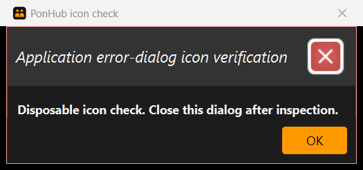

# PonHub application icon — issue #236

Prepared by Ernest Chua with OpenAI Codex assistance on 21 October 2026.
Original base: team master `b9cfd2d9`, including #350. Current integrated
production tree: `846c4cad`, including the normal master merge after #354
landed at `93a907ea`.
The 19 October 2026, 20:00 SGT deadline remains overdue and unchanged.

## Asset and scope

The original vector depicts two people reading an open book, using the existing
`#FF9900` accent and `#101010` surface. The neutral people/lesson cue is readable
at small sizes. Editable source: `docs/images/ponhub-icon.svg`; JavaFX resource:
`src/main/resources/images/ponhub_icon.png`, 64x64 RGBA with transparent corners.
The vector was rasterized with resvg-py as development tooling only; no runtime
library/dependency is added. Re-export with `resvg_py.svg_to_bytes(svg_string=...)`.

Both UiManager's initial icon and MainWindow.fxml now use that resource. Owned
application alerts retain the main Stage as owner. No layout, window dimension,
command behavior, shared image or theme setting changes.

The old brown contact-book asset is removed after all resource references move.
copyright.txt credits the new original artwork and removes the obsolete entries
for address_book_32.png, AddressApp.ico and edit.png, all absent from this tree.
The genuine Marco Jakob/calendar credits and upstream MIT licence are retained.
Final screenshot/public-page changes stay with #102/#152/#223 and #239.

## Automated verification

- Windows 11 Pro x64 build 26200, Oracle JDK 25.0.4, project JavaFX 17.0.7.
- Full `gradlew.bat check coverage shadowJar`: 897 tests, zero failures/errors,
  20 platform-assumption skips. Checkstyle, coverage and packaging pass.
- Existing AppUtilTest now checks successful icon decoding and actual dimensions.
  Existing real-stage CanonicalMainWindowTest covers production initialization,
  FXML and command focus. UiManager startup/fatal/protected regressions also pass.
- Packaged PNG equals the source PNG byte-for-byte; the packaged FXML references
  the new path, and the old PNG is absent. Source audit finds no stale resource
  reference outside the historical issue evidence and accurate deletion record.
- Tested JAR: 12,658,507 bytes, SHA-256
  `eeadd456a55bc1ed241b4bf9c77e18a593db72195ac0fc6d8abf82aeff8d249b`.
  This is this increment's development package, not the final v1.4 candidate.
- Repository formatting scripts and `git diff --check` pass. Locked Bundler
  2.5.11/Jekyll 3.10.0 builds the documentation tree; 412 local targets, 32
  image references, 16 DG tables and ten shared anchors pass. Connected Chrome
  at 2052x986 inspects the exact runtime PNG at 16/32/64/128 CSS pixels on light
  and dark surfaces. All eight images load and the intended people/book cue
  remains visible at the small sizes. This is asset review, not native evidence.

## Native window verification — PASS

The user explicitly authorized PowerShell for these PonHub checks after the
built-in native-control switch was unavailable. This supersedes the previous
NOT RUN status. It is actual automated Windows UI evidence inspected by Codex,
not an additional independent human acceptance run.

Tested production source/resources: `846c4cad`, after integrating the
independently reviewed #354 preferred-height correction. Full checks and the
native icon trial were repeated on that integrated tree. The icon implementation
remains `0ad936ee`; the earlier `8a753d6f` native trial is preserved in commit
`dad61563`. The captures below describe the latest integrated JAR.
The tested JAR's byte size and SHA-256 are recorded above. Java 25.0.4 was
confirmed from the launch installation. Display: 2560x1440 pixels; native windows
report DPI 120 (125%). Main window bounds: 925x750 pixels; error dialog: 525x247.

- Launched the packaged JAR with `java -jar ponhub.jar` from a fresh writable
  folder containing only that JAR. The main window opens with an empty data
  view and the new orange/black people/book icon in its native title bar.
- A disposable Java probe compiled against the same packaged JAR invokes the
  actual UiManager initialization and `showAlertDialogAndWait(..., ERROR, ...)`.
  The owned production error dialog shows the same icon in its native title bar.
- Win32 PrintWindow captured each visible test window directly. Both native
  small icons were independently extracted with WM_GETICON and match each other
  byte-for-byte. The retained images were visually inspected: the intended cue
  appears, with no inherited contact-book icon or missing-resource exception.
- Both created test processes closed normally using their own window-close
  messages. No operational data file was created by the empty normal session.
  Existing user data and other application windows were not operated on.

Full captures, extracted icons, native bounds/DPI metadata, launch logs, the
executed PowerShell helper and Java probe source are retained in `native/`.
The helper's paths describe this local verification environment; reproduction
requires matching/updating those paths and compiling the supplied Java source
against the JAR into the dialog folder's `classes` directory. Launch/capture
logic is separate from production code and no new application dependency exists.

The first helper attempts stopped before capture because hidden-launch windows
were excluded and foreground focus was unavailable. Including the test process's
hidden window, restoring it, confirming visibility and using targeted PrintWindow
resolved that tooling problem. Those attempts are not product failures or passes.
The final evidence uses a newly created clean trial folder. No taskbar screenshot,
native keyboard/mouse workflow, full scaling matrix or final-candidate acceptance
is claimed; #236's initial/main-window and application-error-dialog icon check is
covered by the native captures above.

## Readiness and recovery forecast

Implementation, full automated checks, rendered asset review and bounded native
window verification are complete. Zhu Zhi Yu's non-author source/asset review
found no actionable defect at `8a753d6f`; the icon implementation is unchanged.
The imported preferred-height correction has its own independent #354 review.
This final evidence increment changes no production code/resources. Fresh
current-head CI and evidence reconciliation
remain required before eligible merge. The author can now remove draft status.
Forecast: ready for first-available review/merge pickup once current gates pass;
no teammate availability or merge time is assumed. #236 stays open until merged.
The original overdue deadline, scope and final-screenshot ownership are unchanged.
